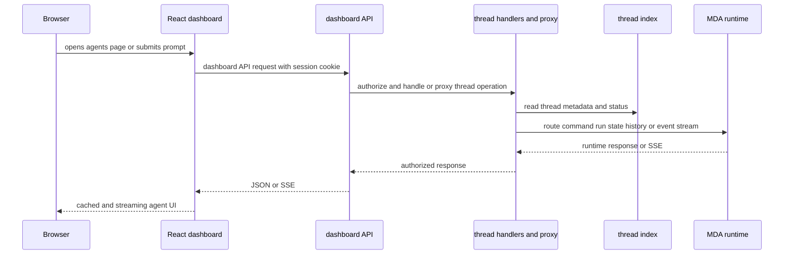
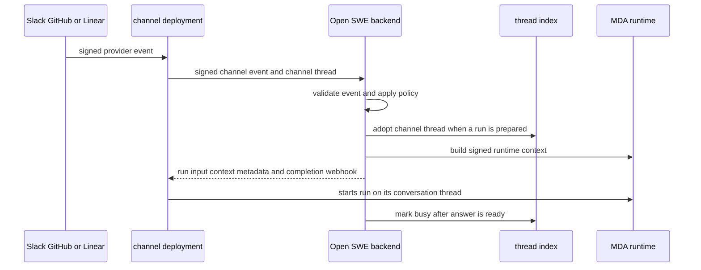

The dashboard is the signed-in control surface for Open SWE threads, runs, workspaces, reviews, and settings. It is not a direct LangGraph client: its API is a backend façade at `/dashboard/api`, which applies dashboard session and mutation protections before delegating to thread handlers or the thread/runtime proxy. Slack, Linear, and GitHub are different entry surfaces for the same agent capability, but their conversations are **channel-owned threads** with deliberately narrower write semantics.

## Surfaces and routing boundary

`openswe.dashboard.router` lazily imports the aggregate API router so importing a dashboard helper does not load FastAPI and every dashboard/job route. When mounted, the aggregate router prefixes all included APIs with `/dashboard/api` and applies `require_same_origin_for_mutations` to the entire subtree. Thread APIs are one included router among specialized routers for authentication, workspace/repository configuration, MCP, reviews, schedules, tasks, notifications, bridge, and UI invalidations.

The React application uses TanStack Router and a QueryClient. Agent pages are routed as `/agents/$threadId`; the older `/assistant/$threadId` route redirects there. UI code calls the dashboard façade, rather than exposing server-side credentials or raw runtime endpoints to a browser.

*Dashboard requests are session-protected backend calls; the backend selects and authorizes the thread runtime.*

### Thread and run API map

The thread router exposes the dashboard-facing resource model, while handlers enforce ownership and runtime rules. Important calls include:

- Listing supports a compact `/threads`, repository folders, pinned threads, and the filtered/paginated `/threads/page`. The page API validates mutually exclusive repository/ownerless filters and makes `all=true` administrator-only. Listing queries the thread index, filters unreadable or unlisted items, and refreshes uncertain active-run metadata with bounded concurrency before returning summaries.
- `POST /threads` creates a dashboard session and, when `start` is true, immediately sends a `run.start` command. The general command endpoint, `POST /threads/{thread_id}/commands`, is the common continuation/start boundary for dashboard, API-key, and federated callers. `POST /threads/{thread_id}/runs` and `/runs/{run_id}/cancel` proxy lower-level runtime operations; canceling a successful run also interrupts transcript turns.
- Detail, state, runs, history, and stream-event endpoints give the UI the data and event paths it needs. `POST /threads/{thread_id}/stream/events` forwards a runtime SSE stream with the caller's principal; thread detail also polls every three seconds while a run or delegated work remains active, so a dropped event stream does not leave the stop control stale.
- Lifecycle and organization mutations include rename, resolve, pin, share to workspace, continue privately, move between cloud and a selected sandbox bridge, cancel, and delete. File index/path, recovery patch, branch/working-tree diff, terminal, browser, queued-message, pull-request, and background-work endpoints are scoped to the requested thread and dashboard session.

New threads live on Managed Deep Agents (MDA) and are indexed locally; the index supplies thread CRUD/search while MDA supplies runs, state, history, commands, and streams. The proxy uses index metadata to route each operation. Older `local` threads are read-only: starts, commands, crons, and copies are rejected. MDA runs mark an indexed thread busy when accepted, then the run-complete callback or reconciliation settles it.

## Conversation channels and ownership

Provider webhooks reach Open SWE first. Slack's `/webhooks/slack` route verifies the Slack signature, records the delivery, rejects duplicates and ineligible inputs, applies routing/gating, and only then forwards MDA-owned conversations to the Trigger Server. GitHub and Linear channel deployments similarly validate provider deliveries before asking backend channel endpoints what—if anything—should run.

The backend channel endpoints (`/slack/channel/events`, `/github/channel/events`, and `/linear/channel/events`) are not public provider-webhook endpoints. They accept only Standard Webhooks requests signed with `MDA_SERVICE_SECRET`; absent configuration or an invalid signature is a 401. This makes MDA the trusted relay that has already verified the provider delivery, while Open SWE remains responsible for repository, workspace, person, prompt, and run policy.

*The channel owns provider conversation identity and starts the run; the backend supplies the approved run definition and indexes its state.*

### Channel-thread invariants

A channel run is adopted into the thread index before its metadata is written, with `runtime=mda` and `channel` metadata. It is marked busy only after a complete answer is ready, preventing failed preparation from leaving a permanent busy state. Completion webhooks and reconciliation settle the status.

A `channel` marker is an ownership boundary, not merely display metadata. Reads still go to MDA, but the backend treats writes as trusted-backend operations in that existing conversation. It may route a run, an interrupt answer, or cancellation through MDA's channel ingress; ordinary copies and crons are refused with 409, as are writes when it cannot obtain the trusted channel write context. The backend strips reserved, malformed, and acting-user metadata keys from the endpoint answer because MDA owns those fields; user attribution and acting identity instead travel in the signed run token.

All three channel handlers refuse malformed event/thread identifiers. If an MDA thread is interrupted, they return only a short input indicating that Open SWE would act—no adoption, run token, metadata, reaction, or run—so an interrupted conversation cannot start another turn accidentally.

### Provider-specific behavior

**Slack.** The main webhook does the provider-facing work: it verifies Slack signatures, logs events, handles URL verification, suppresses duplicates, observes directories, and evaluates eligible message/reaction/session activity. For conversations handed to MDA, it remembers the gated request keyed by channel thread, message timestamp, and webhook ID. The channel endpoint recalls that exact request; an event that was not handed over, is not a supported message kind, or represents a gating reply starts nothing. A preparation error is reported back into Slack so the user is not left without feedback. Retrying the same webhook ID can rebuild the remembered run.

**GitHub.** The channel accepts issue opens/edits/reopens and issue-comment creates/edits. It requires an Open SWE mention, an allowlisted repository routed to a workspace, supported actions, and (for comments) a registered Open SWE commenter; it rejects pull-request comments because they remain on Open SWE's own intake. It also applies the public-repository organization gate. A permitted issue event prepares an `agent` durable run, marks it as GitHub-sourced, and returns a completion webhook.

**Linear.** The channel accepts issue, comment, and agent-session event keys with a delivery ID and a bounded payload. It records a delivery once for event logging and listeners. Issue create/update events additionally launch Linear automations in background but do not start an agent run; comments also start nothing. Agent-session turns are parsed and may either prepare a run on the supplied session thread or return a human-readable decline, for example when repository or sign-in requirements are not met. The channel never silently borrows the session creator's identity for a reply whose author cannot be identified.

## Desktop and the local sandbox bridge

The Electron desktop client is experimental; the web UI is the recommended surface. It downloads a backend-selected standalone UI archive, verifies its SHA-256, preserves the last complete archive (including lazy routes) for offline UI use, and does not embed the dashboard in its installer. It proxies `/dashboard/api/*` to the selected backend, so the browser UI does not receive a LangSmith API key or access raw LangGraph routes directly.

A **This Mac** thread remains an ordinary cloud thread: transcript, model/settings, MCPs, and skills are held by the connected backend, but its sandbox is a selected local project. The desktop app (or `oswe run`, via the shared `bridge-client`) opens a bridge and long-polls the backend for `execute`, `upload_files`, and `download_files` requests, executes them locally, and posts results. A bridge is scoped to its authenticated owner: bridge routes return 404 for another caller's ID, and each active run verifies that its sender owns the bridge.

The backend requires PostgreSQL for bridges. A bridge client registers, heartbeats, claims requests through long polling, answers exactly one result or error, and closes explicitly. It subscribes before claiming so an enqueue cannot be missed between a claim and wait; notifications improve latency but Postgres rows remain authoritative. The bridge backend likewise subscribes before enqueueing and rechecks request state and liveness. Stale-heartbeat pruning closes a dead bridge and fails outstanding work, rather than waiting for a command timeout.

A local thread can run only while its app bridge remains open; after quitting, a new run reports the machine unreachable. Opening the thread or sending a follow-up reopens it. The thread can be viewed from the web or another computer, but only its Mac can continue local work. Work mode supplies a private task folder per thread; an optional existing folder is not a security sandbox. Current checkout and isolated worktree choices prevent accidental checkout contention: one agent may work in a tree at a time, and deleting a thread removes its associated worktree and uncommitted changes.

## Live UI consistency: transcript streams, cache invalidation, and optimistic updates

The agent transcript/run path and query freshness path are separate on purpose. A run command can stream runtime events through the thread endpoint, while the dashboard uses React Query for resource reads. Queries can declare `meta.invalidatedBy` topics (for example a thread's queues, browser, or background work). The server's invalidation SSE sends only authorized topic names; the browser refetches the matching queries rather than receiving data over that stream.

For an invalidation, a write records one `ui_invalidation` row per topic and calls PostgreSQL `pg_notify` in the same transaction, so a rollback publishes neither. Rows are retained for one day to replay changes after a disconnect. The SSE endpoint authorizes every requested topic for the session—including per-thread and per-repository keys—then emits an initial `hello` containing missed topics, denied subscriptions, and the backend commit. It sends coalesced invalidations thereafter and a 15-second heartbeat. If replay fails, it invalidates every subscribed topic rather than serving potentially stale data.

Each browser uses a Web Lock and BroadcastChannel to elect one tab as the EventSource leader; follower tabs report the topics their currently observed queries read, then independently invalidate/refetch their own caches. The leader opens a replacement stream before closing its predecessor when interest changes, reconnects with replay ages after errors or a watchdog timeout, and stops requesting denied topics. A changed backend commit causes the session query to refresh, allowing the UI to recognize a deploy.

Optimism is a UI boundary, not a substitute for server authorization or durable state. Message submission first adds a pending local bubble and marks the thread running; it remains until the transcript or queue reflects it. A rejected start marks that bubble failed and sets the status to error. More general `optimisticUpdate` cancels the exact query, snapshots it, and restores that snapshot only if no later cache write replaced the optimistic value; otherwise it invalidates and refetches. This prevents a failed earlier operation from overwriting newer UI state.

## Safe UI changes and focused verification

Before changing dashboard UI, consult both [`ui/AGENTS.md`](../../ui/AGENTS.md) and [`ui/DESIGN.md`](../../ui/DESIGN.md). They require installed Macaw component discovery and semantic tokens, keep routing/permissions/data behavior in the application, and require review in light/dark themes, narrow and desktop widths, and relevant keyboard, focus, loading, empty, error, and accessibility states. Preserve specialized Monaco, Lexical, Pierre, Sonner, sandboxed artifacts, and desktop setup integrations rather than replacing them with generic controls.

Focused tests exercise the material boundaries: channel route tests verify MDA-signature enforcement, event gating, interrupted-thread no-run behavior, run-token attribution, and Linear declines/automations; thread channel metadata tests ensure MDA-reserved fields cannot be injected. UI invalidation tests cover transactional replay, private-thread topic authorization, and delivery to an open stream. Bridge code is designed around PostgreSQL-backed request state and liveness, so operational validation should include an actual bridge disconnect/reconnect and local-machine run, not only mocked notifications.

See also: [backend control plane](../architecture/backend-control-plane.md), [security and configuration](../concepts/security-and-configuration.md), [local development and deployment](../operations/local-development-and-deployment.md), [testing strategy](../testing/strategy.md), and [run lifecycle](../workflows/run-lifecycle.md).
