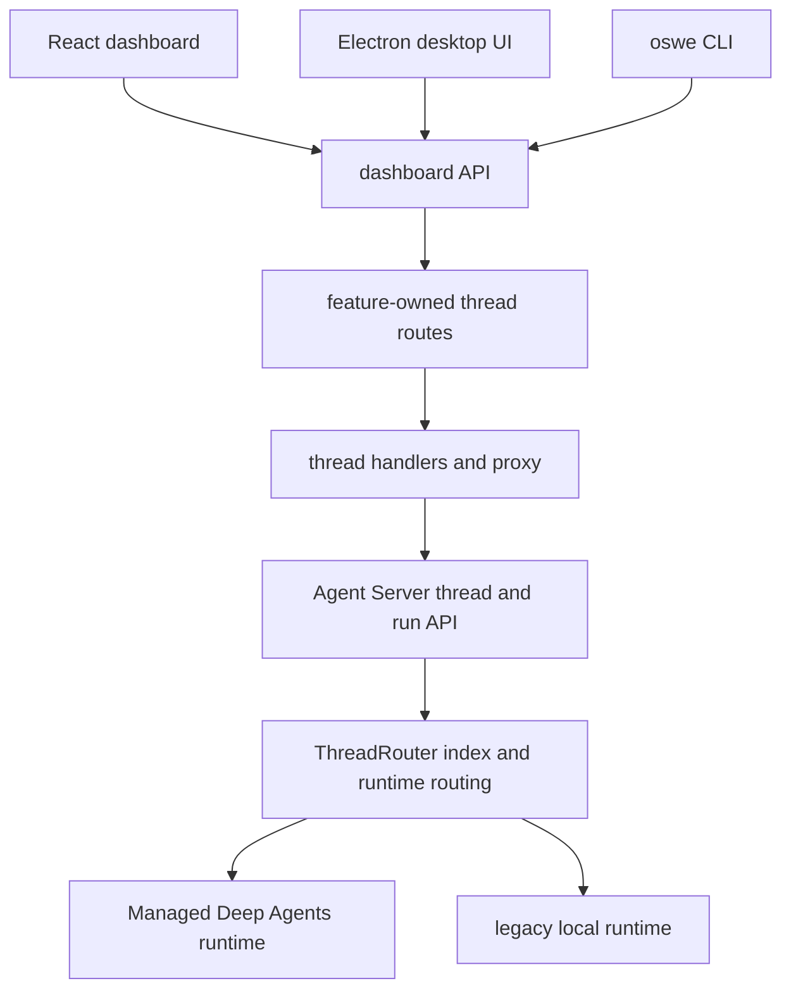
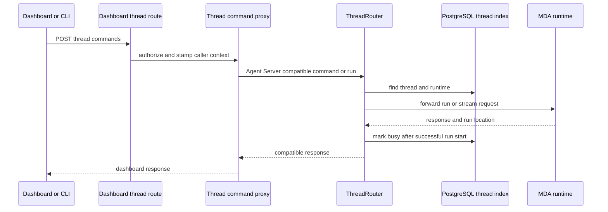

# Dashboard, desktop, and CLI surfaces

Open SWE presents one durable thread model through several clients. The browser dashboard is the primary React surface; the Electron app loads that same dashboard UI but adds trusted local-machine capabilities; and `oswe` is a non-interactive client that creates or resumes a cloud thread while serving its current directory. The backend owns authorization, thread lifecycle, transcript and run coordination—clients must not bypass its dashboard API contract merely because they use the same conceptual thread.

## Surface ownership and routing

The web app uses TanStack file routes. `/agents` is the active agent experience, while `/assistant` is a compatibility redirect to it; `/agents/$threadId` mounts the thread page. The router supplies one React Query client, restores scroll, preloads on intent, and records navigation before route mount for thread-load timing.

The backend aggregates feature-owned routers below `/dashboard/api` and applies `require_same_origin_for_mutations` to the aggregate. `openswe.dashboard.routes` is deliberately an assembly point, not a place for new domain endpoints: add a dashboard endpoint to the router owned by its feature package (for example, `openswe.threads.routes`) and include that router there. This keeps authorization and behavior close to the state owner.

This diagram shows the public dashboard boundary and the separate Agent Server compatibility boundary behind it.

A production build is served from the backend origin. The static catch-all declines reserved API and LangGraph prefixes, serves real build files, and otherwise returns the client shell only to HTML navigations; hashed assets are immutable while the shell is revalidated. This avoids shadowing backend routes and lets the UI call relative dashboard paths with session cookies. `DASHBOARD_STATIC_DIR` selects an explicit build; otherwise the in-repository build is used when present. `DASHBOARD_DEV_SERVER_URL` instead proxies non-reserved HTTP traffic to Vite, retaining the backend origin for cookies and API calls (Vite HMR connects directly to Vite). Builds intended for a LangGraph mount prefix must use the matching `DASHBOARD_BASE_PATH`.

## Thread API: dashboard façade and Agent Server compatibility

`openswe.threads.routes` is the authenticated dashboard-facing façade. It lists and pages authorized thread summaries, creates sessions, exposes thread detail/state/history, proxies commands, run creation/cancel/list and event streaming, and provides lifecycle actions such as rename, resolve, delete, sharing, continuation, pinning, and moves. Mutating endpoints are audit-decorated where appropriate. The detail endpoint returns a summary and timing header—not converted messages—because transcript hydration is client-side.

The UI and CLI both use the dashboard API rather than raw LangGraph endpoints. A command is posted to `/dashboard/api/threads/{thread_id}/commands`; the dashboard, API-key clients, and federated workflows therefore share the same command proxy and the thread metadata it stamps. Run cancellation deliberately operates on *all active runs on the thread*, rather than a browser's cached latest run, so it can stop channel- or automation-started work too. It records interrupted transcript turns, stamps stopped metadata, and can dispatch an eligible queued follow-up.

Behind this façade, `ThreadRouter` is ASGI middleware in front of Agent Server `/threads` and `/runs`. For authenticated backend calls it preserves the Agent Server shape while serving create/read/update/delete/search/count from the PostgreSQL thread index and forwarding run/state/history/stream operations to the selected runtime. New threads are indexed as MDA and created in both the local copy and MDA; index mutations are mirrored asynchronously so runtime traces and runs still see them. An unknown thread can be read from Agent Server and indexed. Calls without the backend credential continue to the underlying Agent Server, which applies its own policy.

This sequence shows why a client should use the dashboard command route while the runtime-compatible layer remains an internal integration boundary.

Runtime and ownership constraints are meaningful API behavior:

- MDA reads may use its Studio-style read access, but writes remain scoped to backend-owned threads. A channel-owned MDA thread continues its Slack, Linear, or GitHub conversation via trusted backend ingress. Channel threads reject ordinary copy and cron writes with `409`; a run, interrupt answer, or cancel is forwarded using the channel write authority when it can be acquired.
- Pre-MDA `local` threads remain readable but are effectively read-only: run, cron, command, and copy writes return `410`, not `409` (clients treat `409` as a busy/retry condition). Serving one logs a warning.
- A successful MDA run is marked busy before the caller receives its response. The run-complete webhook or reconciliation later settles it. The ordering prevents a very fast completion from being overwritten by a late busy mark.
- The dashboard's thread detail refreshes latest-run metadata and derives agent status. It does not mark a running thread viewed; this preserves unread state until the run has settled.

## Live transcript, state, and cache coherence

A thread page chooses one source through `ThreadSourceProvider`. Threads marked with transcript metadata use the transcript/event-log provider unless the stream preference explicitly selects the SDK stream; other threads use the Agent Server stream provider. Keeping that decision in one provider prevents a transcript-backed page from also opening the SDK stream.

For live Agent Server delivery, the dashboard exposes `POST /threads/{thread_id}/stream/events` as SSE and forwards the request only after principal authorization. The client also polls thread detail every three seconds while its server status says `running`. The poll is intentional resilience: the SDK transport with its cookie-aware custom fetch does not reconnect reliably, and losing SSE must not leave a stop control believing a run has already finished. Sidebar pages similarly refresh running content, while background output has its own five-second polling path.

The application has a second SSE channel for cache invalidation, `GET /ui-invalidations`. Mounted queries subscribe with an age and topic; the server authorizes topics per session, replays invalidations from the requested window before live subscription, coalesces bursts, and sends 15-second heartbeats. Frames name stale topics only—the browser refetches. If replay fails, the server invalidates every subscribed topic rather than risk stale UI. The client watches silence/errors, closes the old `EventSource`, reconnects with a fresh replay window, and uses credentials.

User message submission is optimistic: it adds a pending row and sets thread status to running before starting the source's `run.start`. The start is not awaited because a stream resolves only after completion. If start fails, the row becomes failed with a reported error ID, queued presentation is removed when necessary, and status becomes error. Other routine thread mutations such as pin, rename, resolve, schedule toggles, and workflow decisions use optimistic cache updates with rollback on error and an error-toast title; final invalidation/refetch reconciles server truth. Preserve this pattern for safe user-initiated UI mutations; do not make an operation optimistic when its outcome is unsafe or misleading.

## Desktop: same dashboard, privileged local supervision

Desktop runs the React app at `open-swe://app` and proxies `/dashboard/api/*` to its selected backend, so the renderer neither receives server-side LangSmith credentials nor calls raw LangGraph APIs. GitHub login creates the same dashboard session as the web app. Native IPC is accepted only from the trusted app scheme and provides project, worktree, terminal, file, and bridge operations.

The Electron package does not embed a dashboard build. At navigation it requests backend `/desktop-ui.json`, whose descriptor selects the backend commit's release archive. It accepts only the expected bridge protocol version, checks URL host/redirects, size, asset paths, and SHA-256, stages extraction, then atomically replaces `current.json`. A complete cached snapshot—including lazy chunks—opens offline; a failed/corrupt update leaves the prior snapshot active. A first launch without a usable download shows failure rather than an incomplete UI.

A **This Mac** thread remains an ordinary cloud thread with the same transcript, models, settings, MCPs, and skills. Before its first run the renderer asks trusted IPC to prepare a local record, optionally create an isolated worktree and checkpoint, and open a per-thread bridge; it then stamps that bridge ID and repository only on the first `run.start`. The bridge long-polls backend work and performs agent command, upload, and download requests in the selected checkout. Its stable ID is retained in backend metadata, so reopening after sleep or app exit reuses it; when not served, a concurrent run reports the Mac unreachable. The app closes bridges on quit/update. A cloud thread can be moved to a desktop-created worktree through `take-over-thread`, then the normal dashboard move endpoint updates server ownership.

Desktop worktree behavior is part of the safety contract: a current-checkout thread works in the selected project branch, whereas a new-worktree thread gets an `open-swe/local-<id>` branch until the agent renames it. Only one agent may use a tree; attempting conflicting use or branch switches is refused. Deleting a thread removes app-managed worktrees and uncommitted contents, but never deletes files from a user's original checkout.

## CLI: unattended local bridge with a cloud coordinator

`oswe run` uses the same dashboard API and bridge protocol as desktop. It opens a bridge rooted at the current directory, creates (or resumes) a cloud coordinator thread, stamps `sandbox_bridge_id` and detected `origin` repository only for a new thread, sends `run.start`, and follows lifecycle/tool SSE plus task-worker activity. It prints only the agent's `cli_result.stdout` to stdout, keeps progress and dashboard URLs on stderr, and does not release the bridge until coordinator work, task workers, and wake-up reports have settled.

A `--thread` continuation is allowed only when the CLI's local bridge memory proves the thread was started by this CLI in the same directory; it is rejected if another process serves it. `SIGINT` first cancels workers then the coordinator thread, closes the bridge, and exits 130; a second interrupt exits immediately. Stream loss is retried with backoff, but repeated short-lived reconnects eventually fail. A normal result maps agent `exit_code` to the process; missing `cli_result` or any failed outcome exits 1.

CLI credentials resolve in order as workspace API key, GitHub Actions OIDC, then person session. Machine credentials create `system` threads; person credentials create private threads because anyone permitted to prompt one can execute commands on that machine. The CLI runs commands unsandboxed as the invoking user, filters secret-shaped environment variables except `GITHUB_TOKEN`/`GH_TOKEN`, disables interactive Git/pagers, and bounds command duration and output. It never reads a repository `.env`.

## Change and verification guidance

Before changing dashboard UI, read `ui/AGENTS.md` and `ui/DESIGN.md`. Use the installed Macaw catalog and semantic tokens for ordinary controls, preserve specialized Monaco/Lexical/Pierre/Sonner and native desktop setup behavior, and check accessibility plus light/dark and narrow/desktop states. Keep routing, authorization, data fetching, and domain logic in the app rather than duplicating shared design-system behavior.

For backend changes, retain the `/dashboard/api` same-origin mutation boundary, feature-router ownership, and authorization checks before a proxy or live capability (terminal/browser). Treat API aliases such as `/threads/{thread_id}/pr-diff` as compatibility commitments for deployed desktop bundles. If changing thread/runtime behavior, test MDA versus legacy-local and channel-owned write cases, busy/completion ordering, cancellation/transcript closure, and dashboard viewed-state behavior.

Focused coverage includes dashboard API tests for creation, authorization, lifecycle, enqueueing, activity/view semantics, UI serving and CORS; unit tests for React query/optimistic state and thread components; desktop end-to-end coverage that launches Electron, creates a This Mac thread, verifies the cloud transcript and local checkout change, and checks app links; and CLI tests for request, credentials, stream-following, bridge, and signal behavior.

## Related pages

- [Threads, runs, and persistence](/openwiki/architecture/threads-runs-and-persistence.md)
- [Durable state and events](/openwiki/concepts/durable-state-and-events.md)
- [Workspaces, models, and prompts](/openwiki/concepts/workspaces-models-and-prompts.md)
- [Development and deployment](/openwiki/operations/development-and-deployment.md)
