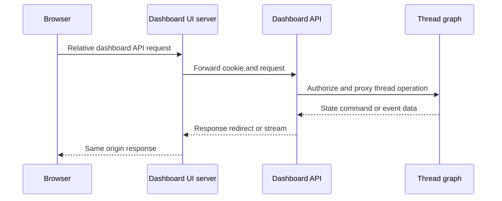
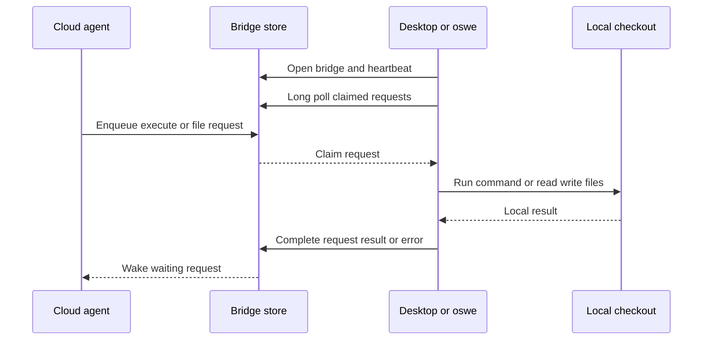

# Dashboard, desktop, and CLI client surfaces

Open SWE presents one cloud-thread model through three client surfaces. The browser dashboard is the normal product UI; Electron embeds that UI and can serve a selected checkout on the user's Mac; and `oswe` creates or resumes a cloud thread from a terminal. The latter two do **not** move agent orchestration local: they authenticate to the connected backend and use a sandbox bridge so that the backend's agent can request shell and file operations from the local machine.

## Dashboard API and browser boundary

`openswe.dashboard.routes.router` aggregates the dashboard API at `/dashboard/api` and applies `require_same_origin_for_mutations` to every included router. It joins thread and transcript operations with authentication, workspace settings, repositories, schedules, skills, reviews, MCP, bridge, and other product routers. Thread endpoints make the dashboard a policy-enforcing facade over thread state and graph operations: they check the caller's principal/session, then proxy commands, run creation/cancellation, history, and event streaming where appropriate.

The browser uses a relative `/dashboard/api` base, retaining a same-origin session cookie. A server render instead uses `DASHBOARD_API_URL` and explicitly copies the incoming `cookie` header, since server-side `credentials: "include"` cannot do that. During development, Vite proxies backend prefixes to `DASHBOARD_API_URL` or `http://localhost:2024`; deployed Nitro sends those requests through `ui/server/backend-proxy.ts`. The deployed handler reads `DASHBOARD_API_URL` per request and intentionally has no fallback, preserves OAuth redirects with `redirect: "manual"`, removes hop-by-hop/reframed headers, and emits each upstream `Set-Cookie` as a separate response header.

Diagram: browser traffic stays at the UI origin while the dashboard API owns authorization and proxies graph-facing operations.

### Sessions, OAuth, and mutation protection

GitHub login creates signed state containing a hash of a nonce held in a state cookie. The callback validates the normal browser state's cookie binding, exchanges the code, resolves the GitHub user, applies the GitHub login gate, stores the token response, and issues the signed `osw_session` cookie. `require_session` rejects missing or undecodable cookies with `401`.

Desktop and CLI interactive login use the same identity flow but a different handoff. They supply a PKCE challenge and loopback port; after identity checks, the callback redirects a PKCE-bound handoff code to that loopback listener without granting the browser a session. `POST /auth/desktop/exchange` accepts the code and verifier and returns the session for the native client to store.

The router-wide mutation guard permits `GET`, `HEAD`, and `OPTIONS`, as well as a bearer-only request with no session cookie. Cookie-authenticated mutations require an allowed origin or referer; WebSockets always undergo the origin check. This prevents a hostile site from spending an ambient browser session, but authorization remains endpoint-specific. In particular, ordinary thread listing and access are principal-aware and `all=true` is administrator-only; machine principals receive their own machine-thread paths. Audit decorators cover state-changing thread endpoints.

### Thread reads, commands, and event stream

The dashboard lists and pages threads, creates sessions, exposes state, files, diffs, queued messages, and background work, and supports pin, share, move, resolution, cancellation, deletion, and rename operations. `POST /threads/{thread_id}/commands` is the common command entrypoint for dashboard users, API keys, and federated workflows; the authenticated principal determines the thread metadata stamped on its first start. `POST /threads/{thread_id}/stream/events` proxies a thread event stream and returns `text/event-stream` with no-cache and keep-alive headers. The UI can therefore render a cloud transcript and run progress without direct browser access to raw graph credentials.

## Sandbox bridges: cloud control, local execution

A bridge turns a local checkout into the sandbox for a cloud run without requiring the backend to connect inbound to the machine. The authenticated client opens `/bridges` with its root path and identity, heartbeats it, long-polls `/requests/claim`, runs claimed work locally, posts either exactly one result or error, and closes it. Bridge routes are owner-scoped and report another owner's bridge as `404`; they require PostgreSQL.

Diagram: the client initiates all network traffic; PostgreSQL-backed bridge state carries requests between the cloud agent and local checkout.

Bridge requests persist as `pending -> claimed -> done | failed`. Claims use `FOR UPDATE SKIP LOCKED`, and completion is conditional on a request not already finishing, preventing two claimers from executing the same queued work and ensuring at-most-once settlement. The next poll sends its held request IDs; server-side release of claimed-but-unheld IDs recovers a response lost between commit and client receipt. Notifications reduce waiting latency, but correctness does not depend on delivery because pollers reclaim/read state and waiters reread request rows.

A bridge is only usable while its heartbeat is recent. Closing it, or the stale-bridge sweeper after the machine stops heartbeating, fails pending/claimed requests rather than leaving the graph waiter indefinitely blocked. A restart may reopen an owned stale or closed bridge with the same ID and requeue unanswered claimed work; an already-live bridge cannot be shared by a second client process. The shared client library retries transient polling failures with backoff, treats credential rejection and a missing bridge as fatal, and on close kills local child process groups before releasing the bridge.

`LocalExecutor` implements bridge methods `execute`, `upload_files`, and `download_files`. Commands run as `sh -c` in the selected root, without a filesystem sandbox; file paths are likewise not confined to it. It removes secret-shaped environment variables except `GITHUB_TOKEN` and `GH_TOKEN`, disables interactive Git/pagers, defaults commands to 300 seconds, terminates the process group before escalation, and caps captured output at 1 MiB while retaining head and tail. This is a safety boundary the operator must understand: a person-private thread is required because anyone able to prompt it can cause commands on that machine.

## `oswe` CLI

`oswe run` starts a normal cloud agent against the current directory. It detects the `origin` repository when possible, opens one CLI bridge per run, remembers the bridge and root for `--thread`, stamps a newly created thread with `sandbox_bridge_id`, and follows the cloud coordinator. Resuming is refused unless the thread was remembered by this CLI and the invocation occurs from the same root; the backend also refuses reopening a bridge another CLI is actively serving.

Credential selection is ordered: `OPEN_SWE_API_KEY`, a GitHub Actions OIDC token, `OPEN_SWE_SESSION`, then a stored session. API keys and Actions are machine credentials, so their threads are `system`; a human session's machine thread is always private. `oswe login` uses browser/loopback PKCE login, saves the returned session in `~/.open-swe/config.json` with mode `0600`, and shares the selected backend configuration with the desktop app. The compiled binary deliberately does not load a repository `.env`.

The command's stdout is reserved for the agent's `cli_result` value; diagnostics and dashboard links go to stderr. It follows lifecycle and tool events through SSE, accepts a result only from the intended root run after it is running, and reconnects dropped/retryable streams with exponential backoff. Task workers share the same bridge, so the CLI keeps serving and follows coordinator wake-up runs until workers settle; the last `cli_result` is final. A completed run without that tool, a failed run, or exhausted reconnects exits nonzero. The first Ctrl-C cancels the run and workers, closes the bridge, and exits `130`; a second exits immediately.

## Electron desktop

The experimental Electron client packages the compiled web UI at `open-swe://app` and proxies `/dashboard/api/*` to a configured compatible backend. The renderer therefore uses the same dashboard API/session model without receiving LangSmith credentials or calling raw LangGraph endpoints. Packaged builds require an organization backend URL and have no hosted default; development defaults to `http://localhost:2024`. Resolution prefers a command-line URL, then `OPEN_SWE_BACKEND_URL`, the legacy `OPEN_SWE_DESKTOP_URL`, persisted configuration, and finally the development default. The main process exposes a narrow preload IPC surface for project, local-thread, diff, file, and terminal actions rather than giving the renderer Node access.

Choosing **This Mac** creates an ordinary cloud thread whose sandbox is served by a desktop bridge. The app stores a per-thread bridge ID and checkout information, opens or reopens that same bridge on first use, and closes all bridges when quitting; a run begun while the app is unavailable reports the Mac unreachable. Desktop also handles `worktree_handoff` itself. A current checkout runs on the chosen branch; a new-worktree choice creates an isolated worktree on a temporary `open-swe/local-<id>` branch, allowing local threads to run concurrently without modifying the user's primary checkout. The app refuses concurrent agents in one tree or branch switching beneath an active agent; deleting a local thread removes its worktree and uncommitted changes.

The local executor uses the user's login-shell environment so Dock-launched Electron can find shell configuration, but it still applies the shared secret filtering. The desktop Changes view diffs against a session-start checkpoint, and the local terminal and file browser operate in that same checkout. This makes the availability and safety distinction explicit: the cloud transcript can be viewed elsewhere, but only the machine currently serving its bridge can execute or continue local work.

## Operations and focused verification

A bridge deployment needs PostgreSQL; otherwise bridge routes return `503`. Do not treat CORS as authorization: configure backend login eligibility with `ALLOWED_GITHUB_ORGS` or `ALLOWED_GITHUB_USERS`, register `<backend-url>/dashboard/api/auth/callback` with the GitHub App, and protect raw LangGraph routes separately when their auth is `noop`. For the browser UI, set `DASHBOARD_API_URL` in a deployed Nitro instance; development can use its localhost proxy default.

The E2E harness runs the real React dashboard, backend, Electron main process, local bridge flow, and git diff logic while faking only the LLM and external SaaS boundaries. Its Playwright suites include raw-response SSR coverage and a desktop suite. Run `pnpm run test:e2e` for browser coverage or `pnpm run test:e2e:desktop` for Electron; both require PostgreSQL. Bridge and client changes should specifically preserve owner isolation, heartbeat/stale failure behavior, lost-claim recovery, cookie and OAuth redirect forwarding, stream reconnect behavior, and the rule that local execution is intentionally unsandboxed.

## Related

- [Sandbox lifecycle](../architecture/sandbox-lifecycle.md)
- [Thread runtime and transcript](../architecture/thread-runtime-and-transcript.md)
- [Auth and security](../concepts/auth-and-security.md)
- [Local development and deployment](../operations/local-development-and-deployment.md)
- [Invocation and follow-ups](../workflows/invocation-and-follow-ups.md)
