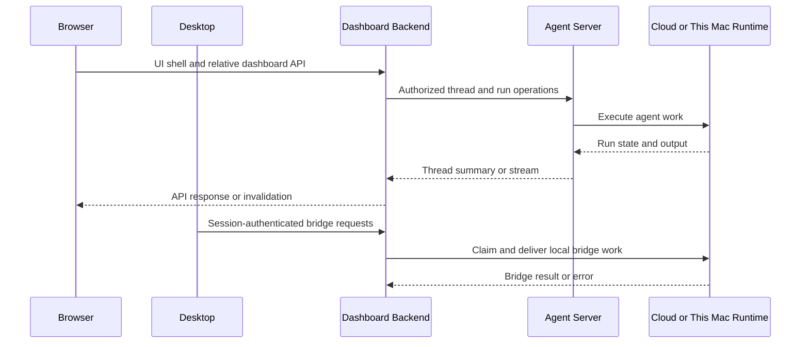

# Dashboard, Web UI, and Desktop

The dashboard is the product boundary around Open SWE's agent services. Its FastAPI router owns browser sessions and dashboard-oriented policy, while the React/TanStack Start UI renders those capabilities. The Electron app uses the same backend, but executes “This Mac” work through a durable, authenticated sandbox bridge rather than exposing a local runtime directly to the renderer.

## Composition and serving

`openswe.api.app.create_app()` installs credentialed CORS, audit and thread middleware, then includes the dashboard router and other APIs before calling `mount_dashboard_ui(app)`. The dashboard router is lazily exported by `openswe.dashboard`: importing a small dashboard helper does not import FastAPI routes and their feature modules until the application actually mounts the router. Its `/dashboard/api` prefix has a router-wide same-origin mutation dependency and composes feature routers for authentication, profiles, workspace settings, threads, schedules, skills, review, integrations, audit logs, bridges, and UI invalidations.

The backend can serve a built client-only UI from `ui/.output/public` (or `DASHBOARD_STATIC_DIR`) at the backend origin. It mounts `/assets` with one-year immutable caching and serves `_shell.html` with `Cache-Control: no-cache` for HTML navigation. The catch-all declines backend-owned paths such as `/dashboard/api`, `/threads`, `/runs`, `/mcp`, and docs; it also declines unknown requests that do not accept HTML, preserving meaningful server 404s. With `DASHBOARD_DEV_SERVER_URL`, it reverse-proxies non-reserved HTTP traffic to Vite instead, retaining the backend origin for login and API cookies; Vite HMR connects to Vite directly. The catch-all must remain last, so a caller that adds routes after mounting must call `keep_dashboard_ui_last`.

A build hosted below a LangGraph `http.mount_prefix` must use the corresponding `DASHBOARD_BASE_PATH`. The browser then uses a relative dashboard API base beneath the UI base path. This deployment mode avoids cross-origin cookies and CORS; standalone UI deployments instead proxy backend paths.

Diagram: browser traffic reaches the API at the dashboard origin; the desktop uses the same API to connect cloud agent work to a local runtime.

## Browser API and proxy boundary

The UI's `dashboard-fetch` layer builds browser requests as `/dashboard/api{path}` at the dashboard's same origin and uses a configured base only when appropriate (the Electron `open-swe:` origin deliberately uses a relative base). During server rendering it instead targets `DASHBOARD_API_URL` and copies the inbound `cookie` header, because server-side `credentials: "include"` does not forward a browser cookie jar.

In development, Vite proxies backend-owned prefixes—including `/dashboard/api`, webhooks, remote MCP, and OAuth discovery—to `DASHBOARD_API_URL` (defaulting locally to `http://localhost:2024`) and preserves redirects. A deployed Nitro UI routes those backend prefixes through `backend-proxy.ts`. The proxy requires `DASHBOARD_API_URL` per request, streams request bodies, leaves OAuth 3xx responses for the browser (`redirect: "manual"`), removes hop-by-hop and reframed encoding/length headers, and emits every upstream `Set-Cookie` as an individual header line.

## Sessions and mutation protection

GitHub sign-in signs state containing a hash of a nonce kept in a state cookie, then redirects to GitHub. The normal callback validates that nonce, exchanges the code, applies the GitHub login gate, persists the access token, and issues the dashboard session cookie. Desktop login uses the same identity checks but returns a code to a loopback callback without minting a browser session; redeeming `POST /auth/desktop/exchange` proves possession of the PKCE verifier before receiving the session.

`require_session` decodes the `osw_session` cookie, binds the authenticated actor to the audit context, and returns 401 if it is absent or invalid. Endpoint dependencies add admin and repository-access requirements as appropriate. CORS accepts configured dashboard origins plus `open-swe://app`, with credentials enabled; a wildcard configured origin is rejected. The dashboard router's mutation-origin dependency provides a shared CSRF boundary, while endpoint-level authorization remains responsible for workspace, repository, and thread permissions.

## Threads in the UI

The dashboard thread API separates discovery from direct readability. `/threads/page` accepts filtering and pagination, reserves `all=true` for administrators, rejects incompatible `repo` and `ownerless` filters, and validates repositories as `owner/name`. Normal searches use participant metadata plus legacy creator fields; summaries apply visibility and status logic after metadata filtering. Latest potentially active runs are refreshed with bounded concurrency, so displayed status can follow the actual newest run. An interrupted newest run wins over a transiently busy thread state, avoiding a misleading “running” presentation after cancellation.

Surfaced-source threads are readable to signed-in users unless private; a private thread is limited to its owner or workspace administrators. Review chats are owner-only. Prompting is stricter: only the owner can drive a private thread or a thread bound to a machine bridge, and Slack-bot-started threads are read-only in the dashboard. Posting also rejects a transcript upload still pending and requires an administrator for admin or automation threads.

Pins are stored per login rather than on thread metadata. Loading a pin list independently re-fetches the saved IDs and rechecks readability, omitting deleted or inaccessible threads. Repository groups are derived from eligible thread metadata and connected to their workspace for sidebar presentation.

### Invalidation rather than pushed data

The UI invalidation endpoint is an authenticated SSE stream. A client subscribes with repeated age-qualified topic names. The service authorizes which topics are audible, registers its stream before replaying the outbox window, sends a `hello` frame containing invalidated and denied topics, then sends topic-only `invalidated` frames (and periodic `alive` frames). The browser refetches queries; it does not accept data in the invalidation frame.

The hub fans PostgreSQL LISTEN notifications to local subscribers. To preserve correctness when a notification connection is unavailable, initial and reconnect replay query the outbox; if that replay fails, the endpoint marks every subscribed topic stale, favoring extra refetches over stale UI. Dashboard startup treats the hub as best-effort: pages remain usable but no longer hear changes made by another replica if it cannot start.

## Configuration screens and policy inputs

The dashboard composes settings-oriented screens from backend APIs rather than embedding policy in the UI:

- **Workspace settings** resolve in tiers: instance settings apply everywhere, workspace records store only overrides, and per-user profile and thread `configurable` values layer above when a caller honors them. Admin settings include model defaults, provider/gateway and feature controls, review behavior, and organization guidelines.
- **Model options** are requested for the intended workspace, so a composer receives its effective model defaults. When Fable is disabled, the API filters Fable models and gates a stale Fable default to a selectable fallback.
- **Repository instructions** normalize `owner/name`, persist one PostgreSQL record per repository, and are access-filtered for the current user. The stored prompt is appended to the main agent system prompt for runs targeting that repository.

## Desktop and local-machine bridge

Electron serves the compiled UI under the trusted `open-swe://app` origin and connects to a configured HTTP(S) backend. Packaged builds have no default backend; development can supply one. The app's backend URL resolver rejects non-HTTP(S) URLs, and trusted proxy or IPC operations require the app origin.

A “This Mac” thread remains a cloud-backed thread, but its command execution is delegated to a desktop `LocalBridges` instance. The main process creates or reuses a registered project checkout, optionally creates a worktree, records a checkpoint, opens a bridge, and returns its bridge ID and origin repository for the renderer's first `run.start`. Taking over an existing cloud thread creates or reuses a worktree before reopening the bridge, so it does not overwrite the user's primary checkout.

`LocalBridges` keeps one live bridge per thread and coalesces concurrent opens. It persists the bridge ID in local thread state, allowing a later app session to reopen the same backend bridge identity after sleep or quit. On loss of the local checkout it fails rather than executing elsewhere; on bridge failure it removes the live entry so a later use can retry. Bridge calls run under the desktop session and use bounded request timeouts.

On the backend, bridge endpoints are scoped to `Principal.sender_id`; an inaccessible bridge is reported as 404. PostgreSQL is required. A client opens and heartbeats a bridge, long-polls to claim requests, and completes each request with exactly one result or error. Claiming subscribes before checking the store, then reclaims after wakeup or timeout, closing the notification race. The listener consumes transactional Postgres notifications for latency but does not rely on them for correctness: waiters re-read durable rows, and the pruning task closes stale-heartbeat bridges so abandoned machines turn into failures rather than indefinitely waiting work.

## Operations and focused verification

For a bundled deployment, build the UI before starting the backend; absent `_shell.html` means no UI catch-all is mounted. Set `DASHBOARD_DEV_SERVER_URL` only for Vite-backed development, and configure `DASHBOARD_API_URL` for separately deployed UI/Nitro server rendering. Configure explicit `DASHBOARD_ALLOWED_ORIGINS` for cross-origin browser deployments. PostgreSQL is operationally required for durable desktop bridges and cross-replica UI invalidations; without it, those listeners deliberately disable themselves.

When changing these boundaries, focus tests on redirect and cookie forwarding, same-origin mutation checks, UI-route precedence, thread visibility/promptability versus listing behavior, invalidation replay after listener disruption, and bridge claim/retry/heartbeat failure. Preserve the distinction between durable state in PostgreSQL/LangGraph and best-effort notification delivery.

## Related

- [Auth and security](../concepts/auth-and-security.md)
- [Models, profiles, and instructions](../concepts/models-profiles-instructions.md)
- [Workspaces and access](../concepts/workspaces-and-access.md)
- [Deployment](../operations/deployment.md)
- [Invocation](../workflows/invocation.md)
