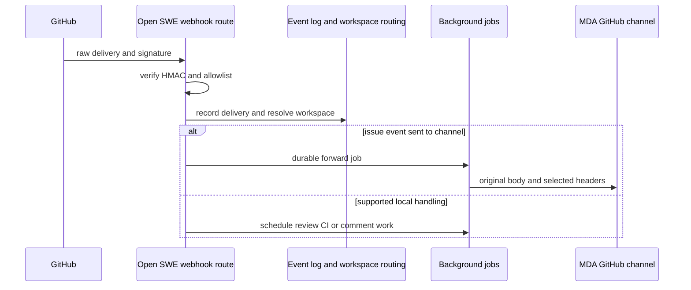
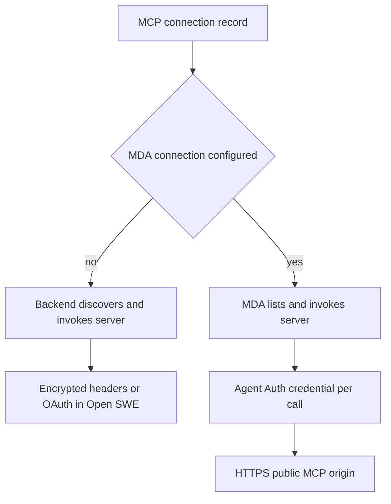

Open SWE combines several externally visible integration boundaries. The most important distinction is **who owns the resource and credential**:

- **Managed Deep Agents (MDA)** owns the normal thread sandbox: it creates, adopts, retains, and replaces it. Open SWE's backend binds to that sandbox and prepares it; it does not provision or replace it.
- The backend ordinarily owns the **sandbox proxy configuration** and mints a scoped GitHub App installation token for it. If the catalog supplies `SandboxSpec.github_proxy`, MDA instead owns the *entire* proxy write and obtains the token from its Agent Auth connection.
- A conventional remote MCP server is **backend-operated**: Open SWE stores/decrypts its headers or client credentials, discovers it, and invokes it. An MCP server declared with an **MDA connection** is the opposite: MDA retrieves the credential and contacts the server directly; the backend neither has the credential nor calls that server.

<!-- openwiki: broken internal link [/openwiki/integrations/sandbox-providers.md] file "/openwiki/integrations/sandbox-providers.md" does not exist. Fix the href or restore the target, then delete this comment. -->
See also [managed runtime](/openwiki/architecture/managed-runtime.md), [security and configuration](/openwiki/concepts/security-and-configuration.md), [tools and catalogs](/openwiki/concepts/tools-and-catalogs.md), and [sandbox providers](/openwiki/integrations/sandbox-providers.md).

## GitHub ingress and authority

### GitHub App credentials are service credentials

The GitHub App configuration (`GITHUB_APP_ID`, `GITHUB_APP_PRIVATE_KEY`, and normally `GITHUB_APP_INSTALLATION_ID`) lets the backend exchange an App JWT for an installation access token. Tokens are cached only in process and keyed by installation, repository scope, and permission scope; a cached token is discarded ten minutes before its recorded expiry. `GitHubClient.as_app()` can resolve an installation for a repository and can narrow the resulting token to that repository and requested permissions. A run acting through LangSmith authentication is deliberately forbidden from using GitHub App credentials.

This is distinct from `GitHubClient.as_user()`, which acts with a person's linked OAuth token, refreshes it once after a 401, and then asks the person to relink GitHub if it remains invalid. The shared GitHub HTTP helper uses a 30-second read and 10-second connection timeout, respects `Retry-After` and secondary rate limits, and retries ambiguous failures only for idempotent methods. It does not blindly replay `POST` or `PATCH` after transport errors or 502/504 responses.

### Webhook intake, routing, and forwarding

GitHub posts to `POST /webhooks/github`. The route reads the raw bytes and requires a valid `X-Hub-Signature-256` HMAC using `GITHUB_WEBHOOK_SECRET`; an absent secret is fail-closed. Before dispatching, it applies the repository allowlist, records the delivery, invalidates relevant PR data, and verifies that a workspace owns the repository. A temporary workspace lookup failure produces a 503 so GitHub retries rather than silently dropping potentially valid work; an unowned repository is ignored.

The handler schedules supported PR, push, CI, review, issue, and comment actions rather than executing long work in the request. Issue/comment agent-run events may be forwarded unchanged to MDA's GitHub channel: a durable job preserves the raw body plus the signature/event/delivery headers, MDA deduplicates by delivery ID, and the forwarding client retries transport failures, 429, and 5xx responses up to four attempts. Other 4xx responses are not retried. Thus the App's webhook endpoint remains Open SWE's ingress for reviews, PR comments, CI, and automations even where MDA starts the issue-agent run.

This shows the authenticated GitHub ingress and the split between local background handling and durable forwarding to MDA.

For user-addressed issue and comment work, later gates include supported actions, an Open SWE mention (with limited agent-PR follow-up exceptions), and a known Open SWE commenter. These gates are not substitutes for signature validation or workspace routing.

## MDA sandbox lifecycle and GitHub proxy

Every MDA graph declares a per-thread sandbox. At run preparation MDA opens or adopts it and reports its ID to the backend; boot continues in parallel until a tool actually needs the sandbox. Transient sandbox-service failures are retried while opening. A non-transient open failure is reported to the backend, while a boot failure is reported when the first dependent call waits for it. `recreate_sandbox` results in MDA replacing the sandbox, after which the backend reconnects and finishes preparation such as git identity.

A thread that is bridged to the owner's machine is not an MDA-managed cloud sandbox. Older backend-owned sandboxes can continue to be used until gone, then the next run moves the thread to an MDA sandbox. Task workers can use their coordinator's MDA-owned sandbox only after the backend has attached them under the ownership checks.

### Creation configuration and proxy writer

The backend resolves workspace snapshot, resources, and creation parameters into the sandbox specification that MDA uses **only when creating a new sandbox**. Existing per-thread sandboxes persist across later configuration changes. The configuration includes snapshot, filesystem capacity, vCPUs, memory, idle TTL, delete-after-stop TTL, and provider-specific creation fields.

Normally the backend reads the workspace GitHub access policy, mints a GitHub App installation token, and patches the LangSmith sandbox proxy. It installs two rules: Basic authentication for `github.com` and `*.github.com` (git-over-HTTPS) and Bearer authentication for `api.github.com` (`gh` and REST calls). GitHub tokens are not deployment environment variables. The backend records expiry, original repository scope, permissions, base proxy configuration, and workspace per thread; refresh preserves rather than broadens those scopes and happens within five minutes of known expiry, or after 50 minutes when expiry is unknown.

With `MDA_GITHUB_PROXY_CONNECTION` and a catalog `github_proxy` reference, responsibility flips. MDA reads its Agent Auth credential and writes both the GitHub rules and the backend-provided proxy rules before sandbox commands; it rewrites them periodically and after replacement. It asks the backend for the backend portion only after the sandbox exists. If the backend refuses that request, the backend writes proxy configuration itself. If MDA is responsible and cannot write the initial proxy configuration after the retry window, the run ends: the backend must not partially write a proxy that MDA owns.

| Concern | Backend-managed proxy | MDA-managed proxy (`github_proxy`) |
|---|---|---|
| Sandbox creator/replacer | MDA | MDA |
| GitHub token source | Backend GitHub App installation access | MDA Agent Auth connection |
| Proxy configuration writer | Backend | MDA, including backend-provided rules |
| Refresh behavior | Backend tracks token expiry and preserves scope | MDA rewrites before commands and periodically |
| Failure boundary | Proxy update failure prevents usable GitHub access | Initial proxy-write failure ends the run |

Review runs narrow sandbox GitHub access to their repository and read-only review permissions. Runs authenticated as `langsmith` do not receive backend GitHub proxy credentials.

## Browser reporting and session handoff

The coding graph has a reported browser middleware; other graphs retain the same middleware shape but can disable its browser tools. Before an enabled run, MDA reports the per-thread browser name to the backend so the dashboard can expose it even before the first browsing action. After the browser opens, it reports that state again. Reporting occurs asynchronously: a slow or unavailable backend does not block the agent, but the dashboard panel is unavailable until a later run or browser call succeeds.

The middleware removes `browser_handoff`. It accepts an MCP-returned `session_handle` only as a separate `browser_run` call without code or actions, consumes it once from backend-held session storage, and installs it only for an allowlisted LangSmith host and a valid local-storage payload. Invalid, already-used, or non-LangSmith handles are rejected without installing a session.

## MCP: backend-operated connections versus MDA connections

### Backend-operated MCPs

Instance MCP connections are inherited by workspaces; a same-named workspace connection replaces the instance connection. Personal MCPs are added only for a private thread owned by the triggering user; they never load into collaborative or channel threads. Higher-precedence disabled connections and empty selections intentionally suppress lower-scope connections rather than falling back to them.

For these ordinary connections, Open SWE owns the URL, selected-tool allowlist, and credentials. Header values and OAuth client secrets are encrypted in PostgreSQL; normal responses expose header names only, while explicit admin reveal endpoints use `Cache-Control: no-store`. The backend discovers and runs these tools. It re-resolves the winning connection and rechecks enabled state and allowed tool set for every call, so disabling or deleting a connection blocks later calls from tools already loaded, though it cannot cancel an in-flight call.

URLs must be HTTPS without embedded credentials, fragments, or secret-like query parameters. Both Streamable HTTP and SSE are supported. Transport is pinned to the configured HTTPS origin, refuses redirects, disables ambient proxy environment settings, validates that DNS resolves only to public addresses, and connects to a checked address to prevent DNS rebinding. Generic discovery has a 30-second deadline and a per-event-loop concurrency limit; duplicate remote tool names are rejected. Catalogs are cacheable per source namespace and connection revision, but an unavailable server leaves out only its own tools.

### Direct MDA-credential MCP servers

A connection-bearing MCP record is not a backend credential configuration. It must name an Agent Auth connection intended for MCP servers (`open-swe-mcp-<server>`), has no stored headers or OAuth, and requires an explicit `allowed_tools` list because the backend cannot discover it. Instance/workspace records use an `agent` connection; a personal record uses the owner’s `user` connection only for a run actually acting as that person.

At run start, MDA reads each server credential, lists the server's tools once, and exposes only names in the explicit allowlist, renamed according to the catalog. On every invocation it reads the credential again and sends it only to the server's HTTPS public origin, as `Authorization: Bearer <credential>` unless `connection_header` specifies another header. A missing connection, missing personal authorization, unavailable server, name collision, forbidden `runtime` parameter, or failed tool listing removes that server's tools without preventing other MCPs from loading. A call that cannot read credentials returns a safe tool error; network and unexpected call failures are logged without exposing request data or credentials.

This shows the exclusive execution and credential paths: a connection-bearing server bypasses backend discovery and execution.

### Managed Tools gateway

The separately configured LangSmith Managed Tools gateway is another backend-facing MCP integration with an important privacy boundary. An instance administrator selects one gateway; private threads load it with the thread owner’s LangSmith token. LangSmith owns provider grants and proxies tool calls, so provider tokens, consent links, and the LangSmith token do not reach the agent, a tool argument, or the sandbox. A 428 credentials response produces a per-service consent requirement; gateways can either expose connected-service tools or require every listed service before exposing any.

## Operational failure guide and tests

- **Webhook rejected (401):** check that `GITHUB_WEBHOOK_SECRET` matches the GitHub App webhook secret and that the raw request body reaches the route unchanged. Unsupported, unallowlisted, unowned, unmentioned, or untrusted-sender deliveries are intentionally ignored rather than accepted.
- **Webhook returns 503:** workspace ownership could not be read; GitHub should retry. Investigate workspace storage/routing rather than treating it as a request-format error.
- **`gh`/git starts returning 401 in a long run:** inspect App installation access and proxy writer ownership. Backend-managed proxies refresh near expiry; MDA-managed proxies require a usable Agent Auth connection and successful proxy writes.
- **Sandbox cannot start or is unusable:** distinguish transient sandbox service retries from invalid create configuration, boot failure, and proxy configuration failure. In the MDA-owned proxy mode, inability to perform the initial proxy write terminates the run.
- **MCP server absent from the tool list:** for backend MCPs check URL, origin reachability, authentication, selected tools, and discovery diagnostics. For MDA-credential MCPs, check the connection slug/owner, user grant when applicable, public HTTPS resolution, and explicit `allowed_tools`; the dashboard cannot discover that catalog.
- **MCP call fails after configuration changed:** this can be expected: each backend-operated call rechecks the live winning record and allowlist. Re-enable or restore the connection rather than relying on a stale loaded tool.

Focused coverage lives in `tests/sandbox/test_proxy_auth.py` for proxy-rule composition and retry behavior, `tests/sandbox/test_sandbox_recreation.py` and `tests/sandbox/test_sandbox_recovery.py` for lifecycle recovery, and `tests/mcp/test_managed_mcps.py` plus `tests/mcp/test_tool_caller.py` for managed gateway, discovery, and execution behavior.
