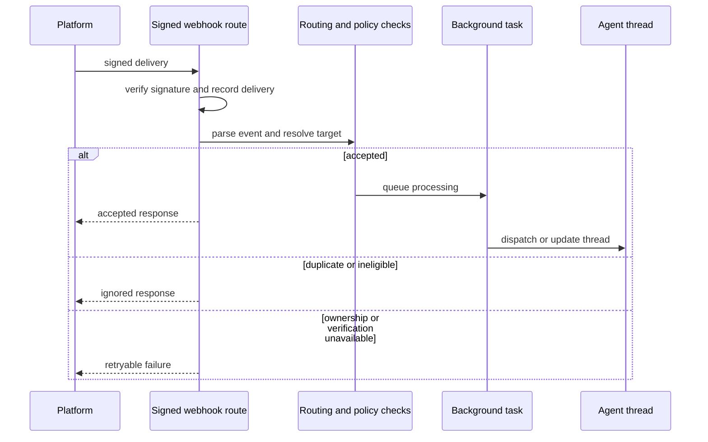

## Integration boundary

Open SWE receives work from GitHub, Slack, and Linear through dedicated FastAPI routes, records inbound deliveries, makes a quick accept/ignore/retry decision, and moves substantive work to background tasks. The agent then acts back through platform clients and tools rather than treating inbound payloads as trusted commands. GitHub repository ownership, Slack channel eligibility, and MCP scope are separate controls: they decide *where* work may run and which credentials/tools it may use.

This shows the common ingress pattern: validation and routing happen before asynchronous agent work, while retryable lookup failures remain visible to the sender.

## GitHub

### Ingress and routing

`POST /webhooks/github` verifies the raw request body against `X-Hub-Signature-256` and rejects an invalid signature with HTTP 401. It records delivery metadata, invalidates a referenced pull-request UI topic, and clears the repository cache for installation changes before it evaluates the event. Unsupported events, malformed JSON, unsupported actions, unmentioned issues/comments, unregistered commenters, and disallowed repositories receive structured `ignored` responses rather than starting work.

A repository-bearing GitHub delivery is checked with `repo_is_routable(owner, name)` before event-specific handling. An unowned repository is ignored when workspace policy says so. Crucially, an unreadable ownership lookup returns HTTP 503 (`workspace ownership is temporarily unreadable`) so GitHub retries rather than silently losing a potentially valid delivery.

Issue events must change relevant content when edited and mention Open SWE; comment-driven work also requires a registered sender (except the dedicated review-finding reply path). Public-repository organization gating is applied before eligible issue/comment/review work is queued. Pull-request opening/ready events and pushes use the repository auto-review setting; PR lifecycle events also maintain agent/ reviewer state and human-review records.

For automatic review, a canonical reviewer thread is created or advanced for the PR. The reviewer records PR metadata and the reviewed head SHA, creates a visible GitHub check, and avoids duplicate ready-for-review work when the head SHA is already reviewed. Later pushes only re-review a watched, open PR with a changed relevant diff; unchanged diffs advance the recorded SHA and settle a check as “No new changes to review.” Closing/reopening/draft transitions adjust the watch state.

### Outbound GitHub clients and sandbox access

Application code should use named `GitHubClient`, `RepoClient`, and `PullRequestClient` methods for repository and PR operations—not raw REST paths outside the designated GitHub transport modules. `GitHubClient.as_user(login)` acts with the user’s OAuth authorization and refreshes a rejected token once; failure to obtain or refresh it raises `GitHubSignInRequired`. `GitHubClient.as_app(...)` mints an App installation token, optionally narrowed to one repository and permissions, and raises `GitHubAppUnavailable` when it cannot do so.

The underlying GitHub transport standardizes bearer/version headers, a 30-second read and 10-second connect timeout, retry/backoff with jitter, and rate-limit handling. It retries transport errors and ambiguous gateway errors only for idempotent methods, while 429, 503, and secondary rate limits can be retried for writes because GitHub has declared the request unprocessed.

Sandboxes do not receive the installation-wide discovery token. When a caller supplies a repository set, `repository_token` resolves only installation-accessible repository IDs and mints a restricted token; a missing match yields no credential, leaving public repositories anonymously readable. A workspace’s ordinary sandbox token is installation-wide unless a caller explicitly narrows it—workspace routing/preload membership is not by itself an access boundary. The LangSmith sandbox proxy is refreshed before expiry while preserving the original repository and permission scope, preventing a refresh from broadening access.

## Slack

Slack has separate signed endpoints for Event API callbacks (`/webhooks/slack`), slash commands, code-channel commands, and Block Kit interactivity. Each verifies Slack’s timestamped signature from the raw body and returns HTTP 401 when invalid; routes log deliveries even when the parsed payload is invalid. Event URL verification returns Slack’s challenge after signature verification.

The Event API route deduplicates first by Slack event ID and, when work is claimed, by the channel/message interaction key. This prevents duplicate `app_mention` and `message` deliveries from starting two runs, including across instances; a retry header alone does not discard an unseen event. It handles only selected message, mention, reaction, session-stop, and code-channel events. Bot-originated messages are ignored unless they are an explicitly directed message from a workspace-scoped allowed bot; the app never processes its own bot messages.

Before a run is resolved, Slack channel context must allow operations. External shared channels are refused, and a direct app mention receives a thread reply explaining that Open SWE does not operate there. When channel verification is temporarily unavailable for an event that might be actionable, the service returns HTTP 503 with `Retry-After` to ask Slack to redeliver rather than starting work in an unverified channel. Watched channels may launch automations for messages independently of whether they mention Open SWE.

Accepted messages resolve to a Slack thread and repository configuration, then queue `process_slack_mention`. Code channels deliberately map every message to one session thread and treat it as addressed to the agent. Explicit requests interrupt an active run; other follow-ups are enqueued. `/oswe` returns ephemeral validation/help feedback and deduplicates an invocation before dispatching its background question; code-channel commands return an ephemeral routing failure or “Working” acknowledgement. Reactions are limited to feedback, stop, and summon behavior rather than becoming arbitrary agent prompts.

## Linear

`POST /webhooks/linear` verifies `Linear-Signature` against the raw body and rejects bad signatures with HTTP 401. It logs the delivery, returns an error status for invalid JSON, and rejects timestamped deliveries older than one minute as replay attempts. Issue create/update deliveries are passed to Linear automations; agent work comes from a newly created non-bot Comment that mentions Open SWE.

For an eligible comment, repository selection is intentionally ordered: an explicit repository in the comment, then the commenter’s workspace-aware default repository, then their global default, then workspace default. No configured repository or an allowlist failure is returned as `ignored`. The processor uses the stable Linear issue ID to continue the issue’s agent thread, maps the Linear email to a GitHub login where possible, resolves the thread/repository workspace, records source metadata, and dispatches a Linear run. It includes the issue plus relevant comments as system/human input and excludes known bot response prefixes to avoid feedback loops.

## MCP connections and tool loading

### Admin-managed and personal connections

The dashboard exposes separate CRUD/discovery surfaces for instance connections (`/mcps`), workspace connections (`/workspaces/{workspace}/mcps`), and the signed-in user’s connections (`/my-mcps`). Instance and workspace changes require an admin; personal changes use the current session identity. Header reveal routes are also authorized and respond with `Cache-Control: no-store`. Discovery lists descriptions only and does not execute a tool.

Connections require HTTPS URLs without embedded credentials, fragments, whitespace, or secret-bearing query parameters. They support Streamable HTTP or SSE, static authentication headers, an allowlist of tool names, and optional client-credentials OAuth. Headers and OAuth client secrets are encrypted at rest, are omitted from public connection responses, and can only be reused from the prior record in the *same* scope. Changing a server URL requires replacing or clearing saved headers; OAuth cannot be combined with an Authorization header.

At run construction Open SWE loads sources in this precedence order: **instance → workspace → personal → managed**. A later connection with the same name entirely replaces lower-scope definitions. Personal and managed sources additionally authorize on every invocation that the run belongs to the private credential owner; they are unavailable to shared/public threads or another person. Connection namespaces isolate discovery and OAuth caches by scope/owner.

Tool discovery is cached for ten minutes (and may serve stale data for up to 24 hours), while a saved revision changes the cache key. Calls re-resolve the connection and enforce that it is still enabled, unchanged, and still permits the particular remote tool; otherwise they return a user-visible tool error requiring a new run or reconnection. Discovery/call failures redact credentials and reduce the affected connection to no tools or “MCP call failed” rather than exposing headers. Tool provenance records the selected connection and overridden lower scopes.

### LangSmith managed tools and consent

A LangSmith Managed Tools (LMT) gateway is a single MCP endpoint curated by an **instance admin**; workspace settings cannot override the selected gateway. In a private thread, it is loaded with the private owner’s own LangSmith access token. Provider grants, the LangSmith token, and consent links remain outside the agent, tool arguments, and sandbox; LMT owns provider connections and proxies the calls.

A gateway may either require every provider connection before exposing tools or permit partial use and report missing providers in MCP metadata. The settings/status API reads the gateway as the current person: it shows connected services and missing OAuth/secret credentials. OAuth services yield a fresh HTTPS consent link for that owner; secret-backed services instruct the person to set the API key in LangSmith. Card-based links are tied to a stored connect card, thread, owner, and gateway, and redirects use the stored target—not request-selected URLs. Consent status long-polls under the owner’s token until completion, failure, or expiration; a successful connection refreshes the gateway catalog so newly available tools load.

## Operational and change guidance

- Configure platform signing secrets and register the exact GitHub, Slack, and Linear endpoints. Signature verification occurs before parsing/application work; do not add alternate unsigned ingress paths.
- Preserve structured accept/ignore responses and retryable 503 behavior. Returning a success for uncertain repository/channel ownership drops work that the source would otherwise redeliver.
- Add a GitHub outbound operation as a named client method in `openswe/github/http.py` or the appropriate `PullRequestClient`, then call that method from feature code. This preserves token selection, HTTP behavior, and testable boundaries.
- For a new MCP scope or transport behavior, preserve per-owner namespaces, encrypted credential handling, `allowed_tools` enforcement, runtime revalidation, and credential-redacted errors.
- Focused coverage includes GitHub workspace-routing retry/ignore behavior, Slack cross-instance event deduplication and channel-verification retry behavior, managed-gateway owner isolation/consent behavior, and MCP scope/sharding tests.

## Related pages

- [Security and tenancy](/openwiki/concepts/security-and-tenancy.md)
- [Tools and safety](/openwiki/concepts/tools-and-safety.md)
- [User surfaces](/openwiki/integrations/user-surfaces.md)
- [Invocation and thread routing](/openwiki/workflows/invocation-and-thread-routing.md)
- [Pull-request review](/openwiki/workflows/pull-request-review.md)
