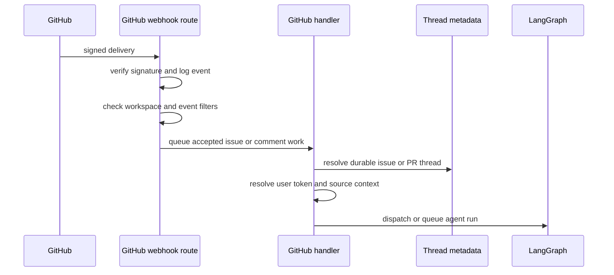
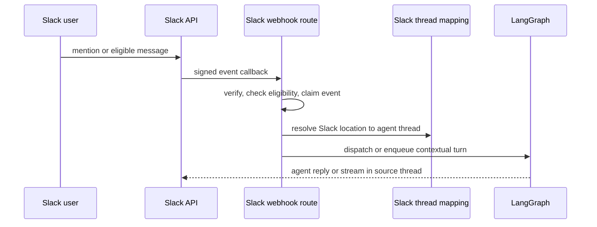
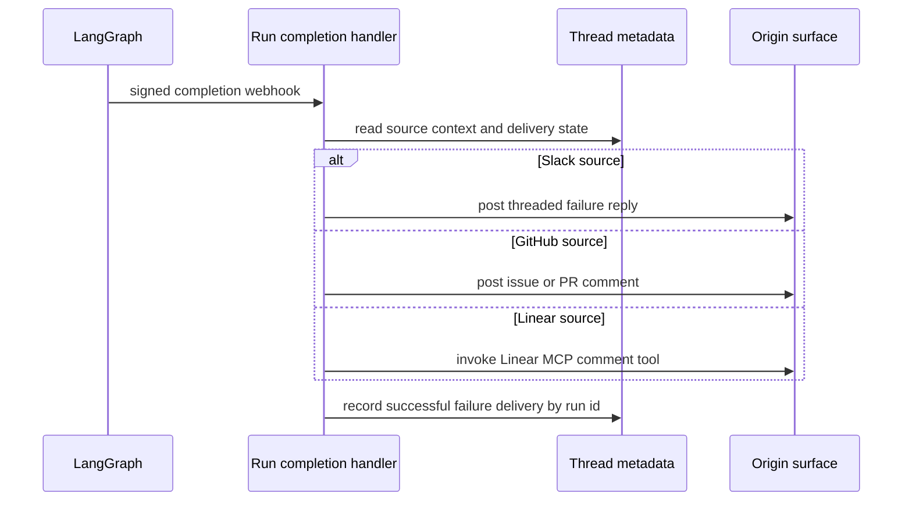

# GitHub, Slack, and Linear integrations

Open SWE accepts work from three external surfaces but converts each accepted request into a LangGraph thread plus a source-specific `configurable` context. The originating surface remains in `SourceContext` and thread metadata, which makes later follow-ups, authorization, workspace continuity, and failure replies route back to the right place.

## Ingress boundaries and common guarantees

| Surface | Endpoint(s) | Authentication and replay control | Primary trigger |
| --- | --- | --- | --- |
| GitHub | `POST /webhooks/github` | `X-Hub-Signature-256` HMAC; invalid signatures receive `401` | Supported issue, comment, PR, CI, or push delivery |
| Slack | `POST /webhooks/slack`, `/commands`, `/code-channel-commands`, `/interactivity` | Slack v0 HMAC over raw body and timestamp; signatures older than five minutes are rejected | App mention, eligible DM/channel mode, command, event, or Block Kit action |
| Linear | `POST /webhooks/linear` | `Linear-Signature` HMAC plus a signed `webhookTimestamp` constrained to 60 seconds | A new human comment that mentions Open SWE; issue updates can instead launch automations |

All three routes record the raw delivery through `EventLog` before work-specific dispatch. Parsing failures are returned as an error response after a successfully verified signature. Work is normally scheduled in FastAPI background tasks so the webhook acknowledgement is not held until the agent run finishes.

GitHub additionally asks GitHub to retry with `503` when repository-to-workspace ownership cannot be read: dropping a delivery in that condition could lose work. Slack similarly returns `503` with `Retry-After` only when an otherwise actionable event cannot be safely evaluated because channel eligibility is temporarily unknown. Known external/shared Slack channels are not agent surfaces; an app mention there gets a refusal reply but never starts a run.

## GitHub: events, authorization, and durable conversation keys

GitHub only admits event types and actions in its explicit support sets. A repository delivery is first checked against workspace ownership, then most issue/comment flows must pass the repository allowlist and the public-repository organization gate. Issue title/body changes and new/reopened issues need an Open SWE tag. Comment and review triggers additionally require the sender to be a registered Open SWE GitHub user; the handler does not rely on the webhook sender alone as authorization.

A GitHub issue maps deterministically to `github_issue_thread_id(issue_id)`. Its initial run includes the issue description and fetched comments; later issue comments or edits reuse the live thread and add a follow-up. The triggering GitHub login is resolved to an email and thread GitHub token. If metadata for a narrowed token scope cannot be persisted, the issue run is deliberately not started.

PR conversation routing is intentionally more nuanced:

- A tagged issue comment on a PR, review comment, or submitted/edited review routes to a branch-derived agent thread when possible, otherwise to the PR-keyed thread. It fetches the relevant comments, reacts to the triggering comment, and creates or queues work through `trigger_or_queue_run`.
- A reply to an Open SWE review finding routes to the canonical reviewer thread even without a tag. A tagged or untagged comment/review can also wake the agent thread that opened that PR; untagged wake-ups require both a registered sender and an open PR linked as agent-opened.
- Pull request `opened` or `ready_for_review` can start automatic review only when enabled for the repository and allowed by the public-repo gate. Reviewer threads are keyed by repository and PR number, retain watch metadata, and PR pushes re-review only watched, open, eligible PRs with a changed diff.

*GitHub ingress verifies, routes, and persists enough identity and source state before an agent run is dispatched.*

GitHub identity in the agent input uses a stable `github:<id>` person identifier when the numeric GitHub ID is available, with the login retained as display and GitHub-login data. Replayed issue and comment material is formatted with a trusted-author set derived from registered users. That preserves attribution while treating untrusted quoted content differently in prompt construction.

### GitHub review and Slack cross-notifications

GitHub PR review processing can notify the active Slack thread associated with the agent thread. The notification location is re-read while holding a Slack-thread mutation lock, and an event claim keyed by the review URL and edit identity prevents redelivery duplicates for 30 days. A detached or no-longer-associated Slack thread receives nothing. Delivery is attempted once—an uncertain Slack response is not retried—so a duplicate notice is not created after a lost response.

## Slack: eligibility, thread ownership, and actions

The Slack Events route acknowledges Slack URL verification and only handles its supported event categories. It deduplicates event deliveries before agent handling and claims the event again at the dispatch boundary, providing cross-instance protection against concurrent redeliveries. A retry header by itself does not make a new event a duplicate.

A normal channel request needs an explicit Open SWE mention, except for supported operating modes: DMs, code channels, kitchen channels, allowed third-party bot requests, and permitted one-person thread follow-ups. Messages addressed to another user are ignored. Slack’s own bot messages are ignored; another bot must explicitly mention Open SWE and be allowed for that workspace/team. Message edits have strict identity and visible-text checks and are queued onto an associated delivered thread rather than starting a separate run.

A Slack location is bound to one Open SWE thread. Standard channels use the Slack thread timestamp; a code channel uses one channel-wide session timestamp, and concierge DMs use one persistent conversation timestamp. Detaching a Slack thread changes future resolution to a fresh thread rather than silently reusing the moved one. The stored records also associate bot messages with their originating runs, enabling reactions and actions to find the right work.

Before dispatch, Slack resolves a user’s GitHub login by stable Slack ID and then profile email, records participant identities, fetches contextual messages, and selects context from the start of the Slack thread or its most recent relevant mention. A user-triggered run requires a usable GitHub authorization because Open SWE opens PRs as that user; absent or revoked linkage produces a dashboard account-link prompt instead of a run. Allowed-bot execution and bot-token-only deployments are handled separately.

Workspace choice is made when a Slack thread opens. An explicit valid `/workspace:<name>` tag can win; otherwise the shared resolver considers inherited context, repository, channel binding, and user/default fallback. Follow-ups retain the thread’s workspace, preserving its sandbox, settings, and MCP connections. The resolved workspace and repository are included in the run configuration and agent metadata.

*Slack preserves a location-to-thread association and sends the resulting turn back to that conversation rather than a new channel message.*

### Interactive controls

`POST /webhooks/slack/interactivity` is signature-checked and accepts selected supported Block Kit payloads. The Explain This shortcut launches a private `/oswe`-style question using Slack’s `response_url`. Feedback actions are backgrounded. Code-channel view actions and runtime code-channel commands are converted into explicit turns on the shared code-channel session.

For an `open_swe_option` button, the route validates the channel, looks up the mapped thread, schedules replacement of the option buttons with a `Selected:` context block, and then forwards the option response as a Slack turn. Workflow-push approval buttons update the stored approval decision before either rejecting or asking the agent to retry the blocked push. Review-guide `Next` actions are server-owned and only the configured reader may advance them. These controls are blocked in ineligible external channels.

## Completion and replies

Agent completion is separate from ingress. A run-complete webhook must present `RUN_COMPLETE_WEBHOOK_SECRET`; without it the endpoint fails closed. For terminal `error` or `timeout`, the completion handler uses persisted source metadata to post one best-effort failure notice per run (subject to a consecutive-failure cap): Slack gets a threaded reply, GitHub gets an issue/PR comment using an app token, and Linear uses its issue-comment path. Interrupted runs intentionally do not generate a failure notice because an explicit follow-up commonly interrupts a prior run.

*Failure completion replies are routed from persisted source context and only marked delivered after the surface operation succeeds.*

Slack reply helpers add an Open SWE Web link when an agent thread is known; normal replies return `False` rather than raising on a Slack request error. Slack can additionally use native status and streaming APIs for thinking/status UI, while code-channel sessions omit the normal thread mapping for their reply delivery.

## Linear: comment-driven work and MCP-backed failure comments

Linear only starts agent work from a `Comment` `create` event authored by a non-bot that mentions Open SWE. It ignores its own recognizable response prefixes to avoid feedback loops. The handler obtains the issue ID from the comment, derives title/identifier/URL from the delivery URL when needed, and chooses a repository in this order: a repository named in the comment, the triggering Linear user’s workspace-aware dashboard default, then the workspace default. The resulting repository must be allowlisted.

The Linear issue thread is deterministically derived from the Linear issue ID. The processor maps the comment author’s Linear email to a GitHub login where possible, so a PR can be authored as the triggering user. It retains an existing thread’s workspace; new work uses the selected workspace or the repository’s workspace. The input includes system issue context plus relevant human comments from the trigger onward, excludes known bot response prefixes, and can add fetched image blocks, selecting a vision fallback model when necessary.

Linear does not contain a direct API client for failure comments. `post_linear_notification` loads only the resolved workspace’s `linear` MCP connection, searches its allowed tools for `save_comment` then `create_comment`, and invokes it with `issueId` and `body`. It applies a 30-second timeout and never retries this mutation; success requires a successful `ToolMessage`. Thus missing, disabled, unselected, rejected, or failed MCP tools leave the notification undelivered and allow completion handling to try again later rather than recording it as sent.

## Operational checklist and focused tests

- Configure nonempty `GITHUB_WEBHOOK_SECRET`, `SLACK_SIGNING_SECRET`, and `LINEAR_WEBHOOK_SECRET`; absent secrets reject webhook traffic. Configure `RUN_COMPLETE_WEBHOOK_SECRET` to enable authenticated completion failure replies.
- Maintain workspace repository/channel assignments, repository allowlists, GitHub account links/tokens, and Slack channel eligibility. A GitHub workspace lookup outage should remain retryable rather than being converted to a successful ignore.
- For Linear failure replies, configure and enable the workspace `linear` MCP connection with either `save_comment` or `create_comment` allowed.
- The focused tests cover GitHub workspace retry/ignore behavior and comment authorization/untagged PR wake-ups; Slack event claims, external-channel refusal, interactivity ordering, and code-channel routing; Linear author/workspace continuity and image attachment placement; and Linear MCP notification delivery, permission changes, timeout behavior, and delivery-only deduplication.
