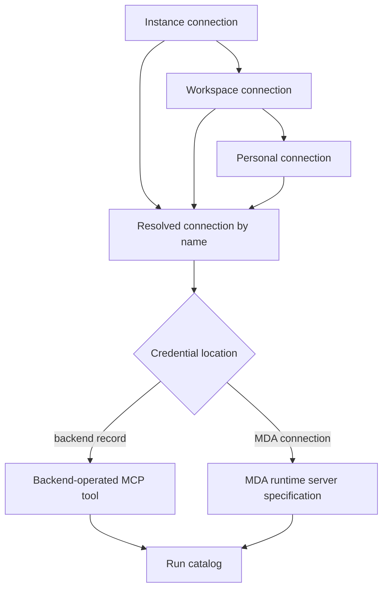

Open SWE uses two deliberately different paths for external MCP servers. **Backend-operated MCP integrations** are contacted by the Open SWE backend, which owns their encrypted headers or client-credentials OAuth configuration. **MDA-connection-backed MCP integrations** are contacted by the Managed Deep Agents (MDA) run itself: the backend records only an MDA connection reference and an allowlist, and MDA reads the credential at runtime. This distinction prevents the backend from acquiring secrets it is not meant to hold.

GitHub and LangSmith are related but separate integration surfaces. GitHub App tokens provide repository access to the backend and sandbox proxy; a person’s LangSmith OAuth login enables LangSmith Managed Tools and browser-facing capabilities. See [Models, prompts, and settings](/openwiki/concepts/models-prompts-and-settings.md) for model/gateway selection, [Security and authorization](/openwiki/concepts/security-and-authorization.md) for authorization boundaries, and [Tools and sandbox access](/openwiki/concepts/tools-and-sandbox-access.md) for the general tool surface.

## MCP connection scopes and ownership

An MCP connection has a name, HTTPS endpoint, `streamable_http` or `sse` transport, enabled flag, and explicit `allowed_tools` list. Endpoint validation rejects non-HTTPS URLs, embedded credentials, fragments, and secret-looking query parameters. Authentication header names are validated and blocked transport headers cannot be configured.

Connections are resolved from ordered scopes:

| Scope | Stored by | Credential owner for MDA-backed server | Typical audience |
| --- | --- | --- | --- |
| instance | `mcp_connection` with no workspace | `agent` | every eligible run |
| workspace | `mcp_connection` for a workspace | `agent` | runs in that workspace |
| user | per-user `user_record` | `user` | runs acting for that user |
| managed | LangSmith gateway-derived surface | LangSmith owns provider grants | private threads of the owner |

A connection with the same name in a later scope **replaces the entire earlier connection**; it does not merge tools or authentication. Thus a disabled or empty personal override intentionally suppresses a shared connection. Each tool carries provenance identifying its chosen scope and scopes it replaced. Namespaces include the scope owner, which isolates discovery and OAuth caches between people.

Personal connections are only supplied to runs acting for their owner. The acting principal is distinct from the user to whom a run is attributed: service-principal and channel runs cannot obtain a user-owned MDA connection. Likewise, a shared instance/workspace MDA server must use an `agent` connection, while a personal MDA server must use a `user` connection.

This shows precedence and the split between backend-operated and MDA-operated MCP servers.

## From settings to a run catalog

`load_mcp_tools` gathers all supplied sources, resolves names by precedence, then keeps only enabled connections that offer tools. For a conventional backend-operated connection, the backend discovers `tools/list`, filters definitions through `allowed_tools`, wraps each selected definition under a safe generated name such as `mcp_<connection>_<tool>`, and adds provenance metadata. Discovery is cached by source namespace, connection name, and revision: it is fresh for 10 minutes and may be served stale for up to 24 hours while refresh occurs. Discovery is bounded to eight concurrent requests and a 30-second deadline.

A connection that names an MDA connection cannot be discovered by the backend because the backend cannot read that credential. Administrators must enter the allowed tool names. Instead, catalog assembly emits an `McpServerSpec` containing the URL, transport, name mapping, connection reference, optional credential header, and provenance note. MDA loads those server tools once at run start, after it can read the referenced connection.

At invocation, backend-operated wrappers re-resolve the connection and verify that scope, endpoint, transport, enabled state, and tool allowlist still match the loaded definition. A changed scope or connection requires a new run rather than silently switching credentials. Backend-operated calls and discovery use a custom HTTP transport that accepts only the configured HTTPS origin, resolves it to public addresses, pins the request to a validated address, disables redirects and environment proxy settings, and preserves TLS SNI.

For MDA-backed servers, MDA lists only tools actually advertised by the server and intersects them with the catalog allowlist. It rejects a remote `runtime` input property because it conflicts with its execution runtime. It obtains the credential again for every call, sends it either as `Authorization: Bearer <credential>` or the configured header, and limits listing and invocation to 30 seconds. Calls are also origin-bound, redirect-free, public-address-pinned HTTPS requests. A missing grant, inaccessible connection, discovery failure, duplicate model tool name, or failed call removes that tool/server or returns a sanitized error rather than exposing request content or a credential.

## Credential modes and operational rules

A single connection uses exactly one credential mode:

- **Encrypted backend headers.** Header values are encrypted in the connection record; only header names are public in dashboard responses.
- **Backend OAuth client credentials.** The client secret is encrypted, tokens are acquired from an HTTPS public endpoint and cached in an owner-specific namespace. Token failures and remote response details are redacted.
- **MDA connection.** The record contains no headers, OAuth secret, or encrypted backend credential. Its connection must be an MDA connection made for MCP servers (`open-swe-mcp-<server>`), and its owner must agree with the connection scope.

This is an important administration boundary: configuring a connection-backed server means Open SWE cannot list its tools during setup; the allowlist is the administrator’s declaration of the callable API. Changing an MDA-backed server endpoint requires naming the connection again, preventing a retained credential from being silently redirected to a new host.

## GitHub App access and the sandbox proxy

The GitHub App integration exchanges the app JWT for installation tokens. Tokens are cached only in process and cache keys include installation, repository IDs or names, and permissions, so a narrower or less-privileged token cannot be reused as a broader one. A cached token is discarded ten minutes before its GitHub expiry. If app configuration is absent, local `langgraph dev` may use the `gh` CLI only for an unscoped development token.

Sandboxes do not receive the installation-wide discovery token. When a caller asks for repository-scoped access, Open SWE verifies repository IDs against the installation’s accessible-repository listing and mints a token only for matching repository IDs. Review paths use a read-only permission set covering actions, checks, contents, issues, pull requests, statuses, and metadata. A normal workspace sandbox receives installation-wide access unless the caller explicitly passes a repository set; workspace routing/preload repositories alone are not an access limit.

The sandbox proxy is how `git` and `gh` inside a LangSmith sandbox receive that token. Open SWE records the token expiry, original repository scope, permission scope, workspace, and base proxy configuration per thread. Before model work, a near-expiry token is refreshed within five minutes of its expiry (or after a 50-minute fallback lifetime where expiry is unknown). Refresh retains the original scope, or intersects it with a newly requested repository set; it must not broaden repository or permission access.

MDA can also own proxy writing when the sandbox catalog specifies a GitHub MDA connection. It obtains the connection token before sandbox commands, writes GitHub rules plus backend-provided proxy rules, and periodically rewrites the configuration because credentials can rotate. If the backend refuses to provide its proxy portion, the backend remains the writer. Sandbox replacement clears the cached backend proxy portion so old workspace rules are never copied to the new sandbox.

## LangSmith login, managed tools, model gateway, and tracing

“Sign in with LangSmith” is a per-person OAuth 2.1 flow using a confidential organization-registered client, PKCE, and `openid email offline_access`. Authorization and token endpoints are discovered from the configured issuer and must have that issuer’s origin. Encrypted access and refresh tokens are stored in PostgreSQL in `user_oauth_credential`, keyed by immutable Open SWE user ID and provider rather than mutable GitHub login. Access is refreshed under a refresh guard near expiry; a credential with no usable refresh token is removed.

The LangSmith Managed Tools (LMT) integration is not a generic backend-held MCP credential. An instance administrator selects one managed-tools gateway ID in instance settings; workspace overrides do not select it. In an eligible private thread, the gateway is loaded using the thread owner’s LangSmith access token. LangSmith proxies the gateway’s tools and owns each provider’s OAuth grant or secret: provider credentials, consent links, and the LangSmith token do not become sandbox data or agent tool arguments.

A gateway can expose some tools while reporting missing service credentials, or return HTTP 428 when all required services must be connected. Open SWE converts that condition into service cards and single-use owner-only consent links, polls consent status within its deadline, and refreshes the tool catalog afterward. Access failures (401/403), inaccessible gateways, and tenant/workspace mismatch are surfaced as safe operational errors. `LMT_TENANT_ID` optionally pins requests to a LangSmith tenant. The same per-user LangSmith identity is what makes managed-tool selection and provider credentials private to that person.

The workspace setting `gateway_enabled` is a tri-state override: a workspace setting inherits from the instance setting, and an unset instance setting inherits the deployment’s `LANGSMITH_GATEWAY_ENABLED` default. It controls whether model calls use the LLM Gateway; it is independent of the Managed Tools gateway ID. The graph’s MDA runtime owns model-loop checkpoints, model calls, middleware, and tool calls, while the backend answers typed runtime operations and reports. This makes external tool, model gateway, and tracing behavior observable at their respective MDA/backend integration boundary rather than embedding credentials in the graph state.

## Browser service lifecycle

MDA’s browser middleware assigns one browser per thread and drives its `mda` window. The backend records the browser name at run start and records that it has been opened after the agent browses; separate metadata keys ensure a later start report cannot undo an already-open state. A person may open the browser first, in which case the service creates or adopts the named browser/window with the agent initially in control. The dashboard receives origin-restricted, expiring view and act links suitable for embedding its window.

A stopped browser is started before use; failed, deleting, or missing browsers are treated as gone. Deleting a browser deletes its profile and signed-in sessions, retains the name in metadata, and lets later agent browsing create a fresh browser. A 501 from the LangSmith browser API means the deployment does not have the browser beta enabled.

## Failure handling and focused tests

MCP discovery errors deliberately avoid echoing headers, response bodies, URLs with secret query data, or credentials. Managed-tool discovery has a short cached failure backoff for unsupported/absent endpoints. The key tests cover scope replacement and revocation when a private thread becomes shared, cache isolation by owner, catalog stale-while-refresh behavior and discovery concurrency, OAuth token refresh/redaction and private-endpoint rejection, MDA connection ownership rules, gateway credential challenges and per-service consent links, repository/permission-preserving GitHub proxy refresh, and browser state transitions.

For deployment requirements—including GitHub App keys, MDA connections, LangSmith OAuth client values, database/encryption requirements, and optional LMT tenant pinning—see [Configuration and deployment](/openwiki/operations/configuration-and-deployment.md).
