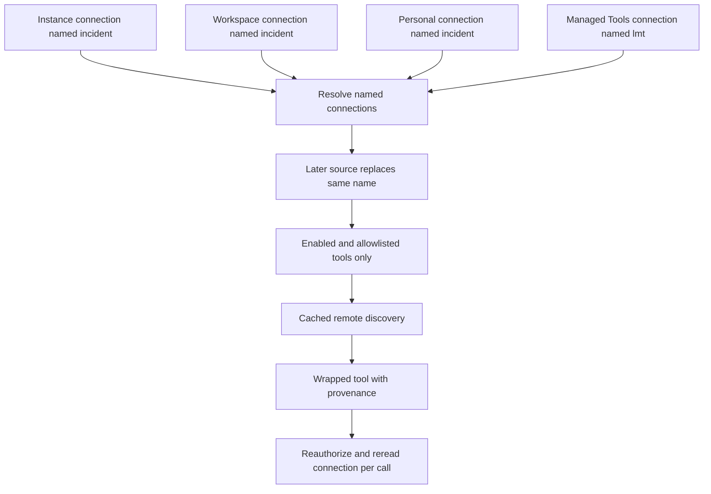
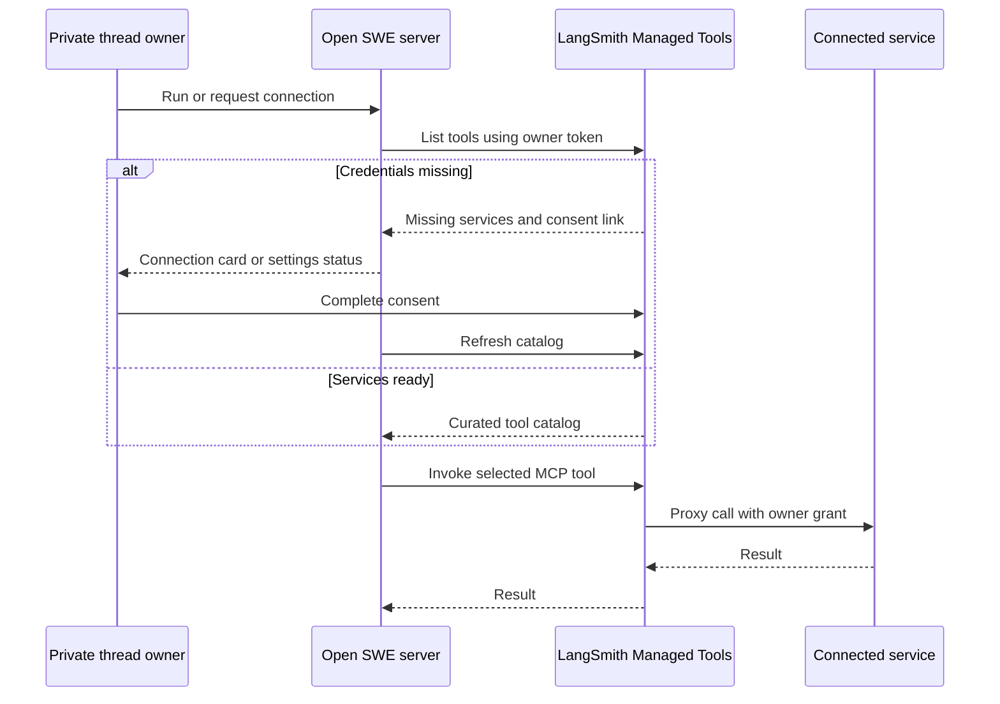
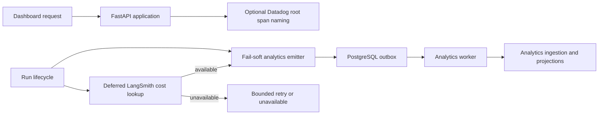

# MCP, model gateways, and observability integrations

Open SWE has three related but distinct integration boundaries:

- **MCP connections** make selected remote tools available to a run, with instance, workspace, personal, and managed-tool scopes.
- **The LangSmith LLM Gateway** is optional routing for model-provider requests, not an MCP tool connection.
- **Observability and analytics** respectively improve request tracing and capture product-usage events; both are designed not to interrupt the user-facing operation when their optional work fails.

These mechanisms keep provider credentials in server-side stores and make access, scope precedence, and failure behavior explicit. For broader runtime and security context, see [Managed runtime](../architecture/managed-runtime.md), [Authentication and security](../concepts/auth-and-security.md), [Configuration and model resolution](../concepts/configuration-and-model-resolution.md), and [Runs, inputs, and tools](../concepts/runs-inputs-and-tools.md).

## Scoped MCP connections

An MCP connection is a named, HTTPS-only remote server configuration. It supports `streamable_http` or `sse`, an enabled flag, encrypted authentication headers, an optional OAuth 2.0 `client_credentials` configuration, and an explicit `allowed_tools` list. A connection offers no tools until that allowlist is non-empty. URLs cannot include credentials, fragments, whitespace, or secret-like query parameters; blocked hop-by-hop and proxy headers cannot be saved. Connection names are constrained to a short lowercase identifier, which makes the name a stable scope-override key.

Credentials are not part of the public connection response. Headers and client secrets are encrypted before persistence; the dashboard displays header names and OAuth metadata, and its separate reveal endpoint returns headers with `Cache-Control: no-store` to an administrator. Updating a connection can reuse credentials only from the same scope and name. Changing a server URL requires headers to be explicitly replaced or cleared, preventing credentials from silently following a changed destination.

### Tiers, namespaces, and precedence

Instance and workspace records live in PostgreSQL's `mcp_connection` table, while personal records use the user-record store. Each source has an owner-specific namespace: `instance_mcps`, `workspace_mcps/<workspace>`, or `user_mcps/<login>`. Namespaces isolate discovery cache entries and OAuth client-token caches as well as storage ownership.

A normal run supplies sources in this order: instance, workspace, then its credential owner's personal source; a configured LangSmith Managed Tools source is appended last. Connections with the same name do not merge: the later source replaces the whole earlier record. Thus a workspace can replace an instance connection, and a personal connection can replace both. A lower-tier connection is never used as a silent fallback once a higher tier owns that name.

This shows source ordering and whole-connection replacement before discovery; `lmt` normally has its own name and is appended only for an eligible credential owner.

The dashboard exposes scoped list, save, delete, reveal-header, and discovery operations. Instance and workspace operations require an administrator; personal operations use the authenticated session. Discovery can run against a persisted connection or an unsaved validated draft, returns only tool names/descriptions, and never executes a tool.

## Discovery and execution lifecycle

At load time, Open SWE reads all sources concurrently. If any scope cannot be read, it returns no MCP tools rather than risking exposure of a lower-precedence record with incomplete override information. It then selects the last record for each connection name, skips disabled or empty-allowlist records, discovers each selected server catalog concurrently, and retains only allowlisted definitions.

Discovery uses the configured transport and has a 30-second limit. Results are stale-while-revalidate cached for 10 minutes and may be served up to 24 hours; the cache key includes source namespace, connection name, and connection revision. A save creates a new revision, isolating the new server/configuration from the prior catalog. Discovery rejects duplicate remote tool names and reduces failures to safe, actionable messages without echoing request credentials. Individual discovery failures remove that connection's tools and are reported in logs and catalog outcome counters, rather than failing all other connections or the run.

The resulting LangChain tool name is sanitized and receives a hash suffix, while its metadata preserves the upstream MCP tool name plus credential-free provenance: connection name, winning scope, and overridden scopes. This permits the tool surface to explain where a tool came from without exposing URL credentials.

Execution deliberately does **not** trust the discovery-time record. On every invocation the wrapper:

1. calls any authorization hook for the source that originally supplied the catalog;
2. resolves the connection name again with the same precedence order;
3. rejects a missing/disabled connection, a scope change, a changed URL or transport, or a tool no longer in the allowlist;
4. creates a fresh MCP client and invokes asynchronously under the same 30-second limit.

Unexpected invocation failures are logged without provider details and become `ToolException("MCP call failed; check its connection and credentials")`; expected policy changes get specific tool errors. MCP tool calls also emit a PostHog MCP-tool outcome signal. The net effect is that a configuration change takes effect safely during a run: a stale schema cannot turn into a call against a different endpoint or broader permission set.

## Client-credentials OAuth for configured MCPs

A configured connection can obtain bearer tokens using only the OAuth `client_credentials` grant. The secret stays encrypted in the connection record. Token acquisition supports `client_secret_post` and `client_secret_basic`, sends an optional scope, validates bearer tokens, caches an auth object by namespace, connection name, settings, and encrypted secret, and refreshes shortly before expiry. A `401` causes one token refresh and retry. Changing credentials or settings naturally selects a new cache entry.

OAuth failures are normalized to messages suitable for an administrator, such as a failed token request with status and configuration hints. They do not disclose the secret or provider response body.

## Open SWE as an MCP server

Open SWE also exposes its own tool catalog at `/oswe/mcp` for external MCP clients such as Claude Code, Claude.ai, or Cursor. The server authenticates through the dashboard's GitHub App OAuth flow when its GitHub client credentials and `TOKEN_ENCRYPTION_KEY` are configured; local development may instead use a GitHub token verifier. It is not mounted when neither option is available.

The remote server is stateless: every list or call derives a `ToolCaller` from the access-token GitHub subject, verifies that the corresponding Open SWE user may sign in, and resolves that person's catalog. The catalog combines exposed native tools—admin-only tools only for administrators—with instance, default-workspace, and personal MCP connections. Tool invocation runs through the same `ToolNode` path and configuration used by a private owned thread, so parameter validation, injected state, and access policy are rechecked rather than trusting a prior `tools/list` response.

The OAuth proxy's registrations, transactions, authorization codes, upstream tokens, refresh tokens, and consent state are stored in PostgreSQL so any replica can handle a step. Store collections declare the small set of readable metadata; every other field is encrypted with `TOKEN_ENCRYPTION_KEY`, and authorization-code keys themselves are hashed. Expired entries read as absent and writes opportunistically sweep expired rows. An unknown collection fails closed, ensuring a FastMCP upgrade cannot persist a new unreviewed secret field in plaintext.

## LangSmith Managed Tools

Managed Tools is a special MCP source, separate from the LLM Gateway. An instance administrator chooses one curated LangSmith tool-kit gateway; workspaces cannot override that selection. In a private thread, the owner can load that gateway using their own LangSmith OAuth token. LangSmith owns service provider grants and proxies calls, so neither provider tokens, consent URLs, nor the LangSmith token become tool arguments, sandbox state, or stored MCP credentials.

The `managed` source has namespace `managed_tools/<login>/<gateway-id>` and re-resolves its in-memory authorization header for each connection lookup. Its authorization hook verifies that the current thread is private and owned by that same login. If the owner lacks a LangSmith connection or token refresh fails, only the managed source is omitted; ordinary instance/workspace/user MCPs remain available.

A gateway may withhold every tool until all services are connected, returning HTTP 428, or may offer tools from connected services while naming missing credentials in MCP metadata. Open SWE exposes readiness, missing OAuth/secret services, and optionally connected service counts. OAuth services receive a fresh single-service consent link for the signed-in owner; secret services must be configured in LangSmith. Consent polling has a bounded deadline and a minimum pause between long polls. After consent, Open SWE refreshes the MCP catalog; refresh failure does not stop the thread from resuming once the services requested by its connection card are ready.

This shows the managed-tool boundary: Open SWE presents and invokes curated tools, while LangSmith holds the provider grants and performs the provider call.

## LangSmith LLM Gateway model routing

The LLM Gateway is applied centrally in `make_model`. When routing is enabled, supported provider calls authenticate to LangSmith with `LANGSMITH_GATEWAY_API_KEY` (preferred) or `LANGSMITH_API_KEY`, and LangSmith resolves the actual provider secret from workspace Provider Secrets. The gateway can enforce spend, PII, and secrets policies and trace calls. This routing is independent of both run-inspection/managed MCP functionality and the MCP connection records above.

A workspace `gateway_enabled` value is authoritative; when absent, `LANGSMITH_GATEWAY_ENABLED` controls the deployment default. If that variable is unset, configuring a dedicated gateway key enables routing by default. `LANGSMITH_GATEWAY_BASE_URL` overrides the default `https://gateway.smith.langchain.com` for regional or self-hosted deployments. Remote-runtime model specifications carry the already-resolved workspace `use_gateway` flag so the graph builds primary and subagent models consistently.

Supported provider prefixes are `openai`, `anthropic`, `baseten`, `fireworks`, and `google_genai`; each maps to the corresponding gateway base path. Unsupported providers—including `google_vertexai`—or missing LangSmith credentials produce a warning and preserve direct-provider routing instead of failing model construction. Gateway-routed OpenAI uses the Responses API by default; `LANGSMITH_GATEWAY_OPENAI_USE_RESPONSES=false` is an explicit compatibility opt-out for Chat Completions.

## Request tracing, analytics, and degradation

Datadog APM integration is optional. At API creation, `OPENSWE_ENV` is copied to `DD_ENV` and, when `ddtrace` is installed, its configured environment. Middleware renames the current Datadog root span to the routed HTTP resource such as `GET /path-template` after routing or while an endpoint unwinds. This avoids collapsing dashboard traffic into one generic route, but missing tracing libraries or span-renaming errors only generate debug logs and do not affect the response.

Product analytics is PostgreSQL-backed rather than a direct in-request provider call. Lifecycle producers create strict, versioned event envelopes with opaque IDs for runs, threads, tasks, people, repositories, and models. They record run starts and terminal token usage, cost observations, PR/review/finding lifecycle events, and feedback. Event capture is fail-soft: it runs only when the database is configured, catches/logs errors, and never interrupts the product transition that emitted it.

Events are inserted idempotently into an outbox in the same database transaction. A worker claims pending work with `FOR UPDATE SKIP LOCKED`, ingests events, acknowledges successful delivery, and retries failures with jittered exponential backoff. After the configured maximum attempts, an event is dead-lettered; outbox status reports pending, dead-letter, and stale counts. Worker-loop failure is also logged and retried on the next iteration.

Run cost is a deferred LangSmith enrichment: after terminal usage is recorded, Open SWE may schedule bounded refresh attempts for LangSmith's run-only cost. A successful lookup writes a `run.cost_recorded` event and thread metadata. An unavailable LangSmith cost or a persistence failure yields retry scheduling or an unavailable/exhausted result, never changes the run's terminal outcome.

This distinguishes synchronous product work from optional tracing and asynchronous usage/cost processing.

## Verification focus

The MCP tests exercise tier isolation, same-name precedence and per-call allowlist rechecks, remote-server schema and administrator gating, sealed OAuth storage and expiry behavior, and managed-gateway ownership, credential challenges, consent/resume behavior, and graceful LangSmith outages. Model tests cover fallback-resolution and request-timeout behavior; gateway routing itself is centralized in the model factory so supported and unsupported provider behavior remains a focused configuration boundary.
