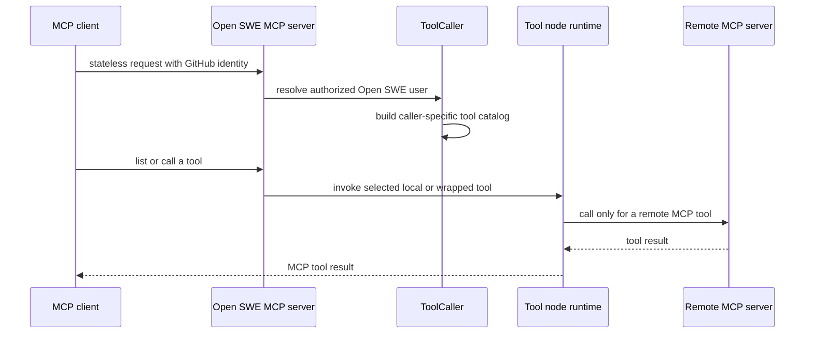

# MCP, Observability, and External Tool Loaders

Open SWE has two complementary MCP roles. It is an authenticated remote MCP server at `/oswe/mcp` for external clients such as Claude Code, Claude.ai, and Cursor, and it is an MCP client that brings configured remote tools into agent runs. The current loader is generic and connection-driven: legacy provider-specific loaders for Datadog, Corridor, Notion, Currents, and a Stagehand browser are not part of this repository. LangSmith appears instead as optional Managed Tools and as the separate LLM Gateway model-routing service.

See [Tools](../concepts/tools.md) for the agent tool surface, [Authentication and security](../concepts/auth-and-security.md) for authorization boundaries, [Dashboard UI](dashboard-ui.md) for administration, and [Configuration](../operations/configuration.md) for deployment settings.

## MCP in both directions

### Exposing Open SWE to an MCP client

When GitHub App client credentials and `TOKEN_ENCRYPTION_KEY` are configured, the API mounts a stateless FastMCP service under `/oswe/mcp`; its discovery and sign-in routes are also exposed. In local development, the service can instead verify a caller-supplied GitHub token when development login is enabled. If neither authentication arrangement is available, no mount is built.

Every request resolves the caller from the OAuth access-token subject, then requires that GitHub identity to belong to an Open SWE user who remains authorized for the instance. The server reconstructs the caller's catalog on each request rather than retaining MCP session state. A caller receives opt-in local tools marked with `@expose_mcp` plus remote MCP integrations available to them; admin-only exposed tools are omitted for non-admins. Invocation is run through the same `ToolNode` runtime used by a private thread, with a configuration that identifies the MCP source, GitHub login, email, and admin context.

This is the request path for an external MCP client. Catalog and authorization are re-evaluated for the authenticated caller rather than inherited from a previous request.

### Loading remote MCP tools into a run

During a normal run, the server loads connections in precedence order: instance, selected workspace, the private owner’s personal connections, then (when configured) the instance-selected LangSmith Managed Tools gateway. A later connection with the same connection name replaces the earlier connection wholesale; a disabled connection or one with an empty allowlist deliberately blocks fallback to a lower tier. Instance and workspace records are stored in PostgreSQL, while a personal record belongs to its user record namespace. Namespaces also isolate discovery and OAuth-token caches.

The loader reads each enabled connection’s tool catalog and only wraps names listed in `allowed_tools`. Wrapper names are stable, safe names derived from the connection and remote tool names, and metadata records the selected scope and overridden scopes. At invocation, a wrapper re-authorizes its source, rereads the selected connection, and refuses calls if it was disabled, moved to another scope, changed URL or transport, or had its tool removed. It then creates a fresh MCP tool and applies a 30-second call timeout. Unexpected failures are logged without request details and become the generic tool error rather than leaking credentials.

The tool catalog uses stale-while-revalidate caching for 10 minutes fresh and up to 24 hours maximum age. Cache keys include the source namespace, connection name, and connection revision, so a saved connection change causes rediscovery and one owner cannot reuse another owner’s catalog. A discovery failure affects that connection only; failure to read any source causes the combined load to return no tools rather than silently exposing a lower-precedence source.

## Connection configuration and credential safety

A connection has a lowercase, bounded name; an HTTPS URL; `streamable_http` or `sse` transport; enabled state; an explicit tool allowlist; optional headers; and optional OAuth client-credentials settings. URLs cannot contain user credentials, fragments, whitespace/control characters, or secret-looking query parameters. Header names and values are constrained, unsafe hop-by-hop headers are blocked, and an OAuth connection cannot also supply an `Authorization` header.

Secrets are not returned in the ordinary connection representation: headers and an OAuth client secret are encrypted with the application token encryption mechanism, while the public view exposes header names only. An edit can retain credentials only for the same connection within the same scope; changing the server URL requires replacement or clearing of saved headers. Dashboard routes require an admin for instance/workspace configuration and the signed-in user for personal configuration; writes, deletes, and secret reveal operations are audited, and reveal responses are `no-store`.

For configured client-credentials OAuth, the loader decrypts the secret only to obtain a bearer token. The token is cached by namespace, connection name, settings, and encrypted secret, refreshed before expiry under a lock, and retried once after a 401. Consequently, credential rotation changes the cache identity instead of continuing to use an old token.

Outbound MCP traffic is intentionally constrained beyond input validation. The HTTP transport accepts only the configured HTTPS origin, disables redirects and environment proxy settings, resolves the host to public addresses, and pins the checked address while retaining the original Host header and TLS SNI. This prevents redirects, DNS rebinding, or a private-network destination from receiving configured authentication headers.

## Private credentials and LangSmith Managed Tools

Personal MCP connections are available only when a private credential owner is known. Their source authorization runs again on every tool call and requires the current thread to remain privately owned by that same login; making a thread shared revokes a previously loaded personal tool.

LangSmith Managed Tools is a distinct personal integration. An instance administrator selects one LangSmith tool-kit gateway; workspaces cannot override it. In a private owner’s run, the gateway is loaded after the other connection tiers using the owner’s refreshed LangSmith OAuth token. LangSmith holds the underlying provider connections and proxies the calls, so provider tokens, consent URLs, and the LangSmith token are not passed into tool arguments or the sandbox.

A person connects LangSmith through a confidential OAuth 2.1 client with PKCE. Access and refresh tokens are encrypted in the user OAuth credential store and refreshed on demand. Managed Tools can report missing service credentials either as a 428 response (all services required) or in tool-list metadata (partial catalog allowed). The dashboard reports that state and mints per-service consent links only for the signed-in token owner. If LangSmith is unavailable or the person has no connection, the managed gateway disappears without removing unrelated MCP tools.

## Observability and model routing

### Datadog request traces

Datadog tracing is application instrumentation, not a Datadog MCP tool loader. At API construction, `OPENSWE_ENV`, when set, is copied to `DD_ENV` and applied to `ddtrace` configuration if the optional library is installed. The API also installs `TraceResourceNameMiddleware`. Platform instrumentation otherwise sees dashboard requests as a single generic resource; after routing, this middleware renames the current root span to `METHOD <route path>`. It attempts naming on response start and also while an endpoint exception unwinds, so route-level 500s remain visible. Missing tracing libraries and naming failures are debug-only and do not break requests.

### LangSmith LLM Gateway

The LangSmith LLM Gateway is separate from Managed Tools and from remote MCP loading. It optionally proxies model-provider calls: Open SWE authenticates to LangSmith, which resolves the provider secret from LangSmith workspace Provider Secrets and applies gateway policies and tracing. Workspace `gateway_enabled` overrides the deployment default. Without a workspace value, `LANGSMITH_GATEWAY_ENABLED` controls routing; if it is unset, setting `LANGSMITH_GATEWAY_API_KEY` enables routing by default. A gateway-specific key is preferred to `LANGSMITH_API_KEY`, because an injected standard key may lack `gateway:invoke`; `LANGSMITH_GATEWAY_BASE_URL` overrides the default gateway host.

`make_model` consumes the workspace’s effective setting. Only `openai`, `anthropic`, `baseten`, `fireworks`, and `google_genai` model prefixes are routed, each to its provider-compatible gateway path. Unsupported providers and missing credentials log a warning and fall back to direct provider calls. Routed OpenAI models use the Responses API by default; `LANGSMITH_GATEWAY_OPENAI_USE_RESPONSES=false` is the compatibility opt-out for Chat Completions.

## Operations and focused verification

To operate remote connections safely, configure an explicit allowlist after discovering a server catalog; a successful discovery alone does not grant any tools. Expect discovery and calls to time out after 30 seconds. Administrators should treat a changed connection URL as a credential rotation boundary, use the dashboard’s audited reveal endpoint sparingly, and investigate sanitized discovery errors rather than expecting secrets or query strings in logs.

Focused tests cover catalog revision invalidation and stale refresh behavior in `tests/tools/test_mcp_catalog.py`; tier replacement, source isolation, call-time revocation, and no-fallback failure behavior in `tests/tools/test_mcp_sources.py`; and public-address pinning and redirect/private-address rejection in `tests/tools/test_mcp_transport.py`. `tests/mcp/test_managed_mcps.py` exercises Managed Tools credential challenges, private-owner loading, and failure isolation, while `tests/sandbox/test_gateway.py` covers LangSmith Gateway provider paths and model construction behavior.
