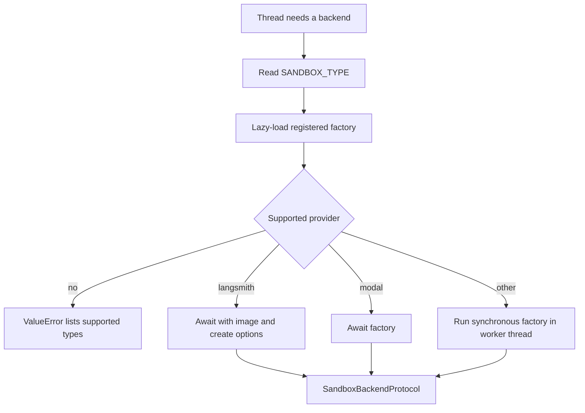
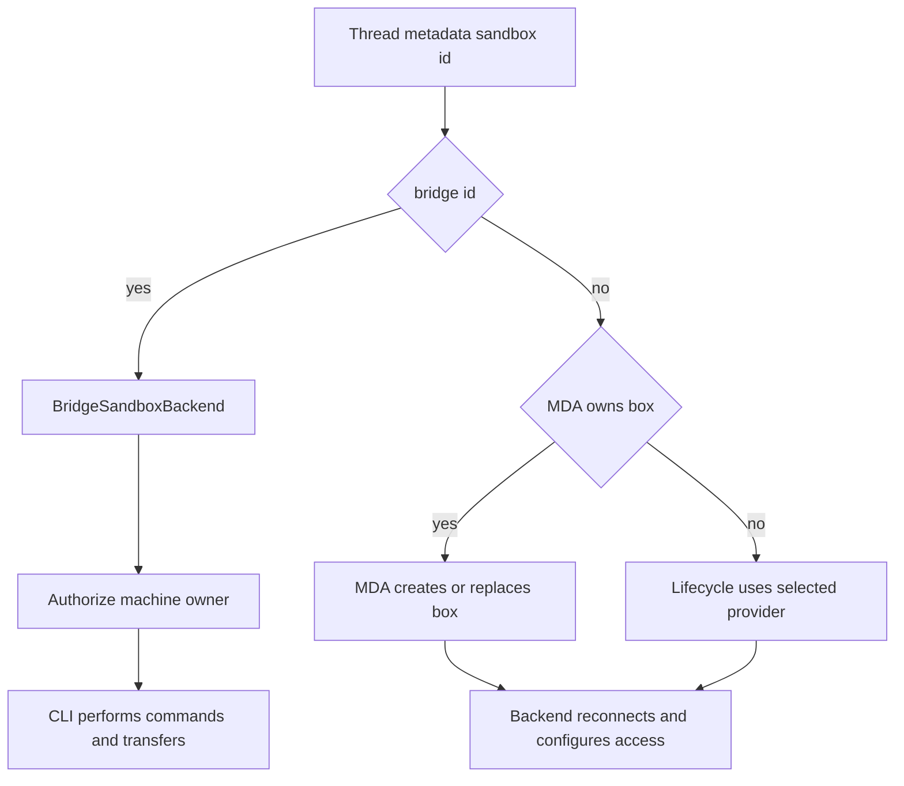

# Sandbox providers and local bridge backends

Open SWE gives the agent a `SandboxBackendProtocol`; provider choice is deployment configuration rather than an agent-graph change. The provider registry creates or reconnects cloud and host backends, while thread lifecycle code decides which backend a thread may use and preserves the distinction between a deleted sandbox and one that cannot safely be reached. A `bridge:` sandbox is a separate local-machine route, not a provider selection.

See [sandbox lifecycle](../architecture/sandbox-lifecycle.md) for thread lifecycle, [workspaces and routing](../concepts/workspaces-and-routing.md) for workspace selection, and [configuration](../operations/configuration.md) for the broader environment-variable reference.

## Provider selection and startup checks

`SANDBOX_TYPE` defaults to `langsmith`. The registry lazily resolves one of `langsmith`, `daytona`, `modal`, `runloop`, `e2b`, or `local`; an unrecognized name raises `ValueError` with the supported set. Factories accept an optional `sandbox_id`: an id means reconnect, and no id means create.

LangSmith is the capability-rich default. `create_sandbox()` forwards snapshot, CPU, memory, filesystem, arbitrary create-body fields, and work-directory preparation only to it. LangSmith and Modal factories are awaited directly. Local, Daytona, E2B, and Runloop factories execute in `asyncio.to_thread`, preventing their synchronous filesystem or SDK work from blocking the event loop.

Provider dispatch: LangSmith alone receives registry-level provisioning options.

Daytona, Modal, Runloop, and E2B integrations are optional dependency groups. A base installation includes LangSmith and Local; selecting a missing third-party SDK produces an install hint for `uv sync --extra sandbox-<provider>` or `uv sync --extra sandbox-providers`. Startup validation imports a selected optional provider early to surface that error at boot. For LangSmith it also checks numeric resource/TTL values, rejects negative TTLs, and parses `SANDBOX_CREATE_EXTRA_JSON` as an object. Other provider credentials are checked when their factory runs.

## Built-in providers

| Provider | Create or reconnect | Required configuration | Scope and caveats |
|---|---|---|---|
| `langsmith` | Async LangSmith client gets an existing box or creates one | `LANGSMITH_API_KEY`; optional endpoint, image, resource, TTL, and extra-body settings | Only provider with workspace snapshot capture and registry-level resource overrides |
| `daytona` | Gets an existing sandbox or creates from its configured snapshot | `DAYTONA_API_KEY`; `DAYTONA_SANDBOX_SNAPSHOT` defaults to `daytonaio/sandbox:0.6.0` | Optional synchronous SDK integration |
| `modal` | Reattaches by id or creates in an app | Modal credentials; `MODAL_APP_NAME` defaults to `open-swe` | Optional native async integration |
| `runloop` | Retrieves an existing devbox or creates one | `RUNLOOP_API_KEY` | Optional synchronous SDK integration |
| `e2b` | Connects by id or creates a sandbox | `E2B_API_KEY`; optional `E2B_TEMPLATE` | Uses a one-hour timeout and optional synchronous SDK integration |
| `local` | Creates a host-backed `LocalShellBackend`; ignores ids | No credential; optional `LOCAL_SANDBOX_ROOT_DIR` | No isolation: local development with human oversight only |

The Local provider creates its root directory and defaults it to the current working directory. It passes a deliberately filtered environment to `LocalShellBackend` with `inherit_env=False`, removing selected model-provider and LangSmith credentials. Unless `GIT_CONFIG_GLOBAL` is explicitly configured, it sets a root-local `.gitconfig-sandbox` that includes the host config; bot identity writes therefore do not overwrite the developer's `~/.gitconfig` while aliases and credential helpers remain available.

## LangSmith images, provisioning, and retention

A `SandboxCreateConfig` resolves the selected workspace (or its inherited default) into a ready snapshot id, resource overrides, and create fields. It always requests `preserve_memory_on_stop=True`; a ready workspace snapshot wins, otherwise creation omits a snapshot id so LangSmith uses its root image. If a workspace snapshot is stale, the current run still boots it and schedules an update rather than waiting.

LangSmith defaults are 4 vCPUs, 16 GiB memory, 128 GiB filesystem capacity, a two-hour idle TTL, and a 30-day delete-after-stop TTL. `0` disables either TTL. `SANDBOX_CREATE_EXTRA_JSON` is merged with call-specific `create_params`, with the latter winning. Extra fields are injected only into the SDK `POST /boxes` request, allowing deployment fields not yet modeled by the SDK. Creation retries retryable failures up to three attempts.

The provider deliberately does not expose general cleanup through the backend factory: sandboxes may hold the only working tree. LangSmith retention uses the idle and delete-after-stop TTLs set when a box is created.

Workspace snapshot capture is intentionally LangSmith-only. It fails early for another `SANDBOX_TYPE`, and a failed capture preserves the prior ready snapshot so new runs do not fall back to an incomplete image. This means other providers can run tasks but cannot participate in Open SWE's workspace-image build and refresh pipeline without an equivalent provider implementation.

## Ownership boundaries: backend, MDA, and bridge

A thread metadata `sandbox_id` can name three materially different owners. Ordinary provider boxes are created and replaced by the backend lifecycle. For LangSmith, Managed Deep Agents (MDA) may own the box: MDA names, creates, adopts, restarts, and replaces it, while the backend connects it and applies Git identity, proxy credentials, and tool access. The backend must not replace an MDA-owned box. Task workers share their coordinator's MDA box only when metadata confirms that ownership and id.

A `bridge:<id>` denotes the user's own machine. It bypasses the configured provider completely: lifecycle and external connection code recognize the prefix and connect `BridgeSandboxBackend` to the live bridge. No cloud box is booted, no managed proxy is changed, and no host global Git configuration is rewritten.

Ownership boundary: the bridge owns execution on the user's machine, MDA owns its LangSmith box lifecycle, and the backend owns ordinary provider boxes.

`BridgeSandboxBackend` is async-only. It queues execute, upload, download, and worktree-handoff requests for the CLI's long poll, subscribes before enqueueing to avoid a missed wake-up, and periodically reloads bridge liveness while waiting. A disconnected, missing, timed-out, or unauthorized bridge raises rather than silently provisioning a replacement; `_authorize_run()` permits only the machine owner to run a thread through that bridge.

## Safe reconnection and replacement

Lifecycle reconnects the cached backend or stored id when possible. A LangSmith missing-box response becomes `SandboxGoneError`, which permits recreation because its old working tree is gone. Other connection failures become `SandboxUnreachableError` and normally fail the run rather than replacing possibly uncommitted work. Reviewer callers may explicitly allow replacement because they regenerate their checkout.

For newly created ordinary boxes, initialization—including Git identity and, for LangSmith, proxy configuration—precedes metadata persistence and publication of the backend connection. This ordering prevents later work from adopting a half-initialized sandbox. MDA ownership changes the rule: if MDA reports no box or an unreachable box, the backend reports failure and leaves MDA to recover it.

LangSmith uses a runtime-minted GitHub App token to configure proxy rules for `github.com` and `*.github.com` Git traffic and `api.github.com` API traffic. The real token is proxy-injected rather than written into the sandbox. Only LangSmith receives this managed proxy configuration; non-LangSmith providers need their own credential strategy.

## Extending and verifying providers

To add a provider, implement `create_<name>_sandbox(sandbox_id: str | None = None)` in `openswe/sandboxes/providers/`, return a `SandboxBackendProtocol`, and add its module/function pair to `SANDBOX_FACTORIES`. The factory may be synchronous or asynchronous. A custom backend can extend `BaseSandbox`, which derives filesystem operations from command execution plus file transfers, but must support the async operations the agent invokes.

Treat capability gaps as part of the integration contract. The registry only standardizes creation/reconnection; it does not grant snapshots, workspace-image capture, MDA provisioning, proxy refresh, or bridge handoff to a new provider. Define credential validation and failure classification explicitly, especially whether a missing resource is safely recreatable versus merely unreachable.

Focused tests cover registry dispatch and optional-extra errors, individual Daytona/E2B/Local behaviors, LangSmith create configuration and execution timeouts, snapshot-aware workspace creation, MDA ownership decisions, and bridge request/authorization behavior. When changing provider behavior, run the relevant tests under `tests/sandbox/` and retain the ownership and replacement invariants above.
