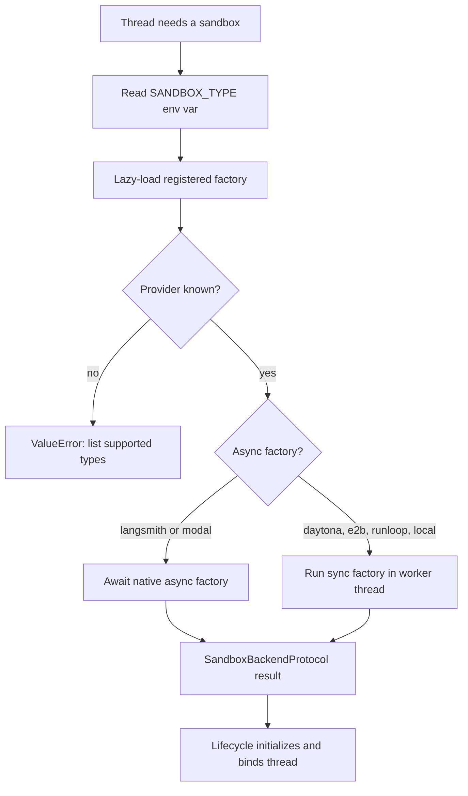

# Sandbox Providers and Backends

Open SWE runs repository work through a `SandboxBackendProtocol`. Provider selection is operational configuration rather than an agent-graph change: `create_sandbox()` resolves the active provider, while the sandbox lifecycle owns thread binding, safe reconnection, and replacement policy. See [sandbox lifecycle](../architecture/sandbox-lifecycle.md) for the broader thread lifecycle and [configuration](../operations/configuration.md) for environment variables.

## Registry and startup validation

`SANDBOX_TYPE` environment variable controls provider selection, defaulting to `langsmith`. The registry supports six providers: `langsmith`, `daytona`, `modal`, `runloop`, `e2b`, and `local`. The selected module is imported lazily when first used, so unselected provider SDKs are not loaded. An unrecognized value raises `ValueError` listing the supported types.

Every factory function accepts `sandbox_id: str | None`: when an id is supplied, the factory reconnects to that existing sandbox; when omitted, it creates a new one.



Provider factory dispatch and async/sync execution paths.

### create_sandbox forwarding

`create_sandbox()` forwards resource options—snapshot, CPU, memory, filesystem—and arbitrary create-body fields only to LangSmith; other providers receive only the id. LangSmith and Modal factories run natively async. Synchronous provider wrappers (Daytona, E2B, Runloop, Local) run through `asyncio.to_thread`, keeping blocking SDK or filesystem setup off the event loop.

```python
# Example: only langsmith honors resource options
await create_sandbox(
    snapshot_id="my-snapshot",
    vcpus=8,
    mem_bytes=32 * 1024**3,
    create_params={"_internal_runtime": "v2"},
)
# Other providers ignore snapshot_id, vcpus, and mem_bytes
# LangSmith uses all of them
```

### Startup validation

The FastAPI lifespan hook calls `validate_sandbox_startup_config()` before serving. Validation is provider-specific only for LangSmith:

- Configured resource and TTL values must parse as integers
- TTLs must be non-negative
- `SANDBOX_CREATE_EXTRA_JSON` must parse as a valid JSON object

For optional provider extras (daytona, modal, runloop, e2b), startup eagerly loads the factory so a missing dependency fails at boot rather than on first sandbox creation. Other provider credentials are checked when their factory is invoked.

## Thread binding and failure semantics

`ensure_sandbox_for_thread()` manages the sandbox lifecycle for a thread. It first consults the in-memory backend proxy and thread metadata. It either reuses the cached backend, reconnects to the saved id, or creates one from the selected environment's ready snapshot and resource/create settings (falling back to the administrator base snapshot). It configures the bot Git identity on each use.

### Distinct deletion vs. unreachability

A missing LangSmith box is deliberately distinct from an unreachable box:

- `ResourceNotFoundError` becomes `SandboxGoneError`, so the lifecycle recreates the deleted box
- Other reconnection failures become `SandboxUnreachableError` and normally stop the run rather than silently replacing the working tree with an empty sandbox
- `allow_replacement=True` permits replacement for reviewer threads because their checkout is regenerated on every review run

### Initialization ordering

The lifecycle updates thread metadata with `sandbox_id` only after creation, identity setup, and proxy work finish. It publishes the backend proxy last. Reset and recreate similarly require a distinct new id and retain the old binding until metadata persistence succeeds. This ordering prevents later work from adopting an incompletely initialized or unpersisted sandbox.

### No delete operation

The provider interface intentionally has no delete operation. A sandbox can contain the agent's only working tree, and failed metadata reads can look like no sandbox. Cleanup is instead a platform responsibility controlled by creation-time idle and delete-after-stop TTLs.

## Provider capabilities

| Provider | Create/reconnect | Credentials | Limitations |
|---|---|---|---|
| `langsmith` | Async client creates or gets a box, then wraps its synchronous form | `LANGSMITH_API_KEY`, `LANGSMITH_ENDPOINT`; snapshots, resources, TTLs, extra create fields | Only provider offering snapshot/resource forwarding; reset and environment snapshot capture are LangSmith-only |
| `daytona` | Sync: gets an id or creates from a snapshot | `DAYTONA_API_KEY`; `DAYTONA_SANDBOX_SNAPSHOT` defaults to `daytonaio/sandbox:0.6.0` | Synchronous SDK wrapper; no resource overrides |
| `modal` | Async: reattaches by id or creates in the configured app | Modal credentials; `MODAL_APP_NAME` defaults to `open-swe` | No selector-level resource or snapshot forwarding; async-native |
| `runloop` | Sync: retrieves an id or creates a devbox | `RUNLOOP_API_KEY` | Synchronous SDK wrapper; no resource overrides |
| `e2b` | Sync: connects by id or creates a sandbox | `E2B_API_KEY`; optional `E2B_TEMPLATE`; one-hour default timeout | Synchronous SDK wrapper; one-hour timeout for sandbox operations |
| `local` | Creates a host-backed `LocalShellBackend`; ignores ids | Optional `LOCAL_SANDBOX_ROOT_DIR`, defaulting to the current directory | No isolation; development only |

## LangSmith provider

### Provisioning and resources

Sandbox operations use the shared `LANGSMITH_API_KEY` and `LANGSMITH_ENDPOINT` environment variables. The integration normalizes the SDK endpoint to `/v2/sandboxes`, allowing sandbox operations to point to a distinct LangSmith workspace without separate credential variables.

New boxes use `DEFAULT_SANDBOX_SNAPSHOT_ID` when set; when absent, the create request omits `snapshot_id` so the platform's root snapshot is used. Resource defaults are:

- 4 vCPUs
- 16 GiB memory
- 128 GiB filesystem capacity
- Two-hour idle TTL
- 30-day delete-after-stop TTL

Setting either CPU or memory per call leaves the other as `None`, rather than mixing a partial override with the deployment default. Zero disables either TTL.

### Create-body options and extras

`SANDBOX_CREATE_EXTRA_JSON` supplies deployment-level JSON object fields (e.g., `{"_internal_runtime": "v2"}`). Per-environment or per-call `create_params` override conflicting fields. The implementation sends recognized SDK fields normally and wraps the SDK HTTP `POST /boxes` call to inject unsupported fields into that create request only.

Normal LangSmith creation retries up to three times for retryable status codes (408, 409, 425, 429, 500, 502, 503, 504, 529) and transient creation error classes (`ResourceCreationError`, `SandboxAPIError`, `SandboxConnectionError`, `SandboxNotReadyError`).

### Execution and timeouts

`TimeoutLangSmithSandbox` adapts the synchronous LangSmith object to async agent work. With an effective command timeout, it:

1. Starts a non-blocking command via WebSocket
2. Waits for the command timeout plus `SANDBOX_EXECUTE_CLIENT_GRACE_SECONDS` (30 seconds by default)
3. Converts the result to `ExecuteResponse`

A server `CommandTimeoutError` returns exit code 124 without a kill. Expiry of the client deadline triggers a best-effort kill and returns exit code 124. WebSocket setup or supported midstream failures fall back to the base HTTP-capable `aexecute()` path. With no effective timeout, it delegates directly to that base path.

### Command execution retries

Only `SandboxRetryableConnectionError` is retried for command execution: it denotes a rejected WebSocket upgrade before the execute frame was sent, making a retry safe from double execution. Retries are capped at four attempts with jittered exponential backoff.

### GitHub credentials and proxy configuration

For LangSmith thread creation and reuse, the lifecycle mints a GitHub App installation token at runtime and configures proxy rules. The proxy injects:

- Basic authentication for `github.com` and `*.github.com`
- Bearer authentication plus a placeholder `GH_TOKEN` for `api.github.com`

The real GitHub token is not written into the sandbox. A not-ready proxy update starts the box best-effort and retries. Proxy configuration also preserves caller-provided rules, can inject connected user LangSmith credentials for HTTPS endpoints, and can add a supported Stagehand model rule.

Non-LangSmith providers skip this integration entirely.

### Environment snapshot capture and reset

Environment snapshot capture and `reset_sandbox_for_thread()` require `SANDBOX_TYPE=langsmith`. Reset creates from an unfiltered create-body object, accepts SDK-supported and injected fields, reconfigures credentials and Git identity, and atomically hands the thread to the new id only after metadata persists.

## Other providers

### Daytona

Daytona requires `DAYTONA_API_KEY` and defaults `DAYTONA_SANDBOX_SNAPSHOT` to `daytonaio/sandbox:0.6.0`. The factory reconnects by id or creates from a snapshot. No selector-level resource or snapshot forwarding.

### Modal

Modal uses the configured `MODAL_APP_NAME` (defaulting to `open-swe`) and operates natively async. The factory reconnects by id or creates in the app. No selector-level resource or snapshot forwarding.

### Runloop

Runloop requires `RUNLOOP_API_KEY`. The factory reconnects by id or creates a new devbox. No resource overrides.

### E2B

E2B requires `E2B_API_KEY` with an optional `E2B_TEMPLATE` and enforces a one-hour default timeout (`DEFAULT_E2B_SANDBOX_TIMEOUT`). The factory reconnects by id or creates with the template if supplied. No resource overrides.

## Local and desktop exceptions

### Local provider

`local` executes directly on the host and must be used only for local development with human oversight. It:

- Creates the root directory if absent
- Constructs an environment without selected model, LangSmith, and OAuth broker secrets
- Uses `inherit_env=False` to isolate from the host environment
- Excludes credential variables: `ANTHROPIC_API_KEY`, `LANGSMITH_API_KEY`, and others

Unless the operator explicitly provides `GIT_CONFIG_GLOBAL`, it writes a root-local `.gitconfig-sandbox` that includes the host configuration. This preserves aliases and helpers while preventing bot identity writes from overwriting `~/.gitconfig`.

### Desktop backend

Desktop runs compose read-only bundled and user skill routes plus separate artifact routes. `ReadOnlyBackend` delegates only async read operations and rejects synchronous calls, ensuring the desktop cannot mutate a sandbox's working tree.

## Extension points

Adding a provider requires a `create_<name>_sandbox(sandbox_id: str | None = None)` factory that returns `SandboxBackendProtocol` and a corresponding `(module, function)` registry entry; a factory may be synchronous or asynchronous. The factory receives the optional existing sandbox id for reconnection. If the id is supplied, the factory connects to that existing sandbox; when absent, it creates a new one. Registry validation runs at server startup to fail fast on missing dependencies.

## Repository preparation

Reviewer preparation clone-or-fetches and verifies the PR head before agent work, while trusted skills are extracted from the base SHA rather than the author-controlled PR head; preparation failure returns `False` so review can continue from diff context. This prevents a PR author from injecting instructions into the reviewer prompt by adding or editing a `SKILL.md` file.
