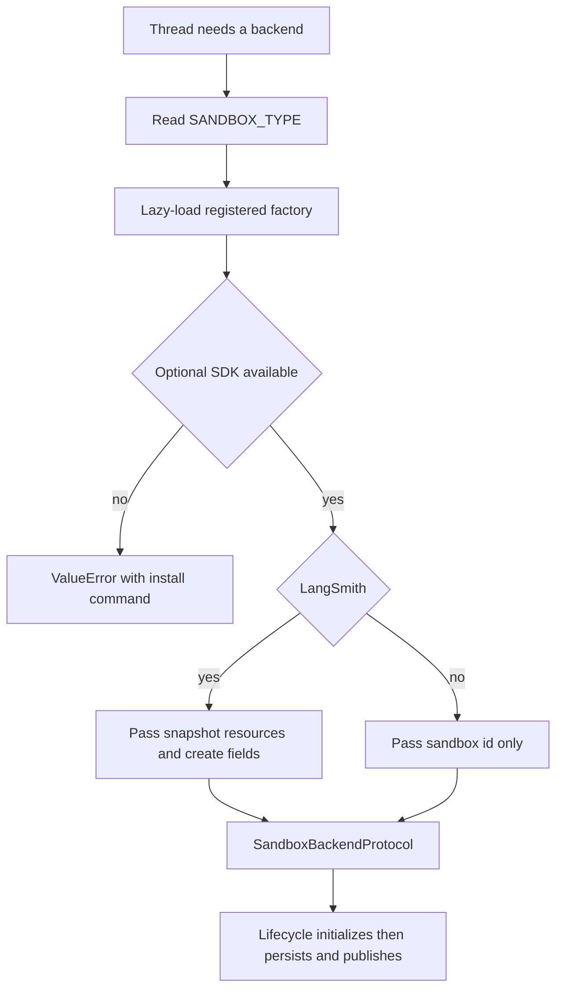
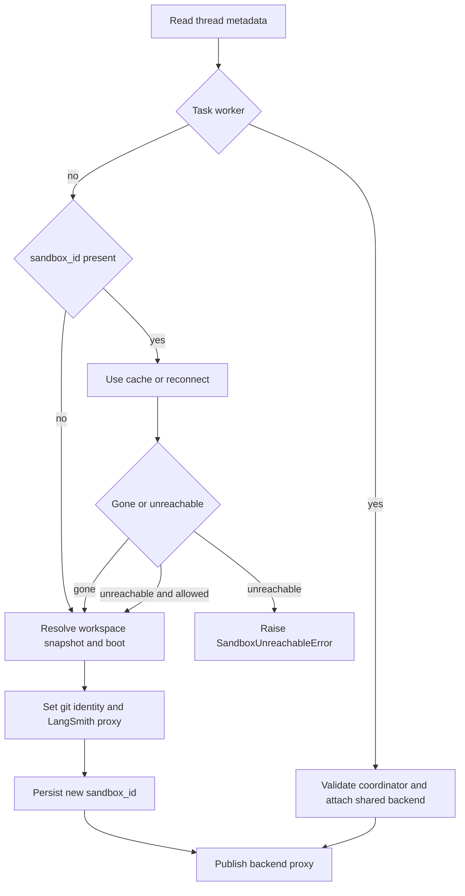

# Sandbox Providers and External Execution

Open SWE executes repository commands through `SandboxBackendProtocol`. Provider choice is deployment configuration, not an agent-graph decision: the registry constructs a backend, while the [sandbox lifecycle](../architecture/sandbox-lifecycle.md) owns thread metadata, initialization, and publishing. This page describes the provider boundary; see [configuration](../operations/configuration.md) for the full environment-variable reference and [deployment](../operations/deployment.md) for deployment concerns.

## Selection, dependencies, and startup

`SANDBOX_TYPE` defaults to `langsmith`. The registry lazily resolves one of `langsmith`, `daytona`, `modal`, `runloop`, `e2b`, or `local`; an invalid value raises a `ValueError` naming the supported choices. Lazy imports keep unused SDKs out of the normal process.

LangSmith and Local are base dependencies. Daytona, Modal, Runloop, and E2B are optional dependency groups in `pyproject.toml`: install one with `uv sync --extra sandbox-<provider>`, or all with `uv sync --extra sandbox-providers`. If the selected provider's own SDK is missing, the registry converts that `ModuleNotFoundError` into an install hint; unrelated import failures are allowed to propagate. Startup eagerly checks this dependency boundary for an optional selected provider, so a missing extra fails before the first sandbox request.

All factories accept `sandbox_id: str | None`: an id means reconnect and no id means create. `create_sandbox()` passes snapshot, sizing, and arbitrary create-body parameters only to LangSmith. It awaits native asynchronous LangSmith and Modal factories, and runs Daytona, Runloop, E2B, and Local factories in `asyncio.to_thread` so their synchronous SDK or filesystem setup does not block the event loop.

Provider selection and the boundary between provider construction and thread binding.

The FastAPI lifespan invokes `validate_sandbox_startup_config()` before serving. For LangSmith, it validates that configured capacity and TTL variables are integers, rejects negative TTLs, and checks that `SANDBOX_CREATE_EXTRA_JSON` is a JSON object. Other provider credentials are checked when their factory is called.

## Provider comparison

| Provider | Create or reconnect | Configuration and package boundary | Operational boundary |
|---|---|---|---|
| `langsmith` | Asynchronously gets an existing box or creates a new one, returning `TimeoutLangSmithSandbox`. | Base dependency; `LANGSMITH_API_KEY`, `LANGSMITH_ENDPOINT`, snapshot/resource/TTL settings, and create-body fields. | The only provider receiving registry snapshot/resource parameters; supports managed proxy configuration, workspace snapshots, stop-on-recreation, and workspace service URLs. |
| `local` | Builds a new `LocalShellBackend`; ignores ids. | Base dependency; optional `LOCAL_SANDBOX_ROOT_DIR` and `GIT_CONFIG_GLOBAL`. | Commands run on the host without isolation—local development with human oversight only. |
| `daytona` | Gets an id or creates from a Daytona snapshot. | `sandbox-daytona`; requires `DAYTONA_API_KEY`; `DAYTONA_SANDBOX_SNAPSHOT` defaults to `daytonaio/sandbox:0.6.0`. | Synchronous wrapper. |
| `modal` | Reattaches with `Sandbox.from_id.aio()` or creates in an app. | `sandbox-modal`; Modal authentication; `MODAL_APP_NAME` defaults to `open-swe`. | Native async wrapper. |
| `runloop` | Retrieves an existing devbox or creates one. | `sandbox-runloop`; requires `RUNLOOP_API_KEY`. | Synchronous wrapper. |
| `e2b` | Connects to an id or creates a sandbox, optionally from a template. | `sandbox-e2b`; requires `E2B_API_KEY`; optional `E2B_TEMPLATE`. | Uses a one-hour SDK timeout and a synchronous wrapper. |

The common factory shape makes basic creation portable, but it does **not** make advanced lifecycle capabilities portable. In particular, snapshots, proxy credential injection, and stopping an old sandbox during recreation are implemented against LangSmith. A recreation with another provider still creates and binds a distinct new backend, but reports that stopping the old provider backend is unsupported.

## Thread binding protects working state

A thread can have an in-memory connection and a persisted `sandbox_id`. `ensure_sandbox_for_thread()` reuses the cached backend when available, otherwise reconnects using that id, or creates a new backend when none is bound. A task worker is different: it verifies ownership, workspace, visibility, and repository scope against its coordinator and attaches to the coordinator's sandbox instead of creating or replacing one.

Thread recovery distinguishes deleted state from unreachable state before it changes a binding.

For LangSmith, `ResourceNotFoundError` reconnect failures become `SandboxGoneError`; a deleted backend is recreated because it has no remaining working tree. Other connection or proxy-refresh failures become `SandboxUnreachableError` and normally fail the run rather than silently replacing uncommitted work. Reviewer and review-scout callers opt into replacement because they regenerate their checkout on every run.

A new backend is initialized before its id is persisted, and is published to the in-memory proxy only after persistence, handoff, and tool URL provisioning. Thus a failed creation or metadata update does not leave later work adopting a half-initialized backend. Recreation similarly refuses a non-distinct id and keeps the old cached binding if metadata persistence fails. The provider abstraction deliberately has no delete operation: platform TTLs, rather than a metadata-driven delete, reclaim working-tree-bearing boxes.

## LangSmith provisioning, snapshots, and proxy behavior

LangSmith uses `LANGSMITH_API_KEY` and `LANGSMITH_ENDPOINT`; the provider turns an API root into the SDK sandbox base ending in `/v2/sandboxes`. New boxes omit `snapshot_id` when none is supplied, which selects the platform root snapshot. Default capacity is 4 vCPUs, 16 GiB memory, and 128 GiB filesystem; default idle and delete-after-stop TTLs are two hours and 30 days. A partial CPU or memory override deliberately leaves the other value unset rather than combining it with the default; `0` disables either TTL.

Workspace resolution supplies a ready workspace snapshot and workspace resource settings when available, otherwise a base/root snapshot. It also adds `preserve_memory_on_stop: true` to provider create parameters. Snapshot capture itself is LangSmith-specific: it captures under a mutable `name:latest` tag and only updates the workspace record after capture succeeds.

`SANDBOX_CREATE_EXTRA_JSON` provides deployment-wide extra create fields; call-specific `create_params` win on conflicts. Because the SDK lacks a public arbitrary-field seam, the integration temporarily wraps its HTTP client so extra fields are injected only into `POST .../boxes`, not subsequent requests. Retryable creation errors receive up to three attempts. This is an intentional SDK integration boundary worth revisiting when the client exposes a public payload API.

For each new or reused LangSmith thread backend, the lifecycle obtains a repository-scoped GitHub access token and configures the sandbox proxy. It injects Bearer authentication for `api.github.com` and Basic authentication for `github.com` and `*.github.com`; `GH_TOKEN` inside the sandbox is only the `proxy-injected` placeholder, not the real token. Custom proxy rules are preserved except retired managed rules, and a not-ready proxy update starts the stopped sandbox best-effort before retrying. Non-LangSmith providers do not receive this proxy refresh.

LangSmith can also expose a sandbox port as a workspace-authenticated service URL. The `expose_port` tool validates ports, requests that URL for the current backend, and rejects the result if the backend changed during the request.

## LangSmith execution semantics

`TimeoutLangSmithSandbox` is async-only. For commands with an effective timeout it opens a nonblocking command handle, waits for the command timeout plus `SANDBOX_EXECUTE_CLIENT_GRACE_SECONDS` (30 seconds by default), and returns an exit-124 response on either server-side timeout or a client deadline. Client expiry best-effort kills and drains the handle; cancellation does the same. WebSocket connection, reload, and selected stream failures fall back to the base execution path. If command state is lost while collecting a result, it raises rather than replaying a command whose effects are unknown.

Automatic command retry is narrower still: only `SandboxRetryableConnectionError` qualifies, because it represents a rejected WebSocket upgrade before the execute frame was sent. Retries use jittered exponential backoff and default to four attempts, avoiding double execution of repository mutations.

## Local execution safety

The Local provider creates its root directory (defaulting to the process working directory) and runs a `LocalShellBackend` with `inherit_env=False`. It starts from the host environment but removes selected model and LangSmith credentials. Unless `GIT_CONFIG_GLOBAL` is explicitly configured, it writes `.gitconfig-sandbox` under the local root and points Git there; that file includes the host configuration so helpers and aliases remain available while Open SWE's bot identity does not overwrite `~/.gitconfig`.

This isolation is credential and Git-config hygiene, not a security sandbox. Local commands can affect the host filesystem and should not be used as an untrusted multi-user execution environment.

## Reviewer checkout exception

Reviewer sandboxes are reusable, but their repository contents are intentionally re-derived. `prepare_review_repo()` clone-or-fetches using a blobless clone, fetches the base and target head (and the pull ref for fork PRs), force-checks out the requested head, and verifies `HEAD`, with a 240-second command timeout. On failure it returns `False` so review can continue from fetched diff context rather than failing solely because checkout preparation failed.

Trusted skills are a separate safety boundary: `.agents/skills` and `.claude/skills` are extracted from the PR base reference into a sibling `.review-skills` path, never from the author-controlled PR head.

## Adding or operating a provider

To add a provider, implement `create_<name>_sandbox(sandbox_id: str | None = None)` that reconnects or creates and returns a `SandboxBackendProtocol`, then register its module and callable in `SANDBOX_FACTORIES`. Factories may be synchronous or asynchronous. If its SDK is optional, add a `sandbox-<name>` extra and teach the registry which missing SDK module should produce the operator-facing install hint.

Do not treat the factory contract as a promise of feature parity. Decide and test how the provider handles reconnect failures, git identity, workspace boot images, replacement, reset/recreation, proxy egress credentials, and cleanup. Preserve the key safety invariant: an unreachable sandbox with possible uncommitted work must not become an empty replacement by accident.

## Focused verification

- `tests/sandbox/test_optional_provider_extras.py` verifies dependency-group install hints and propagation of unrelated import errors.
- `tests/sandbox/test_langsmith_sandbox_config.py` covers create payload injection, retry, missing-box classification, snapshot tagging, and service URL requests.
- `tests/sandbox/test_langsmith_sandbox_timeout.py` covers deadline handling, kill-on-cancellation, fallback, unknown command outcome, file behavior, and retry safety.
- `tests/sandbox/test_sandbox_publish_ordering.py`, `test_sandbox_recovery.py`, and `test_sandbox_recreation.py` cover binding and handoff ordering, recovery policy, and preservation of the old binding on persistence failure.
