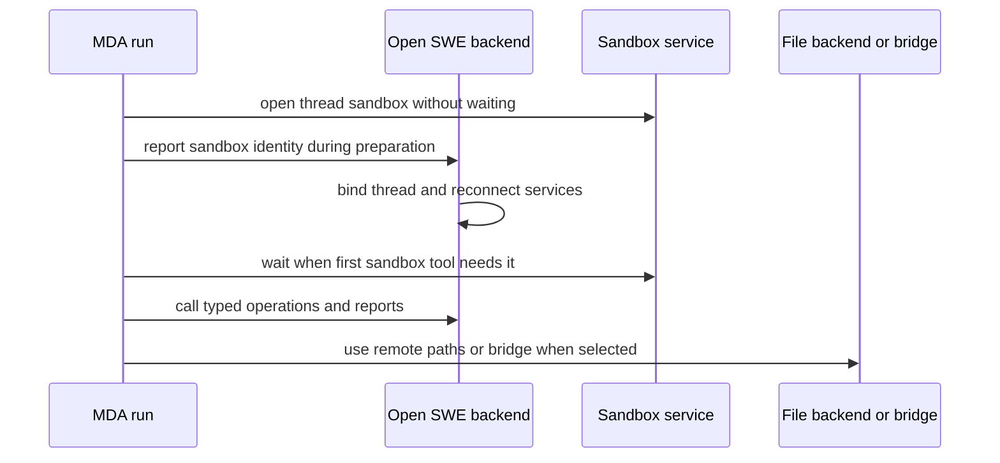

## Ownership and boundaries

Managed Deep Agents (MDA) owns the agent loop, checkpoints, tool calls, and the sandbox lifecycle for MDA-managed threads. The Open SWE backend is a stateless typed-API peer: it plans the run catalog, retains application data and credentials, and reconnects a thread to the sandbox MDA has opened. It does **not** create or replace an MDA-owned sandbox.

A catalog selects either a `SandboxSpec` or no MDA sandbox. MDA declares a single selectable sandbox definition for the shared graph, while the run catalog supplies create options, an optional existing sandbox ID, and the thread whose sandbox is used. MDA retains one sandbox per thread even if later catalog options change; those options affect creation only. Task workers may share their coordinator's MDA sandbox after the backend verifies that relationship. A bridged thread instead runs against its owner's machine, and an older backend-held sandbox may continue to be used until it is gone.

This shows the run choosing its file execution location while the backend binds and services the sandbox MDA owns.

## MDA sandbox lifecycle

Before preparation, MDA opens or adopts the selected sandbox without waiting for it to boot, reports its ID to the backend, and starts booting in parallel with preparation and the first model call. The first sandbox-dependent file or shell tool waits for readiness. Opening retries transient service, network, timeout, and schedulability failures for up to 90 seconds; non-transient errors are reported with a secret-redacted cause. If a bound sandbox is missing, MDA replaces it and marks the workspace as lost. A sandbox that is merely unreachable is not silently replaced, because it can contain the only uncommitted working tree.

`recreate_sandbox` is handled by MDA middleware only for an MDA-managed sandbox. The tool result must carry valid replacement create options; MDA replaces the sandbox, notifies `SANDBOX_REPLACED` so the backend reconnects its thread services, restarts setup against the new handle, and returns the old/new IDs plus best-effort old-stop status. Backend lifecycle code can hand over an eligible *older* cloud sandbox by clearing the binding and recording the next-create request; the next MDA run then opens its own sandbox. It refuses this handover for MDA-owned, bridged, absent, or task-worker shared sandboxes.

The backend keeps stable per-thread backend proxies to reconnect an existing provider or bridge on any replica. The proxy can detach when metadata points at a different sandbox and serializes reconnect startup. Provider connection failures become `SandboxUnreachableError`; their semantics deliberately preserve the working tree rather than substituting a fresh environment.

### GitHub proxy configuration and refresh

Sandbox proxy configuration is split by ownership:

- With no `SandboxSpec.github_proxy`, the backend writes proxy configuration while connecting an MDA-owned sandbox, including a GitHub App token scoped to the thread or a narrower review scope. It records expiry, repository and permission scope so refresh cannot broaden access. A known expiry is refreshed within five minutes; an unknown expiry falls back to 50 minutes.
- With `github_proxy`, MDA obtains the backend's credential-free proxy portion through `sandbox_proxy`, reads the designated MDA connection immediately before writing, and combines its GitHub rules with backend rules. It writes before preparation, refreshes before model and tool calls when due (normally every five minutes), and requests fresh backend rules after a replacement. If the backend refuses that endpoint, it owns the write instead.

The initial MDA-owned write retries while an idle host may be suspending, for up to three minutes; permanent connection/not-found failures or exhausted retries end the run because neither side can safely assume the workspace's egress rules are installed. Routine later refresh failures are logged and retried, leaving the last configuration in place. Tokens and credentials are read at the point of use, never placed in general model-visible context.

## File and shell execution

`FileToolsMiddleware` exposes the normal deep-agent file surface (`ls`, `read_file`, `write_file`, `edit_file`, `delete`, `glob`, `grep`, and `execute`) but routes each request according to the catalog:

1. A path under a skill source is served by the runtime's read-only skill tools.
2. A path explicitly designated as a backend path uses `RemoteFiles` even when a sandbox exists.
3. A run without an MDA sandbox uses `RemoteFiles` for its thread files—for example, a bridged thread whose worktree is on a person's machine.
4. Other calls use the MDA sandbox.

`RemoteFiles` adapts typed backend file endpoints into the deepagents sandbox protocol, including file transfer, search, edits, and asynchronous command execution. It supplies the current run ID on every call. Large tool results live under the run's backend artifacts root; this keeps results out of the root of a bridged machine while retaining a file-tool view of them.

The same middleware applies its safety and observability behavior whichever route executes the call. It reports calls to the transcript, optionally reads applicable `AGENTS.md` instructions and validates image reads, converts tool errors into model-actionable results, and records potentially checkout-changing activity for git evidence. Commands that could push or manipulate pull requests are sent to the backend `check_shell` guards before execution. Sandboxes that reject a call before it starts are retried with short jittered backoff; an unanswered `execute` receives its configured timeout plus 30 seconds and becomes an error result.

### Local bridge behavior

`BridgeSandboxBackend` is the alternate sandbox protocol implementation for a user's machine. It authorizes every operation against the bridge owner, subscribes before queuing a request to avoid a notification race, and long-polls for `execute`, upload, or download results. Its liveness check re-reads state every 15 seconds, so a disconnected machine fails promptly rather than consuming the full command timeout. A bridge is never replaced by this connection path; a disconnected bridge yields an unreachable-sandbox error.

The backend's `/sandbox-tools` router no longer offers general list, search, or invocation endpoints: those routes return HTTP 410 and direct callers to direct tools or `search_tools` from `eval`. Its remaining callback routes are capability-authenticated, set `no-store` and `no-referrer`, and currently accept background-task completion/heartbeats and monitor sync notifications. Authorization and ownership checks distinguish rejected callbacks from unknown resources.

## MCP tool sources and execution

Open SWE supports two materially different MCP paths.

| Source | Discovery and invocation owner | Credential handling |
| --- | --- | --- |
| Backend-held MCP connection | Backend discovers, caches, wraps, and invokes the server tool | Encrypted headers or OAuth remain backend-side |
| MDA connection-backed MCP server | Backend supplies a catalog `McpServerSpec`; MDA discovers and invokes at run time | MDA reads a per-run connection directly and sends it only to that server |

The backend combines instance, workspace, user, and (when applicable) managed-gateway sources in precedence order; a later connection with the same name replaces an earlier one. It only includes enabled connections that offer tools. Backend-held discovery uses a 10-minute fresh cache and may serve cached data up to 24 hours while refreshing; managed 404/method-not-found failures are briefly backed off. Tool names are made deterministic and safe (`mcp_<connection>_<tool>`, with a hash when necessary), and invocation rechecks authorization, connection identity/revision-relevant fields, enabled status, and the allowed-tool list. A changed scope, URL, transport, or allowlist requires a new run rather than silently using changed authority.

A connection-backed server cannot be discovered by the backend because only MDA may read its connection. Instead, the backend validates its declared allowlist and emits `McpServerSpec`; MDA loads those tools once per run after ordinary tool specs are ready. It reads each connection individually, so an authorization-required connection can prompt for that connection without preventing other servers from being listed. It lists the remote tools concurrently, retains only catalog-allowed names, omits tools with a `runtime` argument, resolves output-name collisions by skipping later tools, and offers the resulting tools alongside operations. MCP tools may be direct model tools or code-only according to the catalog, but MDA-connected tools are not searched by the backend's `search_tools` facility.

For every connection-backed call, MDA reads the credential again, builds a fresh FastMCP client, and invokes the selected definition with the caller's arguments. Server-reported tool errors become tool error messages; connection, transport, or unexpected call failures are logged without request material and return a generic connection-and-credentials message. LangChain-reserved argument names are forwarded by calling the remote coroutine directly; `runtime` itself is rejected at discovery because it is reserved for the local tool runtime.

### MCP security invariants

MCP records accept HTTPS URLs only: no URL credentials, fragments, or secret-looking query parameters. Both backend and MDA MCP transports disable environment proxy trust and redirects, require every request to remain on the configured HTTPS origin, resolve the host to public addresses, and pin the connection to a checked address while preserving SNI and `Host`. This prevents redirects, private-address SSRF, and DNS rebinding from receiving credentials.

Connection-backed MCP configuration may name only an MDA connection made for MCP servers, and it cannot also retain backend headers, OAuth, or encrypted secret fields. The backend only emits a runtime server when the connection owner matches the source tier: deployment-owned for instance/workspace sources and person-owned for user sources. A personal server is excluded unless the run actually acts for and is attributed to that person; service-principal runs therefore cannot grant or consume a person's connection. These checks preserve the broader invariant that credentialed integrations are granted per run and credentials are not embedded in general model-visible context.

## Operations and focused tests

When changing this area, keep the MDA/backend ownership boundary explicit: lifecycle APIs reconnect, bind, guard, or report an MDA sandbox; they must not become a second sandbox creator. Preserve the proxy writer's replacement reset and scope narrowing, and treat an unreachable workspace differently from a confirmed missing MDA binding.

Focused coverage includes MDA MCP tests for public-origin enforcement, absence of a personal principal, forbidden agent credentials, and reserved LangChain argument forwarding. Sandbox tests cover handover eligibility and shared-worker refusal, proxy payload preservation/retry behavior, replacement/recovery, provider configuration, bridge behavior, and state reconnection. These tests are useful regression targets when modifying lifecycle, proxy, bridge, or tool-routing behavior.
