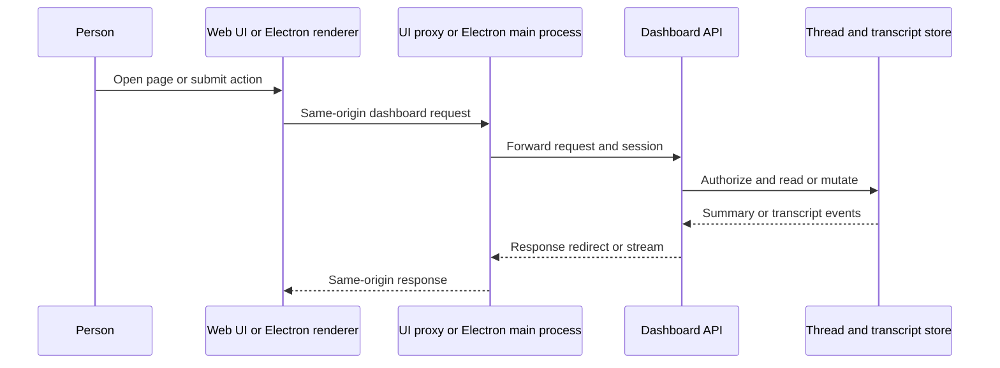

# Dashboard, Desktop, CLI, and Conversation Surfaces

Open SWE has several entry surfaces, but they do not create separate agent worlds. The dashboard API is the authenticated product boundary; the web UI and Electron app present it, `oswe` binds a cloud thread to a local directory, the sandbox-only OpenAI Responses API projects guest-thread activity into a Responses-shaped protocol, and `/oswe/mcp` exposes the signed-in person's available Open SWE tools. Slack, GitHub, and Linear webhook flows likewise create or continue threads with source metadata. Thread metadata and the transcript are the common record across these surfaces.

This page describes those user-facing transport and ownership boundaries, not the Managed Deep Agents runtime that executes a run after one is dispatched. In particular, a local bridge is not a local agent runtime: it is a queue-backed remote-sandbox implementation that carries selected filesystem and shell operations back to the initiating machine.

## Dashboard API and web UI

`create_app()` composes the FastAPI service: it enables credentialed CORS only for configured dashboard origins plus `open-swe://app`, rejects `*` with credentials, adds audit, thread-routing, gzip, trace, and request-ID middleware, and mounts the dashboard router under `/dashboard/api`. That router applies the same-origin mutation dependency to all of its child APIs, including auth, threads, transcript, bridge, settings, integrations, and UI invalidation routes. The application also mounts webhook routers separately, mounts the MCP app when configured, and finally serves the dashboard build.

The React 19/TanStack Start UI is a separate `ui/` build. In production it fronts backend-owned routes including `/dashboard/api`, `/webhooks`, `/oswe`, and OAuth discovery paths; development proxies the same paths to `DASHBOARD_API_URL` or localhost. A deployment must set `DASHBOARD_API_URL`: the server reads it per request rather than baking a backend into the build.

The production proxy streams the upstream body rather than buffering it, retains manual redirects so browser-visible OAuth redirects remain redirects, and forwards client headers/body after removing hop-by-hop headers. It removes stale encoding and length response headers, and emits each upstream `Set-Cookie` as a distinct header. This is essential both for dashboard session continuity and streamed event consumers.

Diagram: browser and Electron traffic reaches the backend through a UI-facing proxy, while thread state and transcript events remain backend-owned.

### Login and transcript reads

Dashboard login uses a GitHub App authorization flow. Normal browser callbacks verify the state nonce cookie, exchange the code, resolve the GitHub account, enforce the login gate, store the access-token data, and issue the signed dashboard session cookie. Desktop login instead returns a PKCE-challenge-bound loopback handoff code and leaves no browser session behind; the desktop app exchanges that code with its verifier for a session. This lets the user's browser authenticate the app without making a browser cookie the desktop credential.

When PostgreSQL is available, dashboard-created threads are stamped for transcript recording and get a `ThreadCreated` event whose metadata is mirrored from the thread record. The transcript APIs authorize against that mirror in the same repeatable-read snapshot used for the read. Their stream subscribes before replay, emits a synchronization marker and heartbeats, and rechecks access while live: deletion or a later access revocation terminates the stream explicitly rather than continuing to disclose events.

## Desktop: packaged UI, authenticated proxy, and This Mac bridges

The experimental Electron client ships the compiled UI at `open-swe://app`; it asks for a compatible backend URL rather than hosting a dashboard. The Electron main process proxies only trusted renderer `/dashboard/api` requests to that backend, substitutes cookies from Electron's cookie store, sets the app origin, follows neither redirects nor a renderer-supplied backend, and stores returned cookies. The renderer therefore does not receive server-side credentials or directly address raw LangGraph routes. Packaged builds have no maintainer-hosted default; a deployment change clears the old local session data. Backend URL resolution is command line, then `OPEN_SWE_BACKEND_URL`, saved configuration, then the local development default.

Selecting **This Mac** still creates an ordinary cloud thread on the configured backend. What changes is its sandbox binding: desktop opens a `client: "desktop"` bridge for the thread's checkout and serves it until the app quits. It retains the bridge ID in local state, so reopening a disconnected bridge keeps the same thread-to-machine binding. The local bridge uses the shared `open-swe-bridge-client`; it can execute commands and file transfers and supplies desktop-only handlers such as worktree handoff. If a bridge stops, the next use can reopen it, but a run started while it is unavailable reports the machine as offline.

A local thread can use the current checkout or a desktop-managed worktree. A new worktree begins from the selected base branch on an `open-swe/local-<id>` placeholder branch; deleting the thread removes that worktree. The desktop protects a checkout from concurrent agent use and refuses unsafe branch changes. Its changes view is based on the session-start git snapshot, and its terminal and file browser point to that same checkout.

## CLI: cloud run, local authority

`oswe run` starts a cloud Open SWE thread but makes the current directory on the invoking machine its sandbox. This is intentionally not a containment boundary: commands run as the invoking user and can read, write, and delete what that user can. The child environment removes variable names ending in `_API_KEY`, `_TOKEN`, `_SECRET`, or `PASSWORD` except `GITHUB_TOKEN` and `GH_TOKEN`; it also disables interactive git prompts, caps command output at 1 MiB, and terminates commands after 300 seconds.

The CLI authenticates in precedence order with `OPEN_SWE_API_KEY`, GitHub Actions OIDC, or a person session from `OPEN_SWE_SESSION` or `oswe login`. API-key and Actions invocations make `system` threads; a personal invocation makes a private thread because anyone allowed to prompt it can operate the local machine. `oswe login --backend …` uses the desktop-compatible browser/loopback PKCE flow and stores the resulting session by backend origin in `~/.open-swe/config.json` with mode 0600. The CLI does not autoload a repository `.env`.

For a run, the CLI registers a bridge for its current directory, remembers the thread-to-bridge mapping for `--thread`, detects `origin` when possible, and starts/follows the remote run. It prints the agent's `cli_result.stdout` on stdout and uses its exit code; diagnostics and dashboard links go to stderr. A failed run or missing result exits 1; one Ctrl-C cancels the coordinator and workers, closes the bridge, and exits 130. Stream interruption is retried with exponential backoff, resetting the retry budget after a stream has remained open for a minute; task following waits for workers and follows later coordinator runs, so an early result is not final while work remains.

## The local sandbox bridge contract

Both desktop and CLI are clients of the same backend bridge protocol. A client registers `root_path`, host, label, client kind, and optionally a previous bridge ID; it heartbeats, long-polls for requests, reports either exactly one result or error, and closes the bridge. Bridge routes scope every operation to the authenticated principal's sender ID and return 404 for a bridge the caller does not own. PostgreSQL is required.

On the agent side, `BridgeSandboxBackend` maps sandbox operations onto `execute`, `upload_files`, and `download_files` queue round trips (and desktop can perform `worktree_handoff`). It refuses a dead bridge and checks on every operation that the run's sender owns the bridge, so a readable/shared thread cannot be used to run commands on another person's machine. The store persists requests through `pending → claimed → done | failed`; `FOR UPDATE SKIP LOCKED` prevents duplicate claims and conditional completion gives at-most-once settlement. Reopening an inactive owned bridge requeues unanswered claims, while reopening a bridge still heartbeating is rejected to avoid two clients executing each other's work. Stale heartbeats close the bridge and fail waiters rather than leaving agent calls indefinitely blocked.

## OpenAI Responses for sandbox programs

The OpenAI-compatible API is mounted at the sandbox tool-access path, not as a general dashboard or public OpenAI endpoint. A caller authenticates as a program inside a sandbox using the tool-access token (or an allowed bearer token), and the workspace must enable `sandbox_openai_enabled`. `GET /models`, `POST /responses`, response retrieval, and cancellation then operate on guest threads owned by the host thread.

A new response creates a guest dashboard thread with the host thread's owner, repository context, visibility, workspace, sandbox ID, and proxy configuration; continuation IDs are accepted only when their thread metadata names the same host thread. A transaction-scoped advisory lock enforces at most five active guest threads per host. Client-declared tools are recorded for projection, but the agent's tools execute in the sandbox and return as already-executed `mcp_call` items—the API client never executes those tools itself.

Synchronous calls wait for the transcript-derived projection, background calls return a queued response, and streaming calls return SSE. The stream replays from the run boundary, listens for transcript updates, emits a heartbeat every 15 seconds, and checks the run state to abandon a response if the run ends without a terminal transcript event. Cancellation delegates to the corresponding LangGraph run.

## Remote MCP server

When GitHub App OAuth credentials and the token-encryption key are configured (or development login is enabled), the application mounts a stateless FastMCP HTTP server at `/oswe/mcp`, plus OAuth discovery and sign-in routes. It authenticates each request as a GitHub identity and constructs that person's `ToolCaller` for each tool listing or invocation. The catalog consequently reflects that user's administrative authority and integration MCPs rather than a global server catalog; a missing identity or permission failure is returned to the MCP client. Tool output is serialized as text and tool failures are represented as MCP error results.

## One thread model across chat and webhook surfaces

The dashboard, CLI, desktop, and sandbox Responses API all resolve activity through backend threads. Transcript storage is a read model for those threads; surface-specific metadata such as source, owner, repository, workspace, visibility, and source context keeps the initiating context available to dashboard and policy code.

Slack breakout creation stamps `source: "slack"`, Slack thread/source context, workspace, title, visibility, owner fields, and repository metadata before dispatching an agent run; it stores the Slack run mapping and returns both dashboard and Slack URLs. Linear issue processing derives a stable live thread for the issue, stamps `source: "linear"` and Linear issue context, maps the triggering email to a GitHub login when possible, and constructs system/user input messages before dispatch. GitHub webhooks verify GitHub's signature, record delivery references, require repository routing where applicable, and schedule supported issue, comment, PR, CI, review, or automation work rather than treating the webhook transport as a separate conversation store.

## Verification focus

The UI proxy unit tests specifically protect streamed chunk delivery and header framing behavior. Dashboard tests exercise session creation defaults and repository authorization, while desktop handoff tests verify that a loopback PKCE code cannot attach an integration to the wrong app session or provider. The Playwright E2E harness uses the real UI, backend webhook route, thread/run dispatch, and Electron UI while faking external Slack, GitHub, and LLM boundaries; its main flow validates Slack request to agent work to PR and reply in the same Slack thread.

## Related

- [Architecture overview](../architecture/overview.md)
- [Security and tenancy](../concepts/security-and-tenancy.md)
- [GitHub and MCP](github-and-mcp.md)
- [Local development and deployment](../operations/local-development-and-deployment.md)
- [Invocation and thread routing](../workflows/invocation-and-thread-routing.md)
