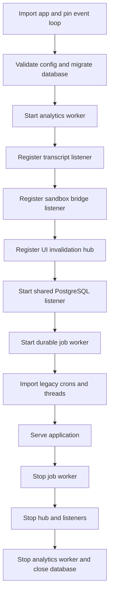
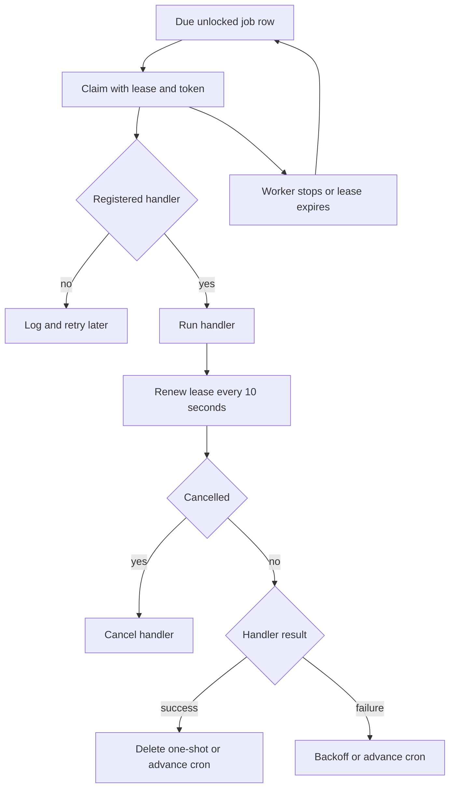
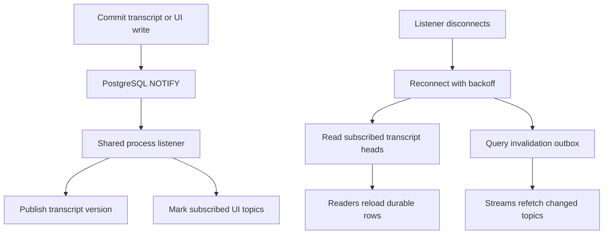
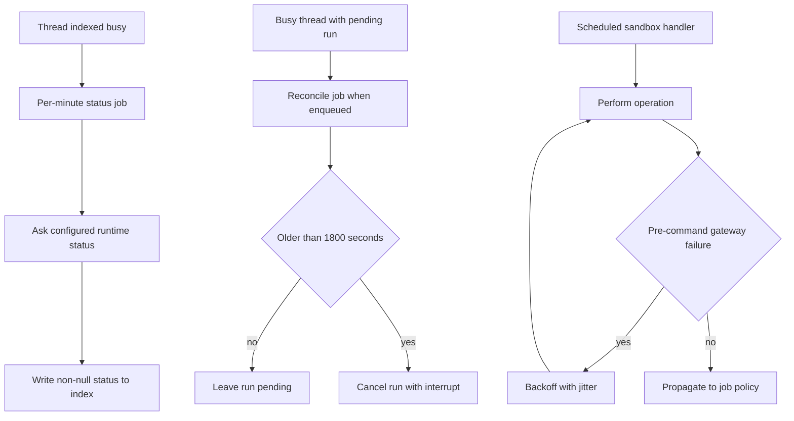

# Workers, reconciliation, and operational recovery

Open SWE runs several process-lifetime components inside the FastAPI lifespan. They have deliberately different durability boundaries:

- The **job worker** executes durable rows in the PostgreSQL `job` queue. It is the mechanism for timers and background work that must survive a web process restart.
- The **analytics worker** drains a separate durable analytics outbox, updates summaries, and periodically enforces retention.
- The shared PostgreSQL **LISTEN/NOTIFY listener** is a low-latency fan-out mechanism for live transcript readers and UI invalidation streams. It is not the durable record; both consumers have a catch-up path.
- **Reconciliation** asks the runtime for authoritative status when completion delivery was missed. It is a safety net, not the normal completion path.

This page focuses on the operational behavior of those components. For sandbox provisioning and lifecycle detail, see [sandbox lifecycle](../architecture/sandbox-lifecycle.md); for the runtime/transcript model, see [thread runtime and transcript](../architecture/thread-runtime-and-transcript.md); and for environment and database prerequisites, see [configuration](configuration.md).

## Process startup and shutdown

Before queue construction, the application pins itself to one event loop because queue work must not land on different loops. Startup validates configuration, requires and migrates the database, performs best-effort cleanup/import work, then starts the workers and listeners. The durable `job` worker starts with `start_jobs` as its one-time background initialization: it attempts to import legacy Agent Server crons and threads and ensures the per-minute busy-thread reconciliation cron exists. Each initialization step is isolated, so one failure is logged without preventing the other steps or the worker poll loop.

The diagram shows lifespan ownership and shutdown order. Individual best-effort services can fail to start without preventing the application from serving; configuration validation and database migration occur before that tolerant section and can still abort startup.

The lifespan shuts down the job worker first, then the UI hub, bridge and transcript registrations, shared listener, analytics worker, HTTP pool, and database. Stopping a job worker cancels currently running handlers after the poll loop stops; interrupted jobs are not explicitly completed and become claimable after their lease lapses.

### Degraded startup is intentional, but observable

Analytics initialization and worker startup are wrapped together: failure to load the analytics workspace, activate reporting, or start that worker is logged as `Analytics startup failed` and does not take down the API. Transcript, bridge, and UI-hub startup failures are also warnings. In those cases local in-process notifications and user-driven refetches still work, but changes made by another replica may not be heard until recovery. A failed agent-build warmup affects first-run latency rather than availability.

The shared listener itself is disabled when PostgreSQL is not configured. Otherwise it reconnects with exponential delays from 0.5 seconds to 30 seconds and a five-second connection health check. A bad notification handler or failed catch-up is contained to its channel, rather than dropping other channels sharing the connection.

## Durable job execution

A queued job contains a kind, JSON payload, due time, optional cron and timezone, optional uniqueness key, metadata, attempt count, and an opaque claim token. `schedule()` inserts a row transactionally; a non-null key uses a database conflict update, replacing the queued definition and clearing its lock. This makes a key appropriate for standing or coalesced work, while metadata supports finding and cancelling related jobs.

Workers across replicas claim due, unlocked rows in a transaction using `FOR UPDATE SKIP LOCKED`, then assign a 30-minute lease and unique claim token. Thus, concurrent workers do not execute the same claim, but delivery is at-least-once across a crash or lease expiry. Keep handlers idempotent, or add an explicit claim for externally visible side effects: scheduled agent launches use a two-day event claim keyed by job ID plus due time to avoid launching the same firing twice after recovery.

The diagram shows the lease-based execution path; a replacement under the same key is protected by the claim token, so an older execution cannot delete or advance the replacement.

The worker allows at most 20 in-flight jobs in a process. It polls again after 0.25 seconds when it started work, otherwise after five seconds. While a handler runs, it renews its lease and checks for cancellation every ten seconds. A cancelled job cancels its handler; a worker shutdown does the same and leaves the row to be claimed after lease expiry. If renewing fails, the handler continues with its existing lease until it expires, which can permit a later claimant if the outage outlasts the lease.

On successful completion, one-shot jobs are deleted and cron jobs move to their next timezone-aware fire time with attempts reset. A failing one-shot retries with 30-second exponential backoff capped at one hour, and is deleted after five total attempts with a `Job gave up after repeated failures` error. A failing cron is advanced to its next fire rather than retried immediately. An unknown kind is logged and follows the retry path. `WAKE_THREAD_JOB` intentionally catches and logs its own failure instead of retrying because a pre-response server failure could otherwise start a duplicate run.

### Registered work and extension boundary

`openswe.jobs.kinds` is the registration module imported before the global worker starts. It binds job kinds to background-task monitoring, monitor polling, watches, workspace refresh, cost refreshes, announcements, human-review deadlines, scheduled agent launches, merge-queue reconciliation, thread wakeups, and the two reconciliation handlers described below. Add a durable job kind by registering exactly one async handler with `WORKER.register(kind)`, designing its payload and idempotency semantics, and scheduling it through `openswe.jobs.queue`; duplicate registration raises at import time.

The legacy cron migration is retryable at later startups: a successfully adopted cron becomes a queue job before its Agent Server cron is deleted; a failed adoption is left in place, and a moved cron whose deletion fails is found again and deleted later. Operators should treat `Could not move a scheduler cron to the job queue` and `Could not delete a moved scheduler cron` as migration warnings to investigate rather than proof that the new queue has lost the schedule.

## Analytics delivery

Analytics events are inserted into the `outbox` transactionally and deduplicated by `event_id`. The analytics worker claims pending or abandoned delivering rows (a delivery lock is stale after five minutes), sends each through ingestion, acknowledges success, recomputes up to 20 dirty summary partitions per iteration, and enforces retention hourly. Delivery failures record an exception type in `last_error`, schedule a jittered exponential retry, and transition to `dead_letter` after `ANALYTICS_OUTBOX_MAX_ATTEMPTS` (default 10).

The worker polls every 0.25 seconds after a nonempty delivery and every five seconds otherwise. Operators can use `outbox_status()` to obtain pending, dead-letter, and stale counts (stale defaults to pending/delivering work older than 15 minutes), and should inspect `outbox` rows and analytics-worker logs for `Analytics delivery failed` or `Analytics worker iteration failed`. A dead letter is durable evidence requiring remediation; it is not retried by this worker without changing the row state.

## Live transcript and UI invalidation recovery

The database listener owns one asyncpg connection per process and multiplexes registered channels. PostgreSQL notifications are transient, so consumers must read durable state rather than trust notification payloads.

- **Transcript listener:** `append` performs `pg_notify` in the same transaction as transcript persistence, carrying only `<thread_id>:<version>`. It also calls the same local publish path for low latency. Subscribers register before replaying rows, receive versions through a bounded queue, and read transcript rows themselves. When full, the queue discards the oldest version rather than the newest, which is safe because readers replay by version. On listener reconnect it queries the current head for every subscribed thread; a missing row becomes the deletion sentinel, allowing readers to recover both missed appends and missed deletes.
- **UI invalidation hub:** A write inserts one durable `ui_invalidation` outbox row per topic and notifies only upon transaction commit. Each stream receives only topics it subscribed to and registers before its own replay. On initial connection or reconnect, the hub queries invalidations for subscribed topics across the outage plus a 30-second margin. Invalidations are retained for one day; when an outage exceeds retention, the outbox conservatively reports the topic changed. The hub prunes expired records hourly.

The diagram shows why notification loss costs latency, not correctness: reconnect recovery derives the signal from durable transcript rows or invalidation outbox rows.

## Runtime reconciliation and sandbox retries

There are two distinct recovery mechanisms; do not conflate their scope.

1. **Busy-thread status reconciliation** is installed as the keyed cron `thread_status_reconcile` on `* * * * *` during job startup. It selects indexed threads that have remained `busy` for more than one minute, asks each thread's configured runtime for its status, and writes any returned status back to the index. Per-thread runtime failures are logged and skipped, so other threads still settle. This handles a missed or delayed completion webhook; the runtime, rather than the index, remains authoritative.
2. **Stale pending-run reconciliation** is the `reconcile` job handler. When such a job is scheduled, it pages through busy threads in the LangGraph runtime, finds pending runs older than 1,800 seconds by default, and cancels them in bulk with the `interrupt` action. It returns `threads_checked`, `stale_runs`, and `cancelled` counts. Search failure ends the sweep; malformed creation times and individual thread/list/cancel failures are logged and skipped, allowing the remainder to continue. This handler is registered but is not itself installed as a standing startup cron in the inspected startup path, so deployment automation must enqueue it if that sweep is desired.

The diagram distinguishes state repair from retry. Thread status repair runs on a standing schedule; stale-run cancellation requires a separately enqueued `reconcile` job.

Most scheduled sandbox-backed job handlers use `_sandbox_work`. It retries only `SandboxRetryableConnectionError`, which represents an HTTP 500/502/503/504 WebSocket-upgrade rejection before the execute frame was sent. This narrow classification is the safety invariant: a retry cannot double-run the sandbox command. It uses 0.5-second exponential backoff capped at eight seconds with ±20% jitter and, for scheduled handlers, retries until a ten-minute elapsed budget is exhausted. A non-transient error is passed to the general job retry policy; exhausted transient sandbox errors are logged and treated as a completed handler, so they do not also enter the durable job retry cycle. Do not broaden this retry predicate to timeouts or ambiguous post-send failures without an idempotency guarantee.

## Operator playbook

1. **Start with logs and lifecycle health.** Search for `Analytics startup failed`, `Transcript listener startup failed`, `UI invalidation hub startup failed`, `PostgreSQL listener lost its connection`, `Job worker iteration failed`, and `Job worker startup step failed`. Listener reconnect and catch-up failures identify cross-replica staleness; they do not normally make local requests fail.
2. **Inspect durable queue rows.** Check `job` for overdue `due_at`, `locked_until`, `claim_token`, `attempts`, kind, key, and metadata. A lock may be valid for up to the 30-minute claim TTL; jobs at five failed one-shot attempts disappear after the terminal error, so retain logs/observability for that condition. Verify the worker process has database configuration—`JobWorker.start()` is intentionally a no-op without it.
3. **Inspect analytics separately.** Query `outbox` and/or call `outbox_status()` for backlog, stale delivery, dead letters, and `last_error`. Restarting a healthy process can resume pending durable rows, but dead letters require an explicit operational decision.
4. **Diagnose apparently stuck threads by authority.** Check the indexed busy age and runtime status first. The minute job should settle statuses older than one minute when the runtime responds. For pending runs that are actually stuck, enqueue or otherwise invoke the `reconcile` handler and review its returned counts and `Reconcile sweep` logs; do not cancel fresh pending runs merely because their thread is busy.
5. **Treat sandbox failures according to certainty.** Gateway upgrade failures can be retried safely by the supplied helper. Ambiguous sandbox failures, including request timeouts, must be investigated through sandbox/runtime state instead of blindly replaying work.

## Focused regression coverage

The most relevant tests are `tests/jobs/test_jobs.py`, which verifies multi-worker exactly-once claiming, cron advancement, retry exhaustion, key replacement protection, cancellation, and scheduled-launch deduplication; `tests/sandbox/test_sandbox_retry.py`, which proves only the pre-command transient error is retried and that retry bounds/budgets work; `tests/threads/test_thread_status.py`, which verifies stale busy threads settle from runtime status; and `tests/reviewer/test_reconcile_sweep.py`, which verifies stale-only cancellation, per-thread isolation, and pagination. `tests/transcript/test_isolation.py` covers reconnect resync including deletion, while `tests/ui_invalidations/test_ui_invalidations.py` covers committed outbox replay and delivery to an open stream.
