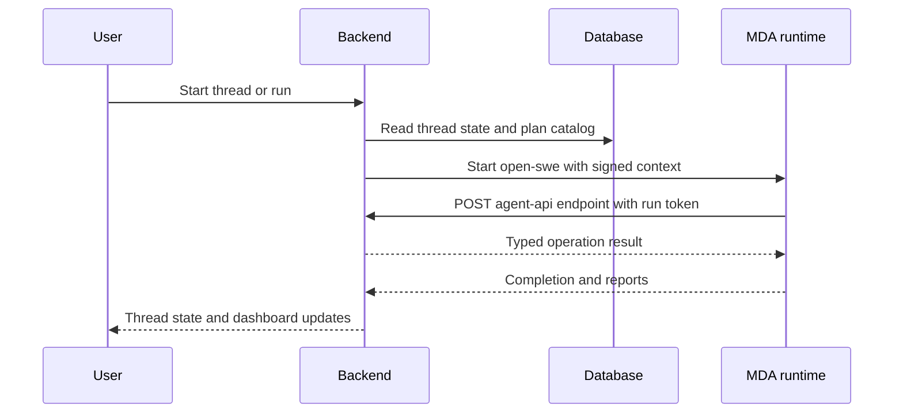

Open SWE is operated as two cooperating projects: the LangGraph/FastAPI backend and the Managed Deep Agents (MDA) runtime in `mda/`. The backend owns ingress, the dashboard API, PostgreSQL-backed application state, and run planning; MDA owns the agent model loop, checkpoints, tool execution, and sandbox lifecycle. Agent, reviewer, and review-scout threads are therefore **not** supported by a backend running alone.

## Runtime contract and startup validation

The backend's FastAPI lifespan validates its login allowlist, sandbox and local-model configuration, the MDA connection, Slack configuration, and PostgreSQL before applying migrations and starting workers. The checks run before the application begins serving.

`MDA_RUNTIME_URL` and `REMOTE_RUNTIME_TOKEN_SECRET` are mandatory:

- `MDA_RUNTIME_URL` must be an absolute HTTP(S) URL. Plain HTTP is permitted only for `localhost`, `127.0.0.1`, or `::1`; other deployments must use HTTPS.
- `REMOTE_RUNTIME_TOKEN_SECRET` signs the per-run tokens MDA presents to the backend's typed `/agent-api` endpoint. It supports comma-separated rotation keys: the first signs and all configured keys verify.
- The backend uses `MDA_RUNTIME_API_KEY`, falling back to `LANGSMITH_API_KEY`, when calling MDA.

A missing or invalid MDA URL, or a missing token secret, causes startup to fail. This is intentional: the thread router sends current agent, reviewer, and review-scout work to the MDA `open-swe` graph, while the backend plans a run, creates its signed context, and serves the runtime's named API calls.



This shows the operational boundary: the backend plans and serves a run, while MDA executes its loop and calls back with the signed run token.

## Configuration model

All backend environment variables are centrally declared in `openswe/config.py`. Values are resolved lazily, whitespace-only values are unset, and the registry marks secrets and aliases. Treat that registry as the exhaustive variable reference; the groups below identify the settings that normally matter when bringing up an environment.

### Backend essentials

| Group | Required or operationally important settings | Notes |
| --- | --- | --- |
| Runtime pair | `MDA_RUNTIME_URL`, `REMOTE_RUNTIME_TOKEN_SECRET` | Required startup contract. `MDA_RUNTIME_API_KEY` can override the MDA call credential. |
| Database | `POSTGRES_URI` | Required outside the special `local_dev` default. It holds the `open_swe` schema and application records; it is not substituted by Agent Server's `DATABASE_URI`. |
| LangSmith and model access | `LANGSMITH_API_KEY`, optionally `LANGSMITH_ENDPOINT`, a provider key such as `ANTHROPIC_API_KEY` or `OPENAI_API_KEY`, or `LANGSMITH_GATEWAY_API_KEY` | LangSmith is used for tracing and sandboxes. The gateway key enables gateway routing by default; `LANGSMITH_GATEWAY_ENABLED` can override that behavior. |
| GitHub and access gate | `GITHUB_APP_ID`, `GITHUB_APP_CLIENT_ID`, `GITHUB_APP_CLIENT_SECRET`, `GITHUB_APP_PRIVATE_KEY`, `GITHUB_WEBHOOK_SECRET`, `GITHUB_APP_INSTALLATION_ID`, plus `ALLOWED_GITHUB_ORGS` or `ALLOWED_GITHUB_USERS` | The allowlist is validated at startup. GitHub App values enable OAuth, webhooks, and App-backed repository operations. |
| Slack | `SLACK_BOT_TOKEN`, `SLACK_SIGNING_SECRET`, `SLACK_BOT_USER_ID`, `SLACK_BOT_USERNAME`, and `SLACK_APP_ID` where Incidents are used | The Slack startup check rejects missing or blank required Slack application values. `SLACK_PUBLIC_BASE_URL` is the externally reachable webhook/OAuth base URL. |
| Dashboard secrets | `TOKEN_ENCRYPTION_KEY`, `DASHBOARD_JWT_SECRET`, `CONFIGURED_ADMINS` | The encryption key protects stored OAuth tokens; the JWT secret signs dashboard sessions and OAuth state. |
| Public origins | `LANGGRAPH_URL`, `DASHBOARD_BASE_URL`, `DASHBOARD_API_BASE_URL` | The latter two default to `LANGGRAPH_URL`. Add only explicit origins to `DASHBOARD_ALLOWED_ORIGINS`; `*` is rejected because credentialed CORS is enabled. |

Useful deployment defaults include `LLM_MODEL_ID`, `LLM_REASONING_EFFORT`, `LLM_FALLBACK_MODEL_ID`, the `DEFAULT_SANDBOX_*` resource and retention controls, and `POSTHOG_API_KEY`/`POSTHOG_HOST` for optional server-side usage capture. Restart the backend after changing its environment.

### MDA runtime secrets

The `mda/` project is independently packaged and must not import the backend. Its deployment needs `OPEN_SWE_BACKEND_URL` (the public backend origin), `LANGSMITH_API_KEY` for tracing/gateway authentication, and direct provider credentials unless it uses a gateway. `MDA_SERVICE_SECRET` is shared with the backend to authenticate MDA channel calls to `/linear/channel/*` and `/github/channel/*`.

On the backend, the same `MDA_SERVICE_SECRET` enables those channel endpoints. `MDA_GITHUB_PROXY_CONNECTION`, `MDA_EXA_CONNECTION`, and `MDA_GITHUB_USER_CONNECTION` are optional MDA connection names that move selected credentials into MDA Agent Auth rather than backend environment variables. Do not put GitHub access tokens into deployment environment variables.

## Local development

### Prerequisites and secrets

Use Python 3.14+, `uv`, Node 22.22.2+, **pnpm** for JavaScript workspace packages, Docker for local PostgreSQL, and Rust/Cargo because `make dev-mda` builds the vendored MDA CLI. Install the backend environment with:

```bash
uv venv
source .venv/bin/activate
uv sync --all-extras
```

Create a gitignored root `.env` for `langgraph dev`. At minimum, configure the backend URL pair and runtime-token secret alongside the normal GitHub, Slack, dashboard, LangSmith/model, and allowlist values:

```bash
MDA_RUNTIME_URL="http://localhost:2025"
REMOTE_RUNTIME_TOKEN_SECRET=""
POSTGRES_URI=""
LANGSMITH_API_KEY=""
ANTHROPIC_API_KEY=""
GITHUB_APP_ID=""
GITHUB_APP_CLIENT_ID=""
GITHUB_APP_CLIENT_SECRET=""
GITHUB_APP_PRIVATE_KEY=""
GITHUB_WEBHOOK_SECRET=""
GITHUB_APP_INSTALLATION_ID=""
ALLOWED_GITHUB_USERS=""
SLACK_BOT_TOKEN=""
SLACK_SIGNING_SECRET=""
SLACK_BOT_USER_ID=""
SLACK_BOT_USERNAME=""
TOKEN_ENCRYPTION_KEY=""
DASHBOARD_JWT_SECRET=""
```

Create `mda/.env` separately. It needs at least the callback address and MDA-side LangSmith/model credentials:

```bash
OPEN_SWE_BACKEND_URL="http://localhost:2024"
LANGSMITH_API_KEY=""
ANTHROPIC_API_KEY=""
```

Use generated random values for secrets, for example `openssl rand -hex 32` for `REMOTE_RUNTIME_TOKEN_SECRET` and `DASHBOARD_JWT_SECRET`, and `openssl rand -base64 32` for `TOKEN_ENCRYPTION_KEY`. Keep both environment files out of Git.

### Database lifecycle and migrations

The local `dev` targets start `postgres:16` on `127.0.0.1:5433` unless `POSTGRES_URI` is explicitly set in the shell or `.env`. The compose service stores data in the named `open-swe-postgres` volume, so deleting the container does not discard local state. Start it explicitly when useful:

```bash
make postgres
```

Outside local LangGraph development, `POSTGRES_URI` is required. The database layer accepts `postgres://` and `postgresql://`, converts them to the asyncpg scheme, translates `sslmode`, and rejects non-PostgreSQL schemes or conflicting SSL parameters. On startup it takes a PostgreSQL advisory transaction lock, creates the `open_swe` schema if needed, and upgrades migrations to all heads. Concurrent backend starts therefore serialize schema migration.

Create a new migration rather than hand-writing an unregistered revision:

```bash
make migration m="Short description"
```

For focused migration/integration coverage, `TEST_ANALYTICS_POSTGRES_URI` is intentionally separate from the development database. Database tests skip when it is unset; the test role needs `CREATEDB` because the test setup creates disposable databases/schemas.

### Start the complete local system

Build the packaged dashboard, then run the backend and MDA runtime in separate terminals:

```bash
make build-dashboard
make dev
make dev-mda
```

`make dev` checks that port 2024 is free, starts local PostgreSQL when appropriate, and runs `uv run langgraph dev --no-browser --port 2024 --n-jobs-per-worker 10`. It serves LangGraph, the FastAPI app, and a dashboard build at `http://localhost:2024`. `make dev-mda` builds the vendored CLI if needed, then runs `mda dev` on port 2025. Both are required for agent threads.

For dashboard work, use the backend as Vite's same-origin front door:

```bash
make dev-ui
```

This runs Vite on port 3000 and the backend on 2024 with `DASHBOARD_DEV_SERVER_URL=http://localhost:3000`; browse port 2024. The backend continues to own dashboard API and LangGraph routes while Vite provides hot reload. JavaScript commands must use pnpm, for example `pnpm install`, `pnpm run dev`, `pnpm run build`, or scoped commands such as `pnpm --filter open-swe-dashboard run build`.

`make run` starts only `uvicorn openswe.webapp:app` on port 8000. It is useful for custom FastAPI routes and `/docs`, but it does **not** include the LangGraph runtime and cannot create runs; it is not a substitute for `make dev` plus `make dev-mda`.

### Local webhook exposure and verification

GitHub and Slack require a stable public HTTPS URL. `make tunnel NGROK_DOMAIN=<name>.ngrok-free.dev` forwards port 2024 with the repository's webhooks-only traffic policy, exposing `/webhooks/*` rather than the unauthenticated LangGraph development API. Keep dashboard pages and non-webhook API routes local. Set `SLACK_PUBLIC_BASE_URL` to that tunnel, while retaining localhost values for the dashboard/backend URL configuration.

After startup, verify `GET /ok` locally, open the dashboard, and test the configured OAuth callback and webhook forwarding. A healthy `/ok` alone does not prove that the dashboard is present: it also needs a built dashboard or active Vite server. For a focused code change, use the repository targets rather than a full suite:

```bash
make test TEST_FILE=tests/path/to/relevant_test.py
make mda-test PYTEST_ARGS="tests/path/to/relevant_test.py"
make typecheck
make mda-typecheck
```

The MDA tests execute in `mda/`'s locked environment, which deliberately prevents imports from `openswe`; endpoint compatibility is maintained through the shared `packages/runtime-api` models.

## Packaging and deployment

### Backend image and dashboard bundle

`langgraph.json` registers the three backend graph aliases, `openswe.webapp:app`, Agent Server authentication, the `.env` file, and checkpointer TTL settings. Its `dockerfile_lines` install pnpm, install the filtered dashboard workspace with the frozen lockfile, build `open-swe-dashboard`, and copy `ui/.output/public` into `/opt/open-swe-dashboard`. The result sets `DASHBOARD_STATIC_DIR=/opt/open-swe-dashboard`. Dashboard build failure is deliberately best-effort in that platform image: the backend can still deploy without bundled UI.

The root `Dockerfile` is the standalone production Agent Server image. It installs the repository into `langchain/langgraph-api`, configures the HTTP app, checkpointer, and legacy graph aliases, and exposes port 8000. When building that image outside the platform flow, run `make build-dashboard` before `docker build` or provide a `DASHBOARD_STATIC_DIR` containing the build.

A standalone deployment also needs Agent Server infrastructure (`DATABASE_URI`, `REDIS_URI`, `LANGSMITH_API_KEY`, and `LANGGRAPH_CLOUD_LICENSE_KEY`) in addition to the Open SWE configuration, and should protect the LangGraph API. The image's default `noop` Agent Server authentication leaves `/threads`, `/runs`, `/assistants`, and `/store` open to any reachable client; the installation guidance uses `LANGGRAPH_AUTH_TYPE=langsmith` plus its endpoint and tenant settings, or requires an equivalent private-network gateway. Do not scale this deployment to zero: background workers rely on persistent Redis/PostgreSQL-backed service.

### Managed Deep Agents build and deployment

The MDA CLI is built from the vendored Managed Deep Agents SDK into the `mda/` project:

```bash
make mda-cli
cd mda
uv run --locked mda deploy --name open-swe-mda-staging --deployment-type prod
```

Run `make mda-cli` before `mda build`, `mda dev`, or `mda deploy`; the runtime uses the resulting CLI and the build is refreshed when vendored sources change. The MDA artifact bundles the MDA project and its editable shared `packages/runtime-api` dependency, not the backend package.

The `deploy_mda.yml` workflow deploys MDA runtime changes from `main` to staging (and supports selected production dispatch/callers). It only deploys changes affecting `mda/`, `packages/runtime-api/`, the vendored MDA/code-mode SDKs, or the workflow itself, and records successful revisions with `mda-deployed/<environment>` tags. The workflow generates `mda/.env` with `OPEN_SWE_BACKEND_URL`, `LANGSMITH_GATEWAY_API_KEY`, `MDA_SERVICE_SECRET`, MDA ingress secret, and the source revision; it fails when the environment's gateway or shared-service secret is absent.

Deploy the backend and its matching MDA runtime as a pair. Set the backend's `MDA_RUNTIME_URL` to the intended runtime deployment and give both sides matching `REMOTE_RUNTIME_TOKEN_SECRET`/callback and service-secret configuration as applicable. A backend revision that passes HTTP health checks but cannot reach or authenticate its MDA runtime is not operational for agent threads.

## Entrypoint reference

| Entry point | Use |
| --- | --- |
| `make dev` | Local integrated backend/LangGraph server on port 2024; starts compose PostgreSQL when no explicit `POSTGRES_URI` exists. |
| `make dev-mda` | Local MDA runtime on port 2025; required alongside the backend. |
| `make dev-ui` / `make web` | Vite dashboard development, using the backend origin for integrated development. |
| `make build-dashboard` | Frozen pnpm install for the dashboard filter and static dashboard bundle. |
| `make postgres` | Local loopback PostgreSQL service. |
| `make migration m="..."` | Generate the next backend database migration. |
| `make run` | FastAPI-only uvicorn server on port 8000; no runnable agent-thread runtime. |
| `make swagger` | Regenerate `swagger.json` from the FastAPI app. |
| `make mda-cli` | Build the vendored MDA CLI. |
| `make test`, `make mda-test`, `make typecheck`, `make mda-typecheck` | Focused backend/runtime validation in their respective environments. |
| `pnpm run build`, `pnpm run test`, `pnpm run typecheck` | Turborepo workspace commands; use pnpm rather than npm or yarn. |
