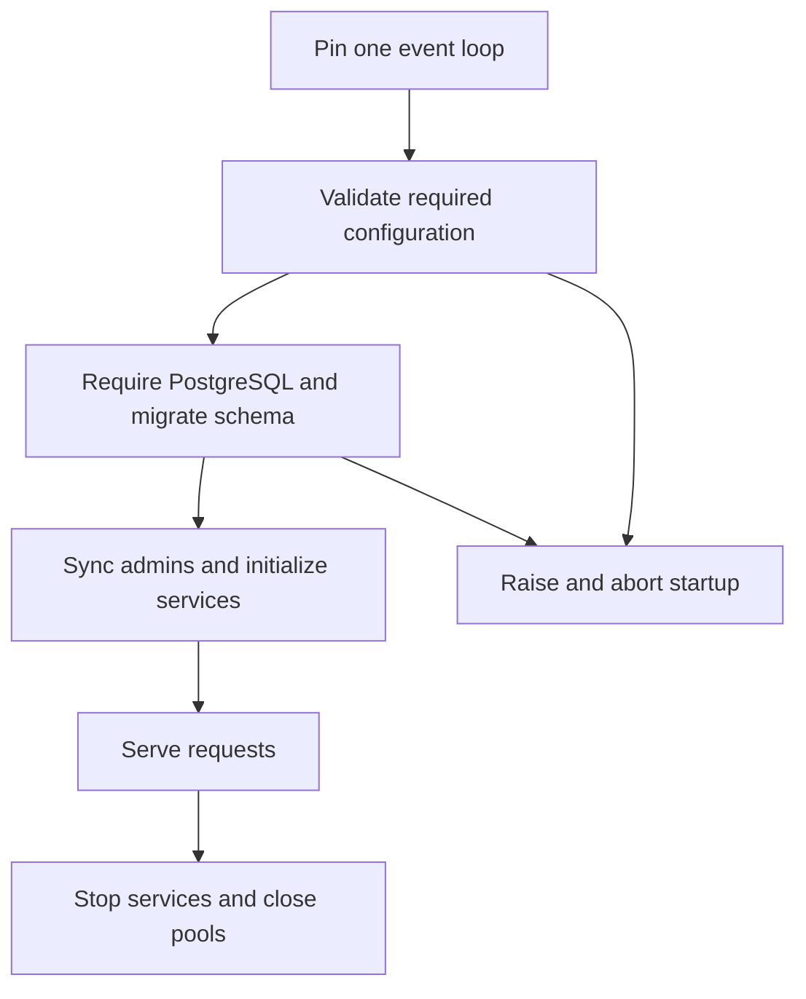

# Configuration and Startup Validation

Open SWE has three configuration layers with deliberately different owners:

- **Deployment environment** supplies credentials, endpoints, provider selection, resource limits, and other values which must be available before the process starts. `openswe/config.py` is the authoritative catalog.
- **PostgreSQL-backed settings** carry administrator-managed instance defaults and workspace overrides. They are appropriate for behavioral choices such as models, review toggles, and a workspace default repository—not deployment secrets.
- **Per-run configuration** is selected from thread/workspace context. In particular, the backend signs the context passed to the separate Managed Deep Agents (MDA) runtime rather than trusting tool arguments controlled by a model.

This page focuses on configuration boundaries and failure behavior. See [Deployment](deployment.md) for setup, [Workspaces and access](../concepts/workspaces-and-access.md) for workspace behavior, [Models, profiles, and instructions](../concepts/models-profiles-instructions.md) for selection precedence, and [Sandbox providers](../integrations/sandbox-providers.md) for provider-specific usage.

## Environment registry

`ENV` is the application configuration schema. A declared `EnvVar` records its description, optional default, aliases, secrecy, and deprecation metadata. Consumers read it lazily through `ENV.NAME`: it looks in the canonical name first and then aliases, trims the result, and treats blank values as unset. This permits late secret injection, key rotation, and test environment patching without import-time snapshots.

Use `optional()` when absence matters, `get()` for the declared or supplied fallback, and `require()` when a caller needs a configured value. Integer conversion raises a descriptive error on malformed input. Boolean parsing recognizes `1/true/yes/on` and `0/false/no/off`; an unrecognized value uses the caller's default. List values are comma-separated, trimmed, and omit empty entries. Access to an undeclared name fails explicitly, so adding a variable means extending `openswe/config.py`, rather than silently creating an ad-hoc contract.

Aliases are migration support, not equal-priority configuration: the canonical variable wins. `deprecated_in_use()` can report a deprecated name or alias, while suppressing a legacy warning when its replacement is also configured. Keep direct `os.environ` access out of application configuration code.

## What must be ready at boot

`openswe.api.app` pins a single event loop before queue workers are built. Its FastAPI lifespan performs hard prerequisites before yielding to serve requests, then initializes state and best-effort auxiliary services. A failure before the yield prevents startup; analytics, listeners, UI invalidations, and agent warming are deliberately logged-and-continued after the required setup so their failure does not take down the core server.

The diagram shows the lifespan's required startup gates and its shutdown boundary.

The required validation sequence checks all of the following:

1. At least one of `ALLOWED_GITHUB_ORGS` or `ALLOWED_GITHUB_USERS` must be configured; otherwise dashboard login authorization has no allowlist and startup raises.
2. The active sandbox provider is validated. Selecting a third-party provider (`daytona`, `modal`, `runloop`, or `e2b`) imports it at boot so a missing optional extra fails early. LangSmith additionally validates its resource and create-body configuration.
3. Local development checks the key for the configured default model only when `DASHBOARD_BASE_URL` was explicitly set to an `http://localhost...` URL. It does not try to validate later workspace, profile, or thread model choices.
4. `MDA_RUNTIME_URL` and `REMOTE_RUNTIME_TOKEN_SECRET` are mandatory. The MDA URL must be absolute HTTP(S); non-local hosts require HTTPS.
5. `POSTGRES_URI` must resolve to a PostgreSQL URI. Startup then takes a PostgreSQL advisory transaction lock, creates the `open_swe` schema if needed, and runs migrations.

`create_app()` also rejects `DASHBOARD_ALLOWED_ORIGINS` containing `*`, because its CORS middleware enables credentials. Supply explicit browser origins when the dashboard is deployed separately; `open-swe://app` is always included for the desktop application.

## Database and runtime boundary

`POSTGRES_URI` is the application database setting. `postgres://` and `postgresql://` inputs are converted to the asyncpg driver form; an `sslmode` query parameter is translated to asyncpg's `ssl` query parameter, but specifying both is rejected. The engine uses configured pool size, overflow, and checkout timeout values and sets the PostgreSQL application name to `open-swe`.

All agent and reviewer graphs run in the separately deployed MDA service named by `MDA_RUNTIME_URL`; the web application does not import that agent stack at process startup. `MDA_RUNTIME_API_KEY` is used to call it, falling back to `LANGSMITH_API_KEY`. A run is accepted only for the hosted `agent`, `reviewer`, or `review-scout` graph, then the backend signs a context carrying the graph, thread/run configuration, and optionally an invocation ID.

`REMOTE_RUNTIME_TOKEN_SECRET` is a comma-separated key ring, newest first. The first HMAC key signs a short-lived (48-hour) HS256 JWT; verification tries each listed key. Tokens require issuer, audience, issued-at, expiry, and subject claims, and carry the thread ID, assistant ID, and configuration. The remote runtime presents this bearer token on tool and hook calls, allowing the server to reconstruct run context from verified claims rather than model-controlled parameters. Prepending a new key and retaining old keys rotates this secret without immediately invalidating in-flight work.

## Sandbox selection and limits

`SANDBOX_TYPE` defaults to `langsmith`. The registry lazily maps `langsmith`, `daytona`, `modal`, `runloop`, `e2b`, and `local` to factories. An unknown provider produces a `ValueError` listing supported types. The optional third-party SDKs are not in the base install: select one only after installing its `sandbox-<provider>` extra (or `sandbox-providers`). `local` runs commands on the host without isolation and is suitable only for local development.

Only the LangSmith factory receives a snapshot, resource overrides, and arbitrary create parameters. Other providers receive only an optional sandbox ID for creation or reconnection. For LangSmith, unset resource values default to 128 GiB filesystem capacity, 4 vCPUs, 16 GiB memory, a 7,200-second idle TTL, and a 2,592,000-second delete-after-stop TTL. Setting either TTL to `0` disables that expiration. `SANDBOX_EXECUTE_CLIENT_GRACE_SECONDS` adds a client-side grace period after a command's own timeout.

`SANDBOX_CREATE_EXTRA_JSON` is an escape hatch for a JSON object merged into a LangSmith create request. It must be valid JSON whose top-level value is an object. The LangSmith startup validator also rejects non-integer resource values, negative resource values or TTLs, and invalid extra JSON, so those errors appear during boot rather than during a user's first run. Sandbox API calls use the deployment's `LANGSMITH_API_KEY` and `LANGSMITH_ENDPOINT`; the former `SANDBOX_LANGSMITH_*` credential overrides are not used.

### Safe provider extension

To add a provider, implement a factory that accepts an optional existing sandbox ID and returns a `SandboxBackendProtocol`, then add its module and factory name to `SANDBOX_FACTORIES`. Keep provider imports lazy so optional dependencies do not burden the default deployment. If the provider is optional, update the registry's optional-extra and SDK-module maps too, so startup can issue the actionable install error. Do not route LangSmith-only snapshot or resource arguments into a provider that does not support them.

## Workspace snapshots and settings

A workspace owns repositories, Slack-channel bindings, MCP connections, and configuration overrides. It can also define a prompt plus setup and update scripts that build a reusable sandbox snapshot. Refresh runs the scripts in a throwaway sandbox, captures the resulting snapshot, and stores status, timestamps, and capped logs for the dashboard. A workspace snapshot uses its recorded immutable ID for runs; publishing a new `:latest` tag cannot change a sandbox that reconnects mid-run. When no workspace or ready workspace snapshot applies, a run falls back to the provider base snapshot.

`WORKSPACE_SNAPSHOT_PREFIX` defaults to `openswe` and contributes the generated snapshot naming convention. It has the legacy alias `ENVIRONMENT_SNAPSHOT_PREFIX`. Setup, update, and capture deadlines have corresponding `WORKSPACE_*_TIMEOUT_SECONDS` variables and legacy `ENVIRONMENT_*` aliases; `OPENSWE_SCRIPT_ROOT` controls their path in a sandbox. `OPEN_SWE_UNASSIGNED_REPO_WORKSPACE` chooses whether GitHub events for an unowned repository route to `default` or are ignored.

Administrator settings are rows in PostgreSQL's `settings_record` table, not LangGraph Store values. There is one `instance` record and a `workspace` record per slug. Effective workspace settings merge, in order: hardcoded defaults, set instance fields, then set workspace fields. A `None` workspace field inherits rather than pinning null. Reads intentionally fail soft—an unavailable settings database yields hardcoded defaults, avoiding a total run-path outage—while writes upsert the scoped row and invalidate cached settings.

The settings API validates model-and-reasoning-effort pairs, rejects an effort without a model, clears deprecated model IDs, and bounds organization review guidelines to 10,000 characters. Invalid or stale saved model pairs resolve to a supported same-provider fallback where possible and otherwise to the global default. The gateway toggle is tri-state: a stored true/false wins, and unset inherits the deployment gateway default. Per-user profiles and thread configuration may impose more-specific choices in callers that honor them.

## Models, gateway, and secrets

Set provider keys such as `ANTHROPIC_API_KEY`, `OPENAI_API_KEY`, `GOOGLE_API_KEY`, `GROQ_API_KEY`, `FIREWORKS_API_KEY`, or `BASETEN_API_KEY` as deployment secrets. `LLM_MODEL_ID` and `LLM_REASONING_EFFORT` provide deployment-level defaults; workspace and user/run selections can supersede them. `LANGSMITH_GATEWAY_ENABLED` is authoritative when set; otherwise a `LANGSMITH_GATEWAY_API_KEY` enables the gateway. The configured gateway host defaults to `https://gateway.smith.langchain.com`, and `LANGSMITH_GATEWAY_OPENAI_USE_RESPONSES` defaults to true.

Keep credentials in the environment or their designated encrypted records—not in workspace settings. The registry marks secrets such as GitHub App keys, webhook signing secrets, database credentials, model keys, dashboard JWT secret, and runtime-token key material for safe configuration handling. `TOKEN_ENCRYPTION_KEY` is the Fernet key ring for stored OAuth tokens; use a most-recent-first comma or newline-separated list so new writes use the first key and reads can decrypt older values during rotation. Configure `DASHBOARD_JWT_SECRET` separately for dashboard session and OAuth-state signing.

## Operational checklist and focused tests

1. Declare every new deployment variable in `openswe/config.py`, including its secret, alias, and deprecation metadata; consume it via `ENV`.
2. Before deploying, provide `POSTGRES_URI`, an organization or user login allowlist, MDA URL and token secret, and credentials for the chosen sandbox and model path.
3. If selecting an optional sandbox provider, build with the matching dependency extra. If using LangSmith, validate numeric limits and `SANDBOX_CREATE_EXTRA_JSON` in the deployment environment.
4. Set explicit, non-wildcard `DASHBOARD_ALLOWED_ORIGINS` only for separately hosted dashboard origins. Do not use `local` sandboxes for untrusted work.
5. Rotate `REMOTE_RUNTIME_TOKEN_SECRET` and `TOKEN_ENCRYPTION_KEY` by prepending a new key before eventually removing retired keys.

Focused tests should exercise blank/canonical/alias environment resolution and typed parsers; the startup failure conditions for login allowlists, database URI, MDA URL, runtime signing keys, optional provider extras, and LangSmith limits; workspace settings inheritance and fail-soft reads; and remote-token signing, expiry, claim validation, and key rotation.

## See also

- [Deployment](deployment.md)
- [Authentication and security](../concepts/auth-and-security.md)
- [Models, profiles, and instructions](../concepts/models-profiles-instructions.md)
- [Workspaces and access](../concepts/workspaces-and-access.md)
- [Sandbox providers](../integrations/sandbox-providers.md)
