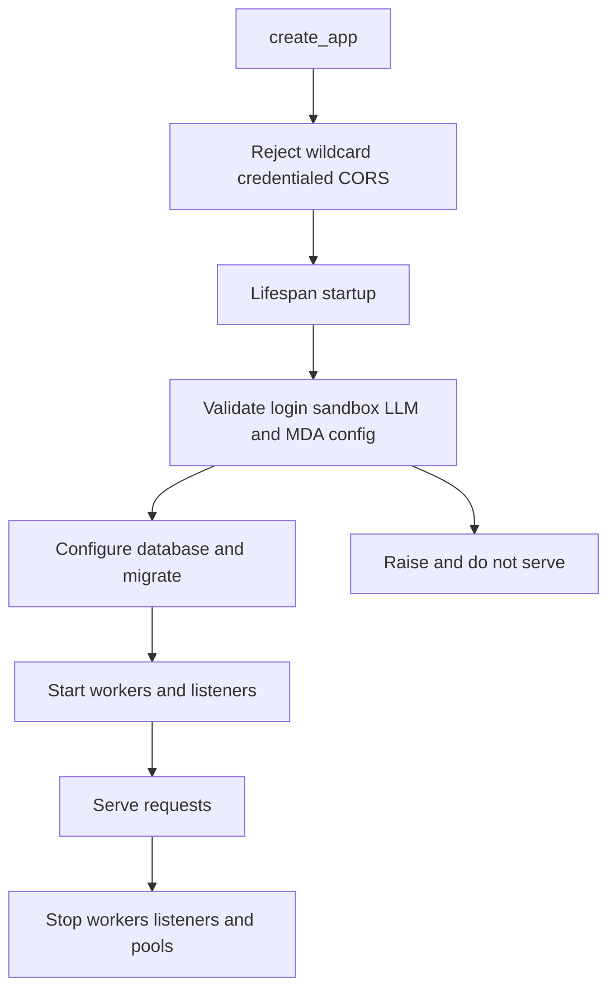

# Configuration, Workspaces, and Provider Selection

Open SWE has three deliberately separate configuration planes:

- **Deployment configuration** is the centrally declared `openswe.config.ENV` registry. It supplies integration credentials, URLs, runtime and provider choices, and deployment-wide defaults. Treat it as the complete environment-variable schema; do not introduce direct `os.environ` reads elsewhere.
- **Instance and workspace configuration** is persisted in PostgreSQL. Administrators use it for non-secret behavior such as model defaults, review features, prompts, repository/channel bindings, workspace snapshots, and MCP connections.
- **Personal and thread choices** are the most specific. A user's profile/preferences and a thread's configurable fields can select a repository, workspace, or model without changing the deployment or a shared workspace.

Secrets belong in the deployment environment or encrypted credential records—not in a workspace definition, prompt, or dashboard setting. Values are intentionally not reproduced here.

## Central environment registry

`openswe.config.ENV` is the sole application registry for environment variables. Its `EnvVar` values are read lazily, so late secret injection, key rotation, and test monkeypatches are visible; blank and whitespace-only values are unset. A canonical variable wins over aliases. Typed helpers parse integers, conventional booleans, and comma-separated lists, while undeclared attribute or item access raises explicitly. Register a new variable here with its description, default, aliases/deprecation metadata, and `secret=True` classification before consuming it.

The registry groups variables by responsibility: LangSmith/LangGraph and MDA; GitHub; Slack and Linear; dashboard/session security; analytics; model and tool keys; sandbox providers; and debugging. Relevant examples include GitHub App/OAuth/webhook credentials, `SLACK_BOT_TOKEN` and `SLACK_SIGNING_SECRET`, `LINEAR_WEBHOOK_SECRET`, `DASHBOARD_JWT_SECRET`, `TOKEN_ENCRYPTION_KEY`, provider API keys, and `MDA_RUNTIME_URL`. Documentation and diagnostics must name variables but never record their values.

`langgraph.json` remains the LangGraph Platform deployment descriptor: it registers `agent`, `reviewer`, and `review-scout`, mounts `openswe.webapp:app`, reads `.env`, and configures delete-based checkpoint cleanup with a 60-minute sweep and a 43,200-minute default TTL.

## Startup gates and managed runtime

`openswe.api.app:create_app` builds the HTTP application, rejects `*` in `DASHBOARD_ALLOWED_ORIGINS` because CORS permits credentials, and pins a single event loop before queue workers are constructed. Its lifespan validates the GitHub login allowlist, active sandbox configuration, local-development LLM credentials, and MDA configuration before database migration and workers begin. Failed validation prevents service rather than deferring a bad configuration until a run is created. Analytics and notification/listener startup are intentionally best-effort; a failure is logged and the server continues with degraded behavior. Shutdown stops workers/listeners and closes the HTTP/database pools.

The FastAPI lifecycle distinguishes fail-fast configuration prerequisites from optional operational services.

Every new coding, reviewer, and review-scout thread runs on Managed Deep Agents (MDA), rather than in the backend process. `MDA_RUNTIME_URL` is required, must be absolute, and must use HTTPS except for loopback development. `REMOTE_RUNTIME_TOKEN_SECRET` is also required: its comma-separated key ring signs with the first key and verifies with every listed key, enabling rotation. The backend calls MDA with `MDA_RUNTIME_API_KEY` when set or `LANGSMITH_API_KEY` otherwise. The signed run token carries the thread/run configuration and metadata; MDA presents it to `/agent-api`, whose backend derives claims from the verified token rather than model-controlled tool arguments.

## Workspaces: ownership, routing, and image lifecycle

A workspace is an administrator-managed PostgreSQL record with an immutable slug and a mutable display definition. It owns preferred repository bindings, Slack-channel bindings, a prompt, setup/update scripts, sandbox resource/create parameters, snapshot/refresh state, workspace settings overrides, and workspace MCP connections. A repository and a Slack channel can each bind to at most one workspace; a preferred repository determines routing and preloaded image contents, not repository authorization. All signed-in users can use any workspace and configured administrators manage all of them; workspace roles are not currently a tenancy boundary.

For new work, `resolve_workspace()` uses the first applicable source: an existing thread's stored workspace, an opening-message workspace tag, the bound Slack channel, the repository owner, the user's default workspace preference, then `default`. The channel deliberately outranks the repository because a channel's work remains in its own context even if it names another workspace's repository. Existing threads do not reroute when bindings change. `OPEN_SWE_UNASSIGNED_REPO_WORKSPACE=default` accepts otherwise-unowned GitHub repositories into `default`; `ignore` drops them. A repository-ownership read failure is handled specially on GitHub intake: the route returns 503 so GitHub retries, rather than treating unknown ownership as unowned and losing an event. General resolution logs the failure and uses `default` so interactive work can proceed.

Workspace setup and update scripts run in a throwaway builder sandbox; refresh captures its result as a snapshot and records a capped log/status. The default snapshot name is `<WORKSPACE_SNAPSHOT_PREFIX>-environment-<slug>` (the legacy `environment` infix is preserved). Runs use the immutable recorded snapshot ID, not the moving `latest` tag, so a refresh cannot change a reconnecting run's filesystem. Setup scripts receive the preferred repositories in the space-delimited `OPENSWE_WORKSPACE_REPOS`; repository changes can trigger a rebuild. Use `OPENSWE_SCRIPT_ROOT` for the script/log root and the `WORKSPACE_*_TIMEOUT_SECONDS` variables to bound refresh, update, and capture work.

Workspace administration is exposed through `/dashboard/api/workspaces`: creation, update, repository configuration, refresh, and deletion require an administrator; the options endpoint is available to signed-in users. Creating/updating a workspace with a setup script starts an initial or repository-change rebuild; the definition can persist even when starting that build returns a 502, so operators should retry it from the workspace settings UI/API. The `default` workspace cannot be deleted.

## Settings hierarchy and model selection

Effective shared settings merge, least to most specific: hardcoded defaults, the instance settings record, and sparse workspace overrides. A `null`/missing workspace field inherits the instance value. The dashboard returns both `effective` values and workspace `overrides` at `GET /dashboard/api/workspaces/{workspace}/settings`; an administrator replaces overrides with `PUT`, while instance settings live at `/dashboard/api/settings` (with a legacy hidden `/team-settings` alias). Settings reads are deliberately fail-soft because every run needs them: an unavailable store yields hardcoded defaults instead of failing all runs.

Settings include review behavior and guidelines, default repository, agent/reviewer/subagent and title model pairs, adaptive-routing tiers, LLM Gateway, Fable, and other feature toggles. A model and reasoning effort must be a supported compatible pair; an effort without a model is rejected. Deprecated model selections clear, invalid stale values resolve to a same-provider supported fallback when possible, then to the deployment default. Fable is additionally gated: disabling it replaces persisted Fable defaults with safe non-Fable choices and runtime construction applies the guard again.

`LLM_MODEL_ID` and `LLM_REASONING_EFFORT` define the deployment fallback pair. If no model is configured, the default is Anthropic Opus only for an Anthropic-only deployment; otherwise it is OpenAI Sol. The catalog in `openswe/dashboard/options.py` is the allowed model/effort contract, including image capability and models disallowed as defaults. Workspace settings sit above the environment default; personal profile values and a thread/run's explicit configurable selection may be more specific in callers that honor them. Changing environment defaults does not rewrite persisted selections.

`LLM_FALLBACK_MODEL_ID` overrides the provider-appropriate fallback selected for a primary model. No fallback model is passed onward when it is absent or equal to the primary. MDA receives model choices, constructs the runtime clients, and owns model-call retries, fallback execution, caching, and summarization.

### Gateway selection

Gateway routing is deployment-defaulted but workspace-overridable. `LANGSMITH_GATEWAY_ENABLED`, when set, is authoritative; otherwise a configured `LANGSMITH_GATEWAY_API_KEY` enables it. A workspace `gateway_enabled=true` or `false` overrides that default, while `null` inherits it. Gateway authentication prefers the gateway key and falls back to `LANGSMITH_API_KEY`; it resolves provider keys from LangSmith Provider Secrets. Only OpenAI, Anthropic, Baseten, Fireworks, and Google GenAI are routed. An unsupported provider or missing LangSmith credential logs a warning and calls the direct provider rather than failing the run. `LANGSMITH_GATEWAY_OPENAI_USE_RESPONSES` defaults to true.

## Sandbox provider selection

`SANDBOX_TYPE` defaults to `langsmith`. The lazy factory registry supports `langsmith`, `daytona`, `modal`, `runloop`, `e2b`, and `local`. An unknown type raises `ValueError` with the supported set when a sandbox is created. Daytona, Modal, Runloop, and E2B integrations are optional extras; startup eagerly imports the selected optional provider and reports the required `uv sync --extra sandbox-<provider>` command if its SDK is unavailable. The `local` backend has no isolation and is for local development only.

Only the LangSmith factory accepts a snapshot ID, resource overrides, and arbitrary create fields; other providers create/reconnect using the optional sandbox ID. For LangSmith, absent overrides default to 128 GiB filesystem capacity, 4 vCPUs, 16 GiB memory, a 7,200-second idle TTL, and a 2,592,000-second delete-after-stop TTL. `0` disables either TTL. `SANDBOX_CREATE_EXTRA_JSON` must be a JSON object and is merged into create requests; workspace-specific create parameters take precedence. During startup, the LangSmith validator rejects malformed numeric resource values, negative TTLs, and invalid extra JSON. It does not itself verify that the LangSmith API key is present; construction does.

New workspace images normally supply the base snapshot. When no ready workspace snapshot applies, LangSmith omits `snapshot_id`, allowing the provider's root snapshot. `LANGSMITH_API_KEY` and `LANGSMITH_ENDPOINT` are the deployment credentials for sandbox provisioning and snapshot capture; the retired sandbox-specific overrides are not used.

## Credentials, webhook boundaries, and encrypted state

GitHub configuration includes App ID/private key, client ID/secret, optional installation ID, and `GITHUB_WEBHOOK_SECRET`; Slack uses bot/signing credentials and optional OAuth identity configuration; Linear intake requires `LINEAR_WEBHOOK_SECRET`. GitHub and Linear routes reject an invalid signature with 401, and Linear rejects every signed request if its secret is unset. Keep app private keys and webhook secrets solely in secret deployment configuration.

`TOKEN_ENCRYPTION_KEY` protects stored OAuth and other sensitive credential records. It accepts one Fernet key or comma/newline-separated newest-first keys. Encryption uses the first key and decryption tries the ordered key set, allowing a safe rotation: prepend the new valid key, retain old keys until data has been rewritten or retired, then remove them. Missing encryption material prevents encryption; decryption of missing-key or invalid ciphertext logs and yields an empty string.

## Customization and change checklist

The backend decides each run's surface in `plan_agent()` in `openswe/server.py` (and the reviewer/review-scout planners). It records tools, middleware, models, and subagents as a `ToolSurface`; MDA consumes model choices and invokes backend operations through the typed agent API. This is the supported boundary for swapping models, tools, middleware, or trigger-specific behavior. To add a built-in sandbox provider, implement a factory returning `SandboxBackendProtocol`, register its import path/function in `SANDBOX_FACTORIES`, declare required variables in `ENV`, and add startup validation plus provider-specific tests.

Before changing this area:

1. Add/rename environment variables only in `openswe/config.py`; preserve aliases or deprecation behavior where needed and mark secrets.
2. Test startup with the selected sandbox provider, database, MDA URL, and runtime token key ring. Treat failures in these prerequisites as deployment blockers.
3. Test workspace binding conflicts, routing precedence, the `ignore` policy, and database-failure behavior; GitHub must remain retryable when ownership is unreadable.
4. Test settings inheritance and cache invalidation across instance/workspace scopes, plus model-pair validation and Fable gating.
5. For new providers or snapshots, test factory loading, optional dependency failure, LangSmith create-field/resource validation, and refresh/reconnect behavior.

Focused coverage exists in `tests/utils/test_config.py`, `tests/workspaces/test_routing.py`, `tests/dashboard/test_workspace_settings_tiers.py`, and the sandbox tests under `tests/sandbox/`.

## See also

- [Managed runtime](../architecture/managed-runtime.md)
- [Models and context](../concepts/models-and-context.md)
- [Security and tenancy](../concepts/security-and-tenancy.md)
- [Local development and deployment](local-development-and-deployment.md)
- [Coding and delivery](../workflows/coding-and-delivery.md)
