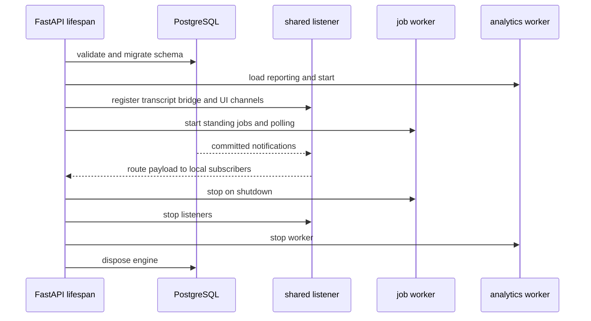
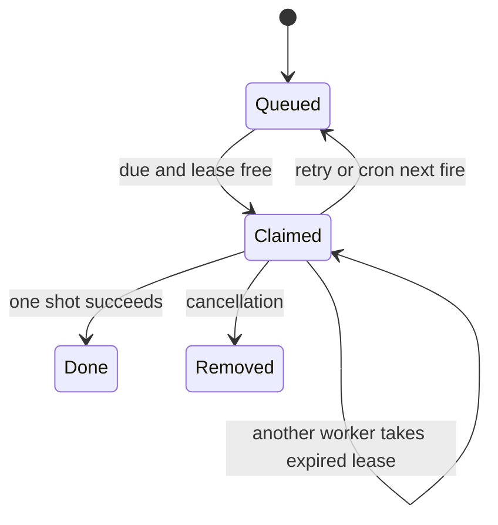

Open SWE uses PostgreSQL as the durable coordination and read-model store alongside external runtime services. The FastAPI lifespan validates required configuration, migrates the database before serving, then starts listeners and workers; shutdown stops them before disposing database and HTTP resources. See [Thread Runtime](/openwiki/architecture/thread-runtime.md) for the execution model, [Configuration and Deployment](/openwiki/operations/configuration-and-deployment.md) for environment settings, and [Testing Overview](/openwiki/testing/overview.md) for the broader test strategy.

## PostgreSQL lifecycle, schema, and transactions

`POSTGRES_URI` is mandatory for normal operation. It is normalized to the `postgresql+asyncpg` driver form (with `sslmode` converted to `ssl`), and non-PostgreSQL schemes are rejected. In local development, the `local_dev` API variant supplies a default local URI. The shared async engine uses pre-ping and configurable pool size, overflow, and timeout; it tags connections with application name `open-swe` and logs queries that cross `POSTGRES_SLOW_QUERY_MS` with duration, SQL statement, and failure status.

All application tables live in the `open_swe` schema. `connection()` sets its search path, while `transaction()` sets it locally and commits/rolls back as the context exits. Use `read_only_transaction()` for trustworthy read paths; it rolls back settings before returning the connection. For arbitrary SQL, use `untrusted_read_only_transaction()`: it invalidates the connection so session state such as advisory locks cannot leak into the pool. A multi-statement snapshot plus live-event reduction should use `snapshot_transaction()`, which is repeatable-read and read-only rather than per-statement read-committed.

Migrations are Alembic revisions under `openswe/database/migrations/versions`. Startup serializes migration across replicas with a PostgreSQL transaction advisory lock, creates the schema if needed, and upgrades to all heads. Preview deployments additionally drop stamped revisions that no longer chain to a current head, but abort rather than replaying every migration when *all* stamped revisions are unknown. Migration failures are startup failures, not a background best effort.

When adding persistence, add an additive Alembic migration rather than creating tables at runtime. Follow the repository’s shared-record conventions where applicable: UUID primary keys, database-clock timestamps, `created_by`/`updated_by` attribution (with `NULL` for system writes), and PostgreSQL foreign keys with deliberate delete semantics. Preserve external natural identifiers as unique keys where needed rather than substituting them for record identity. For example, jobs have UUID identity, timestamps, and actor columns, while `thread_index` keeps a unique external `thread_id` beside its UUID primary key.

## Application startup and cross-replica notifications

This shows the ordering of persistence, local services, and shutdown in the application lifespan.

Several noncritical starters are deliberately isolated: analytics, transcript listening, sandbox-bridge listening, UI invalidations, stale-cron cleanup, and agent-build warming log exceptions and allow the application to serve with reduced freshness or slower first use. Job polling and the shared notification listener are started after their channels have been registered. A failed listener does not make local writers fail: it primarily prevents this replica from immediately hearing writes performed by another replica.

There is one shared `asyncpg` LISTEN connection per process. Channels register a synchronous payload handler and optional asynchronous reconnect handler. The listener reconnects with exponential delay from 0.5 to 30 seconds, catches up each channel after reconnect, and isolates a bad payload handler or catch-up routine so it cannot tear down other channels. Notifications sent while disconnected are inherently lost, so durable channel-specific replay is the correctness mechanism.

## Durable jobs and scheduled work

The database-backed `job` queue carries a handler `kind`, JSON payload and metadata, due time, optional cron expression/time zone, optional unique key, attempts, lease, and claim token. Calling `schedule()` with a key replaces the prior queued job by default; `replace=False` preserves the existing schedule and claim. One-shot jobs are removed on successful completion, while cron jobs are moved to the next fire time in their configured time zone.

This is the durable job lifecycle; an expired lease permits recovery by another replica.

Every replica may run the worker, but `claim_due()` uses `FOR UPDATE SKIP LOCKED` and a 30-minute lease to assign a due row to just one claimant. A per-run claim token prevents an older worker from deleting or rescheduling a row that was replaced and reclaimed. Up to 20 handlers run concurrently; the worker polls every 250 ms while it starts work and every 5 seconds while idle, renewing claims every 10 seconds. Cancellation is observed at a heartbeat and cancels the handler. On shutdown, active handlers are cancelled; their rows remain claimable after lease expiry.

Handler exceptions are logged and a one-shot job retries with exponential backoff starting at 30 seconds and capped at one hour. It gives up after five attempts and is deleted; a failing cron job advances to its next fire rather than retrying the same fire. Missing handler kinds take the same retry path. Lease-renewal errors are logged and retain the existing lease until it expires, preferring recovery over silently losing work.

`openswe.jobs.kinds` is the extension boundary: importing it registers handlers before `JOB_WORKER` starts. It registers domain work such as schedules, workspace refresh, monitoring, delivery, cost refreshes, cleanup, thread wakeups, and reconciliation. Startup imports legacy server crons and thread indexes and establishes standing keyed jobs, including thread-status reconciliation and retention/cleanup jobs. Automation fires take a durable event claim keyed by job ID and scheduled due time, making a re-claimed fire idempotent. Conversely, a reclaimed thread wakeup is deliberately skipped because the prior worker may have already launched the external run; it is safer not to duplicate it.

## Reconciliation and stalled-run recovery

The job queue is not the only recovery layer. The `reconcile` handler scans paginated busy threads in the external runtime, lists each thread’s pending runs, and interrupts pending runs older than its 30-minute default threshold. A failure for one thread is logged and does not abort the remainder; a failed thread search ends the sweep and returns the counts accumulated so far.

Thread-status reconciliation also detects a different failure: an active MDA run that has produced no transcript activity for 90 minutes. It claims the `(thread_id, run_id)` recovery action for two days so replicas act once, reports an error through the normal completion path before cancelling the runtime run, and marks the indexed thread `error` if all remaining active runs have already been claimed as stalled. It does not restart frozen runs because re-sent frozen runs were observed to freeze again. If completion reporting fails, it releases the claim so a later sweep can retry.

Operate these mechanisms as safety nets, not substitutes for normal webhook delivery: investigate recurring lease takeovers, jobs that exhaust retries, stale pending runs, and stalled-run failures. Preserve idempotency at external side effects—either an external delivery key, as with GitHub forwarding, or a durable event claim—because a worker can crash after the side effect and before it records job completion.

## Analytics, audit, transcript, and UI freshness

### Analytics delivery

Product transitions emit strict analytics envelopes through a fail-soft capture wrapper: if PostgreSQL is unavailable or capture raises, the product operation continues and a structured warning includes the operation name. Enqueue deduplicates by event ID into an `outbox` row and records capture progress in the same transaction. The analytics worker repeatedly claims pending records (or deliveries whose five-minute lock expired) with `SKIP LOCKED`, ingests them, acknowledges successes, recomputes dirty summary partitions, and enforces retention hourly.

Failed delivery records the exception class, clears the lock, and retries with jittered exponential delay. After `ANALYTICS_OUTBOX_MAX_ATTEMPTS` (default 10), it becomes `dead_letter`; `outbox_status()` reports pending, dead-letter, and stale work for operational checks. Ingestion itself is deduplicated and transactional: a projection failure does not advance processing progress. Treat analytics as at-least-once at the delivery boundary and rely on event/receipt deduplication rather than assuming exactly-once transport.

### Audit records

Audit middleware considers only dashboard `POST`, `PUT`, `PATCH`, and `DELETE` requests. It writes an audit row only when the matched route explicitly opts in with `@audit_endpoint` and authentication has bound an actor. It records operation, success derived from response status, actor and workspace attribution, route/method/status, UUID-shaped path resource IDs, and typed enrichments—not request payloads. Append is idempotent by audit ID; the fail-safe path has a three-second shielded deadline and logs persistence failure without changing the already-completed request. Queries are descending, keyset-paginated by `(request_time, id)` and filterable by operation, actor, key, or workspace.

### Transcript delivery

The transcript is an append-only per-thread log whose event table is the source of truth and whose other tables are projections. `append()` takes a transaction advisory lock on the thread, assigns gapless versions, writes events, projections, attachments/tool output, command receipts, head version, and `pg_notify` in one transaction. Command receipts make replay idempotent: an accepted command returns its original version instead of appending again. The transactional notification means a subscriber cannot observe a version before its rows commit.

SSE transcript subscribers register before replaying events, preventing an initial race. Local publishing is a latency optimization; PostgreSQL notification is the cross-replica path and carries only thread ID plus version. On notification-listener reconnection, the transcript channel queries each subscribed thread’s durable head and publishes it (or a deletion sentinel), allowing readers that fetch by version to catch up.

### Dashboard invalidation

Committed writes invalidate named UI topics by inserting one `ui_invalidation` row per topic and issuing `pg_notify` in that same transaction; topics contain no business data, so browsers refetch their own queries. The invalidation hub fans a notification to local SSE streams subscribed to that topic. Stream registration precedes replay, and the SSE route authorizes requested topics, sends an initial `hello` containing missed and denied topics, then sends coalesced `invalidated` frames or heartbeat frames.

The outbox retains invalidations for one day and is pruned hourly. On reconnect, the hub asks which subscribed topics changed during the listener outage plus a margin. If a requested replay reaches beyond retention—or replay fails—the safe result is to invalidate rather than claim freshness, producing an extra refetch rather than a stale page. Call `invalidate()` last in the transaction so the replay timestamp reflects the commit closely; use `invalidate_standalone()` only after an external write, accepting that its logged failure may delay refresh.

## Request correlation and tracing

The application assigns or accepts only request IDs matching `req_<uuid>` and returns the value in `X-Request-ID`. It stores the ID in request state and tags the current Datadog root span. For dashboard APIs, every 5xx and failed write is logged under `error_id`; if the endpoint raises, the exception log has the same ID. This makes the browser’s error toast searchable in server logs and APM.

Datadog environment is derived from `OPENSWE_ENV` when configured. A second middleware renames the root APM resource after routing to `METHOD route-template`, including when the endpoint raises, so route-level dashboards and alerts are meaningful even when the outer platform tracer sees only a generic mount route. Both tracing integrations degrade to debug logging when Datadog is unavailable or tagging/naming fails.

## Focused verification

The focused tests demonstrate the operational contracts worth preserving:

- `tests/database/test_postgres_read_only.py` proves that read-only transactions reject writes and that the untrusted variant disposes session state such as advisory locks.
- `tests/jobs/test_jobs.py` covers cross-worker single claiming, key replacement, replacement while running, retry exhaustion, cancellation of a running handler, cron time zones, and idempotent recovery behavior for automation and wakeups.
- `tests/analytics/test_delivery.py` covers capture/delivery deduplication, transactional processing progress, retention, and restart persistence.

When changing these systems, retain structured static log messages with diagnostic values in `extra`, log exceptions rather than discarding them, and add a focused failure-path test for changed lease, transaction, replay, or idempotency behavior.
