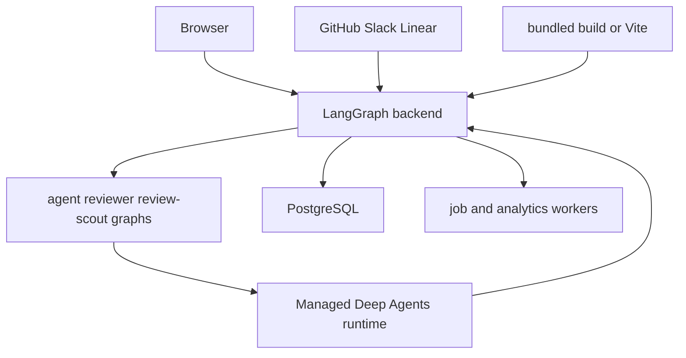

# Development, Packaging, and Deployment

Open SWE is a multi-process system rather than just a FastAPI application. The primary backend is a LangGraph deployment that registers the `agent`, `reviewer`, and `review-scout` graphs and mounts `openswe.webapp:app`. New thread model loops execute in a separate Managed Deep Agents (MDA) deployment; the backend owns the dashboard API, integration webhooks, persistence, routing, and calls to that runtime. A dashboard build can be served by the backend at the same origin, deployed as a separate Nitro proxy, or packaged into Electron.



The production and local control flow: the backend owns state and APIs, while MDA performs the model loop through authenticated callbacks.

See [Configuration](configuration.md) for the full environment contract, [Dashboard UI](../integrations/dashboard-ui.md) for frontend behavior, [Sandbox providers](../integrations/sandbox-providers.md) for sandbox choices, and [Testing](../testing/overview.md) for broader test guidance.

## Build topology

### Python and LangGraph

`pyproject.toml` defines a Python 3.14+ package named `open-swe-agent`. `make install` runs `uv sync --extra dev`; the dev extra supplies pytest, Ruff, and `ty`. The serving manifest, `langgraph.json`, selects Python 3.14 and an `>~=0.15.0rc1` API, loads `.env`, configures custom auth at `openswe.api.agent_server_auth:auth`, and gives checkpoints a delete TTL: a 60-minute sweep and a 43,200-minute default lifetime. Local dependency constraints target `langgraph-api>=0.16.0,<0.17` and `langgraph-runtime-inmem>=0.36.0,<0.37`.

The manifest is the portable graph registration. The root `Dockerfile` mirrors it in container environment variables and builds from `langchain/langgraph-api:0.15.1-py3.14`; it installs this checkout with the API image constraints, exposes port 8000, and does **not** build the dashboard. It is an Agent Server/backend image, not a sandbox image.

### JavaScript workspace

The pnpm workspace includes `bridge-client`, `ui`, `desktop`, `cli`, and `tests/e2e`. Root `pnpm run build`, `check`, `test`, and `typecheck` delegate to Turborepo; root `lint` and `format`/`format:check` run oxlint and oxfmt once, outside Turbo. Turbo makes `dev` persistent and uncached, caches build outputs (`.output/**`, `.vercel/output/**`, and `build/**`), and treats relevant backend URLs, `SOURCE_COMMIT`, `VERCEL`, E2E settings, and `VITE_*` values as task inputs. Thus configuration changes do not silently reuse a frontend build made for different inputs.

## Local development

### Start the complete system

The normal backend entrypoint is:

```bash
make dev
```

It refuses an occupied port 2024, starts the local PostgreSQL service unless `POSTGRES_URI` was set (including in `.env`), then runs:

```bash
uv run langgraph dev --no-browser --port 2024 --n-jobs-per-worker 10
```

`compose.yaml` supplies `postgres:16` on loopback-only `127.0.0.1:5433`, with a named `open-swe-postgres` volume and health check. In the local-dev runtime, an absent `POSTGRES_URI` resolves to that database. The LangGraph server itself persists local threads, checkpoints, and Store data in `.langgraph_api`; it is distinct from PostgreSQL. Copy or link that directory deliberately when moving worktrees, and never run two servers against one linked state directory.

The backend now requires MDA configuration at startup. For local operation, put `MDA_RUNTIME_URL=http://localhost:2025` and `REMOTE_RUNTIME_TOKEN_SECRET` in the root `.env`, set `OPEN_SWE_BACKEND_URL=http://localhost:2024` plus LangSmith/model settings in `mda/.env`, and start the runtime separately:

```bash
make dev-mda
```

This runs `mda dev` on port 2025. The backend creates and indexes runs, but claimed agent, reviewer, and review-scout threads are forwarded to MDA for runs, state, history, streaming, and cancellation. The signed run token, rather than request bodies, carries the backend-selected thread and run configuration. Do not treat a dashboard page or `/ok` alone as proof that model work is ready: the MDA runtime, PostgreSQL, and required startup validation must also succeed.

`make run` starts only `uvicorn openswe.webapp:app --reload --port 8000`. It is useful for narrowly testing FastAPI routes and `/docs`, but has no LangGraph runtime, so operations that create runs do not work there.

### Dashboard: build, hot reload, and paths

Build a backend-served dashboard with:

```bash
make build-dashboard
make dev
```

The command performs a filtered frozen-lockfile install and writes the dashboard public output to `ui/.output/public`. The backend uses that path by default, or `DASHBOARD_STATIC_DIR` when explicitly configured. Its catch-all is intentionally installed after API routers and refuses dashboard API, webhook, health, LangGraph, MCP, OpenAPI, and asset prefixes. It serves only known files or HTML navigation with the client shell; unknown non-HTML requests remain 404s. Hashed assets are immutable-cacheable, while the shell uses `no-cache` so a navigation can acquire a new asset manifest.

For UI work, use:

```bash
make dev-ui
```

It runs Vite (`make web`) and `make dev` concurrently, passing `DASHBOARD_DEV_SERVER_URL=http://localhost:3000`. The backend reverse-proxies non-reserved HTTP UI paths to Vite, preserving a browser origin of `http://localhost:2024` for cookies, API calls, and OAuth callbacks. HMR connects directly to Vite's port. `make web` alone starts the dashboard server; in development it proxies backend prefixes to `DASHBOARD_API_URL`, defaulting to `http://localhost:2024`.

A bundled dashboard under a LangGraph `http.mount_prefix` must be built with matching `DASHBOARD_BASE_PATH` (including its trailing slash). That value controls both router and asset URLs. The platform build extracts the manifest mount prefix and supplies it; local prefixed builds must do so explicitly. A mismatch breaks client navigation or asset resolution.

### Local webhook exposure

Do not publicly forward the complete local port: `langgraph dev` does not authenticate raw LangGraph routes. Instead:

```bash
make tunnel NGROK_DOMAIN=<name>.ngrok-free.dev
```

The command forwards port 2024 through the supplied static ngrok domain and applies `examples/ngrok/webhooks-only.yml`, which returns 404 outside `/webhooks/*`. Update GitHub, Slack, and Linear webhook targets to that public origin while continuing to open the dashboard locally. Preserve a local Slack OAuth callback relay if one is configured: the stock webhook-only policy deliberately blocks dashboard routes. Restart the backend after editing `.env`; code reload does not make a changed process environment reliable.

## Database migrations and backend lifecycle

PostgreSQL is mandatory for application records. During FastAPI lifespan startup, the application validates login, sandbox, model, and MDA configuration; requires a database; then runs migrations before starting service workers. `POSTGRES_URI` accepts PostgreSQL URLs (and translates `sslmode` for asyncpg); `DATABASE_URI` alone does not configure application persistence.

Migrations live in `openswe/database/migrations`, run through Alembic under an advisory migration lock, and operate in the `open_swe` schema. Create a new revision with:

```bash
make migration m="Short description"
```

The helper numbers the filename after the greatest existing prefix and generates a revision chained to all current heads. The database role needs permission to create and alter the schema, tables, and indexes. Startup failures in required database setup prevent a valid backend; some ancillary facilities are intentionally degradable: analytics worker activation, transcript and bridge listeners, UI invalidations, analyzer-cron cleanup, and agent warmup log failures and continue with documented fallback or reduced functionality. On shutdown, the job worker, listeners, analytics worker, HTTP pool, and database engine are stopped in order.

## Production delivery

### Backend and MDA prerequisites

Deploy the backend either through LangGraph Platform or as the standalone root image. The platform uses `langgraph.json`; its `dockerfile_lines` build the dashboard best-effort into `/opt/open-swe-dashboard`, set `DASHBOARD_STATIC_DIR`, and continue a backend deployment if that UI build fails. Standalone Docker must instead receive a prebuilt `ui/.output/public` before `docker build`, or a configured static directory.

A standalone Agent Server needs `DATABASE_URI` and `REDIS_URI` for the server, as well as `LANGSMITH_API_KEY`, `LANGGRAPH_CLOUD_LICENSE_KEY`, and the public `LANGGRAPH_URL`. Application persistence also requires `POSTGRES_URI`, normally pointing at the same Postgres database. Keep Redis/Postgres-backed workers available: scale-to-zero hosting is unsuitable for background runs. All deployed backends also need an MDA deployment URL, credentials to call it, and `REMOTE_RUNTIME_TOKEN_SECRET`; deploy the MDA project independently with `mda deploy` and configure its `OPEN_SWE_BACKEND_URL` back to the public backend.

The standalone image defaults to `LANGGRAPH_AUTH_TYPE=noop`; this exposes raw Agent Server endpoints such as `/threads`, `/runs`, `/assistants`, and `/store` to any reachable client. Use LangSmith auth or a private/authenticated network boundary. Dashboard session cookies and webhook signature validation protect only the custom routes, not raw LangGraph routes.

### Separate dashboard deployment

`ui/Dockerfile` is a two-stage Node 24 Alpine build, invoked from the repository root:

```bash
docker build -f ui/Dockerfile .
```

It installs the filtered workspace with a frozen lockfile, builds the dashboard into Nitro `.output`, and runs that server as `node` on port 8080. `DASHBOARD_API_URL` is read per request, so one image can front different backend deployments. It intentionally has no fallback: an unset value throws rather than accidentally directing traffic to a shared production backend.

The Nitro proxy preserves the original path, query, method, request body, and individual `Set-Cookie` headers while removing hop-by-hop/framing headers. It uses manual redirects so browser OAuth navigation remains visible to the browser. Configure a same-origin proxy deployment by setting the backend's `DASHBOARD_BASE_URL` and `DASHBOARD_API_BASE_URL` to the dashboard origin and registering `<origin>/dashboard/api/auth/callback` with the GitHub App. A direct cross-origin browser setup instead needs an appropriate client API base URL and an explicit credentialed CORS origin; `DASHBOARD_ALLOWED_ORIGINS` may not contain `*` because the FastAPI CORS configuration permits credentials.

## Desktop packaging

Open SWE Desktop is experimental; the web UI remains the recommended interface. Electron packages the compiled dashboard UI and asks packaged users for a compatible backend URL on first launch, storing it in local user data without a maintainer-hosted default. Its internal `open-swe://app` origin proxies `/dashboard/api/*` to the selected backend; it does not expose the server-side LangSmith key or call raw LangGraph routes directly. Switching backend URLs clears the prior deployment's local session data.

For source development, run `make dev` and `make desktop`; the default backend is `http://localhost:2024`. Resolution precedence is `--backend-url`, `OPEN_SWE_BACKEND_URL`, saved configuration, then that development default. `pack` creates an unpacked application and `dist` creates an installer; both build `ui/`, package the public output, and write artifacts beneath `desktop/dist/`.

The **This Mac** mode is a local sandbox bridge, not a local backend replacement. It long-polls the selected backend for sandbox requests, executes them in the selected checkout, and posts results back. A thread remains a cloud thread and can run only while the originating app/bridge is open. Current-checkout mode uses the selected branch; new-worktree mode isolates a thread on a generated worktree. One agent per working tree is enforced to avoid concurrent mutation.

On macOS, `make install-desktop` requires a clean checkout, fast-forwards `main`, and invokes the installer; `make install-checkout` packages the current checkout without Git changes. The installer is macOS-only, checks Node, `ditto`, Bun, and a pnpm/corepack launcher, performs a frozen workspace install and desktop pack, stages the app, then swaps it into `/Applications` or `~/Applications`.

## Focused checks and helpers

- `make test [TEST_FILE=...]` and `make integration_tests` run pytest through uv; absent requested paths are skipped. `make lint`, `make format`, and `make format-check` run Ruff, while `make typecheck` runs `ty check openswe tests`.
- `scripts/create_sandbox_snapshot.py` creates a LangSmith sandbox snapshot from a Docker image through `SandboxClient`, prints the ID, and directs operators to set it as a workspace base snapshot through the dashboard.
- `scripts/purge_wakeup_crons.py` is a one-time cleanup for expired `thread_wakeup` crons. Start with `--dry-run`; it resolves the URL from `--url` or `LANGGRAPH_URL` and uses `LANGGRAPH_API_KEY` or `LANGSMITH_API_KEY`.
