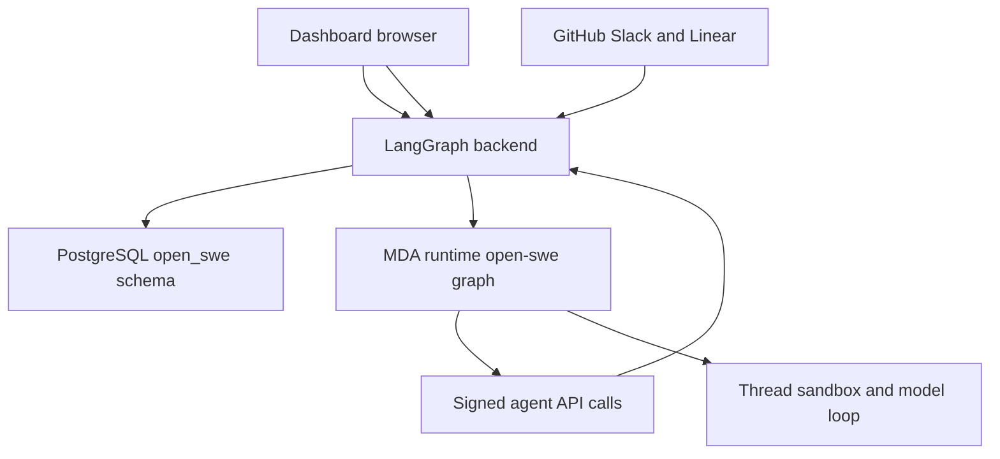

# Development, configuration, and deployment

Open SWE is operated as two Python deployments plus a JavaScript workspace:

- The **backend** is the LangGraph application declared by `langgraph.json`. It hosts the `agent`, `reviewer`, and `review-scout` entrypoints, composes `openswe.webapp:app`, owns PostgreSQL-backed product state, receives webhooks, and serves the dashboard or fronts Vite.
- **Managed Deep Agents (MDA)** is a separate project in `mda/`, with its own lockfile, virtual environment, tests, and deployment. It executes every active agent, reviewer, and review-scout run; it calls the backend's typed `/agent-api/{endpoint}` contract using a signed run token.
- The dashboard, desktop, CLI, bridge client, and E2E packages are a **pnpm workspace** orchestrated by Turbo. Do not install or run workspace JavaScript packages through Python tooling.

The separation is operationally significant: the backend decides and signs a run's context and catalog, while MDA owns the model loop, checkpoints, sandbox, tool calls, and runtime middleware. Backend replicas must therefore be stateless with respect to a run; durable application state belongs in PostgreSQL and runtime state belongs to MDA.



The diagram shows the production responsibility boundary: integrations and browsers reach the backend, while active runs execute in the separate MDA runtime and call back to the backend.

## Local developer loop

### Install the independent environments

Use Python 3.14+ and `uv` for the repository backend, Node 22.22.2+ and `pnpm` for JavaScript, and Rust/Cargo when building the vendored MDA CLI. Start from the repository root:

```bash
uv venv
source .venv/bin/activate
uv sync --all-extras
pnpm install
```

`mda/` is deliberately **not** part of the backend environment. Its project depends on the shared `packages/runtime-api` contract but must not import `openswe`; synchronize and test it from its own directory through the Make targets below. The root package scripts use Turbo for workspace tasks; use `pnpm --filter <package> run <script>` when a change is confined to one package.

### Required local configuration

`langgraph.json` loads the root `.env`. At minimum, a usable local setup needs integration credentials appropriate to the surfaces being exercised, dashboard/token secrets, a model or gateway credential, and these runtime settings:

```bash
POSTGRES_URI=""                         # omit for the local Compose default
MDA_RUNTIME_URL="http://localhost:2025"
REMOTE_RUNTIME_TOKEN_SECRET=""          # e.g. openssl rand -hex 32
```

**Both `MDA_RUNTIME_URL` and `REMOTE_RUNTIME_TOKEN_SECRET` are required for backend startup and active agent execution.** The URL must be absolute; non-loopback URLs must use HTTPS. The secret signs MDA run tokens; it supports comma-separated values so the first signs and all values verify during a rotation.

Configure MDA separately in `mda/.env`:

```bash
OPEN_SWE_BACKEND_URL="http://localhost:2024"
LANGSMITH_API_KEY=""
# a direct provider key, or LANGSMITH_GATEWAY_API_KEY
```

For a remote MDA deployment, use its public HTTPS backend origin and configure the same `MDA_SERVICE_SECRET` on both sides if GitHub or Linear MDA channels are enabled. `MDA_RUNTIME_API_KEY` defaults to `LANGSMITH_API_KEY` for backend-to-MDA calls.

The backend's environment registry treats blank values as unset and reads values lazily. It is the authoritative catalog for variables and defaults. Important operational groups are:

| Concern | Examples | Notes |
| --- | --- | --- |
| persistence | `POSTGRES_URI`, `ANALYTICS_POOL_SIZE`, `POSTGRES_SLOW_QUERY_MS` | PostgreSQL is required at startup; URI forms are normalized for asyncpg. |
| runtime trust | `MDA_RUNTIME_URL`, `MDA_RUNTIME_API_KEY`, `REMOTE_RUNTIME_TOKEN_SECRET`, `MDA_SERVICE_SECRET` | Keep signing and service secrets out of logs and rotate deliberately. |
| dashboard identity | `DASHBOARD_JWT_SECRET`, `TOKEN_ENCRYPTION_KEY`, `DASHBOARD_BASE_URL`, `DASHBOARD_API_BASE_URL` | Cookies/OAuth and encrypted stored credentials depend on these values. |
| integrations | GitHub App values, webhook secrets, Slack bot values, `ALLOWED_GITHUB_USERS` or `ALLOWED_GITHUB_ORGS` | Startup validates the login allowlist and required Slack settings. |
| observability and providers | `LANGSMITH_*`, provider keys, `DD_ENV`, optional `POSTHOG_API_KEY` | LangSmith also supplies tracing, trace links, and sandbox access. |

Do not put deployment secrets in the Vite environment. For UI development against a hosted backend, `DASHBOARD_API_URL` is intentionally the only local `.env` value consumed by `pnpm run dev:prod`.

### Start PostgreSQL, backend, MDA, and UI

Without an explicit `POSTGRES_URI`, `make dev` first starts Compose PostgreSQL 16 at `127.0.0.1:5433` with a named `open-swe-postgres` volume. The bind is loopback-only and the volume survives stopping or removing the container.

```bash
make build-dashboard                 # static dashboard into ui/.output/public
make dev                             # LangGraph backend at http://localhost:2024
make dev-mda                         # separate MDA runtime at http://localhost:2025
```

`make dev` refuses to reuse port 2024. It runs the full LangGraph development runtime, whereas `make run` serves only `openswe.webapp:app` with uvicorn on port 8000; the latter is useful for narrow HTTP work but cannot create runs because it does not include the LangGraph runtime.

For dashboard work, prefer the same-origin proxy mode:

```bash
make dev-ui
```

It runs Vite on port 3000 and the backend on port 2024 with `DASHBOARD_DEV_SERVER_URL=http://localhost:3000`. Open port 2024: the backend handles dashboard APIs, cookies, callbacks, and LangGraph routes, while non-reserved UI requests proxy to Vite. HMR deliberately connects directly to Vite. If Vite is opened directly on port 3000 instead, set both `DASHBOARD_BASE_URL` and `DASHBOARD_API_BASE_URL` to that origin and add its GitHub OAuth callback; wildcard credentialed CORS is rejected.

A bundled UI must be built for the backend's `http.mount_prefix` via `DASHBOARD_BASE_PATH`; otherwise its router and asset URLs will not match the mounted application. The backend serves a static build at `/` only when it finds `_shell.html` in `DASHBOARD_STATIC_DIR` or `ui/.output/public`; it leaves API, webhook, health, LangGraph, and asset prefixes to their owners.

### Expose only webhooks

`langgraph dev` does not authenticate its raw runtime routes. Never publish its port wholesale. Use a stable ngrok domain and the restricted tunnel:

```bash
make tunnel NGROK_DOMAIN=<name>.ngrok-free.dev
```

The supplied policy exposes only `/webhooks/*`; retain an equivalent allowlist if using another tunnel. Keep the dashboard and LangGraph API on localhost. Restart the backend after changing `.env`, because configuration does not hot reload.

## Startup lifecycle, state, and migrations

On FastAPI lifespan startup, the backend pins its event loop and performs fail-fast validation for the GitHub login allowlist, sandbox setup, local model credentials, MDA URL/token configuration, Slack configuration, and PostgreSQL availability. It then applies migrations before loading the workspace and starting optional analytics work, transcript/bridge/UI listeners, the job worker, and an agent-build warmup.

Analytics and listeners are intentionally best effort: their startup failures are logged and do not stop the process. This means a reachable homepage or `/health` is not proof that analytics, cross-replica notifications, or UI invalidations are working. Conversely, missing PostgreSQL or the mandatory runtime/security configuration prevents startup.

Migrations run automatically at startup in the `open_swe` schema. The migrator takes a PostgreSQL transaction advisory lock, creates the schema if necessary, and upgrades all heads; concurrent replicas therefore serialize migration work. The database principal must be able to create/manage that schema and its tables and indexes.

Create a new migration rather than editing deployed history:

```bash
make migration m="Short description"
```

Review the generated revision, test it against a disposable database, and deploy it with the application. Preview environments have special stale-revision cleanup; do not rely on that behavior for production repair. PostgreSQL URLs may use `postgres://`, `postgresql://`, or the asyncpg form; `sslmode` is translated to asyncpg's `ssl` option, while ambiguous SSL settings are rejected.

## Production deployment

A normal deployment uses one public backend origin for the dashboard, webhook endpoints, GitHub OAuth callback, and dashboard API. `langgraph.json` registers the three backend graph entrypoints and `openswe.webapp:app`; its image build installs and builds the dashboard and sets `DASHBOARD_STATIC_DIR`, but intentionally continues a backend deployment if the dashboard build fails. Validate the UI separately after release.

Deploy a matching MDA project for each backend environment. MDA's `open-swe` graph receives a backend-planned catalog and signed run token; it has no backend database or integration credentials. Configure MDA with its backend URL, LangSmith/model or gateway credentials, and any channel service secret. Configure the backend with the corresponding MDA URL and signing secret. A mismatched URL, secret, or rollout can leave the API healthy while runs cannot start or cannot make authenticated callbacks.

For standalone Docker, the root `Dockerfile` produces a LangGraph API image on port 8000. It is not the sandbox image. Supply Agent Server's `DATABASE_URI`, `REDIS_URI`, `LANGSMITH_API_KEY`, and `LANGGRAPH_CLOUD_LICENSE_KEY`, plus Open SWE's own `POSTGRES_URI` and application configuration. Do not scale to zero: Redis- and PostgreSQL-backed background workers must remain available. Build the dashboard before `docker build`, or point `DASHBOARD_STATIC_DIR` at a built directory.

Protect the LangGraph runtime as well as application routes. A standalone image defaults to noop runtime authentication; use `LANGGRAPH_AUTH_TYPE=langsmith` with its endpoint and tenant configuration, or place it behind an equivalent authenticated private gateway. Dashboard sessions and signature-checked webhooks do not protect `/threads`, `/runs`, `/assistants`, or `/store` when runtime authentication is noop.

## Health, observability, and safe diagnostics

### What to check

| Check | Meaning and limitation |
| --- | --- |
| `GET /health` | Returns `{"status":"healthy"}` when the HTTP app answers. It does not test PostgreSQL, MDA, the dashboard build, or background workers. |
| `GET /ok` | Useful local LangGraph readiness check; also verify it from localhost before reporting local readiness. |
| Dashboard login and task | Confirms static/proxied UI, OAuth/cookie setup, database-backed settings, and a real MDA execution path. |
| MDA/runtime logs and a LangSmith trace | Correlate a failed run across the backend and MDA boundary. Search by thread or run ID rather than printing credentials. |
| startup logs | Look for `Database initialized`; inspect warnings for optional analytics/listener startup failures. |

The application attaches request IDs, trace resource names, audit logging, gzip, and structured slow-query warnings. PostgreSQL query logging is controlled by `POSTGRES_SLOW_QUERY_MS` (default 1000 ms; `0` disables it). The dashboard has client performance spans, while deployed MDA API/queue logs can be filtered by run ID or thread ID in LangSmith.

For a safe local diagnosis, first identify the listening owner rather than killing it blindly (`lsof -nP -iTCP:2024 -sTCP:LISTEN`), then check the local backend, MDA port, and Compose status:

```bash
curl -fsS http://localhost:2024/health
docker compose ps
lsof -nP -iTCP:2024 -sTCP:LISTEN
lsof -nP -iTCP:2025 -sTCP:LISTEN
```

Do not send `/ok` through the webhooks-only public tunnel: its intended 404 proves the tunnel restriction. Check a permitted webhook path when validating that tunnel, and use provider delivery views or ngrok's local inspector to diagnose inbound events. Never paste `.env`, database URLs, run tokens, OAuth tokens, or private keys into tickets or logs.

## Focused validation by change boundary

Run the narrowest useful checks rather than the entire suite:

| Changed area | Focused validation |
| --- | --- |
| backend Python | `make lint`, `make typecheck`, then `make test TEST_FILE=tests/<relevant-path>` |
| MDA runtime | `make mda-typecheck` and `make mda-test` with any focused `PYTEST_ARGS`; these run in `mda/`'s locked environment |
| dashboard/workspace package | `pnpm --filter open-swe-dashboard run typecheck` or `test`; use root `pnpm run build`, `typecheck`, or `test` only when cross-workspace coverage is required |
| API shape | `make swagger` after intentional FastAPI route/model changes, then inspect the generated schema or `make run`'s `/docs` |
| migration | start against a disposable PostgreSQL database and confirm startup completes and the expected schema change exists |
| integration/webhook flow | validate signatures, the restricted tunnel route, provider delivery status, and one real or test run through MDA |

The checked-in `swagger.json` describes custom FastAPI routes, not LangGraph runtime routes, and can lag a running deployment. `TEST_ANALYTICS_POSTGRES_URI` enables PostgreSQL-dependent tests with throwaway cloned databases; without it those tests skip, so a green local run may have less coverage than CI.

See [the architecture overview](../architecture/overview.md), [dashboard, desktop, and CLI integration](../integrations/dashboard-desktop-and-cli.md), [sandboxes and MCP](../integrations/sandboxes-and-mcp.md), [quickstart](../quickstart.md), and [testing overview](../testing/overview.md) for adjacent concerns.
