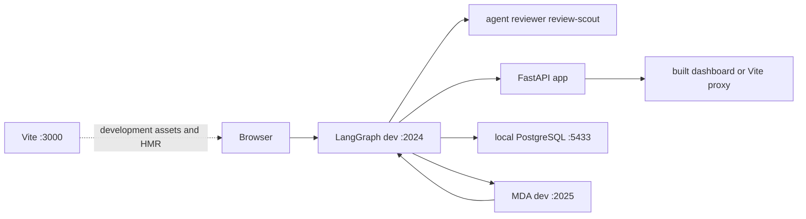
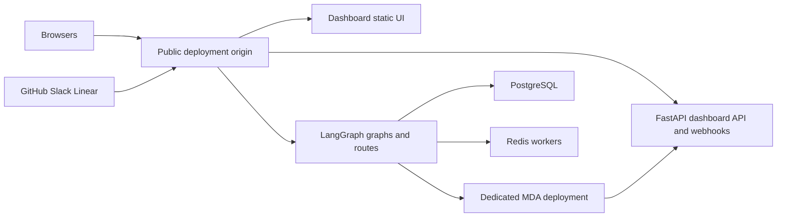

# Local development, builds, and deployment topology

Open SWE is not one process in development. The root Python project supplies the LangGraph graphs and FastAPI application; the pnpm workspace builds the dashboard, Electron client, CLI, bridge client, and E2E package; and `mda/` is a deliberately separate Managed Deep Agents (MDA) project. The ordinary backend routes new agent, reviewer, and review-scout work to MDA, while retaining the public dashboard, webhook, and thread-index boundaries.

## Project boundaries and entrypoints

- **Python backend:** Python 3.14+ is required. `make install` runs `uv sync --extra dev`; `make dev` runs `uv run langgraph dev --no-browser --port 2024`. The `langgraph.json` manifest loads `.env`, registers `agent`, `reviewer`, and `review-scout`, mounts `openswe.webapp:app`, and sets a delete-on-TTL checkpointer policy (60-minute sweep; default TTL value 43200).
- **JavaScript and TypeScript workspace:** pnpm 11.22.0 manages `bridge-client`, `ui`, `desktop`, `cli`, and `tests/e2e`. Root `pnpm run dev`, `build`, `test`, `typecheck`, and `check` dispatch Turbo tasks; `lint` and formatting run once at the root. Turbo does not cache persistent development tasks and tracks dashboard URL/base-path, Vite, E2E, and build metadata environment inputs.
- **MDA runtime:** `mda/` must not import the backend and has its own locked environment and tests. `make dev-mda` first builds the vendored SDK's Rust `mda` binary if needed, then starts `mda dev --port 2025 --no-browser`. The backend requires `MDA_RUNTIME_URL`; locally set it to `http://localhost:2025` and set `REMOTE_RUNTIME_TOKEN_SECRET`. In `mda/.env`, point `OPEN_SWE_BACKEND_URL` at `http://localhost:2024` and provide LangSmith and model credentials.



This local topology keeps the browser's normal entrypoint on port 2024 while MDA executes the model loop remotely from the backend process.

## Database and local server lifecycle

`make dev` starts the Compose PostgreSQL service first only when `POSTGRES_URI` is absent from the environment or `.env`. Compose runs `postgres:16`, binds `127.0.0.1:5433` to the container's 5432, waits for `pg_isready`, and persists data in the named `open-swe-postgres` volume. Thus `docker compose down` stops the database without discarding data; an explicit `POSTGRES_URI` selects an external database instead. Start the database alone with `make postgres`.

The Make target refuses to start the backend if port 2024 is already listening. The local LangGraph runtime retains its own threads, checkpoints, and Store state in `.langgraph_api` under its working directory; copied worktree state is a snapshot, while a shared directory must have only one running backend. `make run` is different: it runs only `openswe.webapp:app` under uvicorn on port 8000, so it is useful for FastAPI work and OpenAPI inspection but cannot create LangGraph runs.

For a normal local session, build the static dashboard then start both runtimes:

```bash
make build-dashboard
make dev
make dev-mda
```

The dashboard build is optional when only the API or webhooks are needed. Environment changes require a backend restart because `langgraph dev` reloads code but not `.env` values.

## Dashboard build and proxy modes

`make build-dashboard` installs the filtered dashboard dependency closure with a frozen lockfile and writes static output to `ui/.output/public`. `make dev` can then serve the dashboard at `/` alongside the FastAPI app and LangGraph routes. When the LangGraph server uses `http.mount_prefix`, build with a matching `DASHBOARD_BASE_PATH=<prefix>/`; otherwise router and asset URLs target the wrong location.

For UI iteration, use `make dev-ui`. It starts Vite and the backend together, gives the backend `DASHBOARD_DEV_SERVER_URL=http://localhost:3000`, and leaves port 2024 as the page origin. The backend fronts dashboard requests to Vite, while `/dashboard/api/*` and LangGraph routes remain on the backend; Vite's HMR WebSocket connects directly to port 3000. This avoids cross-origin login and cookie setup during ordinary frontend work.

Opening Vite directly on port 3000 is a separate mode. Vite proxies dashboard API requests to `DASHBOARD_API_URL`, which defaults to `http://localhost:2024`. Because the browser origin is now 3000, set both `DASHBOARD_BASE_URL` and `DASHBOARD_API_BASE_URL` to that origin and register `http://localhost:3000/dashboard/api/auth/callback` with the GitHub App. `DASHBOARD_ALLOWED_ORIGINS` is only for additional credentialed origins; wildcard origins are rejected.

`pnpm run dev:prod` is intentionally for a preview or other chosen deployment, never a default production backend. It reads only `DASHBOARD_API_URL` from `.env`, completes GitHub login through a PKCE loopback handoff, caches the resulting session in `~/.cache/open-swe/dev-session.json`, and passes it to Vite. That session operates on the real deployment: tasks and administration changes are real.

## Webhook tunnel: a strict local security boundary

> **Security warning:** do **not** expose local port 2024 with a general-purpose tunnel. Under `langgraph dev`, raw LangGraph routes such as `/threads`, `/runs`, `/assistants`, and `/store` have no authentication. Dashboard-cookie and webhook-signature checks do not protect those routes.

Use a fixed ngrok domain and the supplied allowlist:

```bash
make tunnel NGROK_DOMAIN=<name>.ngrok-free.dev
```

The target forwards port 2024 with `examples/ngrok/webhooks-only.yml`, which returns 404 for any path outside `/webhooks/*`. Point GitHub, Slack, or Linear at the corresponding public webhook path, but keep the dashboard on `http://localhost:2024`. Any alternative tunnel or proxy must enforce the same allowlist. If local Slack OAuth is configured, retain a narrowly scoped callback relay that redirects the tunnel callback to localhost with its query string; do not make dashboard pages or APIs public.

## Production packaging and topology

LangGraph Platform and standalone Docker both package the same graph registrations, FastAPI app, and dashboard concept. Platform uses `langgraph.json`: its image instructions install Node temporarily, make a frozen pnpm dashboard build, copy static files to `/opt/open-swe-dashboard`, stamp backend and dashboard build information from `SOURCE_COMMIT`, and set `DASHBOARD_STATIC_DIR`. A dashboard build failure is explicitly best-effort, so the backend can still deploy without a bundled UI.

The root `Dockerfile` starts from `langchain/langgraph-api:0.15.1-py3.14`, installs this project and the API package, configures the FastAPI app, three graphs, and checkpoint TTL, removes package-management tools, and exposes port 8000. For standalone operation, build the dashboard before `docker build` (or supply `DASHBOARD_STATIC_DIR`) and provide the Agent Server's database, Redis, LangSmith/license, and public URL configuration. Do not use scale-to-zero hosting: background work depends on Redis- and PostgreSQL-backed workers remaining available.



This deployed topology normally keeps browser, OAuth callback, API, and webhook URLs on one origin. Each backend should call its own MDA deployment; MDA receives only signed run context and calls backend hooks, rather than holding GitHub, Slack, or database credentials.

Standalone authentication needs deliberate configuration. The image defaults to unauthenticated LangGraph API behavior unless deployment operators set `LANGGRAPH_AUTH_TYPE=langsmith` with the LangSmith endpoint and tenant ID, or isolate it behind a private/authenticated network boundary. Dashboard sessions and webhook signatures are separate controls and do not secure raw LangGraph routes.

## MDA build and deploy

`make mda-cli` builds the vendored Managed Deep Agents SDK CLI with Cargo into `vendor/managed-deepagents-sdk/.../_binaries/mda`; source changes rebuild it. `mda build`, `mda dev`, and `mda deploy` must use that binary so the bundled runtime matches the vendored SDK. A hand deployment is run from `mda/` after preparing its `.env`:

```bash
make mda-cli
cd mda
uv run --locked --python 3.13 mda deploy --name open-swe-mda-staging --deployment-type prod
```

`mda deploy` forwards that project's environment as deployment secrets. Pair the backend's `MDA_RUNTIME_URL`, `MDA_RUNTIME_API_KEY`, and `REMOTE_RUNTIME_TOKEN_SECRET` with the MDA deployment's backend URL and gateway/model credentials. Local MDA has empty checkpoints after each fresh start. It also rejects loopback completion webhooks, so a completion callback needs a non-loopback backend URL when that webhook is enabled.

## Desktop and CLI artifacts

The experimental Electron client packages a compiled dashboard and asks packaged users for a backend URL; it has no maintainer-hosted default. Source development uses `make dev` plus `make desktop` (or `pnpm run dev:desktop`) and defaults to port 2024. Command-line `--backend-url` takes precedence over `OPEN_SWE_BACKEND_URL`, saved configuration, and the local default. `pnpm --dir desktop run pack` creates an unpacked app, and `pnpm --dir desktop run dist` creates an installer; both rebuild the UI, build the CLI, and package them into `desktop/dist/`.

`make cli` requires Bun, installs the filtered CLI and workspace dependencies, and builds `cli/dist/oswe`. Bun compiles its runtime into the binary, so users need neither Bun nor Node to run it. The CLI and desktop share a bridge model: a remote cloud agent sends sandbox requests, while a local process long-polls, performs file and shell operations in the selected checkout, and posts results. Those operations are unsandboxed as the local user; treat a local-agent run as code with that user's filesystem authority.

Desktop releases package the UI and CLI together. Stable version bumps live in `desktop/package.json`; stable publication is a deliberate manual release after testing, while promotion publishes timestamped nightlies. The release workflow signs, notarizes, and verifies macOS artifacts before publishing; local `pack`/`dist` do not perform signing or notarization.

## Release and change checks

Run the narrow validation that owns the change, then add operational checks for changed boundaries:

| Change area | Primary checks |
| --- | --- |
| Backend Python | `make test TEST_FILE=tests/...`, `make lint`, `make typecheck` |
| MDA project | `make mda-test`, `make mda-typecheck`; confirm it remains independent of backend imports and drivers |
| Dashboard/workspace | `pnpm run test`, `pnpm run typecheck`, `pnpm run build`; use a filtered dashboard command for focused work |
| Desktop or CLI | `pnpm --dir desktop run check`; `pnpm --filter open-swe-cli run check`; package when artifact wiring changes |
| Runtime/deployment | Test `/ok` locally, ensure a static build or Vite proxy exists before judging UI readiness, check MDA connectivity, and verify the public webhook policy blocks non-webhook paths |

Before a release or deployment, confirm the public URL, GitHub callback, and webhook targets agree; confirm a dashboard asset build uses the actual mount prefix; ensure production raw LangGraph routes have an authentication or network boundary; and confirm MDA points only to its paired backend. Regenerate `swagger.json` with `make swagger` after changing backend routes or models.
