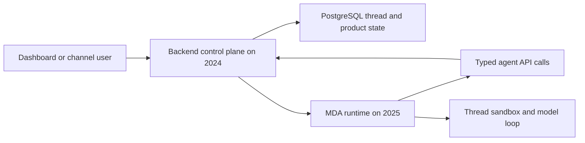

# Open SWE orientation and change routing

Open SWE is a software factory built on Deep Agents: it can investigate and change a repository, validate work, deliver a pull request, review pull requests, and respond to later feedback. It is no longer an in-process coding-agent architecture. The backend is the FastAPI/PostgreSQL control plane; the separate Managed Deep Agents (MDA) deployment owns every `agent`, `reviewer`, and `review-scout` model loop, checkpoint, sandbox, tool call, and runtime middleware.

**Start with the code and the nearest behavioral test.** This page is a routing aid, not a substitute for them. In particular, do not copy legacy backend LangGraph-client patterns: new work belongs in MDA for agent execution and in PostgreSQL for backend-owned state.

## Local prerequisites and process topology

Install Python 3.14+, `uv`, Node 26+ and `pnpm`. Running MDA locally also builds its vendored CLI and therefore needs Rust's `cargo`. Docker is needed when using the default local PostgreSQL container. Webhook work additionally needs a static HTTPS tunnel and the corresponding GitHub/Slack application setup; follow `docs/DEVELOPMENT.md` before exposing a local server.

The backend and MDA have separate environments. Set the backend root `.env` with at least `MDA_RUNTIME_URL=http://localhost:2025` and `REMOTE_RUNTIME_TOKEN_SECRET`; the backend refuses to start without them. In `mda/.env`, set `OPEN_SWE_BACKEND_URL=http://localhost:2024`, `LANGSMITH_API_KEY`, and the model credentials used by the runtime. Keep database URLs, keys, and local state ignored.

```bash
make install                    # backend Python dependencies
make build-dashboard            # optional bundled dashboard build
make dev                        # backend + Agent Server on :2024; starts local Postgres unless POSTGRES_URI is set
make dev-mda                    # MDA runtime on :2025, in a second terminal

# UI iteration instead of a bundled dashboard
make dev-ui                     # Vite on :3000, backend fronting it on :2024
```

`make dev` is the normal local entry point: it serves the FastAPI app, Agent Server routes, and a built dashboard. `make dev-ui` keeps the browser on `:2024` while the backend proxies the Vite dev server, so dashboard APIs remain same-origin. `make run` is useful for inspecting the FastAPI app alone on `:8000`, but it has no LangGraph runtime and cannot create runs. `make desktop` starts the Electron wrapper and needs the backend separately.



This shows the local ownership boundary: the backend plans and authorizes a run, while MDA executes it and calls named backend endpoints with the signed run context.

### Public surfaces and safety boundaries

- `langgraph.json` registers three compatibility graph names—`agent`, `reviewer`, and `review-scout`—and `openswe.webapp:app`. The backend's thread router is in front of Agent Server thread and run routes: new threads run on MDA, whereas pre-MDA local threads are read-only compatibility records.
- The browser dashboard is at `/`; dashboard APIs live under `/dashboard/api/*`. `/ok` and `/health` are health checks. GitHub and Slack use `/webhooks/*`; MDA channel event callbacks use `/github/channel/events` and `/linear/channel/events`.
- All new agent runs use the one MDA graph, `open-swe`. The backend derives a run catalog once from backend-owned settings, access, and integrations, signs a token, and MDA calls typed `POST /agent-api/{endpoint}` operations. Keep per-run execution state in MDA and durable product/thread state in PostgreSQL—not backend process memory.
- A normal coding sandbox is persistent per thread. Do not silently replace an unreachable coding sandbox because it can contain uncommitted work. The runtime, not the backend, owns MDA sandbox lifecycle and execution.
- New backend endpoints belong to the feature package that owns them, not a catch-all dashboard route. Prompts belong in `openswe/resources/prompts/`; delayed or retried work belongs in the PostgreSQL job queue.

For a local webhook tunnel, use `make tunnel NGROK_DOMAIN=<name>.ngrok-free.dev`. Its supplied policy exposes only `/webhooks/*`; do not publish the whole unauthenticated `langgraph dev` port. The detailed local configuration, callback, and verification procedure is in [Local development, deployment, and operations](operations/local-development-and-deployment.md).

## Route a change to its owner

Choose the narrowest system first, then read its code and nearby tests. The pages below are the planned navigation map; absence of a page is not a reason to broaden a change into another subsystem.

| If the task changes… | Start in the repository | Read for context |
| --- | --- | --- |
| Thread records, API composition, transcript/inbox state, runtime forwarding, or background workers | `openswe/api/`, `openswe/threads/`, `openswe/transcript/`, `openswe/jobs/` | [Backend control plane, threads, and durable state](architecture/backend-control-plane.md) |
| Agent/reviewer/scout graph assembly, model loop, file/shell tools, sandbox execution, runtime reports, or recovery | `mda/agent.py`, `mda/rt/`, `mda/tests/` | [Managed Deep Agents runtime](architecture/managed-runtime.md) |
| Which side owns a capability, UI/channel boundary, or deployment topology | the affected backend package and `mda/` | [System architecture and ownership boundaries](architecture/overview.md) |
| A signed runtime endpoint, catalog/token field, backend-to-MDA call, report idempotency, or tool-set lookup | `packages/runtime-api/`, `openswe/agent_api/`, `mda/rt/` | [Signed runtime API contract](architecture/runtime-api-contract.md) |
| Settings, identity, secrets, tokens, GitHub credential scope, or authorization | `openswe/config.py`, `openswe/users/`, `openswe/api_keys/`, `openswe/credential_scope.py` | [Configuration, identity, and security boundaries](concepts/security-and-configuration.md) |
| Catalog resolution, tool grants, MCP exposure, skills, prompts, or model selection | `openswe/agent_api/`, `openswe/tools/`, `openswe/tool_loaders/`, `openswe/resources/prompts/` | [Run catalogs, tools, prompts, and models](concepts/tools-and-catalogs.md) |
| Dashboard, desktop, Slack, Linear, GitHub conversation routing, or streaming UI | `ui/`, `desktop/`, `openswe/dashboard/`, `openswe/slack/`, `openswe/linear/`, `openswe/mda_channels/` | [Dashboard, desktop, and conversation channels](integrations/dashboard-and-channels.md) |
| GitHub App/webhooks, sandbox providers, browser, proxy credentials, or MCP servers | `openswe/github/`, `openswe/sandboxes/`, `openswe/mcp/`, `mda/rt/` | [GitHub, sandboxes, and MCP integrations](integrations/github-and-mcp.md) |
| Dispatch, follow-ups, interrupts, completion, run status, or ingress from any surface | `openswe/dispatch.py`, `openswe/invocation.py`, `openswe/threads/`, `openswe/completion.py` | [Invocation, dispatch, and continuation](workflows/run-lifecycle.md) |
| Schedules, job leases/retries, tasks, reconciliation, CI monitoring, or a wakeup/note to a thread owner | `openswe/jobs/`, `openswe/schedules/`, `openswe/tasks/`, `openswe/baby_sit.py`, `openswe/reconcile.py` | [Scheduling, jobs, tasks, and monitoring](workflows/background-automation.md) |
| PR creation, findings, review/scout behavior, publishing, approval, CI feedback, or delivery | `openswe/review/`, `openswe/reviewer.py`, `openswe/review_scout/`, `openswe/github/` | [Pull request work, review, and delivery](workflows/review-and-delivery.md) |
| Local startup, deployment, health, observability, or a webhook tunnel | `docs/DEVELOPMENT.md`, `Makefile`, `compose.yaml`, `mda/README.md` | [Local development, deployment, and operations](operations/local-development-and-deployment.md) |
| What test to add or run, test database setup, MDA isolation, or browser/Electron E2E | nearest test under `tests/` or `mda/tests/` | [Testing strategy and test boundaries](testing/strategy.md) |

## Change conventions that prevent cross-boundary regressions

- Implement Python asynchronously. If an interface forces a synchronous method, make it raise `NotImplementedError` rather than maintaining two execution paths. Keep Python and TypeScript strongly typed; do not use `Any`/`any` to silence a type error.
- Model execution policy belongs in `mda/rt`; file and shell guards belong in `mda/rt/file_tools.py`. If backend credentials or durable data are required, define a named typed runtime endpoint rather than a generic callback or untyped payload.
- Resolve a provider identity to `users.id` at ingress and use that ID internally. Use named GitHub client methods rather than raw REST or GraphQL calls outside the designated transport modules.
- Put persistent backend data in PostgreSQL. Use `THREADS` for threads and `queue.schedule(...)` with a registered job handler for delayed, recurring, or retrying work. Background work wakes or notes the owning thread rather than posting directly to its Slack channel.
- Before changing `ui/`, read `ui/AGENTS.md` and `ui/DESIGN.md`. Flag native-shell, preload, IPC, packaging, or bundled bridge/CLI changes as potential desktop-release work.

## Focused validation

Never run the full test suite locally. Run the narrowest behavioral test that proves the changed behavior, then the check for the language or boundary you touched.

```bash
# Backend test or a single node
make test TEST_FILE=tests/threads/test_router.py
uv run pytest -vvv tests/threads/test_router.py::test_name

# Backend quality checks
make lint
make format-check
make typecheck

# MDA is intentionally a separate project and environment
make mda-test PYTEST_ARGS="mda/tests/test_file.py"
make mda-typecheck
```

Backend tests can require `TEST_ANALYTICS_POSTGRES_URI`; without it, database-dependent tests skip. MDA must never import `openswe`: both sides test the models exchanged through `packages/runtime-api`, not each other's implementation. Add a test only for a concrete behavioral regression—especially authorization, integrity, or state transitions—and prefer extending a nearby behavioral test to creating a mock-heavy harness.

For a dashboard or desktop change, use the package's narrow check first. Escalate to a single Playwright spec only for a real end-to-end contract:

```bash
pnpm install --frozen-lockfile
pnpm run test:e2e:install
pnpm exec playwright test tests/full_flow.spec.ts
```

The E2E harness runs the real backend, MDA runtime, agent code, dashboard, Electron paths, a temporary local sandbox, and local Git; it scripts the model and fakes external SaaS HTTP boundaries. See [Testing strategy and test boundaries](testing/strategy.md) before changing the harness or relying on a skipped integration test.
