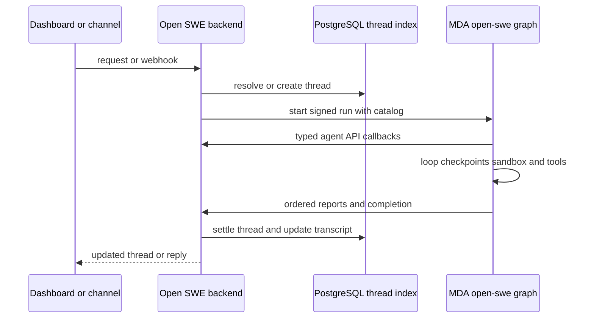

# Open SWE change guide

Open SWE is an asynchronous software factory built on Deep Agents and LangGraph. Work can start from the dashboard, GitHub, Slack, Linear, or automation; coding, review, and review-scout turns run in the separate Managed Deep Agents (MDA) runtime. Treat repository code and focused behavioral tests as authoritative; use this page to find the owner before changing an integration or execution path.

## Before editing: identify the owner

The most important boundary is not a Python package boundary. The **backend** is the stateless control plane: it authenticates and gates ingress, persists its control-plane records in PostgreSQL, plans a run, signs its token, and exposes typed callbacks. **MDA** owns the actual agent execution: model loop, checkpoints, per-thread sandbox, tool calls, and runtime middleware. The projects deliberately communicate through the shared typed `packages/runtime-api` contract; `mda/` must not import `openswe`.



*The normal control path: the backend plans and records a turn, while MDA executes it and calls back with authenticated typed work and reports.*

Do not add backend-memory state, an untyped catch-all runtime endpoint, or a new backend LangGraph SDK client call. A fact fixed at run start belongs in the run catalog/context; a later call derives authorization and identity from the signed run token. New behavior that needs backend data or credentials should be a named endpoint; model-loop behavior belongs in `mda/rt/` middleware, and file/shell policy belongs in `mda/rt/file_tools.py`.

## Set up a useful local loop

Use Python 3.14+ with `uv`; use Node 22.22.2+ and `pnpm` for the workspace UI. Building/running MDA also needs Rust because `make dev-mda` builds the vendored MDA CLI. Install the backend environment and dashboard dependencies, then configure both processes:

```bash
uv venv
source .venv/bin/activate
uv sync --all-extras
pnpm install --frozen-lockfile
```

The root `.env` needs backend credentials and configuration. In particular, the backend requires `MDA_RUNTIME_URL` and `REMOTE_RUNTIME_TOKEN_SECRET`; it also needs PostgreSQL, and the documented local defaults start a loopback `postgres:16` container on port `5433` when `POSTGRES_URI` is absent. `mda/.env` needs `OPEN_SWE_BACKEND_URL=http://localhost:2024`, `LANGSMITH_API_KEY`, and the model credential(s). See [Development, configuration, and deployment](operations/development-and-deployment.md) before provisioning real credentials or a shared environment.

```bash
make build-dashboard  # bundle ui/ for the backend to serve
make dev              # backend, LangGraph development server, and dashboard at :2024
make dev-mda          # separate terminal: MDA runtime at :2025
```

`make dev` registers the three legacy-compatible graph entrypoints (`agent`, `reviewer`, and `review-scout`) and the FastAPI app from `langgraph.json`, but new agent/reviewer/review-scout threads are routed to MDA's single `open-swe` graph. `make run` is FastAPI-only on port 8000 and cannot create runs. Use `make dev-ui` while editing the React dashboard: it runs Vite on `:3000` while the backend at `:2024` fronts it, preserving the normal browser origin. `make desktop` starts the Electron wrapper but requires a backend separately.

For GitHub or Slack callbacks, use a stable ngrok hostname and `make tunnel NGROK_DOMAIN=<name>.ngrok-free.dev`. Its supplied policy exposes only `/webhooks/*`; do not expose the entire `langgraph dev` port, whose Agent Server routes have no authentication. Verify `/ok` locally, the dashboard, and the tunnel/webhook path separately—one healthy endpoint does not prove that the UI build, runtime, or external intake is usable.

### Development conventions that change design

- Implement async paths only. If an interface requires a synchronous method, make it raise `NotImplementedError` rather than maintaining a second implementation.
- Keep prompts in `openswe/resources/prompts/`, place new dashboard routes in their owning feature package, and use `THREADS`/the PostgreSQL thread store rather than the LangGraph Store for new durable state.
- Preserve ownership: only the agent owning a Slack channel thread posts there; background work sends it a wakeup or note instead.
- Make schema changes with `make migration m="Short description"`; new durable tables follow the repository's UUID/timestamps/auditing and foreign-key conventions.

## Thread and run lifecycle

`ThreadRouter` sits in front of `/threads` and `/runs`, so dashboard, CLI, and backend callers retain the Agent Server interface while the PostgreSQL index becomes the routing authority. New threads are created in MDA and recorded as `runtime: mda`; their state, history, streams, commands, and runs are forwarded to the runtime. The index tracks busy/idle status: a started MDA run marks it busy, then the completion webhook or reconciliation settles it. Pre-MDA local threads remain readable but are deliberately read-only for runs, crons, commands that write, and copies.

Channel-owned MDA threads are a special ownership boundary. Slack, Linear, and GitHub conversations remain owned by their MDA channel; the backend reaches them through trusted-backend ingress to continue, answer an interrupt, or cancel. Copies and crons are rejected, and writes lacking the required channel secret are refused. Read [Threads, runs, and durable state](architecture/threads-runs-and-persistence.md) before changing thread metadata, run status, transcript delivery, or a client using `/threads`.

The backend works out a per-run catalog before starting MDA. It describes allowed operations, models, subagents, sandbox/file checks, skills, and loop rules. MDA gets tool specifications and grants through typed callbacks rather than accepting them from model-controlled arguments; runtime reports are ordered, retried from graph state, and deduplicated by a thread-unique receipt key at the backend. See [Backend–Managed Deep Agents boundary](architecture/backend-runtime-boundary.md), [Run catalog and operation boundary](architecture/tool-catalog-and-operations.md), and [Durable state, messages, and events](concepts/durable-state-and-events.md) for the contracts that a cross-boundary change must preserve.

## Route a change to its real surface

| If changing… | Start with | Then read |
| --- | --- | --- |
| A run's planning, signed context, typed callback, or report | `openswe/agent_api/` and `packages/runtime-api/` | [Backend–Managed Deep Agents boundary](architecture/backend-runtime-boundary.md) and [From request to completed agent turn](workflows/turn-execution.md) |
| Model loop, tool middleware, sandbox lifecycle, or runtime file/shell behavior | `mda/agent.py`, `mda/rt/` | [Sandboxes, remote files, and MCP](integrations/sandboxes-and-mcp.md) and [Run catalog and operation boundary](architecture/tool-catalog-and-operations.md) |
| Dashboard API, React UI, Electron, CLI, or Agent Server compatibility | `openswe/dashboard/`, `ui/`, `desktop/`, `cli/`, `openswe/threads/` | [Dashboard, desktop, and CLI surfaces](integrations/dashboard-desktop-and-cli.md) |
| GitHub webhooks, PR work/review, Slack, or Linear | respective `openswe/github/`, `openswe/slack/`, `openswe/linear/`, `mda/channels/` | [GitHub, Slack, and Linear channels](integrations/channels-and-github.md) and [GitHub coding, review, and delivery workflows](workflows/github-collaboration.md) |
| Scheduling, CI watches, task workers, or deferred delivery | `openswe/schedules/`, `openswe/jobs/`, `openswe/baby_sit.py`, `openswe/tasks/` | [Schedules, tasks, and background follow-up](workflows/background-automation.md) |
| Identity, OAuth/App tokens, run tokens, model configuration, workspace routing, or skills | `openswe/users/`, `openswe/credential_scope.py`, `openswe/agent_api/tokens.py`, `openswe/workspaces/` | [Identity, authorization, and credentials](concepts/identity-authorization-and-credentials.md) and [Workspaces, models, and prompts](concepts/workspaces-models-and-prompts.md) |
| Database, startup, deployment, health, local configuration, or observability | `openswe/config.py`, `openswe/api/app.py`, migrations, `compose.yaml` | [Development, configuration, and deployment](operations/development-and-deployment.md) |

For the overall picture, start at [System architecture](architecture/overview.md). Do not copy the legacy per-run `ToolSurface` planning path (`plan_agent`, `plan_reviewer`, `plan_review_scout`): it exists for compatibility and should shrink, not receive new behavior.

## Startup and operational guardrails

The FastAPI lifespan pins one event loop, validates GitHub-login, sandbox, local-model, MDA, Slack, and database configuration, migrates the database, then starts listeners and workers. Some optional reporting/listener startup failures are logged so the process can continue with degraded cross-replica notifications, but the core configuration checks and migrations are not optional. Shutdown stops workers/listeners and closes the HTTP pool and database.

Credentialed CORS permits configured dashboard origins plus `open-swe://app`; a wildcard origin is an error. Treat this, webhook signature checks, run-token authentication, and the separation of credentials from model input as security boundaries, not convenience configuration. Consult [Identity, authorization, and credentials](concepts/identity-authorization-and-credentials.md) for a credential or authorization change.

## Validate the changed boundary

Never run the full Python suite locally. Name the concrete regression or contract your change affects, extend an existing behavioral test where it already owns the behavior, and run the narrowest target. The backend and MDA are separate projects: MDA tests run in its own environment and must not import `openswe`; test both sides of a typed endpoint against the shared exchanged models.

```bash
make test TEST_FILE=tests/threads/
uv run pytest -vvv tests/threads/test_some_behavior.py::test_case
make mda-test PYTEST_ARGS="tests/test_some_behavior.py::test_case"
make lint
make typecheck
make mda-typecheck
```

`make test` skips a nonexistent target, so check the path rather than mistaking a green skip for validation. Pytest runs async tests automatically. PostgreSQL-dependent backend tests use `TEST_ANALYTICS_POSTGRES_URI`; without it, their `registry_db` fixture skips, which means a local run covers less than CI. Use [Testing and validation strategy](testing/overview.md) to select test families and fixtures.

Use Playwright only for an actual end-to-end contract across UI, backend, MDA, sandbox, or external-boundary fakes:

```bash
pnpm install --frozen-lockfile
pnpm run test:e2e:install
pnpm exec playwright test tests/full_flow.spec.ts
```

The E2E harness runs the real backend, MDA project, agent code, dashboard, Electron path, local git, and a temporary sandbox implementation, while scripting the model and faking external SaaS HTTP boundaries. Browser tests are serial with one worker; the desktop configuration runs only `desktop.spec.ts`. It requires PostgreSQL, and retained traces, videos, screenshots, and reports are available for failure diagnosis.

Python quality checks use Ruff with line length 100 and `ty`; the JavaScript workspace exposes `pnpm run check`, `pnpm run lint`, `pnpm run typecheck`, and formatting checks. Run only the relevant check(s) after the focused behavioral test.
