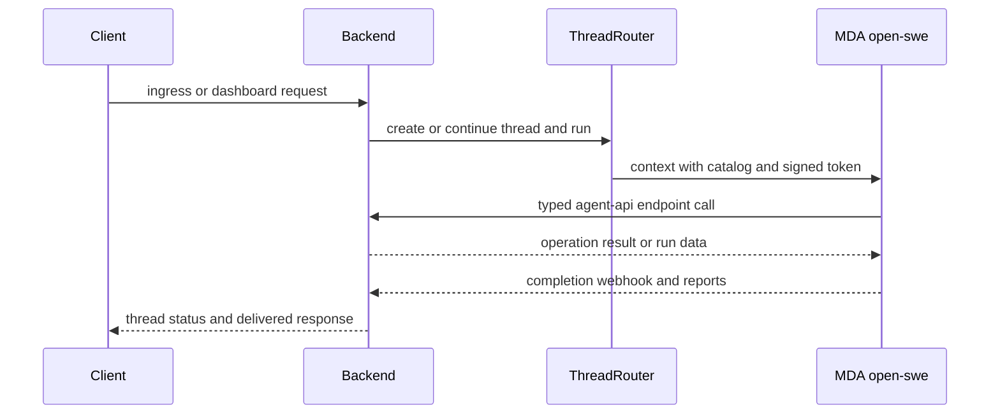

# Open SWE Contributor Map

Open SWE is an asynchronous software factory: it can implement work in an isolated sandbox, deliver or review pull requests, monitor CI, and continue conversations from the dashboard, GitHub, Slack, or Linear. It is deliberately split between a Python backend and the separate Managed Deep Agents (MDA) project in `mda/`.

**Use source and tests as the authority.** OpenWiki pages are optional just-in-time orientation. Before changing behavior, read the owning code and its nearest behavioral test; do not infer the current contract from an older graph or route name.

## First: choose the owner

| If the change concerns… | Work primarily in… | Read next |
| --- | --- | --- |
| HTTP, authentication, PostgreSQL records, thread routing, run planning, product policy, or credentials | `openswe/` backend | [System Topology and Entrypoints](architecture/overview.md), [Backend–Managed Deep Agents Runtime Contract](architecture/backend-mda-runtime.md) |
| The model loop, checkpoints, sandbox lifecycle, native file/shell tools, tool-call middleware, or MDA channel code | `mda/` | [Backend–Managed Deep Agents Runtime Contract](architecture/backend-mda-runtime.md), [Tool Catalog, Operations, and Sandbox Access](concepts/tools-and-sandbox-access.md) |
| A request’s lifecycle, follow-up, interrupt, completion, or user-visible failure | backend dispatch/thread code plus the MDA hook that consumes it | [Invocation, Interrupt, Follow-up, and Completion Workflow](workflows/invocation-follow-ups.md), [Run State, Messages, Transcript, and Delivery Guarantees](concepts/run-state-and-transcript.md) |
| Dashboard, desktop, Slack, GitHub, or Linear behavior | the relevant client/channel package and its thread/authorization boundary | [Dashboard, Desktop, and Conversation Channels](integrations/channels-dashboard.md), [Authentication, Authorization, and Credential Boundaries](concepts/security-and-authorization.md) |
| A tool, MCP integration, sandbox access, model setting, prompt, or skill | the backend catalog/operation boundary or MDA-native runtime behavior | [Tool Catalog, Operations, and Sandbox Access](concepts/tools-and-sandbox-access.md), [MCP, GitHub, LangSmith, and External Service Integrations](integrations/mcp-and-external-services.md), [Models, Prompts, Skills, and Settings Resolution](concepts/models-prompts-and-settings.md) |
| Tables, migrations, jobs, reconciliation, analytics, tracing, deployment, or environment settings | backend persistence/worker/configuration code; sometimes MDA deployment configuration too | [PostgreSQL, Workers, Reconciliation, and Observability](operations/data-jobs-and-observability.md), [Configuration, Local Development, and Deployment](operations/configuration-and-deployment.md) |

### Core boundary: backend plans; MDA executes

All new `agent`, `reviewer`, and `review-scout` threads run on the single MDA graph, `open-swe`. The backend does not own an in-process model loop: before starting a remote run it creates a catalog and signed run token, then MDA executes the loop, checkpoints, sandbox work, tools, and runtime middleware. MDA calls back to typed `POST /agent-api/{endpoint}` operations using that token; backend handling must be derivable from the request and token rather than process memory.



This shows the normal ownership path: the router selects the runtime, the backend plans and services the run, and MDA performs the durable agent execution.

Do not add a generic callback or a backend phase hook for new capability. Put behavior that needs backend data or credentials behind a named typed endpoint; put loop control and checks around MDA’s file/shell tools in `mda/rt`. Run-fixed data belongs in the catalog/context prepared at start, and durable state belongs in MDA state or PostgreSQL—not backend memory. The older `ToolSurface`/`RunSession` planning path is legacy: shrink it rather than extending it.

## Local development: run both services when changing runs

The backend requires Python 3.14+ and `uv`; JavaScript packages are a `pnpm`/Turbo workspace. MDA is its own locked project and is never imported by the backend. A normal local agent change needs a PostgreSQL database, a backend at `:2024`, and MDA at `:2025`.

```bash
make install
make build-dashboard
make dev
make dev-mda
```

`make dev` starts `langgraph dev` on port 2024 and starts the local PostgreSQL container when `POSTGRES_URI` is not set. `make dev-mda` first builds the vendored MDA CLI with Cargo and then serves the MDA project on port 2025. Configure the backend `.env` with `MDA_RUNTIME_URL=http://localhost:2025` and `REMOTE_RUNTIME_TOKEN_SECRET`; configure `mda/.env` with `OPEN_SWE_BACKEND_URL=http://localhost:2024`, LangSmith credentials, and a model credential. The backend refuses startup without the MDA URL and token secret.

Useful narrower loops:

```bash
make dev-ui       # Vite on :3000 plus backend fronting it on :2024
make web          # dashboard dev server only
make run          # FastAPI only on :8000; cannot create runs
make desktop      # Electron; backend must already be running
make migration m="Short description"
```

Build the bundled dashboard with `make build-dashboard`; use `make dev-ui` for UI hot reload while retaining the normal backend origin. `make run` is appropriate for custom FastAPI-route inspection, but not any change that must dispatch an agent run. For webhook work, expose only `/webhooks/*` through `make tunnel NGROK_DOMAIN=<name>.ngrok-free.dev`; the development LangGraph server itself has unauthenticated runtime endpoints.

## Entrypoints and compatibility constraints

`langgraph.json` registers the backend FastAPI app and three legacy graph entrypoints: `agent`, `reviewer`, and `review-scout`. Those graph modules are read-only compatibility graphs for threads created before the MDA migration; they are not the implementation location for new agent behavior. New threads are indexed and routed to MDA, while legacy local threads may be read but reject new runs, crons, commands that write, and copies.

`ThreadRouter` sits ahead of the Agent Server’s `/threads` and `/runs` APIs. It lets dashboard, CLI, and backend clients retain the same thread API while serving thread index reads from PostgreSQL and forwarding run/state/history/stream/cancel activity to the thread’s runtime. An MDA run marks its indexed thread busy; completion webhook processing or reconciliation settles it. MDA channel-owned Slack, Linear, and GitHub conversations retain their channel ownership: ordinary backend writes that would break that ownership are refused, while trusted backend ingress continues the existing conversation.

The backend’s FastAPI composition is `openswe.webapp:app`, a re-export of `openswe.api.app:app`. Its lifespan validates MDA, sandbox, local model, Slack, GitHub-login, and database configuration; migrates the database; starts workers/listeners; and stops them plus the HTTP pool/database on shutdown. Its middleware includes `ThreadRouter`, audit logging, request IDs, tracing, compression, and credentialed CORS; wildcard dashboard origins are rejected.

## Change rules that prevent architectural drift

- Keep Python implementations async-only. If an interface forces a synchronous method, it must raise `NotImplementedError` rather than duplicate the implementation.
- Keep strong Python and TypeScript types. Do not use `Any` or `any` to evade a type error.
- Put behavior on the state-owning class. New module-level functions are only framework entrypoints such as routes, graph nodes, tools, and job handlers.
- Add dashboard routes in the owning feature package’s `router`, not a central dashboard route module. Read `ui/AGENTS.md` and `ui/DESIGN.md` before changing `ui/`.
- Use named GitHub client methods and open clients as the actor they represent. Do not leak REST paths or GraphQL strings outside the GitHub transport boundary.
- Model-facing prompts live under `openswe/resources/prompts/`; agent notifications use structured `RunMessage` builders rather than bare feature-specific payloads.
- Do not add backend uses of the LangGraph SDK client or LangGraph Store. Use MDA for runs and PostgreSQL/`THREADS` for thread state.
- When a setting is user-configurable, update its authorized agent tool and shared validation/permission behavior as appropriate. Favor fine-grained tools over batch orchestration.

## Route a request or integration change

1. **Ingress and identity:** determine whether it starts in dashboard, webhook, or an MDA channel. Preserve the channel’s verification and authorization gate; do not let a user credential escape into a run that is not acting as that user.
2. **Thread ownership:** find the indexed thread and whether it is MDA, legacy local, or MDA-channel-owned. This decides where a run is sent and which writes are allowed.
3. **Run setup:** backend dispatch resolves workspace/settings/context, plans the catalog, signs the token, and starts `open-swe`. A failure to plan must prevent the run from starting.
4. **Runtime execution:** MDA reads the run catalog and invokes named backend endpoints for operations, state-dependent hooks, reports, tool specifications, or credentials. It owns model calls, checkpoints, MDA-owned sandboxes, and native tool middleware.
5. **Settlement:** reports and the completion webhook update backend-owned transcript, usage, status, delivery, and follow-up state. Reconciliation exists for work that did not settle cleanly.

For integration-specific ownership and credential boundaries, see [MCP, GitHub, LangSmith, and External Service Integrations](integrations/mcp-and-external-services.md). For schedules, monitors, background tasks, and recovery, see [Scheduled, Background, and Monitoring Workflows](workflows/automation-and-scheduling.md). For coding delivery and review behavior, see [Pull Request Delivery, Review, and Feedback Workflow](workflows/pr-delivery-and-review.md).

## Validate the smallest changed boundary

**Never run the full test suite locally.** Choose a behavioral test adjacent to the changed package; add or extend a test only for a concrete regression not already covered. Security, authorization, data integrity, and difficult state transitions deserve focused coverage. Documentation, prompt wording, trivial accessors, and behavior enforced by types or a library do not automatically need a test.

```bash
make test TEST_FILE=tests/threads/test_thread_router.py
uv run pytest -vvv tests/threads/test_thread_router.py::test_name
make mda-test PYTEST_ARGS="mda/tests/test_loop.py::test_name"
make lint
make format-check
make typecheck
make mda-typecheck
```

Use backend test families matching the boundary—especially `tests/threads/`, `tests/runtime/`, `tests/tools/`, `tests/mda_channels/`, `tests/webhooks/`, `tests/dashboard/`, `tests/github/`, `tests/slack/`, and `tests/database/`. MDA tests live independently in `mda/tests/`; test each side of their typed endpoint contract without importing `openswe` into MDA.

Escalate to one Playwright spec only when the contract genuinely crosses UI/channel, backend, MDA, sandbox, and delivery boundaries:

```bash
pnpm exec playwright test tests/full_flow.spec.ts
```

The E2E harness runs real backend and MDA code, real local git, and the real dashboard/Electron paths while using a scripted LLM and fake external SaaS HTTP boundaries. See [Focused Testing Across Backend and MDA](testing/overview.md) for fixtures, database-backed tests, and focused browser/desktop commands.

## Follow-up map

- [System Topology and Entrypoints](architecture/overview.md) — public surfaces and major owned domains.
- [Backend–Managed Deep Agents Runtime Contract](architecture/backend-mda-runtime.md) — signed contexts, typed endpoints, catalogs, reports, tools, and failure semantics.
- [Thread Indexing, Routing, and Runtime Ownership](architecture/thread-runtime.md) — PostgreSQL thread index, runtime selection, busy/settled lifecycle, and channel-owned threads.
- [Configuration, Local Development, and Deployment](operations/configuration-and-deployment.md) — secrets, dual-project startup, migrations, packaging, and deployment.
- [Authentication, Authorization, and Credential Boundaries](concepts/security-and-authorization.md) — API/webhook auth, acting-user rules, tokens, and credential connections.
- [Run State, Messages, Transcript, and Delivery Guarantees](concepts/run-state-and-transcript.md) — checkpoints, durable records, inbox/outbox, and completion.
- [Focused Testing Across Backend and MDA](testing/overview.md) — test ownership and narrow validation selection.
