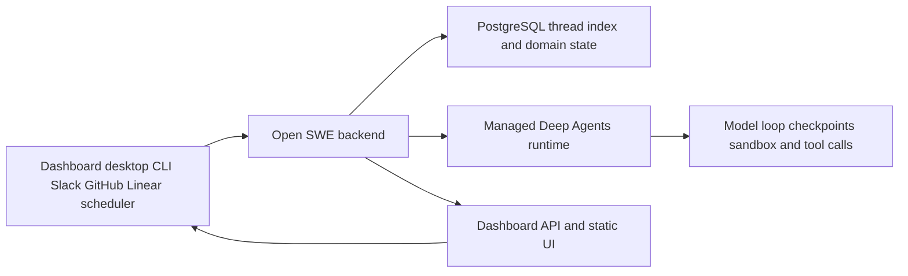

# Open SWE Codebase Guide

Open SWE is an asynchronous software factory: its backend accepts product and integration requests, while Managed Deep Agents (MDA) executes the coding, reviewer, and review-scout model loops. The dashboard and Electron desktop app are separate pnpm workspace clients. Start with source and the focused tests that own a proposed change; this guide is a routing aid, not a replacement for them.

## Pick the owning boundary first

| If the change concerns… | Start in… | Then read… |
| --- | --- | --- |
| HTTP APIs, authorization, PostgreSQL state, dashboard routes, webhook ingress, thread indexing, jobs, or backend-side tool operations | `openswe/` backend | [System Architecture and Deployment Boundaries](architecture/overview.md), [Persistent State, Transcripts, and Background Processing](architecture/state-and-async-services.md), and [Authorization, Credentials, and Tenant Scoping](concepts/security-and-tenancy.md) |
| Model calls, checkpoints, sandbox file/shell tools, MDA-native subagents, or the runtime half of the backend contract | `mda/` runtime | [Managed Agent Runtime and Typed Backend Contract](architecture/managed-runtime.md) and [Tool Surfaces, Sandbox Access, and Safety Guards](concepts/tools-and-safety.md) |
| Dashboard interaction, Electron behavior, CLI, browser-side API use, or conversation rendering | `ui/`, `desktop/`, or `cli/` workspace packages | [Dashboard, Desktop, CLI, and Conversation Surfaces](integrations/user-surfaces.md) |
| A graph's intended behavior, prompt/model selection, skills, or tool visibility | the backend graph planner and its runtime contract | [Models, Prompt Context, Skills, and Run Configuration](concepts/models-and-context.md), [Managed Agent Runtime and Typed Backend Contract](architecture/managed-runtime.md), and [Tool Surfaces, Sandbox Access, and Safety Guards](concepts/tools-and-safety.md) |
| GitHub, Slack, Linear, MCP, signed webhooks, or outbound integration behavior | the owning integration package in `openswe/` | [GitHub, Slack, Linear, and MCP Integrations](integrations/github-and-mcp.md) |
| A task's creation, a follow-up, thread status, routing, cancellation, or completion | thread, dispatch, and runtime-routing code | [Invocation, Thread Creation, and Follow-up Routing](workflows/invocation-and-thread-routing.md) |
| Coding in a sandbox, delivery, push/PR approval, review findings, CI watching, schedules, or queued work | the relevant workflow owner | [Coding, Sandbox, and Pull Request Delivery Workflow](workflows/coding-and-delivery.md), [Pull Request Review and Human Decision Workflows](workflows/pull-request-review.md), or [Schedules, Jobs, Monitoring, and Merge Queue Automation](workflows/background-automation.md) |



The backend owns product state, ingress, authorization, planning, and the typed runtime-facing API; MDA owns execution of the model loop, its checkpoints, sandbox, and tool calls. UI and desktop clients consume backend-facing surfaces rather than becoming an execution runtime.

## Local setup and the smallest useful loop

Use Python 3.14+ with `uv` for the backend and Node 22.22.2+ with `pnpm` for workspace packages. The backend needs PostgreSQL and, unlike older local-only assumptions, requires an MDA URL and a secret used to sign MDA run tokens. Read [Local Development, Builds, and Deployment](operations/local-development-and-deployment.md) and `docs/DEVELOPMENT.md` before configuring credentials, a tunnel, or worktree state.

```bash
make install
make build-dashboard
make dev
make dev-mda
```

`make dev` runs LangGraph development serving on port 2024 and starts the local PostgreSQL container when `POSTGRES_URI` is unset. `make dev-mda` builds the vendored MDA CLI if needed and serves the MDA project on port 2025. Set `MDA_RUNTIME_URL=http://localhost:2025` and `REMOTE_RUNTIME_TOKEN_SECRET` in the root `.env`; MDA separately needs `mda/.env` with `OPEN_SWE_BACKEND_URL=http://localhost:2024` and the needed model/tracing credentials.

For dashboard work, use the backend as the browser origin:

```bash
make dev-ui
```

This runs Vite on port 3000 and the backend on port 2024, with the backend forwarding UI requests so dashboard APIs and LangGraph routes remain at the backend origin. `make desktop` starts Electron but requires a backend separately. `make run` is useful for FastAPI-only route inspection on port 8000; it does **not** provide the LangGraph runtime and cannot create runs.

For webhook development, expose only `/webhooks/*` through the prescribed tunnel policy:

```bash
make tunnel NGROK_DOMAIN=<name>.ngrok-free.dev
```

`langgraph dev` has unauthenticated Agent Server endpoints, so forwarding its whole port publicly is unsafe. See [Configuration, Workspaces, and Provider Selection](operations/configuration.md) for configuration ownership and [GitHub, Slack, Linear, and MCP Integrations](integrations/github-and-mcp.md) for integration setup.

## Execution and thread-routing facts that affect changes

`langgraph.json` registers three backend graph entrypoints—`agent`, `reviewer`, and `review-scout`—and the FastAPI app at `openswe.webapp:app`. It also specifies Python 3.14 and delete-based checkpointer cleanup with a 60-minute sweep and a 43,200-minute default TTL. These backend graph registrations are not where current agent execution happens: every new agent, reviewer, and review-scout thread is created on MDA's single `open-swe` graph.

The `ThreadRouter` fronts Agent Server thread and run routes. It serves thread records from the PostgreSQL index, routes a new thread and its execution to MDA, and forwards run/state/history/stream requests to the thread's runtime. Pre-MDA local threads remain readable but reject new runs, crons, posting commands, and copies with a read-only response; do not treat their local execution path as a model for new work.

The boundary is deliberately typed. For each MDA run, the backend planner supplies a `ToolSurface`/catalog and handles named endpoints under `/agent-api/{endpoint}` behind a signed run token. MDA calls those endpoints while it runs the model loop and tools. Add a typed endpoint for a new cross-boundary operation rather than an untyped request body, and decide whether the behavior belongs in backend planning/phase middleware, a backend operation, or MDA's own file/shell runtime. The managed-runtime guide explains that choice and its sandbox and failure semantics.

## Working conventions that prevent cross-boundary mistakes

- Keep Python implementations async-only. If an interface requires a synchronous method, make it raise `NotImplementedError` rather than maintaining parallel sync and async paths.
- Keep backend persistence in PostgreSQL; do not introduce new backend `langgraph_client` or LangGraph Store state. The runtime has its own execution/checkpoint state, but that is not the product-state database.
- `mda/` is an independent project. Do not import `openswe` into it; evolve both sides of a runtime endpoint against the shared models in `packages/runtime-api`.
- Put a new dashboard endpoint on the router of its owning backend package, not in a central dashboard routes file. For UI mutations, follow the optimistic-update and rollback convention unless that would be unsafe.
- Put model-facing prompt resources under `openswe/resources/prompts/`; do not embed new prompt text in Python.

## Route a workflow change

Use the workflow page matching the behavior, then trace the caller and focused tests from there:

- **Invocation, messages, or lifecycle:** [Invocation, Thread Creation, and Follow-up Routing](workflows/invocation-and-thread-routing.md) covers normalization from dashboard, Slack, GitHub, Linear, API, and schedules; durable dispatch; the index; MDA routing; and settlement/follow-up behavior.
- **Implementation and delivery:** [Coding, Sandbox, and Pull Request Delivery Workflow](workflows/coding-and-delivery.md) covers prepared context, sandbox access, guarded actions, pull-request delivery, and continued work.
- **Review behavior:** [Pull Request Review and Human Decision Workflows](workflows/pull-request-review.md) covers automatic/on-demand review, review-scout support, findings, publishing, and human decisions.
- **Automation:** [Schedules, Jobs, Monitoring, and Merge Queue Automation](workflows/background-automation.md) covers durable work, leases/retries, CI watching, reconciliation, and merge queue behavior.

## Validate only the changed boundary

**Never run the full suite locally.** Select the narrowest existing behavioral test or test node that owns the change, then add only the quality check that applies. Prefer extending an existing behavioral test; a focused regression test is appropriate when a bug would otherwise recur.

```bash
make test TEST_FILE=tests/path/to_test.py
uv run pytest -vvv tests/path/to_test.py::test_name
make lint
make format-check
make typecheck
```

`make test` runs the path supplied by `TEST_FILE`; direct `pytest` is useful for a single node. The backend test environment has optional PostgreSQL-backed coverage controlled by `TEST_ANALYTICS_POSTGRES_URI`; when it is unset, those database tests skip, so record that limitation when it matters. For runtime changes, use the independent MDA environment and a focused test there:

```bash
make mda-test PYTEST_ARGS="tests/path/to_test.py"
make mda-typecheck
```

For UI/desktop changes, run the narrow workspace check or package script first. Escalate to one Playwright spec only when the contract truly crosses browser/desktop, backend, MDA, sandbox, or integration boundaries:

```bash
pnpm install --frozen-lockfile
pnpm run test:e2e:install
pnpm exec playwright test tests/full_flow.spec.ts
```

The E2E harness runs real backend code, the real local MDA project, a temporary local sandbox, local git, the dashboard, and Electron paths; it scripts the model and fakes external SaaS HTTP boundaries. Browser tests use one worker, and the desktop configuration selects `desktop.spec.ts`. For change-to-test selection, fixtures, database isolation, and artifacts, read [Testing and Change Validation Strategy](testing/strategy.md).

## Further operational routes

- [System Architecture and Deployment Boundaries](architecture/overview.md) — deployment roles and public ingress.
- [Managed Agent Runtime and Typed Backend Contract](architecture/managed-runtime.md) — the MDA/backend ownership boundary and endpoint protocol.
- [Configuration, Workspaces, and Provider Selection](operations/configuration.md) — environment settings, providers, sandbox choice, and credentials.
- [Local Development, Builds, and Deployment](operations/local-development-and-deployment.md) — local startup, packaging, deployment, observability, and troubleshooting.
- [Testing and Change Validation Strategy](testing/strategy.md) — focused backend, MDA, UI, desktop, and E2E validation.
