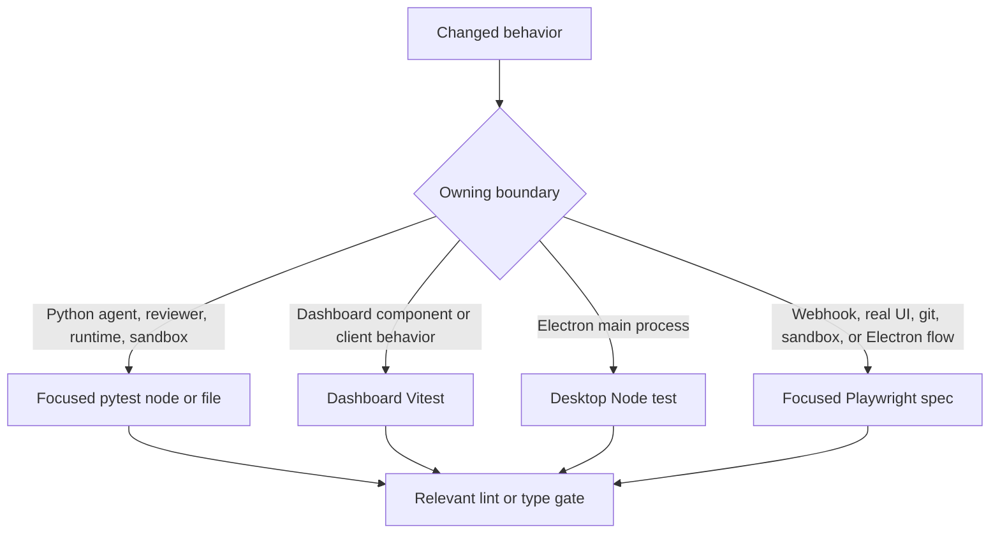
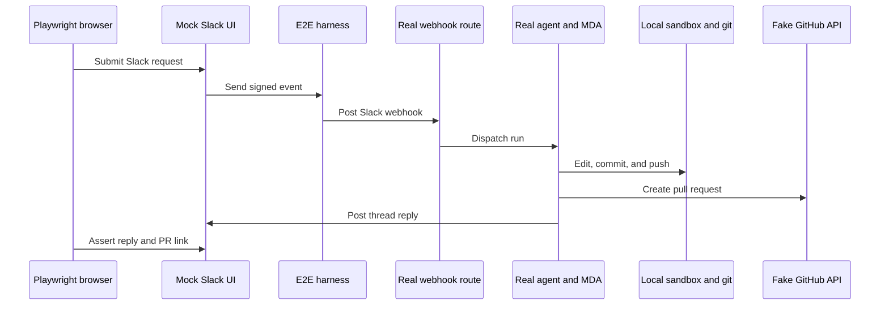

# Testing Strategy and Focused Validation

Validate the observable behavior at the layer that owns it. Start with one focused test or test file, extend an existing behavioral test only when it covers a concrete regression, and escalate to browser E2E only for a contract that actually crosses the webhook, authenticated UI, local git/sandbox, or Electron boundary. **Never run the complete local test suite.** In particular, do not invoke `make test` without `TEST_FILE`: its default is `tests/`.



This is the validation-selection flow: move outward only when the changed contract cannot be proved at the inner layer.

## Python: isolated behavioral suites

Pytest collects from `tests/` and runs in asyncio auto mode, so async tests and fixtures need no individual asyncio marker. The test tree is organized by runtime owner rather than a single integration bucket: `tests/agent/` protects agent creation, dispatch, task, configuration, and tool behavior; `tests/reviewer/` covers review creation, publication, reconciliation, approvals, and outcomes; `tests/runtime/` covers runtime-safe graph configuration; and `tests/sandbox/` covers provider lifecycle, proxying, recovery, and thread bindings.

The shared fixtures deliberately make ordinary tests hermetic:

- The autouse offline fixture rejects HTTP requests to non-loopback hosts and to the configured LangGraph server. Use an ASGI transport, mock transport, or a local fake for a boundary rather than reaching a developer service or the Internet.
- The autouse dashboard fixture sets `DASHBOARD_STATIC_DIR` to a missing temporary path, so a locally built `ui/.output` cannot influence Python behavior. It also clears the shared HTTP pool after each async test.
- TTL and LangGraph in-process caches, plus the process-global sandbox backend and connection registries, are cleared before and after each test. This prevents cached settings, MCP catalogs, or a sandbox handle for one thread from answering for another.
- The default auto-review fixture treats repositories as enabled because the test environment has no populated dashboard opt-in list. A test of the actual gate must replace its `is_review_repo_enabled` stub.

### Database-dependent tests

Most tests should use fakes or in-process routes. Tests that need PostgreSQL opt in through `registry_db` and require `TEST_ANALYTICS_POSTGRES_URI`; otherwise they skip instead of silently using a developer database. The fixture creates each test database by cloning a migrated template, points the real database module at that database and test schema, then closes engines and forcibly drops the database. `registry_db_if_available` supports code that has both configured and unconfigured behavior by yielding which path is active.

### Focused suites by behavior

| Change area | Start here | Contract to preserve |
| --- | --- | --- |
| Agent graph assembly, backend, skills, model routing, middleware, or tool exposure | `tests/agent/test_agent_assembly_context.py` | `get_agent` passes the composite sandbox-backed backend into Deep Agents so filesystem eviction and summarization work; tests also distinguish public/private skills and source- or capability-dependent tools. |
| Runtime configuration carried into a factory graph | `tests/runtime/test_bindable_config.py` | Internal `__pregel_*` bindings from a read path are removed without mutating the caller configuration, so a returned graph does not retain an unusable runtime. |
| Reviewer publish, finding, approval, reconciliation, or learning behavior | the matching file under `tests/reviewer/` | For example, publication must not write a stale assessment whose head SHA no longer matches, and outcome upserts create or update the finding label payload. |
| Lazy sandbox reconnection and backend operations | `tests/sandbox/test_sandbox_state.py` | Concurrent callers share one reconnect, cancelling a waiter does not cancel startup, failed startup can be retried, and delete delegates after lazy initialization. |
| Sandbox error recovery semantics | `tests/sandbox/test_sandbox_recovery.py` | A definitively unreachable sandbox notifies then ends the run rather than replacing a working tree; transient connection errors ask for retry and command errors remain tool errors. |

These are behavior tests, not prompt or source-shape snapshots. Prefer asserting a result, an invariant, or a user-visible failure path over asserting incidental call order.

## Running narrow Python checks

Install development tools with `make install`, which runs `uv sync --extra dev`. Use `make test TEST_FILE=<existing path>` for a file or directory; for one node ID, call pytest directly because the Makefile's existence check accepts a path, not `file.py::test_name`.

```bash
make install
make test TEST_FILE=tests/sandbox/test_sandbox_state.py
uv run pytest -vvv tests/sandbox/test_sandbox_state.py::test_sandbox_proxy_retries_failed_startup
uv run pytest -vvv tests/runtime/test_bindable_config.py
```

`make test` (also named `make tests`) runs `uv run pytest -vvv $(PYTEST_ARGS) $(TEST_FILE)` only when the path exists; otherwise it prints a skip message. Keep `PYTEST_ARGS` for the focused selector or pytest option that the change needs.

Tests are distinct from code-quality gates. `make lint` runs Ruff checking and a format diff, `make format` applies Ruff formatting and fixes, and `make typecheck` runs `ty check openswe tests`. Use the relevant gate after the focused behavioral proof; do not substitute broad test execution for a targeted test.

## JavaScript checks

Use pnpm workspace commands, not root `pnpm test`, for a dashboard or desktop change. The dashboard package uses `vitest run`; the desktop package builds the main bundle and then invokes `node --test test/*.test.cjs`.

```bash
pnpm --filter open-swe-dashboard run test -- <focused Vitest selector>
pnpm --dir desktop run test:run -- <focused Node test selector>
```

Choose dashboard Vitest for component rendering and client-state behavior. Choose the desktop Node tests for Electron main-process behavior. Root `pnpm test` delegates the workspace test task to Turbo and is not the focused local-validation entrypoint.

## Playwright: real agent execution with mocked external boundaries

The browser E2E harness tests a full production-shaped path while avoiding live SaaS. It starts the real Managed Deep Agents server, real `langgraph dev` backend, webhook routes, agent tools and middleware, local sandbox provider, and git operations against a seeded local bare remote. The scripted model and external GitHub/Slack HTTP APIs are substituted; GitHub App token minting and external credential access are also stubbed. The fake Slack and GitHub stores are shared by the fake APIs and mock UIs, making browser assertions observations of what real agent code wrote.



This is the full-flow seam: agent execution and local state are real, while model and SaaS boundaries are deterministic and inspectable.

`full_flow.spec.ts` exercises the Slack request, local implementation, fake-GitHub PR, and same-thread reply. The harness overlays the real application with fake GitHub and Slack endpoints, mock UIs, and control endpoints; it signs the simulated Slack event before posting to the real route. It resets fake and durable PR state between scenarios so a prior run cannot masquerade as the next test's PR.

The dashboard is also real: global setup builds the `ui/` application and starts its Nitro server. Playwright drives that server origin, where the genuine signed session cookie, SSR session gate, hydration, and same-origin `/dashboard/api/*` proxy are exercised. `E2E_FORCE_UI_BUILD=1` forces a dashboard rebuild after UI or port changes.

### Browser and desktop entrypoints

Install Chromium once before a browser run, then run the specific related spec rather than the browser suite:

```bash
pnpm install --frozen-lockfile
pnpm run test:e2e:install
pnpm exec playwright test tests/full_flow.spec.ts
pnpm run test:e2e:desktop
```

The root package maps `test:e2e` to the browser suite, `test:e2e:desktop` to the Electron flow, and `test:e2e:install` to `playwright install --with-deps chromium`. Browser Playwright is serial (`workers: 1`), excludes `desktop.spec.ts`, has a 90-second default test timeout, and reuses warm servers outside CI. The desktop configuration runs only `desktop.spec.ts` with a 180-second test timeout and separate output directories.

The desktop spec resets harness state, clones the seeded remote into a temporary project, injects a harness-issued `osw_session` cookie into Electron, and verifies both the local checkout change and fake-GitHub PR data. It records an Electron trace, attaches key screenshots, and removes temporary state unless `E2E_KEEP_TMP` is set.

### E2E diagnostics and prerequisites

The E2E backend requires `POSTGRES_URI`. Browser runs retain screenshots on failure and retain trace/video on failed local attempts or the first retry in CI; `E2E_ARTIFACTS=1` records trace and video for every attempt below `test-results/` and `playwright-report/`. Desktop disables Playwright's automatic media because the spec creates and attaches its own Electron trace and screenshots.

```bash
pnpm exec playwright show-report
pnpm exec playwright show-trace test-results/<test>/trace.zip
SLOW_MO=700 pnpm exec playwright test tests/full_flow.spec.ts --headed
```

Inspect the trace, screenshot, server logs, and fake-boundary state before increasing a timeout or weakening an assertion.

## Related pages

- [Remote runtime and threads](/openwiki/architecture/remote-runtime-and-threads.md)
- [Sandbox lifecycle](/openwiki/architecture/sandbox-lifecycle.md)
- [Deployment](/openwiki/operations/deployment.md)
- [Quickstart](/openwiki/quickstart.md)
- [PR review workflow](/openwiki/workflows/pr-review.md)
