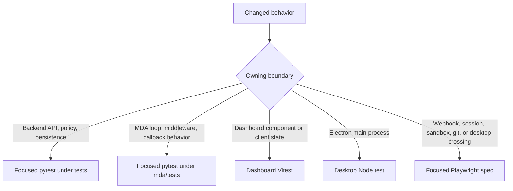
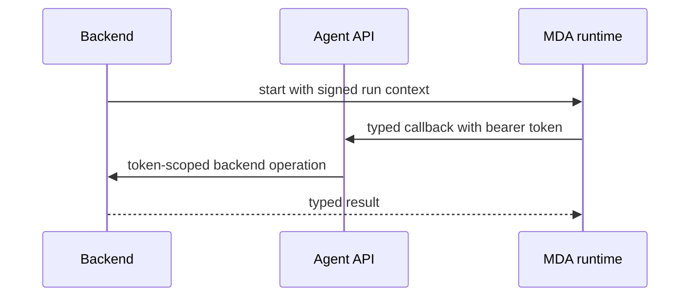
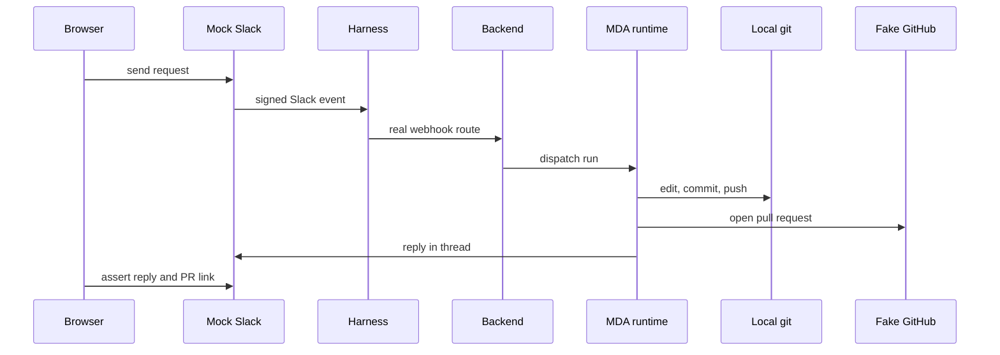

# Testing and validation strategy

Validate at the lowest layer that owns the observable contract. Extend a focused behavioral test for authorization, durable data, or a difficult state transition; do not add a structural snapshot or a mock assertion that only proves a call occurred. Never run the full suite locally. Start with the owning test file or node, then add only the relevant static gate or a cross-boundary proof when the changed behavior needs it.



This is a selection rule, not a requirement to duplicate a scenario at each layer. A bug fix merits a focused regression only when it demonstrates a concrete behavior current coverage misses. Behavior-preserving refactors generally should not require mechanical test changes.

## Python backend tests

The backend pytest project collects from `tests/` and runs in asyncio auto mode, so async tests and fixtures do not need a per-test asyncio marker. Test families follow product ownership: `tests/agent/` and `tests/threads/` cover run setup and thread routing; `tests/dashboard/` covers authorized dashboard APIs; `tests/github/` and `tests/slack/` cover ingress and integration semantics; `tests/mcp/` covers managed connections; and `tests/sandbox/` covers the backend's sandbox-facing behavior.

Use the family that owns the invariant rather than a broad integration test:

| Change | Focused behavioral coverage |
| --- | --- |
| Signed runtime requests, named backend operations, run preparation, or callback error behavior | `tests/reviewer/test_agent_api.py`; it exercises token middleware and token-scoped API work, including the rule that named calls around a model call do not plan a run. |
| Backend access to an MDA thread | `tests/threads/test_mda_runtime_auth.py`; it distinguishes Studio-style authenticated reads from backend writes and verifies the separate clients are used. |
| Lazy sandbox reconnection and thread rebinding | `tests/sandbox/test_sandbox_state.py`; it covers one reconnect for concurrent callers, cancellation-safe waiting, retry after startup failure, and current metadata rather than stale run configuration. |
| Slack or GitHub ingress, deduplication, authorization, and delivery semantics | the corresponding `tests/slack/test_*.py` or `tests/github/test_*.py` file; preserve a real contract assertion such as a signed webhook outcome or scoped action. |
| Completion error handling | `tests/webhooks/test_completion_webhook.py`; it protects requester-scoped retry output and ensures reviewer cleanup failure cannot suppress the Slack failure reply. |

### Shared isolation is part of the contract

`tests/conftest.py` makes ordinary backend tests hermetic. Its autouse network guard rejects external requests and connections to a developer's LangGraph server, while `MockTransport`, `ASGITransport`, and local fakes remain usable. The same fixture layer points `DASHBOARD_STATIC_DIR` to a missing temporary location, sets a controlled GitHub login allowlist, supplies a local Slack API stand-in, closes the per-event-loop HTTP pool, and clears process-global caches and sandbox registries before and after a test. These guards prevent local UI builds, pooled handles, cached settings, and a previous thread's sandbox from silently changing a result.

The default auto-review fixture treats repositories as enabled because the dashboard-backed opt-in list is empty in ordinary tests. A test of that gate must replace the stub with the intended policy. Use `registry_db` only when a PostgreSQL regression is essential: it creates an isolated migrated database when `TEST_ANALYTICS_POSTGRES_URI` is configured and otherwise skips; `registry_db_if_available` supports code that deliberately degrades without PostgreSQL.

## Backend and MDA are separate test projects

Every `agent`, `reviewer`, and `review-scout` run executes in the `mda/` project. MDA owns the model loop, checkpoints, sandbox, tool calls, and runtime middleware; the backend exposes typed, token-authenticated `/agent-api/{endpoint}` callbacks. Consequently, test the side that owns the change in its own environment—never make an MDA test import `openswe`.



The diagram identifies the boundary that requires two focused perspectives: backend tests verify authentication and backend effects, while MDA tests verify runtime lifecycle, callback delivery, and graph isolation. `mda/tests/test_backend_calls.py` is the concentrated runtime-side location for callback failures, report/recovery behavior, and worker-grant adoption; `mda/tests/test_shared_graph.py` covers preventing per-run catalogs, grants, and sandbox configuration from leaking through a shared compiled graph.

Run MDA checks from its own locked environment:

```bash
make mda-test PYTEST_ARGS=mda/tests/test_backend_calls.py
make mda-typecheck
```

`make mda-test` changes into `mda/` and runs `uv run --locked --group test pytest`; `make mda-typecheck` synchronizes that project and checks it against its own virtual environment. This separation intentionally makes a backend import or backend database-driver dependency fail in MDA validation.

## Focused commands and independent gates

Install backend development dependencies with `make install`, which runs `uv sync --extra dev`. `make test` (also `make tests`) runs `uv run pytest -vvv $(PYTEST_ARGS) $(TEST_FILE)` when `TEST_FILE` is an existing file or directory; otherwise it prints a skip message. Since that existence check cannot accept a node id, invoke pytest directly for one test.

```bash
make test TEST_FILE=tests/sandbox/test_sandbox_state.py
uv run pytest -vvv tests/sandbox/test_sandbox_state.py::test_sandbox_proxy_retries_failed_startup
uv run pytest -vvv tests/threads/test_mda_runtime_auth.py
```

Pytest is not a substitute for static validation. `make lint` runs Ruff checking and a formatting diff; `make format` applies both formatter and safe fixes; `make typecheck` checks `openswe`, `packages`, and `tests`, plus sandbox scripts with Python 3.8 compatibility. Apply the narrow relevant gate rather than treating every command as required for every edit.

For frontend behavior, do not use root `pnpm test`: it delegates workspace tests to Turbo. The dashboard runs `vitest run`; desktop builds its main bundle then executes Node tests in `test/*.test.cjs` and `test/*.test.ts`.

```bash
pnpm --filter open-swe-dashboard run test
pnpm --dir desktop run test
```

Use dashboard Vitest first for rendering, browser-independent client state, and API-client transformations. Use the desktop Node tests for Electron main-process behavior. Move to Playwright when the contract depends on the browser/session/server proxy, real webhook dispatch, MDA run, local sandbox/git, or Electron bridge.

## Playwright end-to-end validation

The E2E harness deliberately runs production paths with controlled outer seams. A scripted `BaseChatModel` supplies the LLM response; fake GitHub and Slack HTTP endpoints and their in-memory stores replace SaaS. The real backend webhook routes, MDA server, agent tools and middleware, local sandbox behavior, and git path run normally. The seeded local bare remote is pushed like GitHub, and the fake stores are the source of truth rendered by mock Slack and GitHub UIs.



`full_flow.spec.ts` proves the central Slack request-to-implementation-to-PR-to-same-thread-reply path. The browser configuration is serial, excludes `desktop.spec.ts`, uses a 90-second test timeout, and starts both the real MDA dev server and `langgraph dev` harness. The real built dashboard runs as its own Nitro server on a separate origin: browser requests exercise SSR, the signed session gate, hydration, and the same-origin `/dashboard/api/*` proxy. Set `E2E_FORCE_UI_BUILD=1` after a dashboard or port change to rebuild it.

The desktop configuration selects only `desktop.spec.ts`, uses longer timeouts, and tests a different boundary. Its primary scenario resets harness state, clones the seeded remote into a temporary local project, injects a harness-issued `osw_session` cookie, drives a local-agent request through Electron, and checks both the edited checkout and fake-GitHub pull request.

Prepare the browser once, then select a spec rather than launching all E2E tests:

```bash
pnpm install --frozen-lockfile
pnpm run test:e2e:install
pnpm exec playwright test tests/full_flow.spec.ts
pnpm run test:e2e:desktop
```

The suite needs `POSTGRES_URI` for the backend. Outside CI it can reuse warm servers, making a single-spec rerun the intended iteration loop. Browser failures retain screenshots and retain trace/video on failure locally or on the first CI retry; `E2E_ARTIFACTS=1` records trace and video for every attempt under `test-results/` and `playwright-report/`. The Electron spec records its own context trace and screenshots and removes temporary state unless `E2E_KEEP_TMP` is set.

## Related pages

- [Backend–Managed Deep Agents boundary](/openwiki/architecture/backend-runtime-boundary.md)
- [Development and deployment](/openwiki/operations/development-and-deployment.md)
- [Quickstart](/openwiki/quickstart.md)
- [Turn execution](/openwiki/workflows/turn-execution.md)
