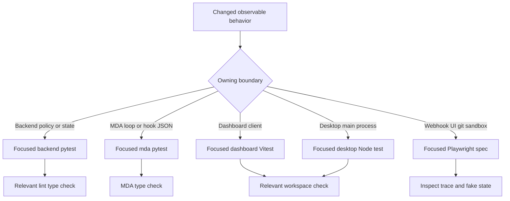
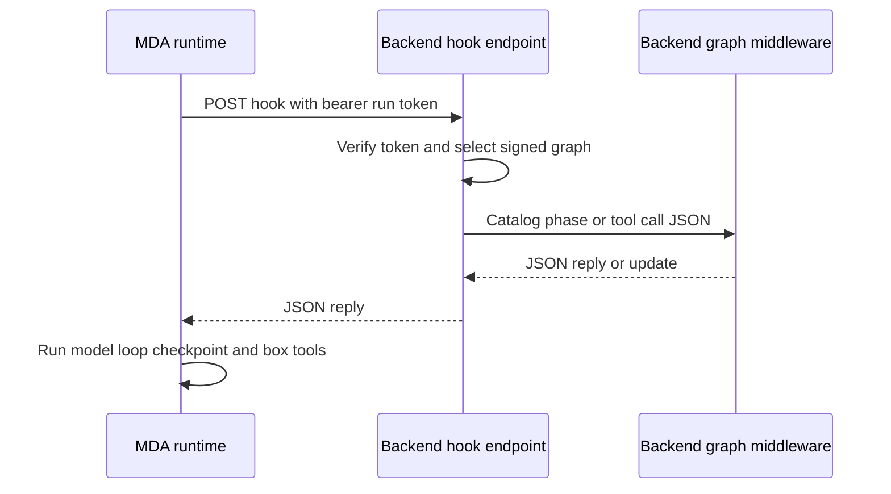

# Testing strategy and focused validation

Validate the smallest boundary that owns the observable behavior you changed. Do **not** run the full local suite by default: it is slower, raises unrelated failures, and makes a regression harder to locate. Start with an existing behavioral test in the owning area, add a regression only when it covers a concrete missed failure, then run the directly relevant static gate. Escalate only when the change crosses a process, persisted-state, authenticated-UI, or real git/sandbox boundary that the lower-level test cannot prove.



This is a test-selection flow, not an instruction to run every branch. A change to a tool guard normally needs its focused Python or MDA contract test, not a browser run; a change to the deployed dashboard proxy or a Slack-to-PR path needs the controlled browser proof.

## Boundaries and test entrypoints

### Backend pytest: isolated behavior and persistence seams

The root Python project collects `tests/` (`testpaths = ["tests"]`) and uses `asyncio_mode = "auto"`, so async tests and fixtures run without per-test asyncio markers. Test directories follow behavior owners—such as `agent`, `sandbox`, `reviewer`, `webhooks`, `dashboard`, `threads`, `tools`, `slack`, `github`, and `middleware`—rather than a separate unit-test abstraction. Prefer extending the narrow family that already asserts the behavior.

The baseline fixtures deliberately make ordinary tests local and deterministic:

- The autouse offline guard rejects HTTP requests to non-loopback hosts and to the developer's configured LangGraph server. Use `httpx` mock/ASGI transports or a local fake at an external boundary; do not silently contact SaaS from a unit test.
- `DASHBOARD_STATIC_DIR` is redirected to a missing temporary path so a developer's `ui/.output` cannot alter backend test behavior.
- TTL caches and sandbox backend/connection registries are cleared around each case. This prevents configuration, MCP catalog, or live sandbox handles from crossing test boundaries.
- The default auto-review fixture returns enabled because an unconfigured test has no dashboard opt-in data. A test of the opt-in policy must replace that stub with the intended rule.

Database coverage is opt-in and explicit. `registry_db` creates an isolated migrated PostgreSQL database but skips when `TEST_ANALYTICS_POSTGRES_URI` is absent; use it for a regression whose contract is the schema, query, transaction, or constraint. `registry_db_if_available` instead exercises the unconfigured/degraded path when no URI is set and yields whether a database was provisioned. A skip here means the database-specific assertion did not run—not that the behavior was validated—so configure the URI before relying on that coverage. The separate `make integration_tests` target similarly prints a skip message when `tests/integration_tests/` is absent.

Examples of useful focused families:

| Change | Start with | What the test protects |
| --- | --- | --- |
| Agent composition, tool surface, skills, or middleware | `tests/agent/test_agent_assembly_context.py` | An initialized sandbox-backed composite backend, context eviction/offload integration, source-sensitive tools and skills, and parent/subagent boundaries. |
| Lazy sandbox reconnect or thread sandbox identity | `tests/sandbox/test_sandbox_state.py` | One shared reconnect, cancellation-safe waiters, retry after startup failure, delegation after lazy startup, and metadata-based ID recovery. |
| Reviewer outcome learning | `tests/reviewer/test_reviewer_outcomes.py` | Finding outcome payloads and conflict updates at the LangSmith boundary. |
| Completion error and follow-up behavior | `tests/webhooks/test_completion_webhook.py` | Reviewer check cleanup, Slack failure replies, and conditions for a queued follow-up pickup. |

### Managed Deep Agents: test the split contract on both sides

`mda/` is a separate Python project and runtime. It owns the model loop, checkpoints, and sandbox-resident file/shell tools; the backend supplies graph-specific tools and middleware through authenticated hook calls. Do not import `openswe` into `mda/`: each side should validate the JSON it exchanges rather than coupling their test environments.



The hook endpoint derives the assistant, thread, and run configuration from the verified bearer token rather than trusting the request body. A normal runtime token can use graph hooks and the run hooks for worker launch; a worker grant is restricted to catalog access and adopting a run token. Unknown hooks return 404, malformed non-object JSON returns 422, and hook exceptions become a 500 response containing the exception type and message. These are contract and security semantics worth testing when changing a hook, token, phase payload, catalog, or worker delegation.

Use `mda/tests/test_backend_calls.py` for transport/retry/failure boundaries, catalog-to-tool routing, backend guards around MDA box tools, worker grants, or turn reconciliation. Its tests distinguish retryable tool calls during a backend rollout from phase gateway failures that must not replay, and assert that a failed hook fails the run with its reported error. Use `mda/tests/test_model_calls.py` for provider-specific replay, timeout/fallback, and image-model selection; use the small middleware suites for subdirectory `AGENTS.md` loading and image-read validation. When a new backend tool-call middleware is added, update the backend graph's MDA box-check mapping or deliberately let MDA send that call to the backend, then cover the corresponding JSON behavior on both sides.

### Dashboard, desktop, and CLI

The dashboard workspace runs component and client tests with `vitest run`; target it with:

```bash
pnpm --filter open-swe-dashboard run test
```

Use those tests for rendering, client state, stream transformations, optimistic mutations, and API-client logic. The desktop package first builds its main bundle and then runs `node --test test/*.test.cjs`:

```bash
pnpm --dir desktop run test
```

Use desktop Node tests for Electron main-process or protocol behavior. Root `pnpm test` delegates to Turbo workspace test tasks, so it is intentionally broader than these focused commands. The repository's CLI is a workspace package built by `make cli`; validate CLI changes with its owning workspace tests or command-level behavior rather than a dashboard or browser suite unless the change crosses that boundary.

## Focused commands and quality gates

Install root Python development dependencies with `make install` (`uv sync --extra dev`). The root dev extra includes pytest, pytest-asyncio, pytest-xdist, Ruff, and ty. `make test`/`make tests` run `uv run pytest -vvv $(PYTEST_ARGS) $(TEST_FILE)` when `TEST_FILE` is an existing file or directory and otherwise print a skip message; because a node id is not a filesystem path, invoke pytest directly for one test.

```bash
make test TEST_FILE=tests/sandbox/test_sandbox_state.py
uv run pytest -vvv tests/sandbox/test_sandbox_state.py::test_sandbox_proxy_retries_failed_startup
make mda-test PYTEST_ARGS=tests/test_model_calls.py
cd mda && uv run --locked --group test pytest tests/test_backend_calls.py
```

The MDA commands use MDA's locked environment: `make mda-test` runs pytest from `mda/`, and `make mda-typecheck` syncs that project's test group then runs `ty` there. For the root backend, `make lint` runs Ruff checking plus a format diff; `make format` applies Ruff formatting and fixes; `make typecheck` checks `openswe` and `tests` and separately type-checks sandbox scripts as Python 3.8. These gates are complementary to a behavioral test, not replacements for it.

## End-to-end validation: real paths, controlled seams

The Playwright harness is the escalation path for a real Slack webhook through dispatch, Managed Deep Agents, backend tools/middleware, a local temporary sandbox, git push, fake-GitHub PR, and same-thread Slack reply. It runs the real `mda/` server and `langgraph dev`; the scripted LLM and external SaaS boundaries are substituted. Fake GitHub and Slack stores are rendered by mock UIs, so browser assertions inspect the writes produced by real agent code. The dashboard itself is not mocked: global setup builds the real `ui/` app, starts its Nitro server, uses a real signed session cookie, and exercises SSR, session redirects, hydration, and same-origin `/dashboard/api/*` proxying to the harness.

`full_flow.spec.ts` is the narrow happy-path proof: a Slack request produces a local edit, branch, fake GitHub PR, and reply in the same thread. The desktop configuration separately selects `desktop.spec.ts`; it resets harness state, clones the seeded local bare remote into an isolated project, injects an `osw_session` cookie, drives a local-agent request through Electron, and checks both the changed local file and fake PR fields.

```bash
pnpm install --frozen-lockfile
pnpm run test:e2e:install
pnpm exec playwright test tests/full_flow.spec.ts
pnpm run test:e2e:desktop
```

Chromium installation must precede the first browser run. Browser Playwright runs serially against the MDA server, backend, and built dashboard; it excludes the desktop spec and has a 90-second test timeout. Desktop selects only its spec and raises test and expectation timeouts. The browser configuration preserves a trace and video on failed local attempts or the first retry in CI, plus failure screenshots; `E2E_ARTIFACTS=1` records trace and video for every attempt. Desktop turns off automatic media because its spec explicitly saves an Electron trace and screenshots, and removes its temporary state unless `E2E_KEEP_TMP` is set. Inspect the trace, screenshot, and fake-boundary state before increasing a timeout or weakening an assertion.

## Choosing the next validation

1. Name the observable failure and the narrow component that can cause it.
2. Find the nearest existing behavioral test; extend it only if it would have failed before the change.
3. Keep persistence and remote boundaries fake by default. If a database contract matters, opt into the migrated database fixture; if an HTTP contract matters, use an ASGI/mock transport or the E2E harness.
4. For an MDA/backend change, prove the JSON protocol from both projects and preserve token/grant restrictions.
5. Run the local static gate that covers edited code. Run one focused Playwright spec only when the lower layer cannot establish the deployed boundary.

## Related pages

- [Managed runtime](/openwiki/architecture/managed-runtime.md)
- [Thread runtime and transcript](/openwiki/architecture/thread-runtime-and-transcript.md)
- [Dashboard UI](/openwiki/integrations/dashboard-ui.md)
- [Local development and deployment](/openwiki/operations/local-development-and-deployment.md)
- [Quickstart](/openwiki/quickstart.md)
