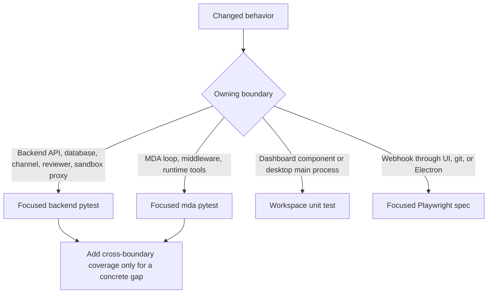
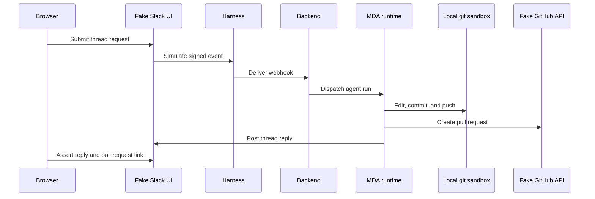

# Focused Testing Across Backend and MDA

Run the smallest behavioral test that owns the changed contract; do not run the full local suite. The backend and `mda/` are distinct Python projects with an explicit runtime-API boundary: backend tests exercise the stateless APIs, PostgreSQL-backed thread and application behavior, while MDA tests exercise the model loop, middleware, sandbox, and typed calls it makes to the backend. A change crossing that boundary normally needs one focused test on the owning side, and a second only if the exchanged model or independently implemented behavior can regress.



This is the validation routing model: move outward only when the changed observable behavior crosses the layer boundary.

## Project boundary and focused commands

`mda/` must be tested in its own environment. `make mda-test` changes into that project and runs its pytest group; `make mda-typecheck` synchronizes its locked test environment and type-checks it there. Its type-check root includes the MDA graph, identity, channels, runtime code, and tests, deliberately excluding backend dependencies: do not import `openswe` from MDA. Both projects instead share `packages/runtime-api` models, so test each endpoint against the request and response models it exchanges.

```bash
# Backend: pass a file or directory that exists
make test TEST_FILE=tests/threads/test_mda_runtime_auth.py
uv run pytest -vvv tests/threads/test_mda_runtime_auth.py::test_thread_reads_and_writes_take_their_own_clients

# MDA: its isolated environment and test collection
make mda-test PYTEST_ARGS="mda/tests/test_loop.py -k github_proxy"
make mda-typecheck
```

Backend pytest collects `tests/` and awaits async functions and fixtures automatically. `make test` (also `make tests`) accepts an existing path in `TEST_FILE`; use direct `uv run pytest` for a node id, because the Makefile checks that `TEST_FILE` itself exists. `PYTEST_ARGS` is available for focused selection. Keep lint and type checking separate from behavioral proof: `make lint` checks Ruff and formatting, `make format` fixes them, and `make typecheck` checks `openswe`, `packages`, and tests (plus sandbox scripts at Python 3.8).

Add coverage only for a named regression that existing behavioral coverage misses. Prefer extending the closest existing test. Security and authorization boundaries, data integrity, and difficult state transitions are high-value reasons to add a focused case; prompt wording, static mappings, implementation structure, call order, and mock-only assertions are not.

## Backend pytest: isolation and persistent-state boundaries

The root suite's `conftest.py` creates an intentionally offline baseline. It disables use of a locally built dashboard, clears process-global TTL and sandbox registries around each case, closes the event-loop HTTP pool, and routes Slack calls to a local test API that fails by default unless the test configures a response. The default auto-review stub treats all repositories as enabled because the normal opt-in list is empty in this environment; override it when testing the actual gate.

Database tests are opt-in rather than silently emulated. The `registry_db` fixture creates an isolated migrated PostgreSQL database only when `TEST_ANALYTICS_POSTGRES_URI` is configured, otherwise it skips. Use it for SQL behavior, migration-backed records, transaction isolation, or authorization that depends on persisted rows. For example, the database tests prove both that a read-only transaction rejects writes and that the untrusted read-only variant does not leak session state such as advisory locks into the next connection.

### Choose the backend family by responsibility

| Change area | Start with | What the focused tests protect |
| --- | --- | --- |
| Thread routing, lifecycle, inbox, run metadata, succession, or workflow approval | `tests/threads/` | MDA runtime access, thread state and metadata, and routing/lifecycle behavior. `test_mda_runtime_auth.py` distinguishes LangSmith-authenticated reads from backend-authenticated writes. |
| Runtime channel identity resolution | `tests/mda_channels/test_resolve_user.py` | The backend endpoint accepts only signed MDA requests and maps a linked Slack, GitHub, or Linear actor to an Open SWE user only when stable identity and workspace constraints match. |
| Managed MCP configuration, credentials, consent, or tool catalog | `tests/mcp/` | Gateway credential challenges, consent links, connection state, and managed tool behavior. |
| Sandbox reconnection and backend-side tool compatibility | `tests/sandbox/test_sandbox_state.py` | The proxy shares reconnect work, tolerates waiter cancellation, retries failed startup, and recovers the live sandbox identifier from thread metadata. |
| Reviewer findings, review outcomes, or check completion | `tests/reviewer/` and `tests/webhooks/test_completion_webhook.py` | Outcome labels and no-op configuration paths, and failure cleanup that must not hide a Slack failure reply. |
| PostgreSQL semantics | `tests/database/` with `registry_db` | Actual database permissions, transaction behavior, and persistent-data invariants. |

Use the existing behavior as the test seam rather than adding a broad integration harness. A backend/MDA feature commonly has two different assertions: a backend channel test can validate authentication and identity policy, while an MDA runtime test can validate that its typed backend call is made, receives an expected typed result, and behaves correctly if the call fails.

## MDA runtime tests: loop and typed backend calls

MDA tests live only under `mda/tests/` and use MDA-local imports such as `rt` and `runtime_api`. `test_backend_calls.py` is the principal contract-level seam: it constructs a per-run catalog and run context, replaces the backend transport with typed responses or `BackendCallError`, and tests runtime behavior around tools, preparation, reporting, sandbox definitions, and model calls. `test_loop.py` focuses on stateful loop behavior such as retry timing, cleanup when task context fails, routing, replies, and preserved errors. `test_shared_graph.py` covers graph assembly, managed sandbox and state-backend behavior; companion files cover intake, MCP, model calls, retries, subdirectory agents, git evidence, and image-read validation.

When changing a shared `runtime_api` model, first identify whether the backend owns validation or MDA owns control flow. Add focused tests on both sides only when each has independently meaningful logic. Do not make the MDA test import backend implementation to reuse a fixture: isolation is intentional, and a backend/database dependency should fail to resolve in its environment.

## Browser E2E: real execution with controlled external seams

Playwright is the escalation path for the production-shaped crossing: real signed webhook handling, actual MDA server and model loop, backend tools and middleware, local git, authenticated dashboard SSR and API proxy, and Electron. The harness fakes the model and external SaaS HTTP boundaries; fake Slack and GitHub stores render the mock UIs, making browser assertions observe effects written by real agent code.



The sequence is the focused full-flow proof: external services are controlled, while the webhook, backend, MDA, sandbox, and git path execute for real. The real built dashboard runs on its own Nitro server, with a genuine signed session cookie and same-origin `/dashboard/api/*` proxy; this catches SSR, session, and proxy regressions that a mocked client would miss. The harness requires PostgreSQL, so set `POSTGRES_URI` before starting it.

```bash
pnpm install --frozen-lockfile
pnpm run test:e2e:install
pnpm exec playwright test tests/full_flow.spec.ts
pnpm run test:e2e:desktop
```

Install Chromium before the first browser run. Run an individual related spec against the reused local servers rather than the whole E2E suite. Browser Playwright is serial, excludes the desktop spec, and has a 90-second default test timeout; desktop selects `desktop.spec.ts` and uses a 180-second timeout. `E2E_FORCE_UI_BUILD=1` rebuilds the dashboard after UI or port changes. Failures retain a screenshot and retain trace/video locally or on the first CI retry; set `E2E_ARTIFACTS=1` to capture trace and video for every attempt.

## Dashboard and desktop unit checks

For a component, client state, API-client, or rendering change, run the dashboard workspace's `vitest run` suite before E2E. For Electron main-process behavior, run its build-plus-Node test command. Root `pnpm test` delegates workspace test tasks through Turbo, so it is broader than the normal focused choice.

```bash
pnpm --filter open-swe-dashboard run test
pnpm --dir desktop run test
```

## Related pages

- [Backend and MDA runtime](/openwiki/architecture/backend-mda-runtime.md)
- [Thread runtime](/openwiki/architecture/thread-runtime.md)
- [Data jobs and observability](/openwiki/operations/data-jobs-and-observability.md)
- [Quickstart](/openwiki/quickstart.md)
