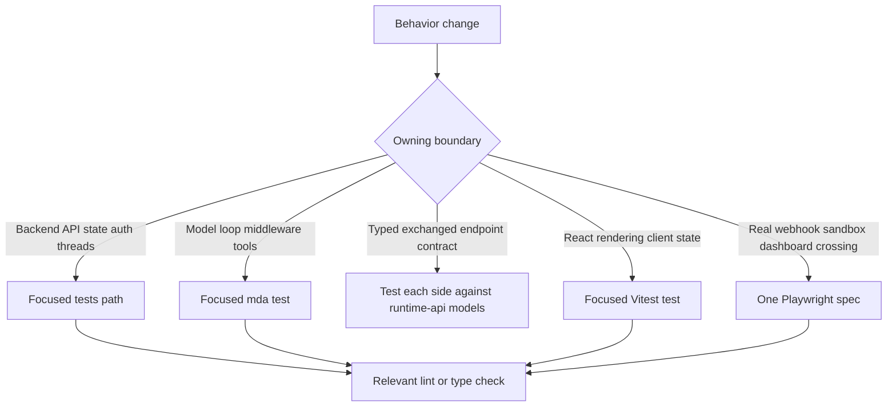

# Testing strategy and test boundaries

Test observable behavior at the layer that owns it, then run only the smallest relevant command. Do **not** run the full local suite. A focused regression test is warranted for a concrete missed regression—especially authorization, persistent state, security, data integrity, or a difficult transition—not for prompt wording, constants, trivial accessors, call ordering, or mocks that only show that a mock was called ([`AGENTS.md`](repo://AGENTS.md#L98-L116)).

The principal boundary is architectural: the backend and Managed Deep Agents (MDA) are separate Python projects and separate test environments. MDA owns the model loop, checkpoints, sandbox, tool calls, and runtime middleware; the backend exposes stateless, typed `/agent-api/{endpoint}` operations that MDA calls using a run token ([`AGENTS.md`](repo://AGENTS.md#L14-L28)). Their shared interface is the `packages/runtime-api` package, installed editable by both projects ([`pyproject.toml`](repo://pyproject.toml#L64-L67), [`mda/pyproject.toml`](repo://mda/pyproject.toml#L36-L46)).



This decision flow keeps runtime ownership and the exchanged contract separate while escalating only for a real integration boundary.

## Backend and MDA stay isolated

### Backend tests

The root project collects `tests/` with pytest asyncio auto mode ([`pyproject.toml`](repo://pyproject.toml#L127-L132)). Start with the family nearest the changed behavior:

- `tests/agent/` for backend preparation, catalogs, dispatch, agent-facing configuration, and backend-owned state transitions. For example, `test_agent_thread_pr_state.py` verifies that PR closure updates stored thread metadata and resolves a thread only when the applicable PR state permits it ([`tests/agent/test_agent_thread_pr_state.py`](repo://tests/agent/test_agent_thread_pr_state.py#L43-L87)).
- `tests/threads/` for routing, lifecycle, run metadata, session upload, succession, and runtime access. The MDA-runtime-auth tests assert that MDA reads use the Studio auth scheme while backend writes do not, and that the backend uses separate clients for those reads and writes ([`tests/threads/test_mda_runtime_auth.py`](repo://tests/threads/test_mda_runtime_auth.py#L17-L60)).
- `tests/runtime/` for backend graph/runtime plumbing. Add a narrow test here when a bound graph or configuration must exclude server-only runtime objects; `test_bindable_config.py` protects that invariant ([`tests/runtime/test_bindable_config.py`](repo://tests/runtime/test_bindable_config.py#L11-L39)).

For a backend endpoint that starts or interprets an MDA run, use `tests/mda_helpers.py` rather than starting MDA. `stub_mda_runtime()` replaces remote run-context creation with a signed `RemoteRun` token and an MDA test URL, while `mda_starts()` and `mda_declines()` interpret an endpoint answer through MDA's channel result normalization ([`tests/mda_helpers.py`](repo://tests/mda_helpers.py#L14-L47)). This checks backend behavior as the consumer runtime will see it without coupling a backend test to MDA internals.

### MDA tests

`mda/` is independently installed, type-checked, and tested. Its type-check root includes only its agent, identity, channels, runtime, and tests; an `openswe` import or database driver is deliberately unresolved there ([`mda/pyproject.toml`](repo://mda/pyproject.toml#L45-L56)). Therefore, **MDA tests must not import `openswe`**. Test MDA behavior using the exchanged `runtime_api` models and controlled backend responses, not backend implementation details.

Use `mda/tests/` for changes to MDA's shared graph, model loop, tool/middleware execution, sandbox behavior, outbox/reports, or runtime error semantics. `test_shared_graph.py` constructs an MDA run context containing a token and a names-only catalog, then supplies fake backend behavior from that catalog ([`mda/tests/test_shared_graph.py`](repo://mda/tests/test_shared_graph.py#L91-L137)). `test_backend_calls.py` imports the contract types from `runtime_api` and exercises runtime failures such as completion, interruption, cancellation, timeout, and provider errors ([`mda/tests/test_backend_calls.py`](repo://mda/tests/test_backend_calls.py#L83-L165)).

That split is intentional: endpoint behavior is verified on each side against the exchanged models/contracts. If a change needs a new endpoint field or changes an existing failure/result shape, update contract-focused tests on both sides; do not bridge the isolation by importing backend code into MDA.

## Fixtures and controlled boundaries

Root pytest defaults make unit tests hermetic and prevent local machine state from silently changing results:

- The autouse network fixture rejects outbound requests, including requests to a developer's LangGraph server; use `httpx.MockTransport`, `httpx.ASGITransport`, or a local fake at the boundary the test reaches ([`tests/conftest.py`](repo://tests/conftest.py#L274-L321)).
- The autouse fixtures set a test GitHub allowlist, point `DASHBOARD_STATIC_DIR` to a nonexistent temporary location, clear TTL and in-process caches before and after each case, and clear process-global sandbox registries before and after each case ([`tests/conftest.py`](repo://tests/conftest.py#L324-L369)).
- Prefer behaviorally useful fakes. `FakeUserRecords` replaces `UserRecords` with an in-memory table, and `grant_tool_access` stubs access resolution to a deliberately selected `Access` value ([`tests/conftest.py`](repo://tests/conftest.py#L107-L153)).

Patch at the seam owned by the code under test. For an HTTP client, use a mock transport; for an in-process route, use ASGI transport; for a provider API, use its test fake. Do not let a unit test make a live request merely because a local server happens to be available.

## Database-backed behavior

Tests requiring PostgreSQL opt into `registry_db`. It requires `TEST_ANALYTICS_POSTGRES_URI`; without it the fixture skips the test rather than simulating database behavior ([`tests/conftest.py`](repo://tests/conftest.py#L206-L228)). The test setup migrates a template database, clones an isolated database per test, then drops the template at session completion ([`tests/conftest.py`](repo://tests/conftest.py#L199-L213)).

Set this variable when changing backend persistence, authorization records, webhook/database interactions, or any fallback whose database-present behavior differs. The test role needs `CREATEDB`, and the database should be separate from local development; otherwise skipped tests provide less coverage than their green result suggests ([`docs/DEVELOPMENT.md`](repo://docs/DEVELOPMENT.md#L127-L134)). For code intentionally able to degrade without PostgreSQL, use `registry_db_if_available` and assert both configured and unconfigured paths.

## Focused validation commands

Run the test file or node that owns the change, followed by only relevant static checks. The Makefile parameterizes `make test` with `TEST_FILE`, while a pytest node id should be passed directly because the Makefile path guard only accepts an existing file or directory ([`Makefile`](repo://Makefile#L106-L121)).

```bash
make test TEST_FILE=tests/threads/test_mda_runtime_auth.py
uv run pytest -vvv tests/threads/test_mda_runtime_auth.py::test_thread_reads_and_writes_take_their_own_clients
make mda-test PYTEST_ARGS="tests/test_backend_calls.py"
make mda-typecheck
make typecheck
```

`make mda-test` changes into `mda/` and runs its locked test dependency group; `make mda-typecheck` first synchronizes that project's locked test environment. The root `make typecheck` checks `openswe`, `packages`, and `tests`, while root lint runs Ruff checking plus a formatting diff ([`Makefile`](repo://Makefile#L127-L150)). Select the appropriate environment—never run MDA tests through the root backend environment or vice versa.

For dashboard behavior, use the dashboard package command and focus the relevant Vitest file when practical:

```bash
pnpm --filter open-swe-dashboard run test -- src/features/agents/lib/transcript/reducer.test.ts
pnpm --filter open-swe-dashboard run typecheck
```

The dashboard's `test` script is `vitest run`, and its `typecheck` script is `tsc --noEmit` ([`ui/package.json`](repo://ui/package.json#L5-L11)). Put client state and stream/transcript-transition coverage beside the reducer, store, hook, or component that owns it—for example the transcript reducer test controls its only lazy output-fetch boundary with a Vitest mock ([`ui/src/features/agents/lib/transcript/reducer.test.ts`](repo://ui/src/features/agents/lib/transcript/reducer.test.ts#L31-L36)).

## Where behavioral tests belong

| Change being made | Preferred test boundary |
| --- | --- |
| Backend state, thread lifecycle, PR metadata, dispatch, or permission decision | The closest existing `tests/agent/`, `tests/threads/`, webhook, or feature test; use the database fixture if persistence changes the result. |
| MDA loop, runtime middleware, sandbox/tool orchestration, model call guard, or runtime end state | A focused `mda/tests/` test with runtime-api models and a fake backend response. |
| Backend–MDA request/result, token, catalog, operation, or endpoint-decline contract | Contract-focused tests on **both** sides using `packages/runtime-api`; backend may use `tests/mda_helpers.py`, MDA must not import `openswe`. |
| UI rendering, optimistic client update, transcript/store transition, stream transformation, or API-client behavior | The colocated `ui/src/**/*.test.ts(x)` Vitest test. |
| A flow that depends on the real webhook route, authenticated dashboard SSR/hydration, MDA server, sandbox, git, or desktop IPC | The smallest relevant Playwright E2E/desktop spec. |

Add a regression test to the row that owns the invariant. Avoid duplicating the same assertion across a unit test and E2E test unless the integration crossing itself is the behavior at risk.

## E2E and UI integration coverage

The Playwright harness is for controlled real-path coverage, not a replacement for focused tests. It drives a Slack request through the real webhook route, real agent execution on a local MDA server, real tools and middleware, and a sandbox created by MDA. It uses a scripted model and substitutes external SaaS HTTP boundaries; the fake GitHub and Slack stores are what their mock UIs render ([`tests/e2e/README.md`](repo://tests/e2e/README.md#L1-L38)).

The dashboard itself is real in this harness: setup builds `ui/`, serves the app through its Nitro server, and uses the same-origin harness so browser tests cover session gating, redirects, server rendering, hydration, and dashboard API access ([`tests/e2e/README.md`](repo://tests/e2e/README.md#L58-L68)). Use a single related spec on the warm local server rather than the browser suite:

```bash
pnpm install --frozen-lockfile
pnpm run test:e2e:install
pnpm exec playwright test tests/full_flow.spec.ts
```

PostgreSQL is required for E2E because the backend requires it; CI provides it, while a local run must export `POSTGRES_URI` ([`tests/e2e/README.md`](repo://tests/e2e/README.md#L109-L110)). Browser failures retain a trace, screenshot, and failed-attempt video; use `E2E_ARTIFACTS=1` to retain artifacts for a passing diagnostic run and inspect `test-results/` or `playwright-report/` before loosening timeouts or assertions ([`tests/e2e/README.md`](repo://tests/e2e/README.md#L93-L107)).

## Related pages

- [Runtime API contract](/openwiki/architecture/runtime-api-contract.md)
- [Local development and deployment](/openwiki/operations/local-development-and-deployment.md)
- [Quickstart](/openwiki/quickstart.md)
- [Review and delivery](/openwiki/workflows/review-and-delivery.md)
- [Run lifecycle](/openwiki/workflows/run-lifecycle.md)
