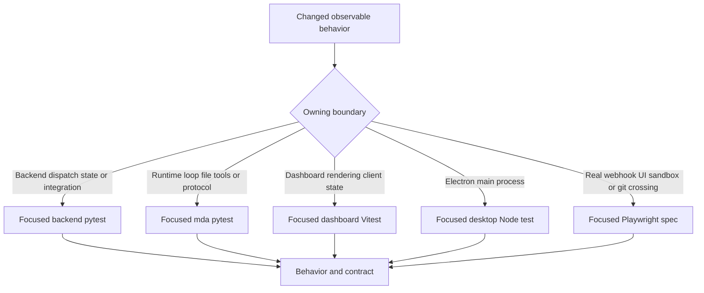
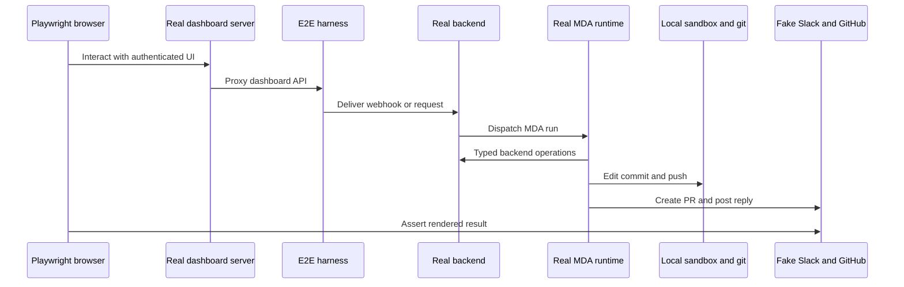

# Testing and Change Validation Strategy

Choose the lowest layer that owns the observable behavior, and extend an existing behavioral test when it can express the regression. A focused test is preferable to a mechanically broad run: the repository explicitly directs contributors **not** to run the full local test suite. Do not add tests for documentation, prompt wording, constants, trivial structure, or call order; do add a focused regression test when a bug, authorization boundary, data-integrity rule, or difficult state transition would otherwise be unprotected.



This is the test topology: select a test by the component that owns the behavior rather than duplicating one assertion across layers.

## Selection guide

| Change area | First high-signal validation | Escalate when |
| --- | --- | --- |
| Dispatch, thread routing, index state, run tokens, or completion behavior | The relevant `tests/threads/`, `tests/agent_api/`, dispatch, or webhook test. `tests/threads/test_thread_router.py` is the model for an in-process router harness with a mocked MDA HTTP boundary and migrated thread index. | The regression requires the actual webhook-to-agent-to-UI path. |
| Graph planning, state-dependent tool surfaces, skills, middleware, or sandbox availability | Extend `tests/agent/test_agent_assembly_context.py`. Its local planner helper replaces external dependencies and asserts the resulting `ToolSurface`, rather than running a model loop. | The change affects what MDA receives or does during its loop. |
| Backend-to-runtime typed API behavior | Test the backend handler and runtime implementation separately against the shared `packages/runtime-api` models. | A compatibility concern requires proving both implementations through their HTTP seam. |
| MDA model loop, file/shell tooling, retry, replay, or runtime-side middleware | Extend a matching `mda/tests/` test and run it with the MDA environment. | The scenario also depends on backend planning or a real integration boundary. |
| Sandbox lifecycle, provider selection, reconnect, bridge credentials, or thread-scoped sandbox identity | Use the corresponding `tests/sandbox/` behavioral test. | A browser or desktop flow must prove the selected sandbox can perform user-visible work. |
| Migration or persistent state | Use a focused test requesting `registry_db`; it runs against a fresh migrated PostgreSQL clone when configured. | Migration behavior itself or multi-service persistence is the changed contract. |
| Dashboard components, stream/transcript reduction, API client behavior, optimistic state, or SSR-facing client code | Run the affected `ui/` Vitest file. Per-file jsdom docblocks select DOM execution; the default environment remains Node for disk-oriented tests. | The defect crosses the authenticated app server, proxy, server rendering, or real browser interaction. |
| Electron main-process, local project, IPC, terminal, or update behavior | Run the matching `desktop/test/*.test.cjs` test through the desktop package script. | It requires the packaged Electron/app-to-agent path. |
| Slack/GitHub webhook, real MDA loop, local git/sandbox, dashboard SSR, or desktop flow | Run one related Playwright spec, not the whole E2E collection. | No lower layer can establish the cross-process observable contract. |

## Backend pytest: isolated behavioral seams

The root Python project collects `tests/` with `asyncio_mode = "auto"`. The narrow Make target accepts an existing file or directory through `TEST_FILE`; use direct pytest for a node id.

```bash
make test TEST_FILE=tests/threads/test_thread_router.py
uv run pytest -vvv tests/threads/test_thread_router.py::test_a_run_goes_to_mda_and_marks_the_thread_busy
```

`tests/conftest.py` makes the normal backend suite deliberately isolated:

- An autouse network guard refuses HTTP requests to remote hosts and to a developer's LangGraph server. Tests must use an ASGI, mock, or local fake transport at the boundary they own.
- Each test closes the shared HTTP pool, clears TTL and LangGraph in-process caches before and after execution, clears process-global sandbox registries, and points `DASHBOARD_STATIC_DIR` at a missing temporary path. These controls prevent loop-bound connections, cached configuration, sandbox handles, and local dashboard artifacts from leaking between tests.
- The `post_signed_github_webhook` helper drives the real ASGI application on the test's event loop rather than `TestClient`, avoiding a mismatch with loop-bound database state.
- Small fixtures such as `user_records`, `grant_tool_access`, `github_app`, `slack_api`, and `memory_event_claims` replace a specific external or persistent seam. Prefer these focused fakes to a broad mock harness.

### Dispatch and state changes

Thread routing is both a state and a security boundary. The router test harness uses a migrated database, fake local/MDA thread stores, and `httpx.MockTransport` for MDA. It verifies behavior such as creation/indexing and copying of MDA threads, busy status before forwarding a run, mapping the public `agent` identifier to an MDA graph, signed run context rather than a raw configurable payload, and rejection of new activity on legacy local threads. Extend this family for changes to dispatch routing, metadata propagation, run completion, or local-versus-MDA lifecycle semantics.

For graph assembly changes, preserve the same focused pattern used by `test_agent_assembly_context.py`: patch credentials, sandbox creation, model construction, and settings only enough to inspect the plan. Assert the user-visible/invariant outcome—such as whether a tool is exposed for a scoped run or whether a backend path is served—not incidental middleware order or mock call counts.

### Database and migration isolation

Tests that need persistent registry/thread data request `registry_db`. It skips clearly if `TEST_ANALYTICS_POSTGRES_URI` is absent; it does not silently use a developer database. The fixture creates one migrated template database per process, clones it for each test, points the real database module at the clone and test schema, then closes engines and force-drops the clone. This runs real migrations, engines, transactions, and sessions while keeping cases isolated. Use it for a migration-sensitive invariant, query behavior, or database-backed router workflow; do not use it for logic that a smaller in-memory fixture can prove.

## The MDA boundary: independently tested runtime contracts

`mda/` is a separate Python project. Its model loop, checkpoints, sandbox, and tool calls run there, while the backend plans a `ToolSurface` and serves typed operations. The common contract lives in the editable `packages/runtime-api` package. Keep the boundary explicit: **do not import `openswe` from `mda/`**. Instead, test each side against the request/response models it exchanges.

```bash
make mda-test PYTEST_ARGS="mda/tests/test_backend_calls.py -k phase_gateway_failure"
make mda-typecheck
```

`make mda-test` changes into `mda/` and uses its locked environment plus the `test` dependency group. `make mda-typecheck` likewise synchronizes and checks only that project; this makes an accidental backend or database import fail rather than being masked by the root environment.

Use `mda/tests/test_backend_calls.py` for runtime calls into backend endpoints and their failure semantics, and `mda/tests/test_model_calls.py` for model-call transformations such as replay ordering, provider-specific payload cleanup, timeouts, and vision-model selection. The backend-call tests demonstrate the desired level of contract detail: an operation transport may retry connection failures, must not expose a secret in the tool result, and phase gateway failures are surfaced rather than replayed. Keep a backend planner/API test and an MDA runtime test distinct when each owns a side of the endpoint contract; avoid a mock-heavy test that pretends both sides are one process.

## Sandboxes and async-runtime safety

Sandbox state is process-global and tied to a thread, so lifecycle tests need explicit cleanup and concurrency behavior. The root autouse fixture clears `SANDBOX_BACKENDS` and `SANDBOX_CONNECTIONS` around every test. The sandbox-state tests prove a proxy reconnects once when concurrent callers need it, reads current thread metadata rather than stale run configuration, allows a cancelled waiter without cancelling startup for others, and retries a failed startup on a later request. Extend those cases for changes to reconnect, handoff, bridge, or provider failure behavior instead of introducing timing-sensitive end-to-end coverage first.

The backend also pins LangGraph background work to one event loop per process. `tests/sandbox/test_event_loop_pin.py` checks both the environment setting and an already-imported LangGraph config, and fails when the upstream setting disappears. Use that focused test when changing event-loop initialization or a loop-bound connection policy. Combined with pool teardown in `conftest.py`, it protects against failures that only appear when resources created on one loop are reused on another.

## UI and desktop validation

The dashboard package exposes `vitest run`; run an affected test file through that package:

```bash
pnpm --filter open-swe-dashboard run test -- src/features/agents/lib/transcript/reducer.test.ts
pnpm --dir desktop run test -- test/terminal-manager.test.cjs
```

Vitest has its own Vite configuration because the production configuration adds Nitro, which is incompatible with the required test module resolution. It keeps Node as the default environment, configures jsdom with a non-opaque localhost URL, loads `vitest.setup.ts`, and lets files opt into jsdom with a docblock. That makes a focused component or client-state test the right proof for rendering, optimistic updates, stream transformation, or reducers.

The desktop package builds its main bundle before its Node test suite. Its package script is the appropriate narrow entrypoint for Electron main-process behaviors such as command, configuration, project-store, terminal-manager, or IPC-adjacent logic. Do not substitute browser E2E when a Node test can verify the desktop-owned contract.

## Playwright: real paths with controlled SaaS seams

The E2E harness is for a contract that cannot be established inside one owner. It runs the real backend webhook routes, graph planning/tools/middleware, real `mda/` server, local sandbox provider, real git against a local bare repository, and the real dashboard application. It replaces the LLM with a scripted model and replaces external GitHub/Slack HTTP endpoints with controlled fakes. Their in-memory stores are what mock Slack/GitHub pages render, so a browser assertion observes an output produced by the real agent path.



The diagram shows the E2E boundary: internal agent components execute for real, while external SaaS and the model are deterministic seams.

The browser configuration starts MDA on `E2E_MDA_PORT` (default 2025), starts the backend/harness on `E2E_PORT` (default 2024), and drives the dashboard's own server on `E2E_UI_PORT` (default 3100). It is serial, ignores the desktop spec, reuses warm servers outside CI, and keeps trace/video/screenshots on failure by default. Run one spec while iterating:

```bash
pnpm exec playwright test tests/full_flow.spec.ts
pnpm exec playwright test tests/desktop.spec.ts --config playwright.desktop.config.ts
```

The desktop configuration selects only `desktop.spec.ts`, uses Electron-specific timeouts and output directories, and disables automatic media because the desktop test records its own relevant artifacts. E2E needs PostgreSQL (`POSTGRES_URI`) because the real backend uses it. After an E2E failure, inspect `test-results/` and `playwright-report/`; set `E2E_ARTIFACTS=1` when a passing but suspicious run needs a trace. The E2E README documents the focused warm-server loop and the commands for installing Chromium; use those only when the browser layer is the owning boundary.

## Change-validation checklist

1. Name the observable regression and the owner. If an existing behavioral test covers that owner, extend it rather than adding a file or fixture.
2. For backend/MDA behavior, decide whether the backend planner/API or runtime loop owns the rule. Test the typed contract independently on each side when both have responsibilities.
3. For persisted behavior, use `registry_db` only when a real migrated schema is material; configure `TEST_ANALYTICS_POSTGRES_URI` and let an unavailable database skip the dedicated regression clearly.
4. For async or sandbox changes, assert cleanup, retry, cancellation, current thread state, and concurrency invariants with the existing sandbox fixtures.
5. For UI/desktop changes, run one relevant Vitest or Node test. Escalate to a single Playwright spec only for an actual cross-process/UI contract.
6. Run the narrow test and the applicable focused type/lint gate for changed code. Preserve failure output and diagnose the owning boundary rather than increasing timeouts or weakening assertions.

## Related pages

- [Managed runtime](/openwiki/architecture/managed-runtime.md)
- [State and async services](/openwiki/architecture/state-and-async-services.md)
- [Invocation and thread routing](/openwiki/workflows/invocation-and-thread-routing.md)
- [Local development and deployment](/openwiki/operations/local-development-and-deployment.md)
- [Quickstart](/openwiki/quickstart.md)
