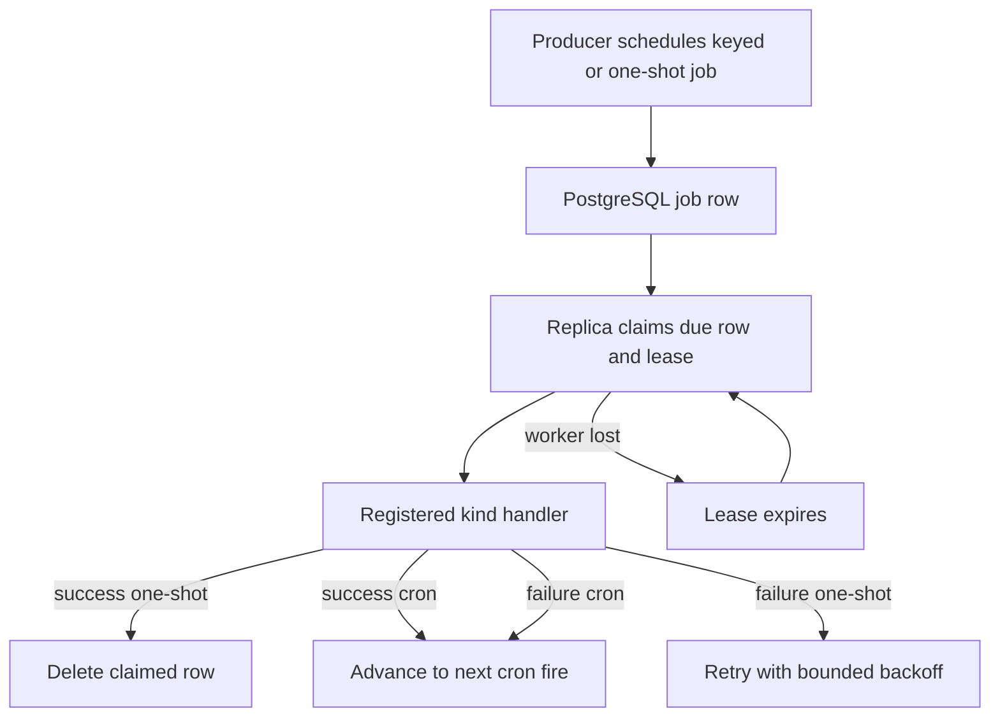
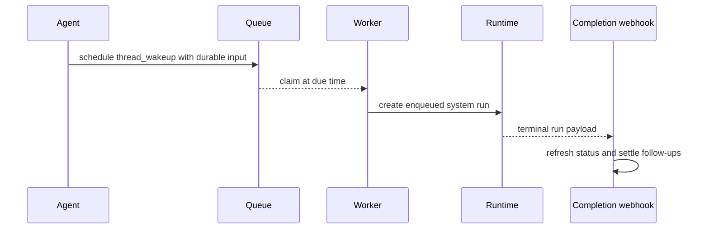
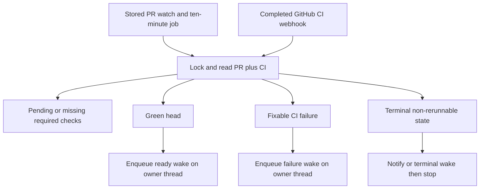
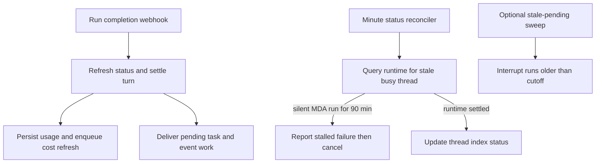

Interactive agent turns are not the only source of work. Open SWE uses a PostgreSQL-backed job queue for delayed and recurring operations that must survive a web process restart. The queue invokes named handlers without requiring an agent graph; handlers either perform bounded service work or communicate a result back to the appropriate agent thread through a deliberately constructed run or message-dispatch path.

This page covers the durable job substrate and its principal consumers. For how an ordinary message becomes a run, see [Invocation and follow-ups](invocation-follow-ups.md); for runtime and thread ownership, see [Thread runtime](../architecture/thread-runtime.md).

## Durable job queue

A job contains a `kind`, JSON payload and metadata, due time, optional cron expression and timezone, optional uniqueness `key`, attempt count, and a claim token. `queue.schedule()` validates cron syntax and writes the row transactionally. A keyed schedule replaces the previous row—including its lease and attempts—unless `replace=False`; this is used to maintain one monitor or cron per logical owner.

Workers on every configured replica poll the shared queue. `claim_due()` locks due, unleased (or expired-lease) rows using `FOR UPDATE SKIP LOCKED`, assigns a new claim token, and leases the work for 30 minutes. Thus replicas can compete safely without running the same claimed row concurrently. A worker has at most 20 in-flight jobs, polls every 250 ms while it started work and every five seconds while idle, and renews active claims every 10 seconds. Cancellation removes the row; the next heartbeat cancels its handler. Shutdown cancels local handlers and leaves their rows reclaimable after lease expiry.

A successful one-shot is deleted. A successful cron job advances to the next occurrence in its configured timezone and resets attempts. Handler failures retry one-shots with exponential delays from 30 seconds up to one hour, giving up after five attempts; cron failures instead advance to the next fire. A handler must therefore be idempotent where a worker can lose its lease or crash after causing an external effect.

This shows the durable queue lifecycle; a claim token prevents an older worker from completing or deleting a replacement job.

### Handler registration and startup

`openswe.jobs.kinds` imports and registers the handlers before the worker is started. Several handlers that need a sandbox use a wrapper that retries transient sandbox attachment failures for a bounded interval. Startup first migrates eligible legacy Agent Server crons, imports legacy thread data, and ensures standing jobs such as the per-minute thread-status reconciler, cleanup jobs, and workspace-curation wakeup exist. Migration is guarded by an event claim: each old non-thread-bound cron is adopted into its current owner’s job representation and only then deleted; failed migrations remain for a later startup retry.

The queue is also an extension boundary: add a named handler to `WORKER`, schedule a serializable payload, choose an idempotency strategy, and use a deterministic key when one logical timer must replace another. Do not create an in-memory timer or make a background handler mutate a conversation directly.

## Agent automations and scheduled thread wakeups

### Workspace automations

Administrators manage recurring automations through `/schedules`. An automation is persisted in `automation` with one or more `automation_trigger` rows and a selected workspace, prompt, model/effort, enabled state, creator, and run-state fields. Supported triggers include five-field cron schedules as well as filtered GitHub, Slack, and Linear events. Input validation bounds cron fields and validates event filters; creation also checks workspace and applicable credentials/access policy.

Each schedule trigger owns a keyed `agent_schedule` cron job. On each fire, the handler claims `job.id:due_at` for two days before launching, so a reclaimed job cannot start a duplicate automation run for the same occurrence. The launch path reloads the automation and trigger, refuses missing or mismatched/orphaned triggers, and records the run outcome separately from configuration edits. Updating triggers or enabled state rebuilds their jobs; deletion cancels owned jobs. Orphan discovery cleans up jobs that survived a failed delete after a grace interval.

Automation result delivery is intentionally not selected from run-supplied data. `CreatorDelivery.for_run()` reauthorizes the stored creator at delivery time and sends only to that creator’s linked Slack DM; it records an error and refuses delivery if the creator no longer passes the login gate or has no Slack identity.

### One-shot wakeups

The `schedule_thread_wakeup` agent tool provides a bounded self-reminder, not a general recurring scheduler. It accepts an integer delay from one minute through 24 hours, rounds the fire time up to a minute, preserves safe thread/source context in the run configuration, and writes a one-shot `thread_wakeup` job. It marks the generated input as a system automation message and creates the follow-up run with `multitask_strategy="enqueue"` and the normal completion webhook.

Wakeups have a per-thread budget tied to the latest human-message generation. The budget is atomically read and recorded under a per-process thread lock before a job is created; system wakeups do not reset it, while a new human message does. This prevents an agent from indefinitely self-scheduling between user turns. Wakeup execution is deliberately treated differently from ordinary jobs: a reclaimed wakeup is skipped and a launch error is not retried, because the remote runtime may already have started the run. Late wakeups still run, with an additional lateness notice when more than 90 seconds late.

This shows a scheduled wakeup communicating with its owning thread by an enqueued, system-identified run rather than by direct state mutation.

## Sandbox background commands

Background commands are owned by the thread that launched them. Their sandbox task records include `owner_thread_id`; the running task IDs are mirrored in thread metadata so the dashboard can display work without waking an idle sandbox. Readers must be authorized and promptable for the thread before they can list commands or retrieve output. Legacy tasks without ownership belong only to a sandbox host that has no host-thread metadata.

Completion detection has two launch-time alternatives controlled by the triggering user’s `experimental_background_callbacks` choice:

- **Callback mode:** the sandbox runner calls the tool channel on command exit. The callback reconnects only after verifying the task exists, derives its owner, and rejects a sandbox/thread ownership mismatch.
- **Polling mode:** a keyed `background_tasks:<thread_id>` cron runs every minute while that thread has work. The launch waits around a sandbox monitor lock to avoid racing monitor shutdown, tracks the task, then ensures polling exists.

Both paths reconcile the sandbox’s task list, update the durable thread metadata set of running IDs, synchronize Slack’s background-work status, and deliver terminal completions to the owner through `dispatch_agent_run(..., multitask_strategy="enqueue")`. The completion input has a system `Background task` identity and uses a recipient configuration for private/task-owned threads, otherwise the designated follow-up configuration. This preserves the owning thread’s routing and access boundary.

Delivery is effectively once-only across polling and callback races: a terminal task first atomically creates `notify.claim` in its sandbox directory; after the agent dispatch succeeds, the claim is renamed to `notify.done`. A dispatch failure removes the claim so a later reconciliation can retry. The monitor deletes its keyed cron only after a monitor lock and a fresh task listing show neither running work nor undelivered terminal notifications. Missing threads or sandboxes clear tracking and stop polling rather than keeping an orphan timer alive.

## PR CI baby-sitting

`/baby-sit` is an opt-in durable PR watch. The watch state is stored under `pull_request.task_state["baby_sit"]`, alongside the task relationship, while a keyed `baby_sit:<owner/repo#number>` cron evaluates it every ten minutes. Starting a watch joins or creates the initiating thread’s task and moves the target to its coordinator thread; another task cannot start a concurrent watch for the same PR. Starting also rolls back newly created durable state if scheduling fails. Stopping cancels the job and removes its stored state (or marks it inactive if cancellation fails).

Each evaluation holds an event-claim lock, reads the PR and both GitHub check-run and legacy commit-status sources, and ignores Open SWE’s own checks. It classifies the head as pending, success, blocked, or failure. Required checks on the base branch must all be reported before a green head is considered ready. A completed GitHub CI webhook is a faster evaluation trigger: matching watches are selected by repository and head SHA or branch, delivery IDs are remembered, and the same lock prevents races with the cron.

State makes the watch safe to run repeatedly: a new head resets ready and retry fields; failure dispatches are fingerprinted by head and retry count; terminal ready wakeups are emitted at most once per head; and retry/alert/delivery lists are capped. Failure and ready prompts go to the owning coordinator thread using an enqueued agent run when needed. Terminal outcomes may notify the original GitHub/Slack context, but Slack-started watches leave Slack posting to their owning agent. Transient GitHub failures keep the watch active; persistent evaluation or ready-dispatch failures stop it after three errors, and flaky retries are capped at three per head.

This shows the polling and webhook paths converging on one locked evaluation and using agent dispatches as the designated thread communication mechanism.

## Completion, accounting, and reconciliation

Every dispatched run carries the run-completion webhook when configured. The endpoint is fail-closed unless `RUN_COMPLETE_WEBHOOK_SECRET` is set and the supplied token matches. On a terminal payload, completion refreshes indexed thread status, settles the transcript turn, finalizes invocation usage telemetry, handles worker/task and pending-event delivery, and then applies success or failure-specific behavior. Failure replies are deduplicated by run-scoped event claims and remembered IDs; repeated event-woken failures are rate-limited after three consecutive notices. Automated `thread_wakeup` failures intentionally do not generate a user-facing failure reply.

Cost enrichment is decoupled from terminal run completion because LangSmith cost data can arrive late:

- Agent invocation completion persists usage and schedules an `agent_cost` refresh after 15, 30, 60, 120, then 240 seconds. A successful refresh stores the recorded run cost and a per-invocation `run_cost_usd:` entry on thread metadata. Invalid identifiers, unavailable service, and exhausted attempts do not block completion.
- A successful Slack run schedules the same bounded retry cadence for `session_cost`, marks the mapped Slack response as pending, reads cumulative and run-only cost snapshots, then updates the mapped reply footer. If the mapping, trace, message, or update never becomes available, it clears the pending label when unavailable or exhausted. Completion stores bounded run IDs in thread metadata to avoid scheduling the same successful run twice.

Reconciliation is a safety net, not a substitute for completion. The standing per-minute `thread_status_reconcile` job asks runtimes about index entries busy longer than one minute; for a channel thread with no runtime record after ten minutes it can settle it idle. The same tick detects MDA runs that have no transcript activity for 90 minutes. It claims each stalled run, routes a synthetic `RunStalledError` through the normal completion failure path, cancels the MDA run, and marks the indexed thread error if all remaining active runs are already claimed stalled. This reports the failure once and never restarts a frozen run.

The older `reconcile_stale_runs()` sweep is separately registered as `reconcile`: it pages busy LangGraph threads, finds `pending` runs older than its 30-minute default cutoff, and interrupts them while isolating per-thread failures. It must be explicitly scheduled by an operator or another producer; the startup standing reconciler is the thread-status/stall job.

This shows normal completion and the two recovery paths converging on thread state and the established failure-handling mechanism.

## Operations and focused tests

Operate the job worker wherever PostgreSQL is configured; without it, due durable work does not execute. Inspect jobs by metadata with `queue.find()` and cancel logical work by deterministic key or matching metadata. Job logs include job ID/kind, lease takeovers, exhausted retries, and handler results. Investigate persistent `background_tasks`, `baby_sit`, or `thread_status_reconcile` jobs together with their owning thread/PR metadata rather than manually manufacturing an agent turn.

The focused tests demonstrate the important safety properties: `tests/jobs/test_jobs.py` verifies multi-worker single execution, cron advancement in timezones, backoff/give-up behavior, keyed replacement, cancellation, one-shot wakeup reclaim protection, and fire-level automation deduplication. `tests/tools/test_schedule_thread_wakeup.py` covers wakeup bounds, context propagation, shared budgets, late execution, and legacy-cron cleanup. `tests/agent/test_baby_sit.py` exercises transient versus persistent GitHub failures, lock/deduped failure dispatch, required-check readiness, head-reset behavior, bounded retries, and terminal fallback to the owning thread.
