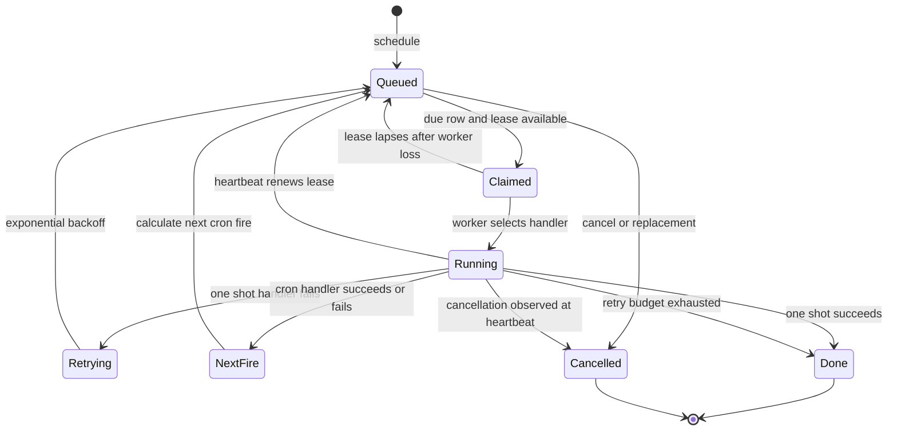
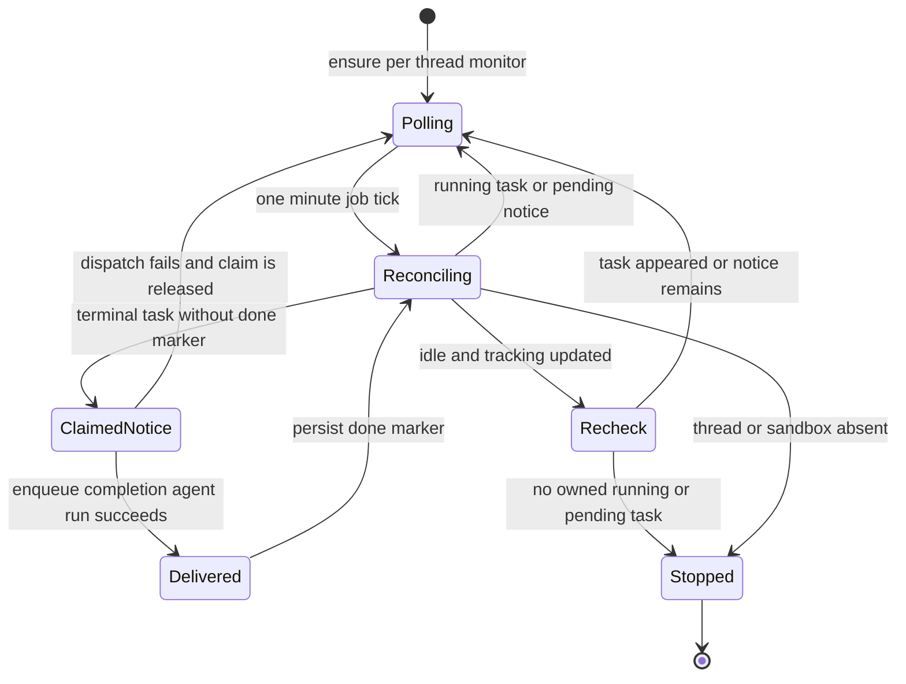

# Schedules, Jobs, Monitoring, and Merge Queue Automation

Open SWE uses a database-backed job queue for work that must survive a web-process restart: one-shot work, cron work, polling monitors, and queue reconciliation. A job is a `kind` plus JSON payload; the process-local `JobWorker` selects a registered handler. This is deliberately different from an agent run: the worker can perform deterministic maintenance directly, or a handler can explicitly dispatch an agent run when model reasoning is appropriate.

The shared worker starts with the API lifespan (only when the database is configured), runs startup provisioning before polling, and stops its in-flight handlers during shutdown. Job handlers are registered centrally in `openswe/jobs/kinds.py`; adding a durable automation therefore means defining a narrow kind, a handler, and a producer that schedules and cancels it. See [State and async services](../architecture/state-and-async-services.md) for service ownership and [Invocation and thread routing](invocation-and-thread-routing.md) for durable agent-run delivery.

## Durable job semantics

A row records `due_at`, optional cron and timezone, optional uniqueness `key`, payload and metadata, attempt count, and a claim token. A keyed `schedule()` call replaces the existing row by default, resetting its lease and attempts; `replace=False` preserves an existing keyed row. Producers can also find or cancel jobs by metadata. This makes keys useful for idempotently maintaining one monitor per logical owner.

Diagram: the claimed-job lifecycle; lease expiry can permit a later worker to run work that a lost worker may already have begun.

### Claims, heartbeats, and retries

Workers atomically claim due unlocked or expired-lease rows with `FOR UPDATE SKIP LOCKED`, issue a new 30-minute lease and claim token, and run at most 20 handlers per worker. They poll quickly after finding work and otherwise every five seconds. A running handler is checked every ten seconds: a successful heartbeat extends its lease; a cancellation removes the row and cancels the handler; replacement is detected because the old claim token no longer matches.

This is **not at-most-once execution**. A shutdown cancels the local handler but leaves its lease to lapse, and another replica can claim it. If lease renewal fails, the worker continues on its still-valid lease, so a sufficiently long database failure can also lead to takeover. Handlers that can cause externally visible effects must therefore tolerate redelivery or introduce a separate idempotency claim.

On successful completion, a one-shot job is deleted; a cron row is rescheduled from the current time in its configured timezone and its attempt count is reset. A failing cron advances to its next occurrence rather than being retried on the same fire. A failing one-shot releases its claim and backs off exponentially from 30 seconds, capped at one hour; its fifth failed attempt is deleted and logged. An unknown job kind follows the same one-shot retry behavior.

The queue protects a replacement made while an old execution runs: `finish`, `retry_later`, and `stop` act only when the original claim token still matches. Thus an old worker cannot delete, reschedule, or overwrite the replacement.

### Scheduling agent automations

Dashboard schedule APIs are session-readable but creation, update, manual trigger, and deletion require an administrator and are audit-wrapped. An automation stores its definition and triggers; creating or changing triggers creates corresponding cron jobs, with cleanup on persistence failure. Launching a scheduled job re-loads the automation and validates the fired trigger, removing orphaned cron jobs rather than running an obsolete definition.

The `agent_schedule` handler adds a second idempotency boundary for each cron fire: it claims `job.id:job.due_at` for two days before launching. This addresses the job queue's lease-takeover semantics—if a crash happens after dispatch but before the cron row is advanced, a re-claimed execution does not launch the same fire again. It does not turn the general queue into at-most-once delivery; it is a handler-specific safeguard with a finite TTL.

## Monitoring and reconciliation

### Background sandbox commands

A background command can report completion through a runner callback or, for users not opted into callbacks, through a per-thread `background_tasks` cron every minute. `ensure_background_task_polling(thread_id)` uses the keyed job `background_tasks:<thread_id>`, so repeated starts maintain one polling row. Both paths reconcile only tasks owned by the thread; legacy unowned tasks are attributed to the sandbox host only where host ownership metadata is absent.

Diagram: scheduled sandbox monitoring reconciles terminal-task delivery before removing its per-thread polling job.

For every terminal task without a `notification == "done"` marker, reconciliation atomically creates a task-directory `notify.claim`, dispatches a system completion message to the owning thread with `multitask_strategy="enqueue"`, and then renames the claim to `notify.done`. Failed dispatch removes the claim so the callback or a later tick can retry. It also updates the thread's tracked running-task state and Slack background status.

An apparently idle polling tick does not immediately delete the job. It first takes a sandbox monitor lock, lists tasks again, and cancels the keyed job only when no owned task is running and no terminal task needs notification. Missing threads or sandboxes also stop polling; a missing sandbox resets any tracked task state. The callback path treats an unreadable task list as an error so the runner retries, and validates that its task owner belongs to the requesting sandbox.

### Stale agent-run recovery

`reconcile_stale_runs()` is the safety net for the separate durable-run completion contract. It pages through `busy` threads, lists each thread's `pending` runs, and interrupts those older than its 1,800-second default. It skips malformed timestamps and isolates failures per thread, returning counts for threads checked, stale runs found, and cancellations. This prevents a lost completion webhook or crashed delivery from holding a thread busy indefinitely; it does not retry or reconstruct the cancelled agent work.

### Event-driven delegation to threads

Inbound subscription events are persisted as `EventMatch` records *before* an agent run is started. Uniqueness on `(thread_id, source, delivery_id)` suppresses repeated nonempty webhook delivery IDs. A match is considered delivered only after its ID is present in checkpointed thread messages; owed matches are recovered oldest-first from state rather than trusting the platform run queue, because an interrupting run can cancel queued runs.

Delivery serializes per thread with a Postgres advisory lock. For `enqueue`, a busy thread is left alone for its next run; `interrupt` may start a durable run using the requested strategy. Before dispatch, delivery increments an attempt counter and stops self-starting a match after three unsuccessful delivery runs. Sandbox-only monitor matches additionally consume a monitor wake budget, so repeated monitor output cannot indefinitely create agent runs without a human turn. A missing thread causes subscriptions and its owed matches to be forgotten.

`event_claims` is a second, general-purpose database primitive used where a brief exactly-once gate or mutex is needed. It atomically claims a `(scope, key)` until expiry, sweeps expired rows opportunistically, and allows failed handlers to release the claim for provider redelivery. Because claims lapse, they provide bounded deduplication and crash recovery—not a guarantee that a side effect occurred exactly once.

## Opt-in `/baby-sit` CI monitoring

`/baby-sit` maintains a durable pull-request watch keyed as normalized `owner/repo#number`, stored in the PR task state. Starting a watch joins the initiating thread's task, rejects another task's active watch, saves head SHA/ref, installation, run configuration and source context, and schedules one keyed `baby_sit` job every ten minutes. A fresh head resets retries and dispatch/alert dedupe state; a same-head restart carries them. If initial job creation fails for a new watch, the watch and job are rolled back. Stopping cancels the job and removes the state; if cancellation fails, it marks the watch inactive so evaluation ceases.

GitHub CI webhooks and the polling job converge under a five-minute per-watch `event_claims` lock. A completed CI webhook is matched by repository and watched SHA or branch, records a bounded delivery-ID history, may refresh the installation ID, and immediately evaluates. The cron remains the fallback for absent or delayed webhooks. Concurrent triggers return `busy`, and duplicate failure dispatches are suppressed by a SHA-and-retry-count fingerprint.

Evaluation stops closed PRs, classifies checks and commit statuses as `pending`, `failure`, `blocked`, or `success`, and dispatches a queued agent continuation only for a new failure. Missing CI data, GitHub credentials, and other evaluation failures increment a durable counter; the watch terminates after three consecutive evaluation errors. A head change resets that counter along with retry and dispatch state. Green state is accepted only after required branch checks are reported, then a ready wakeup is dispatched and the watch stops. Terminal blocked or exhausted outcomes are sent to the source destination when possible, otherwise queued back to the agent thread, before stopping.

The agent can call `record_retry` only from the watch's task, for the current SHA, and only up to three flaky reruns per head. The service records concise evidence and sends at most one alert per SHA/check/safe GitHub URL. This ownership and cap prevents unrelated threads or repeated events from consuming a watch's retry budget.

## Separately configured merge queue

The merge queue is not a general dashboard automation and does not take controller authority from job payload. At startup, `start_queue()` loads exactly one canary workspace configuration; absence disables the controller, while multiple configurations are rejected. Configuration requires an isolated (non-local) sandbox, required-check provenance and validation policy, normalized operator emails, an HTTPS dispatch URL without credentials/query/fragment, and 7–365 days of retention. The controller obtains its dispatch secret from `MERGE_QUEUE_DISPATCH_SECRET`.

Once configured, the controller registers the repository queue for `main`, installs one `merge_queue_reconcile` job every minute using `replace=False`, and supplies trusted policy, GitHub access, and dispatch gateway through the in-memory runtime. Before every repository operation it verifies workspace and target branch, the database repository identity, GitHub repository identity, and the SHA-256 digest of `.github/workflows/merge_queue_validate.yml` at `main`. The GitHub App token is limited to the read/write permissions the controller needs; a changed binding or workflow refuses operation.

Each reconcile claims a queue lease for 60 seconds; if another controller holds it, it does nothing. Under a 240-second bound it advances validation state, reconciles batches, renews the lease, and gives candidate validation 45 seconds. Cleanup and history pruning use the same lease and lease loss is handled as a normal competing-controller outcome; release is attempted in all cases.

Candidate validation treats GitHub output as evidence that must satisfy a contract, not merely a green workflow. It dispatches saved intent through the gateway, finds at most one matching run within a clock-skew window, and verifies actor, triggering actor, repository, head repository/branch/SHA, workflow path, event, title, and first run attempt. Completed success also requires exactly the expected successful jobs plus `candidate-result`, one unexpired attempt-specific artifact, and a `result.json` exactly matching the request, run, and tested candidate SHA. It re-checks workflow identity and candidate/base references while collecting evidence; a changed base or candidate invalidates the batch, while rejected dispatch or invalid evidence is recorded as failed validation.

## Verification focus

- `tests/jobs/test_jobs.py` covers multi-worker claiming, cron timezone advancement, one-shot backoff/exhaustion, keyed replacement safety, cancellation heartbeat behavior, metadata cancellation, and per-fire automation deduplication.
- `tests/agent/test_baby_sit.py` exercises serialized evaluation, failure and webhook dedupe, task ownership, retry limits and reset on a new head, ready dispatch, and terminal fallback.
- `tests/merge_queue/test_queue_controller.py` verifies trusted repository/workflow identity checks; `tests/merge_queue/test_queue_validation.py` tests dispatch rejection, identity/evidence rejection, clock skew, and invalidation when the base changes.
