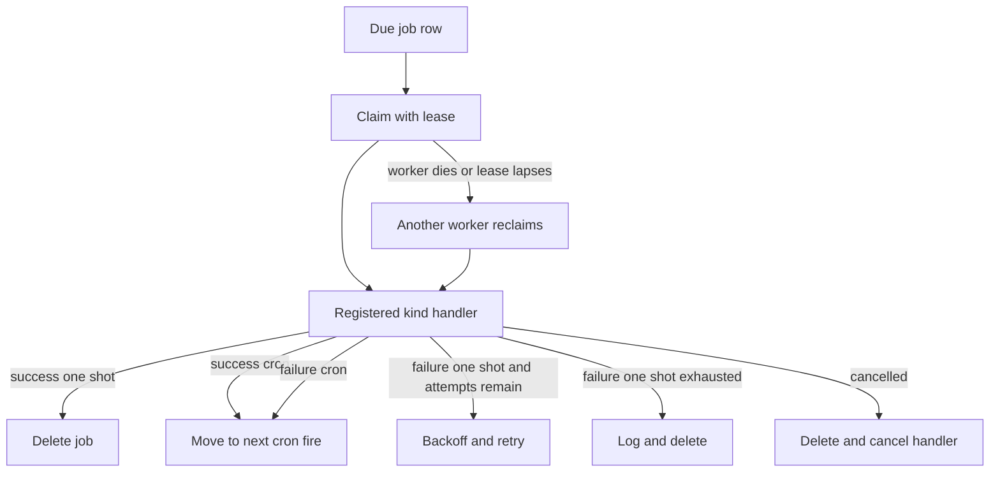
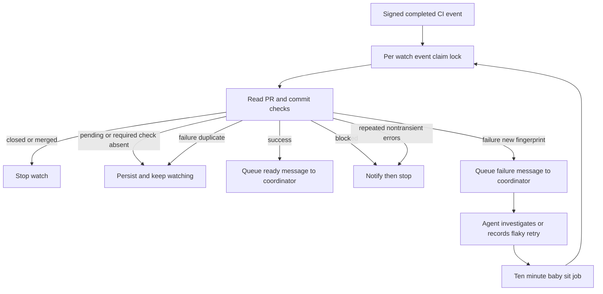

# Schedules, tasks, and background follow-up

Open SWE separates **durable background work** from an agent run. The PostgreSQL-backed job queue runs deterministic handlers; a handler may maintain state, start a new run, or enqueue an input for an existing thread/task owner. This distinction is intentional: polling and reconciliation should not consume model tokens merely because they ran.

| Mechanism | Durable owner | What happens when due or triggered |
| --- | --- | --- |
| Job queue | `job` row, optionally keyed | A registered handler performs deterministic work; it may launch or enqueue agent work. |
| Scheduled automation | `automation` and trigger rows plus an `agent_schedule` job | Creates a fresh system automation thread and run. |
| Thread wakeup | one-shot `thread_wakeup` job | **Starts a new `agent` run on the existing thread** with `enqueue`. |
| Sandbox command completion | task files plus thread metadata and a per-thread polling job or callback | **Queues a system completion message to the command owner's recipient thread**, rather than directly running a model loop. |
| `/baby-sit` | PR task state plus a keyed repeating `baby_sit` job | Evaluates CI deterministically, then queues an `enqueue` follow-up only for a meaningful failure or ready outcome. |
| Async task worker | task/delegation records and a worker thread | Starts a worker's own run on a new child thread; task completion and messages remain task-service responsibilities. |

## Durable job execution

`openswe.jobs.queue` stores a kind, JSON payload, due time, optional cron/timezone, metadata, attempts, and optional unique key. Scheduling the same key replaces its payload and schedule (unless explicitly requested otherwise), which gives owners an idempotent way to maintain one monitor or cron. The queue claims due rows using `FOR UPDATE SKIP LOCKED` and a 30-minute lease, so replicas may poll concurrently without executing a normally claimed job twice.

A `JobWorker` has a registry of kind handlers and limits concurrent work to 20. It renews a running claim every 10 seconds; cancellation removes the row and causes the worker to cancel the handler. A one-shot job is deleted after success. A cron advances to its next timezone-aware fire and resets attempts. A failing one-shot retries at exponential delays from 30 seconds, capped at one hour, and is discarded after five attempts; a failing cron instead advances to its next scheduled fire. If a process dies, a worker can reclaim the job after the lease expires, so handlers that cause external effects must supply their own deduplication.

Diagram: claim tokens and leases provide at-least-once execution, while kind-specific idempotency protects effects after a reclaim.

`openswe.jobs.kinds` is the integration boundary: importing it registers production handlers such as automation scheduling, sandbox monitoring, CI watches, cost refresh, thread wakeups, and reconciliation. Startup imports eligible legacy Agent Server crons into keyed queue jobs, then deletes the old cron only after adoption; a failed adoption leaves the old cron for a later startup attempt. Thread-bound legacy wakeups are excluded because they already fire once on their target thread.

### Operations and safe handler design

Use `queue.schedule(kind, payload, due_at=..., cron=..., timezone=..., key=..., metadata=...)` for durable work. Validate cron expressions at enqueue time. Prefer a stable key for singleton work (`background_tasks:<thread>` and `baby_sit:<watch>` are examples), retain ownership metadata for targeted cancellation, and make outbound effects deduplicable. `Job.hold()` tells a long-running handler whether it remains held, was replaced, or was cancelled.

A special case is a `thread_wakeup` job. Its handler deliberately does **not** retry an exception and skips a reclaimed lease: Agent Server might have accepted `runs.create` before the client lost the response, and retrying could start the same wake twice. In contrast, schedule fires use an `event_claim` keyed by the job ID and due time (two-day TTL), so a recovered worker starts an automation only once for a particular fire.

## Scheduled automations and event triggers

An automation is a durable prompt/configuration record scoped to a workspace. Its triggers can be five-field cron schedules, GitHub issue/PR events, Slack messages, or Linear issue events. The dashboard API is admin-gated for create/update/delete and manually triggering a test; cron syntax is normalized and range-checked. Schedule creation gives each schedule trigger its own keyed `agent_schedule` job.

When an `agent_schedule` fire is accepted, `launch_scheduled_agent_run` verifies that its automation and trigger still exist; stale/mismatched triggers clean up orphan jobs rather than launching. A valid launch creates a **new public system automation thread and a new agent run** with a fresh invocation ID—this is not a continuation of a conversational owner thread. Configuration and operational state are separate: the automation records its last thread/run/trigger time or launch error without a run overwriting concurrent configuration edits.

Event-triggered automations are also new automation runs, but their inbound event is first claimed per automation and rate-limited where configured. Their run may deliver a result only through `CreatorDelivery`: the destination is read from the automation record, the creator must still pass the GitHub login gate and have a linked Slack identity, and delivery is a DM to that creator. It is not taken from untrusted run output or arbitrary event data.

## Existing-thread wakeups

The `schedule_thread_wakeup` tool lets an active agent schedule one future continuation for its current thread. It accepts only whole-minute delays from one minute to 24 hours, rounds the target time up to a minute, preserves selected source/repository/context configuration, and records a system sender/input. At due time the worker calls `runs.create` for `agent` on that same thread with `multitask_strategy="enqueue"` and the normal completion webhook.

Wakeups are bounded to ten per *latest human-message generation*. `WakeBudget` derives that generation from durable thread state; metadata whose generation differs counts as zero. The budget is recorded before creating the job, so a scheduling failure consumes a slot instead of enabling a failure loop. The default prompt is used when no nonblank prompt is supplied. Removing task work cancels queued thread wakeups by metadata.

Older wakeups were Agent Server crons with an end time roughly 90 seconds after their one-shot fire. Current wakeups are queue jobs; the tool still best-effort purges only expired legacy crons marked `metadata.kind=thread_wakeup`, fully paginating before deletion. A late job adds a lateness notice to its input rather than silently pretending it fired on time.

## Sandbox background commands: callbacks, polling, and recipient safety

A background command is tracked before launch so a fast completion cannot beat tracking. Commands are owned by `owner_thread_id`; sandbox guests may see a shared sandbox but only their own commands (with a narrowly defined legacy-host compatibility case). If the triggering person enabled experimental callbacks, the runner invokes `reconcile_background_task_callback`; otherwise launch schedules one keyed, every-minute `background_tasks` polling job for the owner thread.

Both paths converge on `_reconcile`:

1. Load the thread, validate callback sandbox ownership, and find only its tasks.
2. Reconcile the set of running and finished IDs into thread metadata and Slack background status.
3. For every terminal task not already marked done, atomically create its sandbox `notify.claim` directory.
4. Build a system completion prompt, resolve the recipient configuration (task recipient for task/private-user work; ordinary follow-up configuration otherwise), and call `dispatch_agent_run(..., multitask_strategy="enqueue")`.
5. Rename the claim to `notify.done` only after dispatch succeeds; on failure remove the claim so a later callback/poll can try again.

Thus a terminal command does not directly resume a model loop: it queues a message for the task-aware or thread-aware recipient. The completion input is explicitly a system/automation sender and command output is referenced by path rather than trusted as instructions. A missing thread stops reconciliation; missing sandbox metadata clears tracked state and stops polling. When polling sees idle work, it takes a sandbox monitor lock, lists again, and cancels its singleton job only if no owned task is running or awaiting notification. This final recheck prevents a command launch racing monitor teardown.

The dashboard's background-work reader is deliberately read-only and authorization-gated: it connects to a sandbox only when metadata says a command or monitor is running, and exposes bounded recent output only after confirming ownership.

## `/baby-sit`: CI events with a polling fallback

`/baby-sit` is an opt-in pull-request watch, not a general CI watcher. A watch is keyed by normalized `owner/repo#number`, stored in the PR's task state, and joins the initiating thread's task; thereafter it follows that task coordinator thread. It preserves run configuration and source context, head SHA/ref, installation, retries, dispatch/delivery/alert dedupe keys, errors, and its keyed ten-minute `baby_sit` job. A different task cannot take an active PR watch; restarting on the same head carries state, while a new head resets retries and dispatch/alert state.

Signed GitHub `check_run`, `check_suite`, `workflow_run`, and `status` deliveries are processed asynchronously. Completed CI deliveries select matching active watches by repository plus head SHA or branch, update the installation ID, record a bounded delivery-ID dedupe list, and evaluate immediately. The repeating job is the fallback for missing or delayed webhook delivery. Both acquire the same five-minute event claim lock, so concurrent triggers return `busy` rather than duplicate a continuation.

Diagram: webhook acceleration and periodic polling serialize through one watch lock and only meaningful CI state changes enqueue an owner-thread follow-up.

CI aggregation ignores Open SWE's own check names. It reports failure for configured failing check conclusions or failed/error commit statuses; pending for incomplete or empty check sets; blocked for other terminal non-success states; and success only for completed successful/neutral/skipped checks plus all required branch checks reported. A green head queues a ready update once and keeps watching future commits. A failure uses a SHA-and-retry fingerprint before queueing the owner coordinator with `enqueue`; if dispatch fails, the fingerprint is removed so another trigger can retry.

The agent may record at most three evidence-backed flaky reruns per head. Recording verifies task ownership and unchanged head SHA, increments durable retry state, and sends a deduplicated alert with only a safe GitHub URL. Closure, blocked CI, retry exhaustion, or three non-transient evaluation/ready-dispatch errors finishes the watch. Terminal delivery prefers the saved source destination when appropriate; if it cannot notify there—or the source is a Slack thread owned by the agent—it queues a terminal message to the owner thread, then stops the watch.

## Delegated task workers

MDA's `start_async_task` launches a new child thread and initial worker run, but Open SWE turns it into a task worker rather than letting it inherit the coordinator's authority. The coordinator asks `launch` for a signed `WorkerGrant`; delegation authorization rejects guest sandboxes and workers delegating again, and requires an attached coordinator sandbox. On `worker_launched`, the service validates that the child was launched from that coordinator and registers exactly one task delegation for the stable tool-call ID. A replayed launch cancels its second worker run and returns the original worker.

On the worker's first `adopt`, its grant and child thread ID are exchanged for a run token/configuration of its own. Registration is safe whether it occurs during `worker_launched` or `adopt`. The worker has its own indexed thread, task membership, sandbox access, and completion webhook; completion, cancellation, task messages, and result delivery are handled by the task service. If the initial run ended before registration, `settle_if_ended` invokes normal completion handling, and can safely be repeated. This is a **new worker run**, not a queued message on the coordinator thread.

## Reconciliation and focused verification

Normal durable dispatch expects completion webhooks to settle runs. `reconcile_stale_runs` is the recovery sweep for lost completion: it pages through busy threads, lists pending runs, and interrupts only runs older than 1,800 seconds by default. It skips malformed timestamps and isolates errors per thread, returning checked/stale/cancelled counts; one inaccessible thread cannot prevent other blocked threads from recovering. The `reconcile` job kind invokes this sweep when scheduled by deployment/operator policy.

Focused tests document the important safety properties:

- `tests/jobs/test_jobs.py` covers cross-worker single claiming, keyed replacement, replacement while running, lease reclaim behavior, cancellation, cron advancement, one-shot backoff/exhaustion, and schedule-fire/wakeup deduplication.
- `tests/agent/test_agent_schedules.py` covers automation cron registration, trigger validation and lifecycle, launch state, and authorization paths.
- `tests/agent/test_baby_sit.py` exercises locking, webhook/failure dedupe, head reset, required-check waiting, terminal/error behavior, retry caps, and owner-thread `enqueue` dispatch; `tests/github/test_baby_sit_webhook.py` verifies that CI routing requires a valid GitHub signature.
- `tests/github/test_github_ci.py` covers CI payload/check interpretation. Background-task, wakeup, and stale-run behavior should be changed alongside their respective ownership, claim, and retry invariants.
