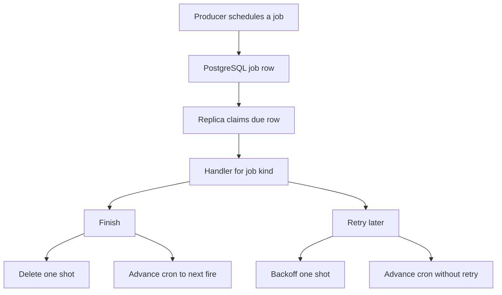
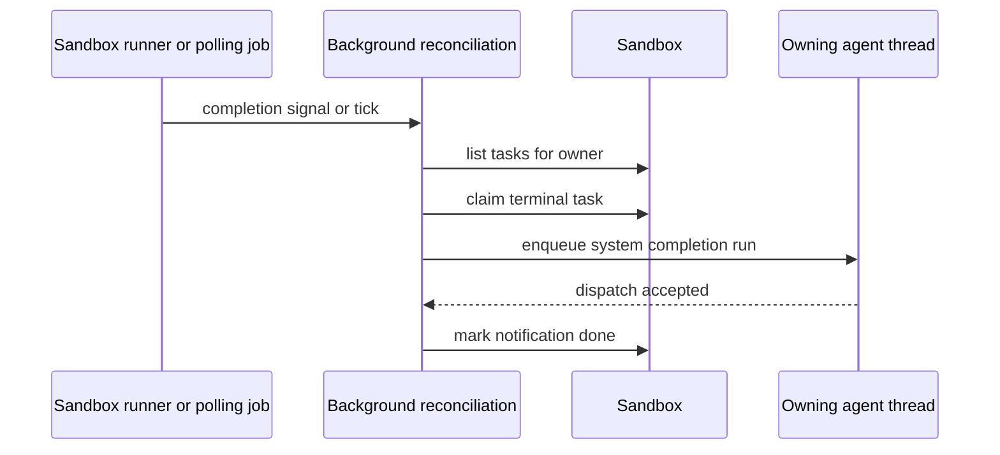

# Scheduling, jobs, tasks, and monitoring

Open SWE uses a PostgreSQL job queue for durable delayed and recurring background work. A job is a small, model-free envelope—`kind`, JSON `payload`, due time, optional cron and timezone, optional replacement `key`, and metadata—not an Agent Server cron or a graph run. `openswe.jobs.kinds` maps kinds to handlers; the web application imports that module before starting the shared `WORKER`.

This separation is intentional: timers and maintenance survive process restarts, can run on any replica, and only start an agent run when the handler explicitly needs thread-owned reasoning or delivery. In particular, background code must not post directly into a user-visible Slack thread owned by an agent. It should enqueue a system message/run on the owning thread; the owning run then preserves channel, transcript, ordering, and delivery policy.

## Durable queue and execution contract

`queue.schedule()` inserts a one-shot job or a cron job. A non-null `key` is an upsert identity: by default a new enqueue replaces the prior keyed row, including its schedule and claim; `replace=False` retains the existing row. Producers use stable keys for singleton polling and watches. Metadata supports scoped lookup and cancellation, for example all thread wakeups for one thread.

Diagram: a job is claimed transactionally, then deleted, advanced, or retried according to its type and outcome.

### Claims, leases, replacement, and retry

Workers select due, unlocked rows with `FOR UPDATE SKIP LOCKED`, assign a random claim token, and lease them for 30 minutes. Thus multiple replicas may poll but only one claims a particular eligible execution. A running worker renews its lease every 10 seconds. Cancellation removes the row; a renewal then reports cancellation and the worker cancels the handler. On shutdown, the handler is cancelled and another replica may reclaim the row after the lease expires.

The claim token is the ownership invariant. `finish`, `stop`, lease renewal, and retry update/delete only when their token still owns the row. If a keyed producer replaced a job while an old handler was executing, the old handler cannot delete or overwrite the replacement. A takeover after a lapsed lease is possible, so handlers must be safe for at-least-once execution or add their own idempotency claim.

For an unhandled kind or a thrown handler exception, a one-shot attempts at most five times, with exponential delays starting at 30 seconds and capped at one hour; the final failure is logged and the row is removed. A failing cron advances directly to its next cron fire, resets attempts after successful/cron completion, and never retries the same tick. Cron next-fire calculation honors the stored IANA timezone.

The worker has at most 20 in-flight handlers, polls quickly while it started work and otherwise every five seconds, and logs unknown kinds and failures. Startup work is isolated per step: import legacy Agent Server crons/threads, initialize standing jobs and queue-related services, but do not prevent worker polling because one setup action failed.

### Handler registration and special idempotency

Most handlers in `openswe.jobs.kinds` are wrapped in transient-sandbox retry logic: sandbox attachment faults retry within the sandbox retry budget, while non-transient failures follow queue retry semantics. It registers queue work for background task polling, baby-sit watches, schedules, reconciliation, costs, notifications, merge queues, workspace refreshes, and maintenance cleanup.

A scheduled automation adds an explicit two-day `event_claims` fire key composed from the queue job ID and due time before launching. This closes the window where a process launched a run but died before finishing its job: a reclaimed execution does not launch the same automation twice, while its next cron occurrence has a different due time.

Thread wakeups are deliberately different. Starting a remote run can have succeeded even if the caller receives an error, so the wakeup handler does not queue-retry exceptions and skips a reclaimed/lapsed-lease execution. This favors avoiding a duplicate agent wakeup over a best-effort retry.

## Automations and recurring schedules

The dashboard exposes authenticated, audited CRUD and manual-trigger routes under `/schedules`. Schedule records and their triggers live in PostgreSQL. A five-field cron trigger is normalized and range-validated, and creates a keyed `agent_schedule` queue cron carrying `schedule_id` and `trigger_id`; other triggers can react to GitHub, Slack, or Linear events. Each timed trigger owns its own queue cron.

A fire validates that the automation remains enabled and that the trigger still matches. It creates a fresh agent thread/run and records `last_thread_id`, `last_run_id`, trigger time, and errors separately from the schedule definition. The stale-cron behavior matters during edits: a cron that survived a trigger change recognizes the mismatch, removes itself when possible, and launches nothing. Event-triggered deliveries are claimed per automation/event before dispatch, preventing duplicate webhook deliveries from producing duplicate runs.

Automation output has a narrow destination: `CreatorDelivery` resolves the creator from the schedule record rather than trusting run input, rechecks the GitHub login gate, requires the creator's linked Slack account, and DMs that creator. It records a delivery error when authorization or Slack linkage is no longer valid.

## Thread wakeups

`schedule_thread_wakeup` lets an active agent ask to resume its own thread after one minute through 24 hours. It rounds the due time up to a whole minute, preserves selected run configuration and the active Slack correlation, and stores a one-shot `thread_wakeup` queue job with system input and queue metadata. At execution, `run_thread_wakeup` creates an `agent` run with `multitask_strategy="enqueue"` and the completion webhook. A job that runs more than 90 seconds late still launches, but prepends a lateness notice.

Wakeups are rate limited by `THREAD_WAKEUPS`: at most ten are scheduled for a thread's current latest human-message generation. The generation and count are stored in thread metadata. A new human message resets the effective count; system wakeups do not. The tool serializes local concurrent scheduling per thread and records the spend *before* writing the job, so a scheduling failure consumes a slot rather than allowing an error-driven wakeup storm. Cancelling a thread's wakeups deletes matching queue jobs and also cleans up legacy Agent Server cron wakeups.

## Sandbox background commands

Sandbox commands can complete after the agent run that launched them. Completion delivery has two selectable triggers: opted-in runners call back through the sandbox tools channel; otherwise a keyed `background_tasks:<thread_id>` cron polls each minute. Both feed the same reconciliation path and only consider tasks owned by that thread (with a carefully limited legacy-host fallback).

Diagram: completion is claimed in the sandbox and handed to the task-owning agent thread rather than posted directly to a channel.

The reconciler updates tracked running/finished task IDs in thread metadata and Slack background status. For each terminal task not yet delivered, it atomically creates a task-directory claim, builds a system completion prompt that treats command output as untrusted, and calls `dispatch_agent_run(..., multitask_strategy="enqueue")` on the owner thread. Only a successful dispatch turns the claim into `notify.done`; a failure removes it for a later callback/tick. This is the durable handoff boundary for user-visible status.

When there are no running tasks or undelivered terminal notifications, polling takes a sandbox monitor lock, re-lists tasks, then stops the keyed poll job only if the fresh view is still idle. A missing thread or sandbox also stops polling. Dashboard readers may list/output background work only after thread access checks; the endpoint avoids opening an idle sandbox and limits command output to the latest 200 lines.

## `/baby-sit` CI monitoring

`/baby-sit` is an opt-in durable watch, not general CI polling. Watch state is persisted on the pull-request task state under a normalized `owner/repo#number` key. It retains the active flag, head SHA/ref, originating task coordinator thread, installation and run configuration, source context, retry count, dispatch/delivery/alert dedupe keys, evaluation-error count, and queue job ID. A PR can be watched by only one active task; restarting at the same SHA retains dedupe/retry state, while a new SHA resets the relevant state.

Starting saves the watch, turns the initiating thread into or joins its task coordinator, and schedules a keyed `baby_sit` job every ten minutes. A failed first job creation rolls back persisted watch state; stop removes the job and state, or marks the state inactive if deletion fails. Signed GitHub CI webhooks and the periodic job both call `evaluate_watch`. A five-minute event-claim lock serializes them, returning `busy` to a concurrent evaluator.

Evaluation fetches the PR and check/status sets. It stops closed PRs, treats incomplete/absent checks as pending, recognizes completed failing checks/statuses as failure, marks non-success completed sets as blocked, and regards only nonempty successful/neutral/skipped check sets as success. A failure is dispatched at most once for its SHA/retry fingerprint: the watch enqueues a `/baby-sit --continue` system run on the owner thread. If dispatch fails, its fingerprint is removed so a later trigger can retry. The agent may record at most three evidence-backed flaky retries per head.

Terminal or blocked outcomes attempt a source-context notification but preserve ownership: for a Slack-originated watch, the service intentionally does not post in the agent-owned Slack thread and instead enqueues `/baby-sit --terminal` on the owner thread. The same thread fallback is used if direct source notification cannot be made. Repeated evaluation failures stop the watch after three non-retryable errors.

## Async task workers

An MDA coordinator can launch an async subagent using `start_async_task`, but Open SWE converts it into an ordinary task-service worker rather than allowing the subagent framework to wake the coordinator directly. The coordinator receives a signed worker grant instead of its own run token; the worker adopts it to obtain a token for its own thread. Registration establishes the task membership, owner, index entry, and sandbox access. A worker cannot delegate again.

Launch and registration are replay-safe. A transient MDA start failure is retried after 4 then 12 seconds using the same tool-call grant. If parallel/replayed launches create more than one thread, the first registration wins and the other launched run is cancelled. A run that ended before registration is settled through the normal completion handler; settlement can be repeated. Thereafter task messages, cancellation, results, and completion webhook handling belong to the task service, not deepagents' native task tracking.

## Reconciliation and operations

Normal run completion is released by the completion webhook. `reconcile_stale_runs` is the safety net for lost delivery: it paginates busy threads, lists their pending runs, and interrupts only those older than 1,800 seconds by default. Malformed timestamps are skipped, search errors end the sweep, and a failure on one thread is logged without blocking the others. Its result counts checked threads, stale runs, and cancellations.

Operationally, monitor queue health through job failure logs, unknown-handler logs, lease-takeover warnings, and the final one-shot failure log. Use keys for singleton/replacement semantics, metadata for cleanup scope, and explicit idempotency claims around irreversible external actions. Never assume a lease prevents duplicate side effects after a crash: it prevents concurrent ownership until expiry, not re-execution after expiry.

## Focused tests

- `tests/jobs/test_jobs.py` verifies multi-worker single claiming, cron advancement/timezones, one-shot backoff/exhaustion, keyed replacement safety, cancellation, reclaimed wakeup suppression, and per-fire schedule idempotency.
- `tests/agent/test_agent_schedules.py` covers cron creation, trigger routing and stale-trigger cleanup, access checks, event-delivery claims, and launch bookkeeping.
- `tests/tools/test_schedule_thread_wakeup.py` exercises bounds, configuration propagation, budget reset/concurrency, cancellation, purge scoping, and late execution.
- `tests/agent/test_baby_sit.py` and `tests/github/test_baby_sit_webhook.py` cover durable watch lifecycle, locking/deduplication, CI webhook ingestion, retry limits, and terminal delivery behavior.
- `tests/tools/test_background_task.py`, `tests/tools/test_background_execute.py`, and `tests/utils/test_background_task_state.py` cover command ownership/state and completion-monitoring support.
