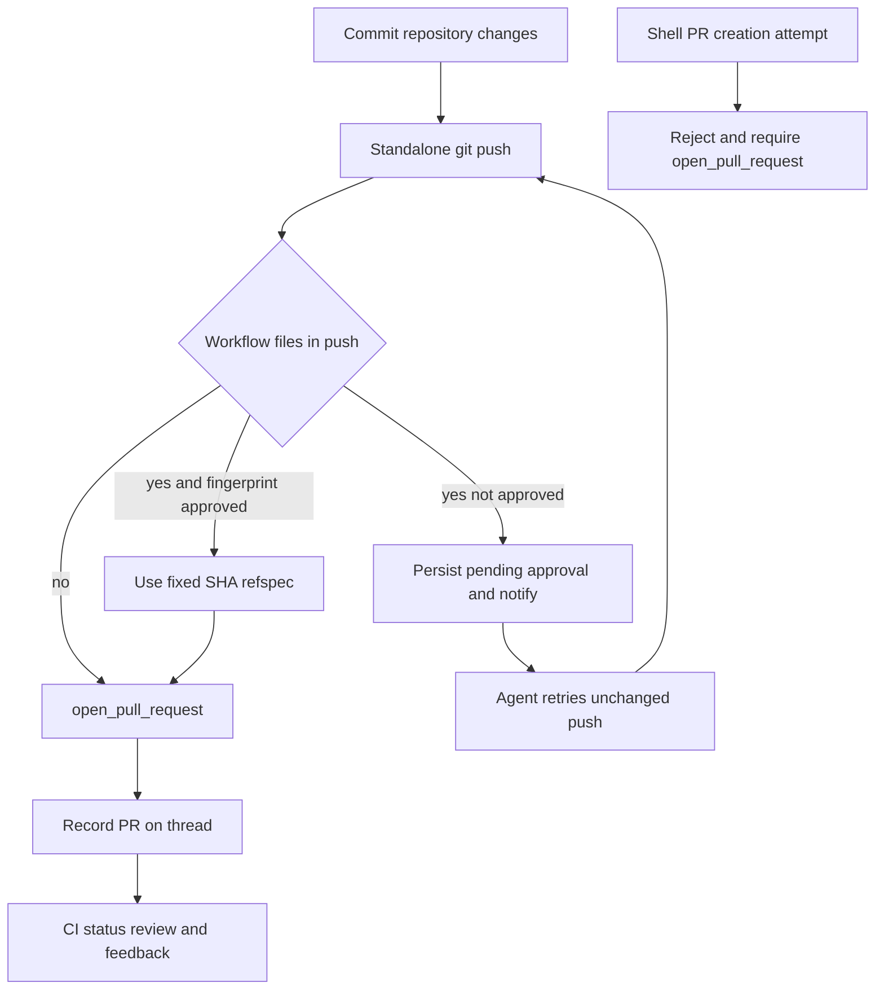

# Coding, Sandbox, and Pull Request Delivery Workflow

A coding run works against the sandbox already associated with its durable thread, then moves its changes through **commit → guarded push → attributed PR → CI/review feedback**. The backend plans the thread-specific tools and policy; Managed Deep Agents (MDA) executes the model and local file/shell loop when it owns the cloud box. A desktop/CLI bridge is a different kind of sandbox: its filesystem and commands run on the owner's machine through a durable, owner-scoped request bridge.

<!-- openwiki: broken internal link [/openwiki/workflows/invocation.md] file "/openwiki/workflows/invocation.md" does not exist. Fix the href or restore the target, then delete this comment. -->
This page concentrates on the coding-to-delivery path. For invocation and thread selection, see [Inbound Invocation to Durable Run](/openwiki/workflows/invocation.md); for tool-surface policy, see [Tool Surfaces, Sandbox Access, and Safety Guards](/openwiki/concepts/tools-and-safety.md); and for the MDA API boundary, see [Managed Agent Runtime](/openwiki/architecture/managed-runtime.md).

## Sandbox selection and ownership

`ManagedSandbox.for_thread()` describes an MDA-owned box only when `SANDBOX_TYPE` is `langsmith`, the thread is neither bridged nor already backend-owned, and any task worker is validly attached to its coordinator's MDA-owned sandbox. Otherwise the backend retains the existing sandbox arrangement. The MDA catalog is acquired before the run is prepared; MDA opens its declared box and supplies its ID on preparation. `bind_mda_sandbox()` persists `sandbox_owner="mda"` and the ID, after which backend reconnection configures Git identity, the GitHub proxy, and the sandbox tool channel without taking ownership of creation or replacement.

```mermaid
sequenceDiagram
    participant Thread as Durable thread metadata
    participant Planner as Open SWE planner
    participant MDA as Managed Deep Agents
    participant Box as MDA cloud sandbox
    participant Backend as Sandbox lifecycle
    Planner->>MDA: catalog with ManagedSandbox declaration
    MDA->>Box: create or open thread box
    MDA->>Backend: prepare with sandbox id
    Backend->>Thread: bind id and mark MDA owner
    Backend->>Box: reconnect configure proxy and git identity
    MDA->>Box: file shell and git work
    alt explicit MDA replacement
        Backend->>MDA: replacement options
        MDA->>Box: replace owned box
        MDA->>Backend: report replacement
        Backend->>Thread: rebind and reconnect
    else unreachable MDA box
        Backend-->>MDA: typed sandbox unreachable failure
        MDA-->>Thread: end run and notify through failure path
    end
```

This sequence distinguishes the deliberate MDA replacement/rebinding protocol from an unreachable MDA-owned sandbox; the backend does not silently create a substitute for the latter.

For backend-managed sandboxes, `ensure_sandbox_for_thread()` reconnects the persisted ID (or creates a box only when no ID exists), re-applies bot Git identity, refreshes scoped GitHub proxy credentials, completes any worktree handoff, provisions the sandbox tool URL, and publishes the usable backend only after initialization succeeds. A deleted backend-owned box can be recreated because it holds no tree; a merely unreachable coding sandbox raises `SandboxUnreachableError` instead of being swapped for an empty filesystem. The read-only reviewer path can opt into replacement because it re-derives its checkout each run. Provider selection is controlled by `SANDBOX_TYPE`; the registry supports `langsmith`, `daytona`, `modal`, `runloop`, `e2b`, and `local`, and startup validation exposes invalid provider configuration or missing optional provider dependencies before the first run.

### Desktop/CLI bridge case

A bridge sandbox ID represents a local machine, not a cloud sandbox. `BridgeSandboxBackend.connect()` loads a live bridge, verifies that the current run's sender is its owner, and queues `execute`, upload, and download requests for the CLI's long-poll loop. The bridge route likewise scopes open, heartbeat, claim, answer, and close operations to the authenticated principal, requires PostgreSQL, and hides another owner's bridge as not found. The backend subscribes before enqueueing and checks liveness while awaiting an answer, so a missed notification adds latency rather than losing a response, while a disconnected bridge becomes a typed unreachable failure.

A bridged thread is never booted as a cloud box, receives no managed proxy refresh or global Git rewrite, and cannot be given a cloud sandbox by `recreate_sandbox_for_thread()`. Thus delivery commands still follow the guards below, but local-machine availability and ownership are explicit prerequisites.

## Repository work and guarded tool execution

The prepared `ToolSurface` defines the tools, file routes, checks, and shell guards for this run; it is not a global tool grant. MDA's `FileToolsMiddleware` routes skill paths to its retained, read-only skill mapping, backend paths to remote file tools, and other calls to the MDA box when it owns one. It transcribes every file/shell call, including a refused command. Configured image validation prevents an invalid image attachment, ancestor `AGENTS.md` instructions are loaded on reads, and tool errors become model-visible results. Code-mode file tools are wrapped through the same middleware rather than bypassing these checks.

For an `execute` command likely to affect delivery—one containing `push`, `gh`, or `pulls`, or deeply nesting shells—MDA calls the backend `check_shell` endpoint before execution. The result may refuse the command or replace it with a fixed command. Sandbox calls retry a pre-start retryable connection failure with bounded backoff; an unanswered `execute` is limited to its configured/default timeout plus 30 seconds. This relevance heuristic deliberately sends more commands for inspection than a particular guard necessarily blocks; it is not a general authorization boundary.

## Delivery guards



This flow shows the two focused safeguards: PRs must be opened by the attributed tool, and inspectable workflow-bearing pushes require approval for the exact diff.

### Preserve PR attribution

New PRs are created through `open_pull_request`, after the branch is pushed, rather than `gh pr create` or a direct GitHub REST write. The tool selects the triggering user's current OAuth token when a PR author is available; system/no-user cases use the GitHub App token. It preflights repository, base, and eligible same-owner head-branch visibility and returns diagnostic failures rather than masking access or branch problems. On a 422 creation response it looks up an existing open PR for the head branch, returning it rather than duplicating it. Successful creation or duplicate discovery records PR usage and normalizes/upserts the PR record into thread metadata; that telemetry is best effort and does not reverse a successful GitHub operation.

`PullRequestCreationGuardMiddleware` guards shell-bearing arguments of `execute`, `background_execute`, and `monitor`. It tokenizes commands and recursively expands supported `bash`, `dash`, `sh`, and `zsh` `-c` invocations to a bounded depth. It rejects `gh pr create`, POST/body-based `gh api` writes to a `/pulls` endpoint, and comparable `curl` requests, returning the non-recoverable `pr_creation_fallback_blocked` error. The hosted main surface installs this guard together with the workflow guard.

### Require an exact approval for workflow changes

`WorkflowPushGuardMiddleware` accepts only conservative, inspectable standalone `git push origin <refspec>` forms, including supported `git -C`, `cd … &&`, `--set-upstream`, and safe lease variants. It uses the thread's sandbox backend to inspect pending/unpushed `.github/workflows/` changes. A non-workflow push proceeds. For workflow changes it captures the diff, bounded preview, changed-file statistics, base/head SHAs, remote and refs, then persists a SHA-256 fingerprinted pending approval. The fingerprint means a changed workflow diff needs a fresh decision.

Until approval, the push is refused and the guard sends one Slack approval request per pending record. Approval permits a retry only by rewriting the command to an explicit `<head_sha>:refs/heads/<branch>` refspec, preventing a moving local ref from changing what was reviewed. A lease-protected push that cannot be safely inspected is refused; a chained push that could include workflow changes is also refused because the guard cannot show an exact push to the thread owner. These controls gate guarded, inspectable delivery paths only—not every shell expression, Git API mutation, or arbitrary process that might run in a sandbox.

## PR state, CI, and continued work

PR lifecycle data ties delivery back to the thread for dashboard status and subsequent messages. CI readers gather both GitHub check runs and legacy commit statuses, excluding Open SWE's own checks. Their calls are best effort: unavailable permissions or HTTP failures yield `None` instead of breaking webhook handling. Only completed `failure`, `timed_out`, and `action_required` conclusions are auto-fix candidates; cancelled, stale, and skipped are excluded. Payload helpers normalize branch, head SHA, and completion state across `check_run`, `check_suite`, `workflow_run`, and legacy `status` events.

The optional `/baby-sit` watch persists state on the PR, schedules a ten-minute durable job, and locks each watch evaluation to avoid duplicate work. It tracks head SHA/ref, run configuration/source context, deliveries, dispatch keys, alerts, and retry count. A failure wake-up is bounded to three retries per head SHA, so a persistently failing commit does not launch unlimited repair runs. Feedback or a CI failure can therefore wake a correctly attributed thread with the PR and failure context, where the agent continues through the same sandbox and delivery controls.

Run completion is a separate reliability path. When a dispatch has a valid completion webhook configuration, the completion route authenticates it with a shared secret. `error` and `timeout` produce an idempotent, source-appropriate best-effort failure reply (Slack, Linear, or GitHub); `interrupted` is intentionally silent because it commonly represents a superseded run. This is also how a sandbox-unreachable ending is surfaced rather than silently replacing the coding environment.

## Operations and focused verification

- Treat thread metadata sandbox ID and owner as durability state. Do not make a backend helper recreate an MDA-owned or bridged sandbox: MDA replacement must be explicitly requested, reported, rebound, and reconnected; a dead bridge/MDA box fails visibly.
- Add a delivery-sensitive shell-bearing argument to `SHELL_TOOL_ARGS` so planned guards can inspect it. Do not infer that the existing PR or workflow guard authorizes a new write capability.
- Preserve `open_pull_request` as the new-PR path and preserve its author-token/preflight/duplicate behavior. A shell fallback defeats user attribution and is deliberately a hard error.
- Exercise `tests/sandbox/test_sandbox_recovery.py` for failure-versus-retry semantics, `tests/sandbox/test_reviewer_sandbox_recovery.py` for the reviewer-only replacement exception, and bridge tests when changing local execution. `tests/github/test_open_pull_request.py` covers token selection, preflight and duplicate outcomes; `tests/agent/test_workflow_push_guard.py` covers inspection, approval, and rewritten pushes.

## Related pages

- [Managed runtime](/openwiki/architecture/managed-runtime.md)
- [Tool surfaces and safeguards](/openwiki/concepts/tools-and-safety.md)
- [GitHub and MCP integrations](/openwiki/integrations/github-and-mcp.md)
- [Background automation](/openwiki/workflows/background-automation.md)
<!-- openwiki: broken internal link [/openwiki/workflows/invocation.md] file "/openwiki/workflows/invocation.md" does not exist. Fix the href or restore the target, then delete this comment. -->
- [Inbound invocation](/openwiki/workflows/invocation.md)
