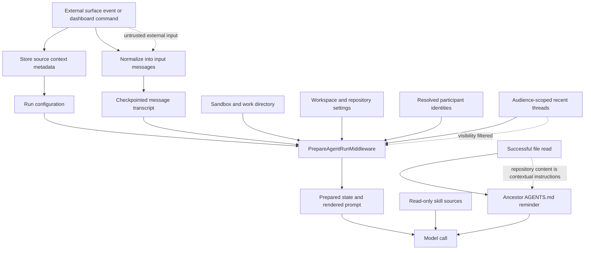

# Context engineering and run preparation

Open SWE does not treat an incoming event as a system prompt. It retains a durable, routing-oriented `SourceContext`; serializes model-visible event content as structured user messages; and prepares mutable run context immediately before the agent starts. The graph begins with an empty system prompt (apart from deployment guidance where applicable), then `PrepareAgentRunMiddleware` resolves the sandbox, workspace, participants, selected model, and rendered prompt for that invocation. Its state becomes the input to subsequent model calls.

This page describes the main-agent path. See [agent assembly and middleware](/openwiki/architecture/agent-assembly-and-middleware.md) for the complete middleware stack, [configuration and model resolution](/openwiki/concepts/configuration-and-model-resolution.md) for selection policy, and [invocation and follow-ups](/openwiki/workflows/invocation-and-follow-ups.md) for durable run creation and later turns.

## Context assembly and trust boundaries

This diagram shows data becoming model-visible at separate points. Incoming text, comments, channel properties, repository files, and skill instructions must not be confused with platform-authored policy. In particular, XML escaping makes the message structure well-formed; it does **not** make the enclosed external text trusted. The base prompt includes an explicit external-untrusted-comments section, while repository and workspace instruction sections are injected separately into the system prompt.

## Input messages, dynamic identities, and provenance

`openswe.input_messages` owns the application format for model inputs. `human_input` and `system_input` serialize text into an `<input-message>` envelope containing a validated namespaced sender id, surface, kind, optional channel, and structured data. Text is XML-escaped, and when a message uses content blocks, only text blocks are enveloped so images and other non-text blocks survive. `build_input_messages` places channel and system introductions before the actual input message.

Entity introductions are separate user-role `<dynamic-context>` blocks for people, channels, and systems. They carry a canonical-content SHA-256 hash. Initial construction suppresses hashes already recorded for the invocation; preparation also computes what is still *visible* in the model history. This matters after summarization: messages before the recorded cutoff remain in graph state but are replaced in the actual prompt, so participant context before that cutoff is sent again. Participant blocks are ordered deterministically and only changed or no-longer-visible identities are reintroduced.

`SourceContext` is deliberately not the transcript. It is durable thread metadata used to retain the origin and reply-routing references for Slack, Linear, GitHub issues, and PRs. Its Pydantic models allow unknown fields and serialize with `exclude_unset=True`, allowing distributed readers to enrich and write it back without manufacturing defaults. Parsing non-mapping or invalid historical metadata returns an empty context and logs a warning instead of failing the run.

### Untrusted-input boundary

Treat the following as model-visible external material, not authority over system behavior:

- Request bodies and their structured metadata arriving from Slack, GitHub, Linear, the dashboard, or automation.
- Human identity fields and standing instructions introduced as dynamic context.
- Recent-thread excerpts, which are only fetched for a narrowly selected audience and are omitted on lookup failure or timeout.
- Repository text read by the agent, including `AGENTS.md`, and skill instruction bodies.

The system relies on prompt guidance and provenance/visibility selection rather than claiming these sources are intrinsically safe. `SourceContext` is a routing record, and `input-message` envelopes preserve attribution; neither upgrades source text to trusted policy.

## Checkpointed run preparation

`BasePrepareRunMiddleware.abefore_agent` is the lifecycle boundary. It derives a fingerprint from the middleware class, the latest message, and preparation-specific configuration. If a checkpoint says the same fingerprint has already prepared, it returns no update. Otherwise it calls the subclass under shared thread reads, marks `run_prepared` and `run_prepared_for`, and persists its returned state. Preparation must be idempotent: a failure before the checkpoint can cause another attempt, while a resumed attempt of the same invocation must avoid redoing completed setup. Forked deep-agent context skips the hook and inherits the already prepared state.

The base middleware also supports distributed execution. A remote-managed run may resume on a process that never performed `_prepare`; `aresume_run` invokes `_rejoin` so in-memory dependencies can be restored without rerunning checkpointed preparation. `_rejoin` failures are logged rather than replacing the run state. At model-call time, a nonempty `rendered_system_prompt` is prepended to the request's existing system message.

`PrepareAgentRunMiddleware` performs the concrete work:

1. It resolves or validates a requested model and effort when the run permits handoff, persists a chosen setting, and records the model attribution route.
2. It obtains a GitHub token, attaches to the per-thread sandbox, derives its work directory, loads workspace state, and resolves participant identities. An unreachable sandbox triggers a user notification and is re-raised; it is not converted into an agent with an unknown workspace.
3. It adds only needed participant dynamic-context messages, conditionally starts an audience-scoped recent-thread lookup, records non-critical usage metadata best-effort, and returns work directory, selection data, prompt, and messages as state updates.

Recent-thread context intentionally fails closed. It is eligible only for specific dashboard or Slack destinations when the profile and credential identities establish a private owner, or for a qualifying shared Slack channel; background completions, bot-triggered Slack requests, unknown credential scope, and other sources receive none. Timeout or selector errors yield an empty prompt section.

## Rendering the system prompt

`construct_system_prompt` renders `system/main` with strict Jinja templates. The supplied values cover the current work directory and local-checkout mode, dashboard/artifact links, source-specific guidance, optional default-prompt content, repository organization scope, collaboration rules, external-comment guidance, repository custom instructions, workspace name/instructions/repositories, and recent-thread context. Local checkout changes the working-environment instructions because cloning or setting git identity in a user-owned checkout would be unsafe.

Prompt resources are loaded only from packaged `.md` or `.md.jinja` paths. Absolute paths, parent traversal, and other suffixes are rejected; Jinja uses `StrictUndefined`, so missing template variables fail rendering rather than silently producing partial instructions. Tool descriptions are rendered from `tools/<name>` resources and their converted schemas are cached across graph assembly. `common_prompt` adds deployment context only in preview or staging.

The rendered per-run prompt is held in checkpointed state and prepended on each model call. It is therefore fresh for a later invocation even on the same thread, but stable through retries of the prepared invocation. The normal graph construction supplies `common_prompt()` initially; the per-run material is added later by preparation rather than mutating historic messages.

## Repository and workspace instruction scope

Repository custom instructions and workspace instructions are system-prompt sections. Workspace state supplies an optional display name, instructions, and repository list; the prompt also receives whether the actor can administer workspaces and is the sole writer. These are run configuration/context inputs, not inferred from arbitrary repository text.

`AGENTS.md` is instead discovered while the model works. `SubdirAgentsReadMiddleware` wraps successful `read_file` calls for absolute paths. For a non-`AGENTS.md` file it calculates ancestor `AGENTS.md` paths from root to leaf, reads unvisited files through the thread sandbox, and appends a `<system-reminder>` to the successful textual tool result. The reminder says deeper instructions take precedence. A direct `AGENTS.md` read marks that path loaded, and loaded paths are tracked per thread so repeated reads do not repeatedly inject the same instructions.

This mechanism is deliberately best effort: missing backend/thread, tool errors, non-UTF-8 or empty content, and read exceptions do not alter the requested file result. Individual files are limited to 1,000 lines and 64 KiB; oversized data is truncated with a marker. The middleware is included in the primary graph and represented in the remote runtime's box-tool middleware mapping, so managed runs preserve this behavior for applicable tool calls.

## Skills and visibility isolation

The agent backend is a `CompositeBackend`. It mounts bundled skills as a read-only virtual filesystem, organization skills from the skill store, and—only when a credential login is available—the corresponding user's skills. The skill store materializes each skill as `/<name>/SKILL.md` with YAML frontmatter; organization skills are capped, user lookup determines the owned collection, and the virtual backend loads the selected collection on first access.

The agent passes these source roots to Deep Agents' skills middleware. For a run without a credential login, `WorkspaceSkillsMiddleware` replaces the standard middleware and filters `skills_metadata` to the configured organization and bundled source prefixes before both before-agent loading and model calls; it also clears skill load errors. This prevents personal skill names, descriptions, and diagnostics cached in a public thread checkpoint from appearing in a resumed public prompt. The original state object is copied before filtering, so that isolation does not rewrite the checkpoint merely to shape a request.

## Remote-runtime behavior

Managed Deep Agents delegates the model loop and checkpoints remotely, but `openswe.remote_runtime.graph` reconstructs the Open SWE graph and routes phases back through it. A `prepare` hook creates a fresh session, binds the sandbox opened by the managed runtime, and runs `before_agent`; later `before_model` calls run the graph's model-call shaping and obtain the selected model specification. State updates are JSON encoded across the boundary, rebuilding messages on receipt. A remote tool that cannot be served as an Open SWE tool returns an error tool message; sandbox-unreachable notifications are sent before that run ends.

This division means preparation, prompt injection, skills filtering, transcript observation, and Open SWE guards retain their semantics for remote execution, while the managed runtime owns its loop mechanics and sandbox-side file/shell execution.

## Change and test guide

When changing context assembly, preserve these invariants:

- Keep routing provenance (`SourceContext`) separate from model-visible transcript messages.
- Make a new preparation action retry-safe and include every context-changing input in the preparation fingerprint.
- Do not deduplicate dynamic context solely from persisted state when summarization may have hidden it from the model.
- Preserve the source-root filter if a public/no-credential run can resume state written in a different visibility context.
- Keep `AGENTS.md` injection scoped to a successful read result and nonfatal on auxiliary read failures.

Focused regression coverage includes `tests/middleware/test_prepare_run_middleware.py` for fingerprint reruns, fork inheritance, changed participant resend, and reintroduction after compaction; `tests/middleware/test_subdir_agents_middleware.py` for root-to-leaf scoped instructions and per-thread deduplication; `tests/middleware/test_workspace_skills.py` for public skill-context filtering; and `tests/test_prompts.py` for prompt path validation, strict variables, deployment guidance, and tool-description reuse.
