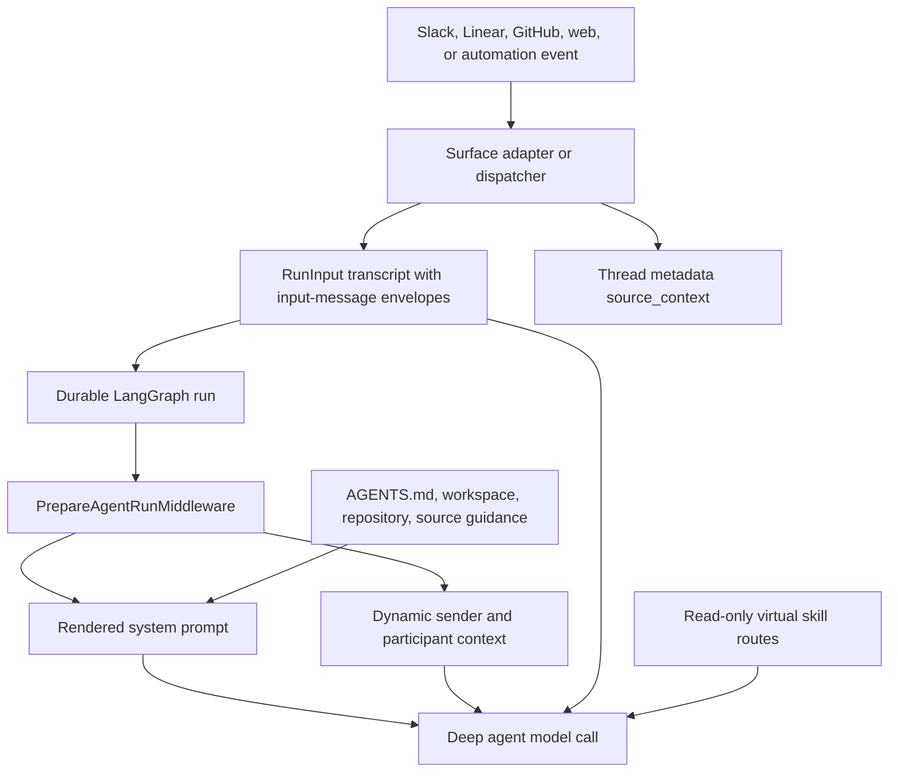

# Context Assembly and Prompt Engineering

Open SWE does not send a webhook body directly to a model. It separates **the conversation transcript** (`RunInput.messages`), **durable routing provenance** (`source_context` in thread metadata), and **per-run system instructions** (`rendered_system_prompt`). This division prevents current identity or operational context from rewriting historical turns, while allowing a resumed run to reconstruct fresh credentials, sandbox state, and instructions.

The diagram shows the assembly boundary: adapters normalize event data before dispatch; preparation resolves run-specific context before model calls; virtual skills remain files the agent may read rather than bulk prompt text. The [agent graph](../architecture/agent-graph.md) describes execution, while [models, profiles, and instructions](../concepts/models-profiles-instructions.md) describes model selection and instruction ownership.

## 1. Normalize an event into a transcript

`openswe.input_messages` owns the typed input format. `RunInput` contains ordered `user`-role and system-origin messages, optionally with files. Human and system-origin content is serialized as an escaped `<input-message>` envelope containing a namespaced sender, surface, kind, optional channel, and structured data. Text blocks in multimodal content are enveloped; non-text blocks, such as images, remain intact and in order. Entity identifiers are validated before serialization and XML parsing helpers ignore malformed fragments.

`dispatch_agent_run` is the common agent dispatch contract. A caller may provide an already ordered `input`, or provide raw content plus an explicit context, or let the dispatcher derive context from `RunConfig`; it may not combine a prebuilt input with raw fields. Fallback attribution is deliberate: Slack derives a triggering person and channel when present, GitHub login and Linear email become person identities, and otherwise the event is attributed to a synthetic `system:` identity. The function then creates a durable agent or reviewer run through `create_durable_run`.

### Dynamic identity context and summarization

Introductions for channels, systems, and people are separate `<dynamic-context>` messages. Their canonical XML is SHA-256 hashed, so `build_input_messages` avoids repeating an introduction already supplied during that construction. The state-level visibility check is intentionally narrower than “ever seen”: after deepagents summarization, messages before its cutoff are no longer sent to the model, so their dynamic contexts are eligible to be introduced again. This preserves sender resolution after history compaction.

Channel fields such as Slack topic and purpose are ordinary escaped dynamic context, not a privileged instruction channel. Treat all event content as data unless it has been incorporated into an explicit system prompt section by trusted application logic.

## 2. Keep source provenance outside model history

`SourceContext` records where a thread originated: Slack thread or ask route, Linear issue, GitHub issue, and PR number. Webhook setup writes it as `source_context` in LangGraph thread metadata; later webhook activity preserves an existing nonempty context rather than repointing the thread. This provenance supports reply routing and lifecycle behavior, but is distinct from the model-visible transcript.

The model is designed for compatibility with metadata written by different releases and integrations. Source-context models allow unknown fields; `dump()` uses `exclude_unset=True`, which avoids manufacturing omitted defaults during a read/enrich/write cycle. `parse()` accepts mappings only and returns an empty context after validation failure, logging a warning rather than failing the run because old metadata is malformed.

## 3. Render the system prompt at run preparation

The graph starts with an empty static system prompt. `BasePrepareRunMiddleware` runs before the agent and stores a preparation latch keyed by a hash of the latest message, middleware class, and configuration fingerprint. A checkpointed repeat of the same invocation skips completed setup; a later turn gets fresh setup. Implementations must be idempotent because a failure before the checkpoint can cause setup to run again. Forked deepagents contexts skip this preparation, and a replica that resumes a checkpoint can run `_rejoin` to restore process-local resources.

`PrepareAgentRunMiddleware` is the main-agent implementation. It resolves GitHub credentials and default repository information, waits for a sandbox and determines its work directory, loads workspace settings, optionally gathers recent-thread context, resolves participants, schedules title generation, and records run metadata. Sandbox-connect failures notify the user and are re-raised rather than allowing an agent to operate without its workspace.

The middleware returns a rendered prompt and, when needed, dynamic person-introduction messages. It does not modify an old user turn to attach current sender details: the sender blocks are independent messages and are omitted only when their hashes are still visible. Immediately before each model call, the base middleware prepends `rendered_system_prompt` to any existing system message. Thus preparation controls current system context without changing the durable conversation transcript.

`construct_system_prompt` renders the `system/main` Jinja prompt and its included resources. Its inputs select working-environment instructions, dashboard and source guidance, an optional configured default prompt, repository scope, collaboration guidance, external-comment safety rules, repository custom instructions, recent context, and workspace instructions/repositories. Jinja uses `StrictUndefined`; prompt paths reject absolute paths, traversal, and unsupported suffixes, so missing template variables and unsafe resource names fail rather than silently rendering a partial or unintended prompt. Preview and staging deployments additionally receive common deployment context.

## 4. Repository and scoped instructions

The main repository-setup prompt tells the agent to inspect the checkout and, after synchronizing/cloning a hosted repository or before substantive work in a local checkout, read root `AGENTS.md` in full when it exists. The prompt gives those repository rules the authority to override agent defaults. It also tells the agent where repository-local skills may be found: `<repo>/.agents/skills/<name>/SKILL.md` and `<repo>/.claude/skills/<name>/SKILL.md`.

`SubdirAgentsReadMiddleware` adds runtime scoping. After a successful string-result `read_file` for an absolute path, it finds ancestor `AGENTS.md` candidates from shallow to deep, reads candidates through the thread's sandbox backend, and appends successful results in a `<system-reminder>`. The reminder explicitly makes deeper instructions take precedence. Loaded paths are tracked per thread, including a directly read `AGENTS.md`, so rules are not repeatedly appended. Candidate failures—missing files, backend errors, non-UTF-8 data, or empty content—do not invalidate the requested file read. Reads are limited to 1,000 lines and content is capped at 64 KiB, with oversized UTF-8 content marked as truncated.

Reviewers have a different trust boundary because convention files are loaded deterministically for a reviewed revision. `fetch_agents_md` fetches root `AGENTS.md` at a supplied GitHub ref and considers `CLAUDE.md` only after a 404; HTTP errors, request failures, or an oversized preferred document produce no fallback. `fetch_scoped_agents_md` derives changed-file ancestor paths and reads `AGENTS.md`, with `CLAUDE.md` as a per-directory fallback, from the clone's specified Git tree—not its possibly untrusted working-tree HEAD. It returns an empty result on execution or parse failure and orders paths shallow-to-deep so consumers can apply nested rules last. See [reviewer and review scout](../architecture/reviewer-and-review-scout.md).

## 5. Skills are virtual, read-only files

The main agent uses a `CompositeBackend`: the ordinary sandbox remains the default backend, while skill prefixes route to read-only specialized backends. Bundled package skills are exposed from `/bundled-skills/`; organization skills from `/organization-skills/`; and authenticated user skills from `/skills/`. When a credential login is available, the user route is listed first in the skill sources, ahead of organization and bundled sources. The skill-store backend lazily reads stored skills on first access into a store backend and wraps it read-only, so skills can be discovered and read through normal file tools without giving the agent write access to the skill store.

Repository-local skills are separate from these mounted routes: they live in the checked-out project and must be discovered by the repository instructions rather than assumed to be in the global skill catalog. For available tool and filesystem behavior, see [Tools](../concepts/tools.md).

## Safety, extension points, and verification

When changing this flow:

- Preserve the distinction among untrusted event text, structured identity metadata, durable provenance, and system instructions. Do not elevate channel metadata or external comments into trusted instructions.
- Preserve ordering when adapters provide a prebuilt transcript; use `dispatch_agent_run` rather than creating runs directly when adding a new event surface.
- Keep preparation idempotent and include any setup-affecting configuration in its fingerprint. Fail workspace setup explicitly instead of continuing with a missing sandbox.
- Treat scoped instruction loading as best effort, but retain its ordering, duplicate suppression, path normalization, and size/line limits.
- Keep skills read-only and routed outside the project checkout; do not solve skill discovery by appending every skill body to the system prompt.

Focused regression coverage includes `tests/agent/test_input_messages.py` for escaping, multimodal preservation, and summarization visibility; `tests/agent/test_dispatch.py` for dispatch contracts; `tests/agent/test_source_context.py` for tolerant metadata round trips; `tests/middleware/test_prepare_run_middleware.py` and `tests/agent/test_agent_assembly_context.py` for preparation and agent assembly; `tests/middleware/test_subdir_agents_middleware.py` for scoped reminders; `tests/agent/test_agents_md.py` for reviewer convention retrieval; and `tests/agent/test_skills.py` for skill routing.
