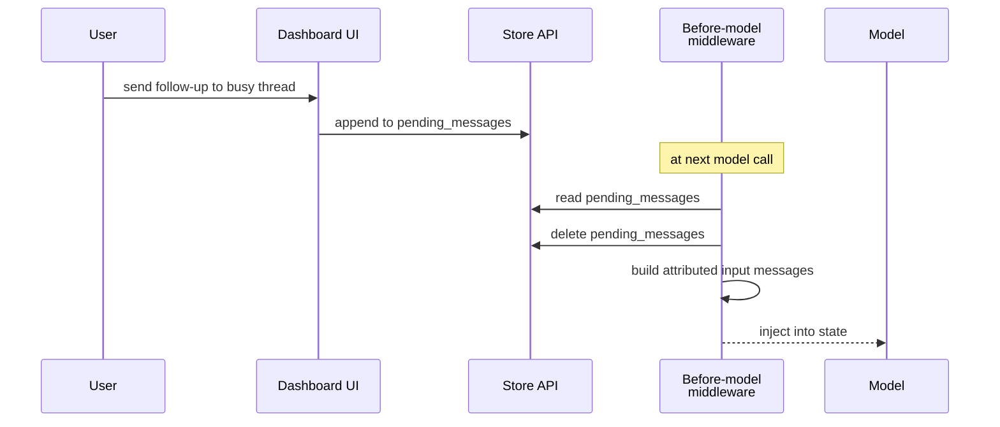

# Follow-up Messages and Interruption

Open SWE coordinates concurrent work without losing user input through two key mechanisms:

1. **Store-backed message queue** with before-model injection: Messages queued by dashboard follow-ups, Slack edits, and background task completions are delivered into active runs at their next model boundary, allowing handoffs without creating separate runs.

2. **Multitask strategy dispatch**: Background monitoring systems (baby-sit, background tasks), interrupts from explicit user requests, and completion webhooks use configurable `multitask_strategy` settings—`"interrupt"` for immediate user input and `"enqueue"` for deferred background work—to control run scheduling without losing queued work.

## Durable dispatch and multitask strategy

`dispatch_agent_run` is the common agent/reviewer dispatch contract: it constructs or accepts structured `RunInput` and delegates to `create_durable_run`, which invokes `client.runs.create` with a caller-selectable multitask strategy that defaults to `"interrupt"`.

When a new run is dispatched to an active thread:
- **`multitask_strategy="interrupt"`**: The new run halts the active run (with all progress preserved by checkpoints), then resumes the agent with the full message history plus the new input. On an idle thread, it simply starts. This is used for explicitly tagged user requests (e.g., `:x:` reactions or tagged Slack mentions) where the user expects immediate attention.
- **`multitask_strategy="enqueue"`**: The new run is queued behind active work, allowing the interactive run to finish before the follow-up begins. This is used for background monitoring (baby-sit CI checks, sandbox task completions) and non-interactive updates (message edits, automated follow-ups) where interrupting user work would be disruptive.

Durable dispatch uses `durability="async"` (checkpoint written while the next step runs), resumable/subgraph-capable Protocol v2 stream modes (including `stream_mode=["values", "updates", "messages", "custom", "tasks", "checkpoints"]`), and an optional completion webhook. This preserves a checkpoint before each step and allows a later dashboard client to replay runs it did not create. The run is also marked with the v3 streaming compatibility key so it streams all supported event types, matching the behavior of dashboard-initiated runs.

The sandbox lifecycle relies on interrupt dispatch: a subsequent agent step resolves the sandbox by thread, reusing an in-memory backend or reconnecting through the persisted `sandbox_id`. An unreachable existing sandbox is not silently replaced for a normal agent thread, because replacement would discard uncommitted work; a deleted sandbox can be recreated, and the read-only reviewer can explicitly opt into unreachable replacement.

### Strategy usage by source

- **Explicit Slack requests** (tagged mentions or explicit requests): use `"interrupt"` to prioritize urgent input.
- **Untagged Slack follow-ups**: use `"enqueue"` to allow the current turn to finish.
- **Slack message edits**: placed in the store message queue instead of creating a run, so an edit corrects the existing conversation without creating new runs.
- **Baby-sit terminal/failure updates and background-task completions**: use `"enqueue"` to preserve interactive work ordering.

## Message queue and before-model injection

### Queueing messages for a live run

The dashboard's message continuation path does not create a new run immediately. Instead, it queues a message for injection into the active run at its next model boundary. It authorizes the caller against thread metadata, checks that the thread is `busy` (returning 409 for idle threads and 502 if status cannot be determined), then stores the message in the store:

`queue_message_for_thread` persists each message as a database row in the message queue. Messages are appended in FIFO order and the queue caps at 100 newest entries, dropping the oldest on overflow. Store errors are logged and reported to the dashboard as a failed queue operation.

### Before-model middleware: consume and attribute

`check_message_queue_before_model` is installed in both the agent and reviewer graphs as a before-model middleware. It is deliberately excluded from the agent's `stop_summary` mode (read-only summary runs have no need to consume queued messages).

At every model boundary, the middleware performs three sequential operations:

1. **Consume a batched autofix event** from `("autofix", thread_id) / "pending_event"` (if present). It deletes the event and prepends a system instruction to re-check CI and review comments before finishing, rather than launching a separate run. This allows baby-sit status changes to be handled within the active run.

2. **Read and clear the message queue** from `("queue", thread_id) / "pending_messages"`. The middleware deletes the entire record *before* conversion, preventing a subsequent invocation during the asynchronous conversion (e.g., image fetches) from injecting the same batch twice. A snapshot of the queued messages is taken first, so any follow-ups appended while the conversion is in flight are preserved for the next model call.

3. **Convert queued messages to input blocks** and append them to the model's state:
   - Ordinary queued blocks become a system message attributed to `system:thread-queue` on the automation surface.
   - A dashboard payload (identified by `source: "dashboard"`) produces a dashboard-handoff system message followed by a human message attributed to its supplied sender on the web surface.
   - Dynamic identity context is emitted only when its hash is not already visible to the model. The visibility calculation honors summarization cutoffs, so context retained only in historical state is re-introduced.
   - Each structured envelope is its own message because the transcript parser expects one `<input-message>` envelope per message. Plain text blocks may be merged before serialization.

### Image handling and error resilience

For payloads with image URLs, the middleware resolves the thread's configured model once. If the model does not support vision, it omits those fetched images and adds a warning to the text; supplied image blocks are retained. Failures reading images or the queue are logged and allow the model call to proceed rather than aborting the run. A failed queue read still flushes any autofix instruction already assembled, ensuring partial content is not lost.

## Run completion and follow-up dispatch

### Completion webhook and terminal-condition handling

Every durable dispatch attaches a completion webhook only when both `RUN_COMPLETE_WEBHOOK_SECRET` is set and `COMPLETION_WEBHOOK_URL` is absolute and non-loopback. The webhook route rejects requests whose token fails verification and is fail-closed when no secret is configured.

The completion webhook handler (`handle_run_completion`) processes terminal runs:

- **Success**: Clears any consecutive-failure counter, schedules a private feedback prompt five minutes later (unless the run was automated), and for Slack runs with an invocation ID, schedules deferred session-cost enrichment. Returns the code-channel session to `active`.
- **Error or timeout**: Posts a best-effort failure reply with run-scoped idempotence (per run ID, with fallback to thread-level tracking for older/manual payloads without a run ID). Limits consecutive failure replies to prevent loops. Never blocks run creation.
- **Interrupted**: Intentionally ignored—with `multitask_strategy="interrupt"`, an interruption is expected and healthy, not a failure.

Run-completion replies are best-effort and never block run creation. A missing webhook or a completion that arrives out of order has no side effects beyond deferred feedback and cost enrichment.

If a successful run (not a follow-up-pickup run) left pending messages in the store, `dispatch_pending_follow_ups` dispatches an empty-input follow-up run to pick them up when no run is already pending, allowing stored work to reach the agent without losing it to an idle timeout.

## Background monitoring and follow-up dispatch

### Baby-sit CI monitoring

`/baby-sit` is an opt-in watch for pull-request CI status. It runs on a configurable cron schedule (10-minute intervals by default) and evaluates whether CI has succeeded, failed, or remains pending. When CI status changes from a previous evaluation, it dispatches a follow-up run with `multitask_strategy="enqueue"` to let the interactive agent finish before the notification begins.

The watch stores metadata including retry count, dispatch keys for idempotence, and delivery tracking. Terminal failures (exceeding retry limits) and successful CI (all checks passing) stop the watch and post a summary to the originating thread.

### Background task completion monitoring

`monitor_background_tasks` polls sandbox background commands on a per-minute cron schedule. It tracks running and terminal tasks, and when a task reaches a terminal state (completed, failed, timed out, stopped, or lost), it:

1. Claims the notification with a filesystem marker to prevent duplicate delivery.
2. Builds a notification message from the task's completion status.
3. Dispatches a follow-up run with `multitask_strategy="enqueue"` and context marking it as a background-task completion.
4. Marks the notification as delivered and cleans up the claim.

When all running and pending background tasks are complete, the monitor deletes its per-thread cron entry and clears the running-tasks metadata, shutting down the background-task monitoring for that thread.

## Emergency stop and follow-up cleanup

### Slack emergency stop (`:x:` reaction)

The `:x:` reaction on a Slack message triggers immediate stop processing:

1. Resolve the reaction's target thread through Slack-run mapping or root timestamp.
2. Verify the thread metadata matches the Slack channel and thread timestamp (mismatch is rejected).
3. Claim the event ID for delivery deduplication.
4. Enumerate and cancel every pending and running run for the thread by thread ID (not `latest_run_id`, so the stop button works for runs this browser never started).
5. Clear deferred-work records: delete pending messages and autofix events from the store.
6. Update thread metadata with `latest_run_status="interrupted"` and `stop_requested_at_ms`.
7. Dispatch a read-only stop-summary run that permits only thread inspection and summary output.

The summary run is mapped back to the Slack thread via the Slack-run mapping, so a subsequent `:x:` reaction can find and stop it. If cancellation or cleanup fails, the handler does not claim success, so the webhook will retry.

A code-channel `agent_session_stopped` event performs the same cancellation and cleanup without dispatching a summary run, and returns the session to `active` status.

### Dashboard stop and queued-message preservation

The dashboard stop endpoint (`cancel_dashboard_thread`) authorizes the caller, cancels all pending and running runs by enumerating the thread (not trusting `latest_run_id`), and marks the thread interrupted. Unlike Slack stop, it **preserves** pending messages in the store. If a queued follow-up exists, it dispatches an empty-input agent run; the before-model middleware drains the preserved queue, allowing the follow-up to continue the conversation without losing user input.

The admin variant (`admin_cancel_dashboard_thread`) cancels and marks interrupted without authorization checks or queued continuation.

## Testing and regression coverage

Focused regression tests exercise message queue draining, dashboard handoff attribution, error resilience when queue reads fail, Slack stop cleanup (mapped and root reactions), cancellation of pending and running runs, deferred-work deletion, summary dispatch, duplicate and missing-event protection, the no-summary code-channel session-stop path, and the preservation and continuation of queued messages after dashboard stop.
