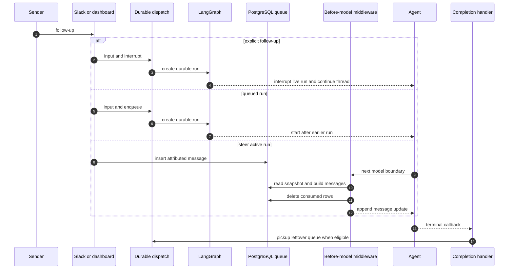

# Follow-Ups, Interrupts, and Completion Replies

A thread is the continuity boundary for an agent conversation, its checkpointed graph state, and its associated metadata. When work arrives for a busy thread, Open SWE deliberately chooses between two different mechanisms:

- A **durable follow-up run** is submitted to LangGraph. Its multitask strategy is normally `"interrupt"`, which replaces live work while retaining the thread history; `"enqueue"` waits for earlier work.
- A **queued message** is persisted in PostgreSQL and injected before the next model call of the live run. This is a steer, not a new run.

The distinction matters operationally: an enqueued run is a separate turn scheduled by the platform, whereas a queued message can affect the current turn. See [Invocation](invocation.md), [Threads and state](../concepts/threads-and-state.md), and [Middleware stack](../architecture/middleware-stack.md) for the adjacent contracts.

## Delivery paths and durable-run defaults

`dispatch_agent_run` is the common dispatch boundary for agent and reviewer graphs. Callers may provide a prebuilt `RunInput`, or content plus identities from which it builds one; mixing the two is rejected. It delegates to `create_durable_run`, which creates/titles a system-owned thread when needed, enriches config and metadata with an invocation identifier and the v3 streaming compatibility marker, and creates the LangGraph run.

The standard creation policy is:

- `multitask_strategy="interrupt"` by default; callers must opt into `"enqueue"` or another platform strategy.
- `durability="async"`: each step is checkpointed without making the next step wait for the write. An interrupt therefore continues from checkpointed thread state rather than opening an unrelated conversation.
- resumable v3-compatible streams with subgraph streaming and values, updates, messages, custom events, tasks, and checkpoints. This allows the dashboard to attach to a run started elsewhere and observe tools and subagent namespaces.
- a completion webhook only when `RUN_COMPLETE_WEBHOOK_SECRET` is set and `COMPLETION_WEBHOOK_URL` is absolute and non-loopback. Otherwise dispatch continues without a completion callback rather than allowing an invalid webhook to break every run.

The completion route is fail-closed: `/webhooks/run-complete` accepts a request only when its query token verifies against that secret.

The diagram contrasts active-run steering, run interruption, platform enqueueing, and the completion-time pickup safety net.

### Choosing a delivery mode

Slack dispatch classifies a direct bot tag as explicit and creates an interrupting run. An untagged Slack follow-up instead creates an enqueued run. A message edit is not dispatched as a new run: its correction is placed in the message queue. This preserves active-work ordering for ambient context while making an explicit request take precedence.

Dashboard commands support two explicit choices while a thread is live:

- **Steer** uses `steer_running_thread`: it validates a nonempty text or image message against the live run's model, attributes and records the human transcript message immediately, then writes an attributed queue payload. Its `queue_id` is the message ID, so retries cannot enqueue it twice.
- **Queue a follow-up** uses `queue_follow_up_run`: it creates a distinct run with `multitask_strategy="enqueue"`, records its turn as queued, and stamps `queued_by` so later cancellation can distinguish its sender.

A steer can race with the prior run finishing after the busy check. After persisting the message, the handler checks whether that run is still live; if not, it attempts a `"reject"` pickup run. `reject` avoids racing another newly-created run, whose first model call would consume the same rows.

Automation avoids preemption. Background task completion notifications use `"enqueue"`, so an interactive run finishes before the agent processes command completion. Background-task reconciliation accepts either runner callbacks or minute polling; it validates sandbox/thread ownership, uses a filesystem claim directory to prevent duplicate delivery, and marks a notification delivered only after dispatch succeeds.

## Persistent message queue and middleware pickup

`QueuedMessage` is a PostgreSQL row per message, rather than a single mutable queue record. Rows are ordered by an identity `seq`; writers insert and the consumer deletes only the snapshot it consumed, so a message arriving during conversion is retained for a later model call. `queue_id` is unique per thread when supplied, providing dashboard retry idempotence. The queue keeps at most 100 newest rows per thread, drops older overflow rows, and invalidates the thread-queue UI topic.

`check_message_queue_before_model` runs before model calls in both agent and reviewer graphs; agent stop-summary mode excludes it. It reads the thread ID from run configuration, snapshots rows oldest-first, constructs structured messages, and only then removes that snapshot. Thus a construction failure leaves queued work available instead of silently losing it.

Message construction preserves attribution and reply routing:

- Unattributed strings or blocks are batched into an automation-system message from `system:thread-queue`.
- Attributed payloads become input messages attributed to the canonical person. For a dashboard handoff from Slack, a one-time system handoff notice is injected and the reply surface moves to web; later web messages do not repeat the notice.
- Image payloads use the run's resolved model when available, otherwise thread metadata. Unsupported fetched image URLs are skipped with a text warning; supplied image blocks remain. Dynamic identity context is injected only when its hash is not already visible.
- The middleware catches queue and conversion failures so the model call can proceed. If a queue read fails before there are queued rows, it returns no update.

If a successful ordinary run ends with queue rows left behind—such as a message that arrived after its last model boundary—the completion handler starts an empty-input `follow_up_pickup` run. It first requires an owner login and no pending run, dispatches with `"reject"`, and relies on the new run's middleware to drain the queue. Completion deliberately does not create another pickup after a pickup run itself succeeds, or after a failed run, to prevent a failing loop.

## Stops and ownership-sensitive cancellation

Cancellation enumerates `pending` and `running` runs for a thread instead of trusting `latest_run_id`, because metadata may lag and the run may have started from Slack, GitHub, Linear, CI, or another browser. It uses `cancel_many(..., action="interrupt")` and settles transcript turns for the run IDs actually cancelled.

### Slack stop reaction

A Slack `:x:` reaction is resolved through a reply-to-run mapping, or the root timestamp when the reaction is on the root. The handler fetches the mapped thread and verifies its persisted Slack channel and thread timestamp before claiming the Slack event; a missing ID, duplicate claim, unknown mapping, or mismatched metadata has no effect.

After a successful claim, Slack reaction stop cancels all live runs, clears queued messages, marks the thread `interrupted` with a stop timestamp, then dispatches a special `stop_summary` run and maps it back to the Slack thread. If cancellation or queue cleanup fails, it does not dispatch a misleading successful summary. The summary graph excludes queued-message middleware, and its prompt constrains it to a read-only concise Slack summary rather than resuming work.

Native Slack `agent_session_stopped` has two paths. For an ordinary channel thread it authorizes the linked Slack user and invokes the dashboard cancellation path, preserving a follow-up queued by somebody else and reporting whether one is starting next. For a code-channel session, it cancels all live runs, clears queued messages, marks interruption, and returns the session status to active without creating a summary run.

### Dashboard and machine stops

`cancel_dashboard_thread` authorizes posting access for user threads (or read access for bot-triggered threads). When invoked by a person, it leaves pending runs queued by another sender untouched; it then starts a queue pickup only when no such run was retained and the thread is not bot-triggered. The administrative and machine-principal cancellation paths cancel all live runs and mark interruption, but do not perform that owner follow-up pickup. Cancellation request failures surface as HTTP 502 before interruption metadata is written.

## Completion replies and wakeups

`handle_run_completion` refreshes thread status, finalizes invocation telemetry for terminal statuses, and settles the transcript turn. `success`, `error`, `timeout`, and `interrupted` are terminal for telemetry; only `error` and `timeout` are failures. An interruption is expected during ordinary follow-up dispatch and must not post a false failure reply.

For a successful eligible Slack agent run, completion schedules session-cost refresh and records a bounded per-run deduplication list. Failure replies are best effort and route to the originating Slack thread, Linear issue, or GitHub issue/PR based on thread source context. They are idempotent by run ID (with a legacy thread-wide fallback when the payload has no run ID); repeated event-woken failures are capped after three consecutive replies. Reviewer-check cleanup, UI status synchronization, and reply posting are isolated so one best-effort operation does not unnecessarily silence another.

## Focused verification

Useful regression coverage includes:

- `tests/agent/test_dispatch.py` checks asynchronous durability, interruption defaults, resumable v3 stream options, and invocation metadata.
- `tests/middleware/test_check_message_queue.py` checks dashboard-handoff routing and that a message written during image conversion remains queued.
- `tests/test_thread_ops.py` checks per-thread queue-ID deduplication and queue preview invalidation.
- `tests/dashboard/test_dashboard_thread_api.py` checks live steering attribution and cancellation ordering before a replacement pickup.
- `tests/slack/test_slack_stop.py` checks mapping validation, all-live-run cancellation, idempotency, cleanup failure behavior, owner-sensitive native stops, and code-channel behavior.
- `tests/webhooks/test_completion_webhook.py` checks leftover pickup eligibility and run-scoped completion deduplication.
