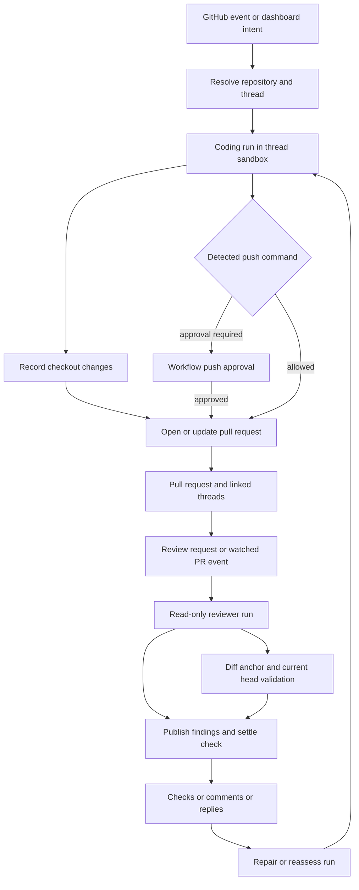

# GitHub coding, review, and delivery workflows

Open SWE is a GitHub-facing software factory: coding runs investigate and change a checkout, validate it, and deliver a pull request (PR); the separate reviewer graph assesses a PR and publishes findings. GitHub webhooks, dashboard operations, and PR comments can start or continue either path. A PR is also a durable collaboration object: it links the originating coding thread, later repair threads, and reviewer publications rather than treating each interaction as unrelated work.

The coding and review paths converge on a PR, while approval, push, and finding-publication guardrails apply at their respective boundaries.

## Entrypoints and durable ownership

GitHub issue and PR events are converted into structured system or human inputs, retaining the sender, surface, and PR identity. PR review requests fetch current metadata, reject drafts unless allowed, scope a reviewer token to the repository, create or reuse the canonical reviewer thread, enable its watch flag, post a temporary “review started” comment, and dispatch the `reviewer` assistant. Automatic first review runs on opened or ready PRs subject to repository/draft policy; a `ready_for_review` event whose head is already `last_reviewed_sha` is deliberately skipped.

The `PullRequest` PostgreSQL entity is the cross-thread registry. Its natural identity is repository plus PR number; it has exactly one primary thread (chosen by first writer) and can link secondary coding threads and multiple review records. `save()` updates GitHub-owned PR fields, whereas identity-only linking avoids overwriting them. This makes it possible to find the original agent thread for untagged feedback and to offer a later repair thread without relying solely on an expensive metadata search.

A dashboard user can start an `open`, `message`, `fix`, `address-comments`, `address-comment`, or batched-comment intent for a PR. The operation validates the PR identity and the caller’s repository access, gets a dashboard GitHub token, serializes create-or-find under a per-user/PR lock, and links a new coding thread to the PR. A busy thread rejects non-queueable work as already running, while messages and comment batches enqueue behind it. Fix prompts include mergeability and CI context but intentionally exclude review decision, because comment remediation is a separate intent.

## Coding, delivery, and trace evidence

Coding file and shell tools run either in the thread’s MDA-owned sandbox or against configured backend files. Every tool call is reported; configured image, error, and ancestor `AGENTS.md` checks wrap execution. A sandbox command that never answers is converted to an error after its requested/default timeout plus 30 seconds, and calls refused before starting are retried with short backoff.

The runtime tracks possible checkout mutation rather than assuming every command changed Git. Before `execute`, `write_file`, `edit_file`, or `delete` runs in a sandbox, it waits for a baseline fingerprint; later model turns trigger background fingerprints. At run completion, changed repository/branch targets are recorded in chronological order. PRs opened or found by operations are also evidence, and their head branch is preferred when reconciling a repository’s target. Fingerprinting failures or an unavailable sandbox reduce available evidence rather than causing the system to invent a replacement sandbox.

PR delivery should use `open_pull_request`, which selects the requester’s verified GitHub grant when it matches the requested author, falls back to that user’s sign-in, and uses an app token for system threads. A creation guard blocks common shell and background-tool fallbacks such as `gh pr create`, POSTs to the pulls endpoint, and nested-shell variants, directing the agent to the attributed tool. This protects the intended delivery and attribution path, but it is not a general GitHub mutation firewall.

### Push approval is narrow and fingerprinted

When the file-tool catalog enables `shell_commands` guards, only `execute` commands matching push/`gh`/`pulls`-like patterns (including deeply nested shells) are sent to the backend shell check. The check may reject the command or replace it with an approved command. The workflow approval store keeps up to 20 fingerprint-keyed records in thread metadata; each contains the repo/branch, base and head SHA, affected files, diff summary/preview, status, and actor/timestamps. Concurrent changes use a PostgreSQL advisory transaction lock, and terminal decisions are not overwritten.

This is a guard for **detected Git pushes**, not approval of every possible shell or API write. Deployment operators must still use least-privilege credentials and repository/integration scope: coding sandboxes can have powerful tools and network access. Reviewers are separately constrained by tool selection and instruction not to commit or push.

## PR lifecycle controls and feedback

The PR status/action layer validates `owner/repo` and positive PR number before mutating GitHub. It supports merge, close, mark-ready, update-branch, and resolving selected currently open review threads. Merge includes the caller’s expected head SHA and treats success as GitHub confirming `merged: true`; update-branch likewise sends `expected_head_sha` to prevent acting on a stale view. Closing can post a de-duplicated reason before setting state. Marking ready reads the PR first, refuses closed PRs, and uses the GraphQL mutation because REST cannot clear the draft flag. Review-thread resolution is serial to avoid GitHub secondary-rate-limit pressure.

GitHub comments and reviews can wake the coding thread that opened a PR even without an explicit tag when the commenter is an accepted Open SWE user; otherwise tagged PR comments are routed to the branch-derived or PR-comment thread. This turns reviewer and CI feedback into a continuation with repository context rather than an unscoped new task.

## Review, findings, and publication

The `reviewer` graph is a different execution surface. It creates a repository-scoped, read-only GitHub proxy and deterministically prepares a checkout before its first model call. It computes the unified diff and changed `(file, line)` set used to validate findings. Its review-specific tool set includes finding creation, update/list, and `publish_review`, not commit, push, or PR-opening tools. PR descriptions and existing review-comment content are treated as untrusted data and XML-delimited so they cannot escape into instructions.

Findings belong in PostgreSQL under the PR; reviewer-thread metadata retains the PR identity, head SHA, watch state, and related run state. A finding carries severity, confidence, diff location/side, lifecycle status, fingerprint, publication identities, and a forward-only surface state. Legacy metadata findings are migrated on first access. Findings must be anchored to the computed changed-line set for inline review comments; out-of-diff reports are not eligible for publication.

`publish_review` must be the only tool call in its turn and requires a total, duplicate-free ranking of every eligible finding. It validates the current review head rather than blindly trusting frozen run configuration, obtains the thread token, and records a review only after GitHub publication. Re-review publication limits new comments to findings first seen at the current head, while reconciliation associates existing markers/identities with live GitHub threads, captures human replies, and advances resolution only when appropriate. A stale head causes publication to stop without posting or advancing the reviewed SHA.

Repositories may opt into approval criteria through `.open-swe/APPROVALS.md`, read from the default branch so the PR cannot rewrite the policy that judges it. The stored review style selects `off`, `dry_run`, or `approve`; lookup failure safely becomes `dry_run`, which never approves. New commits revoke superseded Open SWE approvals, preventing a prior approval from silently standing for changed code.

## Watches, checks, and operational recovery

A watched PR push is eligible only when auto-review is enabled, an open PR for the branch exists, the canonical reviewer thread has `watch=true`, and draft policy permits review. A matching `last_reviewed_sha` is ignored. If GitHub comparison proves the diff unchanged, the system links a completed review at the new SHA, advances `last_reviewed_sha`, and creates/completes a success check saying there are no new changes. Otherwise it reconciles live review threads, creates a fresh in-progress check on the new head, and dispatches a re-review. Close disables watch; reopen enables it; conversion to draft disables it only when that author does not allow draft reviews.

Automatic review checks must be created on the current head because GitHub hides the prior head’s checks after a push. Publication settles the check; if a run fails to publish, the exit middleware can settle the remaining check neutrally rather than misrepresenting reviewer infrastructure failure as a code failure. CI webhooks are also forwarded to the baby-sit handler and human-review settlement paths, allowing monitoring and review workflows to react to CI completion.

## Safe changes and focused verification

<!-- openwiki: broken internal link [pr-creation.md] file "pr-creation.md" does not exist. Fix the href or restore the target, then delete this comment. -->
<!-- openwiki: broken internal link [pr-review.md] file "pr-review.md" does not exist. Fix the href or restore the target, then delete this comment. -->
When changing delivery behavior, test both the explicit tool path and shell bypass attempts. `tests/github/test_pr_creation_guard.py` covers `gh`, raw API, `curl`, nested shells, background execution, and monitor filters. `tests/github/test_pull_request_actions.py` verifies that merge/close outcomes require GitHub confirmation and that stale-head protections are sent. For review changes, use the reviewer tests for publishing/ranking/stale heads and watch behavior, especially unchanged diffs, watch gates, and check completion. The adjacent pages [PR Creation Workflow](pr-creation.md), [Pull Request Review Workflow](pr-review.md), [Channels and GitHub](../integrations/channels-and-github.md), and [Sandboxes and MCP](../integrations/sandboxes-and-mcp.md) cover narrower interfaces and deployment context.
