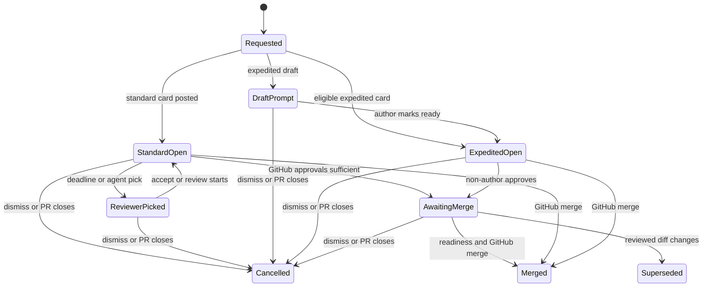

# Human and Expedited Review

Open SWE represents review activity as a durable `HumanReviewRequest` attached to one pull request. The request owns the Slack card location, the initiating agent context, card participants, and its terminal outcome. There may be only one `open` request per PR across the `standard`, `expedited`, and `posted` kinds; the database enforces that invariant. This page covers the two card-managed kinds. A `posted` request instead watches a person's existing PR link, reacts to it, and never merges it.

Standard review sends people to GitHub to review. Expedited review is an opt-in, instance-enabled path for a very small, fully visible diff: a qualified Slack user approves from the card and Open SWE submits that person's GitHub approval. Neither path bypasses GitHub branch protection. For agent invocation and normal PR creation, see [Invocation](invocation.md) and [PR Creation](pr-creation.md); for automated Open SWE code review, see [PR Review](pr-review.md).

## Lifecycle and state ownership

`human_review_request` is the state owner. Its `state` is `open`, `merged`, `rejected`, `superseded`, or `cancelled`; participants reference `users.id` rather than mutable Slack or GitHub handles. A request records the PR head SHA, Slack message/thread/DM locations, and, for expedited review, its rendered-diff fingerprint and excluded hunks. Row locks and expected-state transitions make card clicks, deadlines, webhook settlement, and close actions race safely: only an open request may take a terminal transition.


The request remains open while it waits; closure is an explicit terminal state, not merely a Slack-card rendering change.

On terminal closure, Open SWE renders the outcome in the originating thread. If an open card had been broadcast or copied to another channel, it withdraws that channel copy so the finished card remains in the thread. A merged card receives a `merged` reaction (with a fallback emoji). An expedited request closed without merge also attempts to dismiss its recorded GitHub approvals, including approvals left on earlier closed cards for the same PR.

## Standard review

### Request and routing

The agent calls `request_human_review(pr_url, inline_summary, channel="")`; the dashboard offers equivalent authenticated endpoints:

- `POST /dashboard/api/repos/{owner}/{repo}/pulls/{number}/human-review`
- `POST /dashboard/api/repos/{owner}/{repo}/pulls/{number}/human-review/dismiss`

The tool requires a canonical GitHub PR URL, a nonblank `inline_summary`, and repository access for the calling agent or MCP user. Dashboard requests additionally require an Open SWE user record and repository access. Standard review refuses a closed or merged PR, draft, merge conflict, or failing required check; it also refuses when GitHub state cannot be read. An active standard request is reused. Only its original thread or requester can replace its summary; an active expedited request blocks a concurrent standard request.

The target comes from an explicit `channel` override or `.open-swe/settings.json`. Settings are read at the PR head and fall back to the default branch when that revision lacks the file. `reviewChannelRules` route each changed file to the first matching case-sensitive `fnmatchcase` pattern; the channel owning the most changed files wins, with random selection among ties. With rules configured, unmatched files do not contribute; an incomplete changed-file list is rejected rather than routed incorrectly.

```json
{
  "reviewChannel": "#eng-reviews",
  "reviewChannelRules": [
    { "paths": ["ui/*", "desktop/*"], "channel": "#frontend-reviews" },
    { "paths": ["agent/*"], "channel": "#backend-reviews" }
  ]
}
```

The request persists before posting and schedules two deadlines: the workspace auto-assignment wait and the two-hour auto-merge check. Failure to schedule either, or failure to post the Slack card, discards the newly created request so it cannot become a permanently invisible open request. A card requested from a thread in its destination channel is a thread reply broadcast to that channel; otherwise it is a top-level channel post. When the asking Slack thread is elsewhere, Open SWE posts a pointer to the selected channel rather than unfurling a second card.

### People, picks, and deadlines

**I'll review** resolves the clicker's linked Open SWE account and GitHub write access, rejects the PR author, records a `review` participant, requests that person as a GitHub reviewer, and refreshes the card. Any number of people can volunteer. **Dismiss** may be used by anyone who can see the card and needs neither a linked account nor repository write access.

When no one has claimed the card by the workspace timeout, `start_auto_assign` selects a candidate using changed-file ownership and review history, or wakes the owning agent thread with suggestions when no direct pick can be made. `assign_human_reviewer` is restricted to the woken request thread unless a PR author/requester explicitly names the reviewer. A picked reviewer is added to the card and GitHub review-request list and receives a Slack DM with **Accept**, **Decline**, and **Snooze**. Pending picks expire or rotate after the assignment interval; accepting or beginning a GitHub review counts as acceptance. Automatic picks honor the prospective reviewer's `auto_human_review_enabled` preference, but an explicit person-named pick and voluntary sign-up do not.

The assignment timeout is workspace-configured (`human_review_auto_assign_minutes`); the separate merge deadline is fixed at `AUTO_MERGE_AFTER_HOURS = 2`. Reviewers may snooze a pending pick for one of the supplied durations. Review reminders are scheduled in the reviewer's local weekday 09:00–18:00 window.

### Settlement and merge

GitHub events and scheduled deadlines call `settle`. It re-reads the PR rather than trusting the earlier card snapshot. The request closes if the PR merged or closed. Otherwise it tracks each reviewer's latest non-author GitHub state, releases unneeded agent-picked reviewers, updates the card with what is still blocking, and merges only when all of the following hold:

1. There is at least one standing GitHub approval.
2. Every card reviewer has approved, unless two hours have elapsed since request creation.
3. The PR is ready: open, non-draft, conflict-free, no running or unreported required checks, no required-check failure, no unresolved review threads, and no standing request for changes.

Open SWE merges conditionally on the current head SHA using an app token scoped to `contents` and `pull_requests` write permissions when available. It chooses a repository-allowed merge method. GitHub's refusal leaves the request open with the returned reason; Open SWE never uses an administrative bypass.

## Expedited review

### Admission and card creation

`expedite_pr_approval(pr_url, action="start", channel="", inline_summary="", excluded=None)` is an MCP-exposed, audited agent tool. It is experimental: `expedited_review_enabled` must be enabled in instance workspace settings. The caller needs repository access and a Slack location, unless it names a target channel. A request belongs to its originating agent thread or MCP requester; another caller cannot take it over. Starting expedited review displaces an open non-expedited request for the PR, while an unchanged matching expedited card is reused. A changed diff supersedes the old card and creates a new one.

Eligibility is deliberately about reviewability, not permission to bypass safeguards:

- The PR must be open, authored by an Open SWE user, contain fewer than 100 files, and have at least one changed line.
- Every non-test, non-generated file shown to voters needs a readable text patch. Binary, oversized, or unpatchable shown files fail admission.
- The agent target is 20 changed shown lines; the enforced tolerance is 25. Test files and declarative generated OpenAPI/Swagger specs or snapshots do not count toward that budget. Generated executable code remains reviewable.
- The agent may exclude individual text hunks under the repository's `.open-swe/APPROVALS.md`, supplying a guideline and reason. CI workflows, migrations, dependency manifests and lockfiles, environment files, and paths associated with auth, credentials, secrets, passwords, or tokens cannot be excluded. Exclusions are audited with base/head SHAs and an `APPROVALS.md` hash.
- The service verifies that drawn, excluded, test, and generated line totals account for the whole PR. The fingerprint covers non-test/non-generated file patches, including excluded hunks, so an excluded-hunk change is not silently carried forward.

The card shows the diff it is asking someone to approve and its status. A draft does not become eligible merely by posting: Open SWE sends an author-only DM card. Only the linked PR author can use **Mark ready for review**, which invokes GitHub with that author's token; once ready, the shared approval card is posted. A configured review channel is automatically broadcast only after the card is ready. Otherwise a thread participant may broadcast to the source channel; sending the diff to another channel requires GitHub write access and both source and target must be internal, public, and not externally shared.

### Vote, fingerprint, and merge

A voter must resolve from Slack to an Open SWE user with GitHub write access and a stored GitHub token. The PR author cannot vote, each user votes once, and Slack reactions are not votes. The vote is stored first, the card is refreshed, and Open SWE immediately submits a GitHub `APPROVE` review using the voter's token if the current diff fingerprint still matches. If GitHub is unavailable, the recorded vote remains and merge retries the review submission. The first approval wakes the originating agent once; it should use `/baby-sit` for readiness changes and call `merge_expedited_pr` rather than polling.

`merge_expedited_pr(pr_url, keep_approval_reason="")` rechecks the live PR, current diff, readiness, and head SHA. It needs a non-author approval and the same readiness gates used by standard merge. It also confirms no unresolved threads immediately before merge and resubmits any voter approval that GitHub has not left standing. A non-test/non-generated diff change normally returns `diff_changed`: the agent must request a fresh card, or provide `keep_approval_reason`. The latter writes an explanatory PR comment and updates the fingerprint before merge; if the changed diff is no longer eligible, the card is superseded and votes are discarded. Test-only and declarative-generated changes do not alter the fingerprint.

Anyone can dismiss an open expedited card. Dismissal cancels it, removes channel copies, and dismisses its submitted GitHub approvals when possible; failure to dismiss is retried on a later expedited-card closure for that PR. A GitHub close webhook settles from current PR state, avoiding a late event incorrectly closing a reopened PR.

## Operational boundaries and verification

Slack interaction and event endpoints verify Slack signatures before accepting work. Interactions are acknowledged and processed in background tasks; click handling checks card/thread identity through the request before applying an action. GitHub is re-read at every consequential transition, and unavailable GitHub produces retryable/no-action outcomes rather than inferred approval or merge.

Focused test coverage lives in `tests/human_review/test_standard.py` and `tests/expedited_review/`. In particular, the tests exercise workspace assignment waits, the rule that no approval means no merge, reviewer-deadline behavior, summary normalization, readiness/fingerprint changes, approval re-submission, and closure behavior. When changing this area, preserve the one-open-request invariant, expected-state transitions, and the distinction between a configurable reviewer-assignment timeout and the fixed standard merge deadline.
