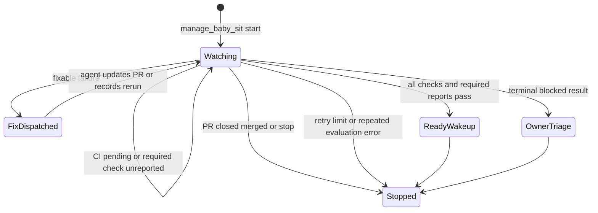

# Implementation, approvals, and pull-request delivery

An implementation run is a thread-scoped operation: it prepares a usable sandbox, changes and tests the checkout, pushes a branch, then creates or links a pull request (PR). The safety model is deliberately layered. Agent instructions can advise a preferred sequence, but they are not authorization. Runtime middleware and tool APIs enforce the two consequential boundaries described here:

- **Workflow-file pushes are blocked until the thread owner approves the exact inspected change.**
- **New PR creation must use `open_pull_request`; shell and direct-API fallbacks are blocked so attribution is not bypassed.**

For request entrypoints and tool availability, see [Runs, inputs, and tools](/openwiki/concepts/runs-inputs-and-tools.md). For sandbox ownership and recovery details, see [Sandbox lifecycle](/openwiki/architecture/sandbox-lifecycle.md); credential scope and consent are covered in [Auth and security](/openwiki/concepts/auth-and-security.md).

## From thread to working checkout

Before code work starts, the server resolves the run configuration and GitHub token and concurrently attaches the thread's sandbox and triggering-user identity. It resolves the sandbox work directory only after attachment. If attachment fails with an unreachable or retryable sandbox error, the run notifies the user-facing source and fails instead of continuing without its working environment.

Sandbox identity is persisted in thread metadata. A normal coding thread reuses or reconnects to that sandbox; if no ID exists, it creates and initializes one, then binds the ID to the thread. A task worker attaches to its coordinator's sandbox and cannot create or replace it. An unreachable existing sandbox is normally *not* silently replaced because uncommitted work would be lost; a deleted sandbox can be replaced, and the explicitly re-derivable reviewer path may opt into replacement. GitHub proxy scope is refreshed as the sandbox is attached, and git identity is reapplied on every run.

```mermaid
sequenceDiagram
    participant User
    participant Server
    participant Thread
    participant Box as Sandbox
    participant Agent
    User->>Server: start or continue coding run
    Server->>Thread: read run configuration and metadata
    Server->>Box: attach or create thread sandbox
    Box-->>Server: ready backend and work directory
    Server->>Agent: provide sandbox-backed tools
    Agent->>Box: edit test commit and push branch
    Agent->>Agent: call open_pull_request
```

This shows the normal implementation path; sandbox attachment is a prerequisite for sandbox-backed work.

### Guidance versus enforcement

The agent may be prompted to inspect, edit, test, commit, push, summarize, and then open or update a PR. That sequence is useful **prompt-level guidance**, not a security control: it can be incomplete, ignored, or altered by a model.

The following are **enforced at tool-call time**:

| Boundary | Enforced mechanism | Effect |
| --- | --- | --- |
| PR creation | `PullRequestCreationGuardMiddleware` | Rejects `gh pr create`, POSTs to GitHub's `/pulls` endpoint via `gh api` or `curl`, including nested shell invocations, in `execute`, `background_execute`, and monitor command/filter fields. Read/edit/comment commands remain allowed. |
| Workflow delivery | `WorkflowPushGuardMiddleware` | Inspects eligible standalone `git push` commands. A push containing `.github/workflows/` changes cannot execute until a matching approval exists. |
| Attributed PR API | `open_pull_request` | Resolves the appropriate author credential, asks the act-as consent gate, preflights access and branches, then performs creation. |

Both guards are included in the remote-runtime sandbox tool checks; workflow guarding is also installed for subagents. Therefore a subagent cannot escape the workflow gate merely because it has its own graph.

## Workflow-file push approval

Workflow files can execute CI and potentially access repository secrets, so approval is tied to content rather than a general “yes.” The guard accepts only a constrained standalone push form: `origin`, a safe refspec for the current branch/`HEAD`, optional upstream setup, and a safe `--force-with-lease`. It resolves the actual head SHA and compares the outgoing range with the tracked remote branch (or the default branch for a new branch).

If that range contains `.github/workflows/` files, the guard collects names, binary/full-index diff, stat, base/head SHA, remote/ref information, and whether a merge inherited the workflow change from the base branch. It hashes this material into a fingerprint. The approval record, keyed by fingerprint, is kept in thread metadata under `workflow_push_approvals`; at most 20 records are retained. A changed workflow diff produces a new fingerprint and needs a new decision.

```mermaid
sequenceDiagram
    participant Agent
    participant Guard as Workflow push guard
    participant Box as Sandbox
    participant Thread
    participant Owner
    participant API
    Agent->>Guard: standalone git push
    Guard->>Box: inspect branch range and workflow diff
    alt no workflow files
        Guard->>Box: run original push
    else workflow files and no matching approval
        Guard->>Thread: store pending fingerprint and review data
        Guard->>Owner: Slack card and web review link when available
        Guard-->>Agent: approval_required error
        Owner->>API: approve or reject fingerprint
        API->>Thread: persist decision and actor
        API->>Agent: dispatch retry instruction on approval
        Agent->>Guard: retry push
        Guard->>Box: run fixed SHA push only if approved
    else rejected
        Guard-->>Agent: rejected error
    end
```

This shows the enforced approval path, not a model suggestion.

### Approval surfaces and state

A pending record contains reviewable repo/branch/base/head data, changed files, stats, a possibly truncated preview, inherited source, an approval URL, request time, and notification state. The dashboard API exposes records only to a user who can read the thread. Approve and reject require a same-origin session plus promptable ownership; both decisions record the actor and timestamp. Approval dispatches an interrupting follow-up instructing the agent to retry the blocked push without changing workflow files. Rejection records the result but does not restart the agent.

When Slack context is active, the guard posts a single approval card with approve/cancel buttons and marks the record notified. Lack of a thread, Slack target, or durable approval-state error fails closed: the push is not run.

Approval is for the inspected commit and refspec, not an arbitrary repeat command. After approval the middleware replaces the command with a fixed push using the inspected head SHA and destination branch, preserving permitted upstream/lease options. This narrows the time-of-check/time-of-use gap.

Ambiguous delivery is also refused. If an eligible lease-protected push cannot be safely inspected, the guard returns `WorkflowPushInspectionError`. If a push appears within a longer shell command and might carry workflow changes (including uncommitted edits or an uninspectable repository), it returns `WorkflowPushMustStandAlone`: commit first and issue a standalone push that can be reviewed. Non-workflow pushes proceed without this approval.

## Opening or reusing a PR

`open_pull_request` is the sole new-PR path. It defaults to a draft, although the run/profile `draft_prs` preference overrides the tool argument. It uses the requested/requesting participant's valid GitHub OAuth token when there is an author; system threads use an installation token. A requested author must be a thread participant. Before creation, the tool checks workspace installation membership for user-token operations where required, invokes the act-as consent gate, and preflights repository, base branch, and same-repository head branch visibility.

On success it POSTs title, head, base, body, and draft state to GitHub. It enriches the body with available plan/source references and an attribution footer. A `201` response is recorded as a newly opened PR. A `422` is treated specially: the tool looks up an existing open PR for the head branch and returns it as `success: true, created: false`, allowing the agent to update it rather than create a duplicate. Other failures return actionable diagnostics including whether the branch appears pushed, and emit structured failure telemetry; they must not trigger a shell fallback.

After either a newly created or discovered PR, best-effort telemetry updates thread metadata (including PR list, state, refs, diff stats, and URL), the persistent PR registry, usage/revision tracking, and Slack code-channel context where applicable. Registry/telemetry failure does not negate a PR that GitHub has already created. `link_pull_request` instead validates and reads an existing GitHub PR, then records it against the current thread; it does not create one.

## GitHub comments as an input and output boundary

GitHub comments are both a delivery channel and potentially untrusted agent input. `post_github_comment` posts to the GitHub issue-comment endpoint for an issue or PR and returns `False` on HTTP failure rather than raising. Comment/review fetching combines issue comments, inline review comments, and reviews; on a first Open SWE mention it supplies the full timeline, while repeated mentions get content since the previous mention. The deployment's mention handles are configurable through `OPEN_SWE_MENTION_TAGS` with defaults.

When comment content enters a prompt, known registered-user authors are passed through after reserved-tag sanitization; other authors are fenced in explicit untrusted-content tags. This boundary prevents a commenter from injecting the markers used to represent trust. GitHub webhook signatures require a configured secret and a valid `X-Hub-Signature-256` HMAC; missing configuration is rejection, despite older docstring wording suggesting otherwise.

## CI follow-up with `/baby-sit`

A successful push/PR does not itself mean CI is ready. `manage_baby_sit` starts an opt-in durable watch for a canonical, open GitHub PR after resolving its head SHA/ref and the repository's App installation. The watch belongs to the starting thread's task (using the coordinator when applicable), stores enough run/source context to wake it later, and is persisted in that PR's `task_state["baby_sit"]`. A single active watch cannot be claimed by a different task.

The system schedules a durable job every 10 minutes and also processes signed completed GitHub `check_run`, `check_suite`, `workflow_run`, and legacy `status` webhooks. Webhooks are first checked against the repository allowlist and use delivery IDs plus a five-minute event-claim lock to avoid duplicate evaluations. A completed event matches watches by head SHA or branch and can refresh its installation ID.



This is the durable watch lifecycle; webhook delivery accelerates evaluation and polling remains the fallback.

Evaluation reads both check runs and legacy statuses, excluding Open SWE's own review/auto-fix checks. Failure means a completed run with `failure`, `timed_out`, or `action_required`, or a legacy `failure`/`error`. Pending includes incomplete checks, pending statuses, and the absence of any results. A nominally successful aggregate is still pending until every required check discovered from branch protection and rulesets has reported; check identity can include the reporting GitHub App. Terminal non-success/non-neutral/non-skipped results are blocked and handed to owner triage rather than treated as fixable code failures.

For a fixable failure, the watch dispatches a queued agent follow-up with compact failure signals. It deduplicates dispatches per head SHA/retry count. A changed head resets retries and dispatch/alert keys. The agent can call `record_retry` only for its own task's active watch and the current head, with bounded check/evidence fields; retries are capped at three per head and first observations are reported to the original Slack/GitHub source. On green CI, the watch wakes the thread so the agent decides whether to merge or report; it does not merge autonomously. Evaluation/access failures are retried, but after three consecutive evaluation errors the watch notifies/stops. Closing or merging the PR simply stops the watch.

## Operations and focused regression coverage

Operationally, verify GitHub App repository access, `Checks: Read` permission, signed webhook delivery, the job worker, and the workspace's ability to persist thread metadata and PR registry records. CI reads are best effort: unavailable checks never break webhook handling, but a watch eventually reports that it could not evaluate them. A watch's scheduled-job setup rolls back newly created persisted watch state if scheduling fails; stopping cancels the job and removes state when possible.

Focused tests cover the controls rather than merely their helpers:

- `tests/github/test_pr_creation_guard.py` verifies detection through direct, prefixed, nested-shell, background, and monitor paths while preserving safe `gh` read/edit/comment commands.
- `tests/agent/test_workflow_push_guard.py` covers safe parsing, fingerprint contents, inherited workflow labelling, rejected chained/uninspectable paths, Slack review cards, and execution of the fixed-SHA command only after approval.
- `tests/github/test_open_pull_request.py` exercises workspace and requester authorization, profile draft override, preflight branch failures, existing-PR recovery on `422`, and failure diagnostics.
- `tests/github/test_baby_sit_webhook.py` verifies that each CI webhook kind is accepted only with a valid signature and is routed without an invocation mention.
