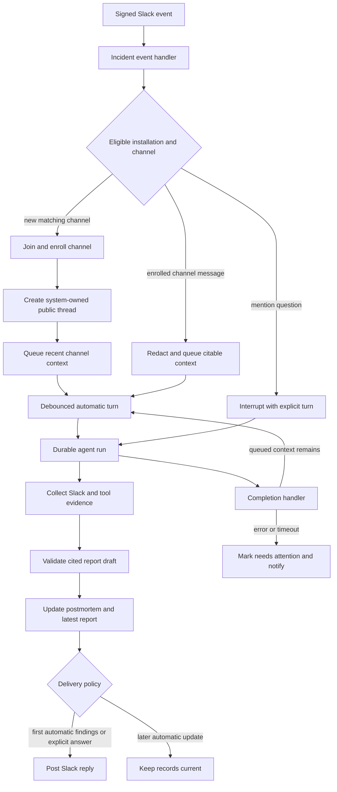

# Incident Response Workflow

Incidents turns a Slack channel into a long-lived, system-owned investigation. It is intentionally a separate workflow from ordinary Slack conversations: a deterministic incident ID binds a configured Slack workspace and channel to one LangGraph thread, and the agent produces a current report and retained postmortem rather than an uncontrolled stream of channel replies. See [Inbound Invocation to Durable Run](./invocation.md), [Threads and State](../concepts/threads-and-state.md), [Tools](../concepts/tools.md), [Authentication and Credentials](../concepts/auth-and-security.md), and [Dashboard UI](../integrations/dashboard-ui.md) for the shared boundaries.

## End-to-end lifecycle

This diagram shows the incident intake, evidence collection, turn scheduling, report lifecycle, and completion feedback loop. Automatic work is deliberately quiet after its first evidence-backed investigation; responder questions are not.

## Intake, enrollment, and channel boundary

Slack Events are signature-verified by the general Slack route before it delegates to `handle_slack_event`; an incident response takes precedence when it recognizes the event. The handler only processes its supported channel/message event types and validates the callback `team_id` and `api_app_id` against the saved policy. It claims the Slack delivery before side effects, so duplicate events do not enqueue another turn.

An administrator enables a single `IncidentPolicy`, which contains the bound workspace and app identity, a normalized `channel_prefix` (default `inc-`), excluded channel IDs, and an optional supported model choice. Enabling verifies the bot installation and obtains the server-owned workspace/app identity; those identities cannot be changed after incidents exist. Required Slack capabilities include channel discovery/join/history, mentions, writing, and user/profile lookup.

Automatic enrollment is triggered by creation or rename of a prefixed channel. The bot joins it and accepts only a non-archived, public internal Slack channel—not a DM, group DM, private, externally shared, or pending external-share channel—and honors exclusions. A responder can instead invoke `manage_incident(start)` from an eligible public internal Slack channel; this manual path does not require the prefix, but does require a connected Open SWE account. Failed setup is persisted as `needs_attention` with `setup_failed` so an administrator can diagnose it.

On enrollment, the workflow creates or resolves the channel-wide Slack session thread (`thread_ts` `0`), persists it as a **public, system-owned** `incidents_agent` thread with the incident ID, posts an introduction, and queues up to the most recent 100 usable historical messages. It ignores membership changes, deletions, and its own messages. The stable incident ID is UUIDv5-derived from the workspace and channel, preventing a second record for the same pair.

## Slack coordination and controls

For an enrolled channel, ordinary usable messages become queued context. A message includes text plus attachment/block text, is redacted, and carries a citable `INCIDENT_CONTEXT` header containing a Slack permalink, author, timestamp, and evidence ID; an edit receives a distinct evidence/queue ID. New context schedules one automatic run only while status is `watching` or `needs_attention`.

A bot mention accepts `pause`, `resume`, `complete`, or `reopen`, or treats the remaining text as a question. Anyone in the channel can apply a control, whereas a question requires that Slack user to be linked to an Open SWE account because it unlocks agent tools; unlinked users receive an account-link prompt. Questions may reply in the originating Slack subthread. Archiving a channel marks it archived and completes a non-completed incident. Excluded channels are ignored even after enrollment.

The record status is one of `watching`, `paused`, `needs_attention`, or `completed`. Pause and complete interrupt pending/running incident runs (except a run executing its own control), persist activity, and announce the new state. Resume/reopen returns to `watching` and schedules work if context is waiting. A run that completes the incident is recorded so that same run cannot immediately reopen it. Paused incidents retain incoming context but do not automatically investigate it; explicit questions can still be answered.

`manage_incident` is the agent-facing extension point for starting or changing the current Slack channel's incident. The dashboard exposes equivalent responder commands and returns accepted/duplicate receipts. Dashboard command idempotency is scoped to incident, actor, and caller-provided `request_id`; same ID with different content returns `409`, and a receipt is claimed before side effects then removed if execution fails.

## Turns and runtime isolation

Automatic turns are delayed 15 seconds to coalesce messages. They first check for an active run and use a rejecting scheduler strategy as a race-safe second gate; automatic work enqueues behind existing work. A responder question is an explicit turn and interrupts work in flight. Every run config explicitly writes `incident_request`, including `null` for automatic turns, so an automatic run cannot inherit an earlier question from thread configuration.

The incident runtime refuses a forged or stale binding. It loads the LangGraph thread and requires `source == "incidents_agent"`, `owner_type == "system"`, and `visibility == "public"`; its thread ID must match the saved incident, and the run cannot carry a personal GitHub login or email. Before model calls and incident tools, the session rechecks that the record/thread/workspace binding remains valid, Incidents is enabled, the channel is not excluded, and automatic work is not continuing a paused or completed incident.

The middleware supplies the incident prompt and registers Slack context evidence from human messages. It also observes ordinary tool results: failed results add a coverage gap; successful results are bounded/redacted and recorded with a sanitized HTTPS source URL when available. The runtime exposes three incident-only tools: `record_incident_report`, `search_incidents`, and `read_incident`. History reading is explicitly marked as context rather than proof of the present cause.

On completion, a successful run with stranded queued context is followed by another delayed turn only if policy/status still allow it and no run is active. An `error` or `timeout` is deduplicated per run ID, moves `watching` to `needs_attention` with `run_failed`, records activity, and posts one retry instruction unless the channel is archived.

## Evidence and report contract

`EvidenceCollector` records de-duplicated observations under a content-derived evidence ID and limits retained observation text to a 30,000-character budget. It redacts common API tokens, passwords, bearer credentials, email addresses, and private keys before prompt/report use; source URLs must be credential-free HTTPS URLs and have query/fragment removed. Truncation or redaction becomes an explicit coverage gap rather than silently suggesting complete evidence.

The agent must submit a bounded `ReportDraft` with claims that cite collected evidence IDs. Finalization drops every claim, hypothesis, or next step that has no citations or references an unknown ID, deduplicates citations, adds a gap when it omits unsupported claims, and redacts report text. A report is `findings` only if its supported summary (or supported problem fallback) is nonempty; otherwise it is inconclusive and clearly says that no evidence-backed conclusion was established. The report also preserves gaps, questions, checked sources, and evidence alongside its supported conclusions.

Recording a report updates the postmortem before storing the latest report record; if the postmortem write fails, it stores and posts neither report nor Slack reply. The postmortem is Markdown derived from the report, with evidence IDs converted into numbered HTTPS source links. PostgreSQL keeps policy, incident JSON, latest report, curated history, postmortem, and idempotency receipts; typed columns support workspace/status/thread queries and dashboard invalidations.

Delivery is a separate confirmation boundary. An automatic turn posts only the first `findings` investigation to the channel; later automatic turns update the report and postmortem silently. An inconclusive first turn does not consume that one automatic announcement. An explicit question can post once per run even after the automatic investigation has been announced. A failed Slack delivery does not mark the digest delivered, allowing the same report to retry later; only confirmed delivery records the digest/run/time and spends the automatic post.

## Dashboard and document surfaces

All incident dashboard endpoints require a signed dashboard session. Any signed-in responder can list/get incidents and submit commands; settings are administrator-only and settings/commands are audit-wrapped. `GET /incidents/records` supports active, inactive, or all views, text filtering, and stable keyset pagination. Records are visible only in the configured workspace while the bot remains a member of the eligible channel; setup failures are exposed only to administrators. A detail response overlays `investigating` when active runs exist, includes allowed state-dependent actions, latest report/coverage/activity, and a trace URL when available.

Responder-only document routes provide history search and an individual postmortem. They reapply workspace, exclusion, channel readability, and stored-history binding checks, preventing historical content from becoming an access bypass. Search returns metadata rather than workspace/channel IDs and skips inaccessible histories.

## Operations and focused verification

To operate Incidents, configure the Slack bot token, `SLACK_APP_ID`, and bot user ID, install the required Slack scopes, and use the admin settings surface to bind and enable the installation. Treat Slack verification errors, missing scopes, an identity mismatch, and `setup_failed` records as configuration incidents—not as agent failures. The settings readout reports configuration, verified workspace, required-scope status, verification time, and errors.

Focused tests live in `tests/incidents/`: `test_channels.py` covers enrollment, event/install gating, controls, and linked-user questions; `test_turns.py` covers citable/redacted context, scheduling, and completion recovery; `test_runtime.py` covers runtime binding, posting semantics, and postmortem failure atomicity; and `test_report.py` covers citation filtering and digest behavior. The Slack ingress tests additionally verify that signed incident events reach this handler before normal Slack routing.
