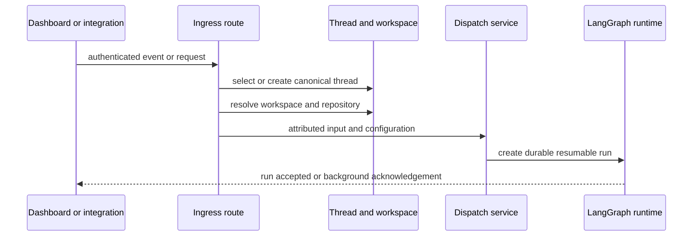
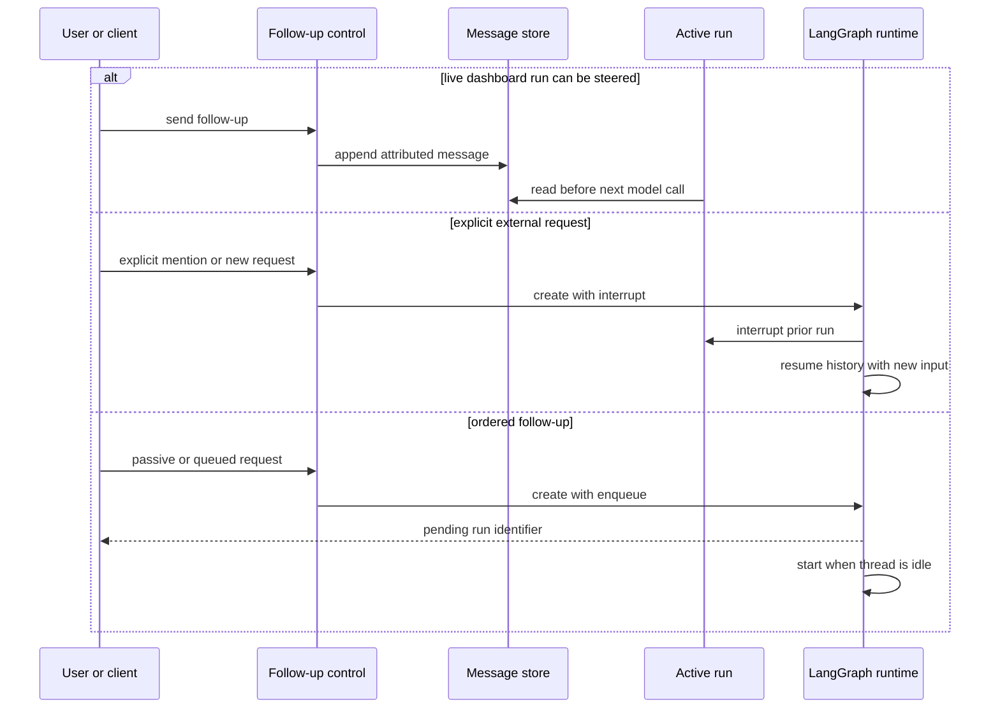
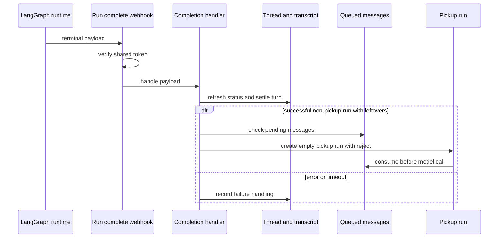
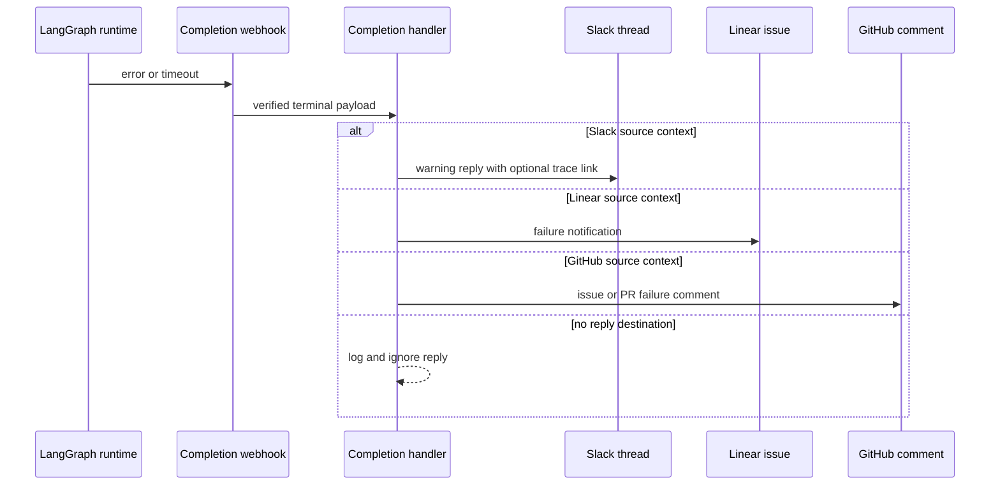

# Inbound invocation and follow-up delivery

Open SWE turns an inbound request into a **run on a durable thread**, rather than letting each integration implement its own run semantics. `dispatch_agent_run()` is the common boundary for Slack, Linear, GitHub, dashboard, and other callers: it either accepts a prebuilt `RunInput` or builds one from content and source context, then delegates to `create_durable_run()`. The latter is the one place that applies the LangGraph run contract.

## The common contract

A dispatched run has these important properties:

- **Thread ownership and routing:** A caller can name a thread to create and title (`thread_title`), or pass `None` for an already-created thread. The thread router subsequently directs agent/reviewer thread requests to their runtime.
- **Normalized, attributed input:** `RunInput` carries introductions and message envelopes, separating human/system sender, surface, channel, and source data. The generic builder canonicalizes Slack, GitHub, Linear, and system identities where possible; integration-specific builders preserve richer context such as GitHub issue/PR data or Slack channel identity.
- **Durability and observability:** runs default to `durability="async"`, `stream_resumable=True`, the v3 stream modes plus subgraphs, and an invocation ID/start time in configuration and metadata. Async durability checkpoints steps without making every step wait for the checkpoint write; resumable v3 streams let a dashboard attach to work begun elsewhere.
- **Concurrency:** the default `multitask_strategy` is `interrupt`; an explicit follow-up replaces an active run while retaining checkpointed history. Callers that must preserve ordering request `enqueue`.
- **Completion callback:** when both a valid public completion URL and `RUN_COMPLETE_WEBHOOK_SECRET` exist, dispatch attaches `/webhooks/run-complete?token=...`. Invalid relative or loopback URLs deliberately disable the callback rather than make all run creation fail.

This shows the shared start path: ingress-specific validation and routing happen before the common durable dispatch boundary.

## Where requests enter and how they choose context

### Dashboard and API clients

Dashboard session creation validates a selected repository against the signed-in user's access, ensures a dashboard GitHub token, resolves the workspace with this precedence: explicit valid workspace, repository owner, user default, then instance default. `create_dashboard_thread_record()` persists ownership, visibility, repository/model/workspace choices, and—when PostgreSQL is configured—a transcript marker before creating the LangGraph thread. A normal dashboard start then dispatches the first prompt on that owned thread.

The dashboard's `POST /threads/{thread_id}/runs` is intentionally not a raw pass-through: it authorizes posting, reshapes the body into the command pathway, and always creates an `enqueue` follow-up. This prevents a REST client from bypassing busy-thread and attribution/transcript handling. The command pathway can instead *steer* a message into a currently live turn (described below).

Sandbox guest runs are also dashboard-originated but use `enqueue`, including when tool results are supplied, so a guest invocation does not displace work already in progress.

### Slack

The Slack route verifies Slack's signature, records the delivery, handles URL verification, and deduplicates event IDs before it schedules processing. Eligibility is deliberately narrower than “any message”: normal channels need an explicit mention; DMs, code channels, kitchen channels, and allowed solo-thread continuations have their own admission rules. Processing resolves the Slack `(channel_id, thread_ts)` mapping to a durable agent thread, derives the sender's linked GitHub account when available, resolves repository/workspace, and persists Slack source context on the agent thread.

Slack input can replay the relevant conversation with human/system identities, channel name/topic/purpose, timestamps, attachments, and a triggering message envelope. Explicit mentions interrupt; passive eligible follow-ups use `enqueue`. This means a user can urgently redirect current work, while non-explicit conversation is ordered behind it rather than canceling it.

### GitHub

`/webhooks/github` verifies `X-Hub-Signature-256`, records each delivery, rejects repositories not owned by a workspace (and returns 503 when workspace ownership cannot be read, so GitHub retries), then hands accepted work to background tasks. Issue/comment starts require an Open SWE mention plus an accepted commenter; PR events also drive review/watch/automation paths. GitHub helpers select stable issue, PR-comment, or reviewer thread IDs, construct issue/PR-specific envelopes, and dispatch agent or reviewer graphs. The payload context distinguishes a human-triggered event from a system webhook and supplies repository/PR/issue metadata to the run.

### Linear

`/webhooks/linear` validates its signature, records the delivery, rejects webhooks whose signed timestamp is more than one minute old, and ignores bots, non-create comments, and comments without an Open SWE mention. It extracts a repository from the comment or falls back through the commenter/thread workspace and defaults; the repository must be allowed. `process_linear_issue()` reuses the canonical thread for the Linear issue, keeps an existing thread in its workspace (otherwise resolves the repository workspace), stores Linear source context, and builds a system issue message plus attributed relevant comment messages. It can fetch linked images and select a vision-capable model fallback before dispatch.

### Schedules and other system callers

Schedules create a fresh UUID thread, persist schedule metadata, and send a `system:schedule:<id>` automation envelope through `create_durable_run()`. They check workspace repository access before creating the run and record the latest run/thread in their schedule state afterward. Other background producers should follow the same pattern: create or select a durable thread, persist source context, and call the shared dispatcher instead of constructing a bare platform run.

## Interrupt, enqueue, and in-run steering

These mechanisms solve different timing problems; they should not be treated as interchangeable.

This shows the three delivery choices for a busy thread.

**Steering (dashboard command path)** appends an attributed message to `QueuedMessage` while a live run owns the open transcript turn. The agent reads that store before its next model call, so no separate model run is required. If the run ended in the narrow interval after the busy check, the code attempts a `reject`-strategy pickup run; `reject` prevents it from racing with another newly started run. The transcript records the human message immediately and the response reports `steered: true`.

**Interrupt** is the shared dispatch default and Slack's behavior for explicit requests. The platform interrupts the active run, whose progress is checkpointed, and begins the replacement with full history and the new message. Completion intentionally does **not** present an `interrupted` status as a user-visible failure: ordinary follow-up interruption is expected.

**Enqueue** creates a separate pending run that starts when the thread becomes idle. Dashboard follow-up creation writes `TurnQueued` with the platform run ID when the transcript is enabled; if platform creation fails, it closes that requested turn as failed so it cannot appear queued forever. This is used by raw dashboard run creation, sandbox guests, Slack passive follow-ups, and system/background producers that must not cancel active work.

## Completion, leftovers, and status settlement

This shows that completion both settles the current run and closes the race for messages that arrived after its last model call.

The public callback endpoint is fail-closed: it returns 401 unless the query token exactly matches `RUN_COMPLETE_WEBHOOK_SECRET`, rejects invalid JSON/object payloads, and then invokes `handle_run_completion()`. Completion refreshes thread status, finalizes invocation usage telemetry when an invocation ID exists, settles the transcript turn, and invalidates related pull-request UI state. Worker runs additionally settle task-worker state.

On successful runs (except a pickup run, which would otherwise repeat a failed drain), completion checks for queued-message leftovers. If there is no already-pending platform run, it starts an empty `follow_up_pickup` run with `reject`; the new run's first model call drains the store. The design gives each leftover one pickup attempt rather than repeatedly launching runs after a failure.

For success and terminal failure, completion also delivers task messages and event subscriptions using `enqueue`, preserving current work. Slack successes may schedule one deferred session-cost refresh per run and reconcile background/thinking status.

## Surface-specific completion replies

This is the failure-reply path; successful agent responses are ordinarily produced by the graph/integration output flow, while the completion hook guarantees that an abnormal terminal run does not silently disappear.

Only `error` and `timeout` trigger this fallback. The handler derives a user-oriented reason from the final model-error classification where it matches the run, posts to Slack/Linear/GitHub based on persisted `SourceContext`, and treats posting as best effort. It deduplicates by run ID when present (keeping a bounded recent-ID list); legacy payloads without a run ID fall back to a thread-level flag. Event-woken/task-message failures also cap consecutive notices at three to avoid an endless notification loop. Reviewer failures receive separate best-effort cleanup of their GitHub check run before the normal reply handling.

## Operations and safe extension points

- Configure `COMPLETION_WEBHOOK_URL` as an absolute non-loopback HTTPS URL ending in `/webhooks/run-complete` and configure `RUN_COMPLETE_WEBHOOK_SECRET` on both dispatch and callback sides. Without the secret—or with a relative/loopback URL—runs still start, but completion callbacks/failure replies are disabled.
- Preserve source context and canonical thread identity when adding a new ingress. That context is what lets completion route a failure to the correct external surface and lets later turns retain workspace/repository identity.
- Use a prebuilt `RunInput` for integration-specific conversation replay; use `dispatch_agent_run()` for ordinary attributed content; use `create_durable_run()` only when the caller must control lower-level behavior such as delayed starts or an explicit durability/strategy.
- Choose `interrupt` only for an instruction that should supersede active work. Choose `enqueue` for scheduled/background work, passive messages, or ordered client requests. Use the dashboard steering path for a message that the currently running agent should see before its next model call.
- Do not expose a raw run-create shortcut for clients: it can skip authorization, attribution, transcript state, and busy-thread semantics.

## Focused verification

The webhook completion tests cover fail-closed token matching, one pickup attempt for pending messages, suppression for error/pickup/cancelled-worker cases, run-scoped failure-reply deduplication, and background-status behavior. Slack event-deduplication tests demonstrate that an app-mention and its mirrored message delivery schedule only one task, while preserving claims for both delivery IDs and the channel/timestamp key. When changing ingress behavior, extend these integration-level tests alongside unit tests for the specific normalizer or context builder.
