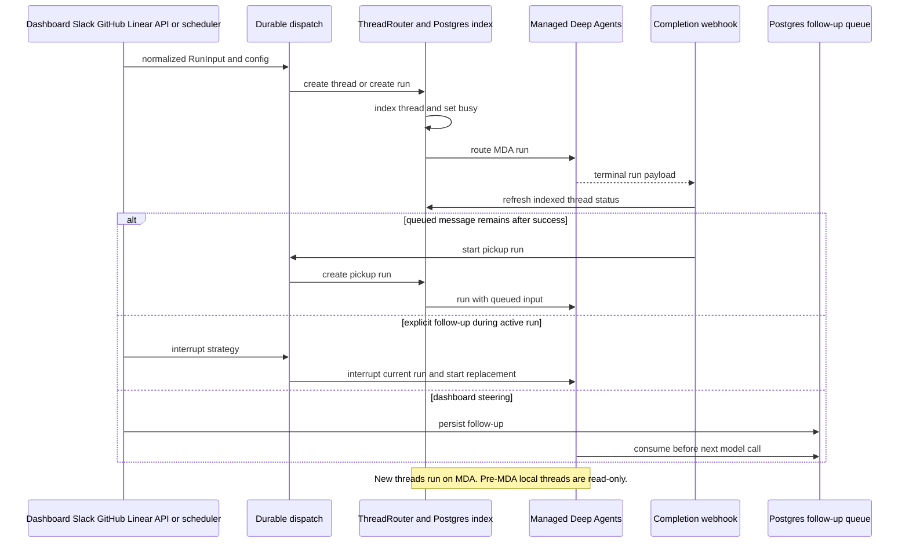

# Invocation, Thread Creation, and Follow-up Routing

Open SWE has one durable dispatch contract for agent and reviewer runs. Entry points retain source-specific authorization, context gathering, and user experience, but converge on a typed input envelope and `create_durable_run`/`dispatch_agent_run`. The ThreadRouter then makes the ordinary LangGraph thread and run API runtime-aware: the PostgreSQL index owns the application-facing thread record and routes new work to Managed Deep Agents (MDA).

## Entry points and normalization

### Interactive and event surfaces

- **Dashboard and API-backed dashboard actions** validate the caller's repository access and GitHub token before creating an owned thread. A dashboard record includes ownership, visibility, repository/workspace, model selection, title, and—when PostgreSQL is available—a transcript marker. The first prompt is dispatched after creation. Dashboard commands can also enqueue a follow-up or deliberately steer it into a live run.
- **Slack** resolves the Slack conversation and user context, attaches channel identity, files, and source details, and dispatches to the associated thread. An explicit tag/request interrupts the active run; a non-explicit Slack follow-up is sent with `enqueue`, letting the platform start it when the thread is idle.
- **GitHub** derives a stable PR/agent thread, authorizes the commenter (including private-thread restrictions), gathers relevant PR comments, and constructs one human input envelope per comment with PR metadata before invoking the common trigger-or-queue path.
- **Linear** derives a stable issue thread, keeps a follow-up in the existing thread/workspace, resolves the author, builds issue/comment and optional image input, then dispatches it through the same contract.
- **API, commands, and schedules** enter through the same `/threads` and `/runs` family intercepted by `ThreadRouter`. Run creation and `run.start` commands are routed to MDA; a thread cron is likewise an MDA run creation. Background producers can set `after_seconds` and select `enqueue` where ordering rather than interruption is required.

`input_messages` is the cross-surface boundary. It serializes authored content as a user message containing an `<input-message>` envelope with namespaced sender, surface, kind, optional channel, and structured data. Stable channel/system/person facts are introduced separately as deduplicated `<dynamic-context>` messages. Dispatch derives canonical human identity where possible; otherwise it identifies the sender as an `open-swe` system actor. This keeps agent input attributable without making every integration invent its own prompt wire format.

## Thread creation, indexing, and runtime invariant

`create_thread` and `ensure_titled_thread` are the application helpers for threads people can open: titles are mandatory, and generated titles stop changing after `title_locked` is set. The API middleware is the broader ownership boundary:

1. A `POST /threads` creates an indexed thread with runtime `mda`, records the MDA runtime marker, and creates copies in the local Agent Server and MDA. The PostgreSQL index answers create/read/update/delete/search/count requests; metadata patches are copied to runtime copies best-effort because reads remain index-backed.
2. On a run request, the router obtains (or indexes on first read) the thread. For MDA threads it ensures the remote thread exists, rewrites the payload for the selected MDA graph, forwards it, and marks the index `busy` only after successful start response handling.
3. **Invariant: every new thread runs on MDA.** A pre-MDA `local` thread may still be discovered, listed, read, and have its metadata served, but it is read-only for new runs, crons, posting commands, and copies. These mutations return HTTP 410 and direct the user to start a new thread. This is intentionally not a busy-style 409.

The local runtime copy is not permission to execute locally: it preserves compatibility/traces while the index remains the read model and MDA is the execution runtime for new threads.

This sequence shows ingress, indexed routing, completion settlement, and the two follow-up mechanisms.

## Durable dispatch contract

`dispatch_agent_run` either accepts a prebuilt `RunInput` or builds one, then delegates to `create_durable_run`. The latter optionally creates/titles a system-owned thread, merges source/run metadata, assigns or preserves an invocation ID and start time, and creates the LangGraph run with these defaults:

- `multitask_strategy="interrupt"` by default: a newer turn stops the active run while preserving checkpoints and resumes with history plus the new message. Callers explicitly choose `enqueue` for ordered background or non-explicit Slack work.
- `durability="async"`: checkpoints are written asynchronously rather than blocking every model/tool step.
- the v3 streaming configuration, subgraphs enabled, and non-resumable stream storage for dispatched transcript readers;
- an optional authenticated completion webhook; and
- source, repository, Slack location, workspace, user attribution, and canonical invocation metadata propagated in the config and run metadata.

`thread_title=None` means the caller already created the thread; a supplied title asks dispatch to ensure a system-owned thread exists. The router, not the caller, is what ultimately chooses MDA for the run.

## Completion, status, and recovery

When both `RUN_COMPLETE_WEBHOOK_SECRET` and an absolute non-loopback `COMPLETION_WEBHOOK_URL` are configured, dispatch attaches `/webhooks/run-complete?token=…` to each run. The endpoint fails closed for missing or invalid token. It accepts only JSON objects and invokes `handle_run_completion`; unset secret or a relative/loopback URL disables attachment rather than causing every run creation to fail.

Completion refreshes the indexed status from the runtime, settles transcript turns and usage telemetry, invalidates linked PR views, and may deliver task/event work. The completion webhook is best effort for status: a minutely reconciliation job re-queries any thread busy longer than one minute, so an absent or failed callback does not leave the index permanently busy.

Success can start one empty-input `follow_up_pickup` run if persisted messages remain. Pickup runs do not recursively create another pickup, preventing an unchanged queue from spinning. Failure/timeout handling logs the terminal failure, settles reviewer checks and Slack activity, and posts an originating-surface failure notification where possible (Slack, Linear, or GitHub). It is idempotent per run ID; legacy payloads without one use a thread-level fallback. Repeated event-woken failures are capped at three notices, while `interrupted` is deliberately not treated as a user-visible failure because it can be the normal result of an interrupting follow-up.

## Follow-ups: interrupt, enqueue, and the PostgreSQL queue

These are distinct mechanisms and should not be collapsed when changing an integration:

| Mechanism | When used | Result |
| --- | --- | --- |
| `interrupt` run strategy | Default dispatch and explicitly tagged Slack requests | Platform stops the active run and starts the newer turn with preserved checkpoints. |
| `enqueue` run strategy | Non-explicit Slack messages, dashboard queued runs, sandbox/background ordered work | Platform creates a durable successor that starts when the thread is idle. Dashboard transcript marks the turn queued and closes it as failed if creation itself fails. |
| `thread_queued_message` PostgreSQL queue | Dashboard steering and messages that must reach the next model call of an already live run | Before every model call, middleware takes an ordered snapshot, turns queued payloads into structured input, then deletes only the rows consumed. A completion pickup run handles messages that arrived after the last model call. |

The message queue is append-only per row, FIFO by identity sequence, capped at 100 messages per thread, and supports retry-safe dashboard `queue_id` uniqueness. Queue writers do not overwrite each other. Middleware removes rows only after it successfully builds their message updates, so an exception leaves them for a later model call; queue read failure merely skips injection for that call. When a dashboard follow-up races with run termination, its code checks liveness after writing and asks for a pickup run with `reject`, preventing the steering path and completion path from creating competing successors.

## Operational and change guidance

- Configure an externally reachable HTTPS `COMPLETION_WEBHOOK_URL` and `RUN_COMPLETE_WEBHOOK_SECRET` to enable completion settlement callbacks and failure replies. Do not use localhost/relative URLs.
- Preserve the ThreadRouter middleware ordering ahead of core thread/run routes. Bypassing it can create work outside the PostgreSQL index or violate the MDA-only new-thread invariant.
- Add integrations by producing `RunInput`/identity context and calling dispatch, not by calling `runs.create` directly. Choose `interrupt`, `enqueue`, or persisted injection based on the desired concurrency semantics.
- Treat completion as at-least-once: use run-scoped metadata and idempotent settlement. Keep reconciliation when extending status transitions.

## Focused verification

`tests/threads/test_thread_router.py` exercises the architectural boundary: indexed creation/metadata copies and search, first-read legacy indexing, MDA forwarding and busy status, HTTP 410 refusal for all new activity on local threads, MDA graph selection/token forwarding, copy semantics, and completion webhook propagation for command-started runs. Slack tests under `tests/slack` cover source-specific request, explicit interrupt, and follow-up behavior; queue and completion changes should be tested with races rather than only a happy-path run.

## Related pages

- [Managed runtime](/openwiki/architecture/managed-runtime.md)
- [State and async services](/openwiki/architecture/state-and-async-services.md)
- [User surfaces](/openwiki/integrations/user-surfaces.md)
- [Background automation](/openwiki/workflows/background-automation.md)
- [Coding and delivery](/openwiki/workflows/coding-and-delivery.md)
