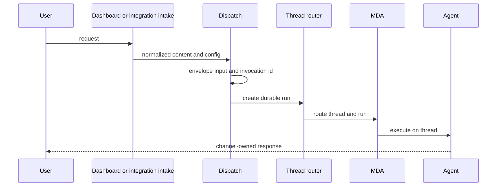
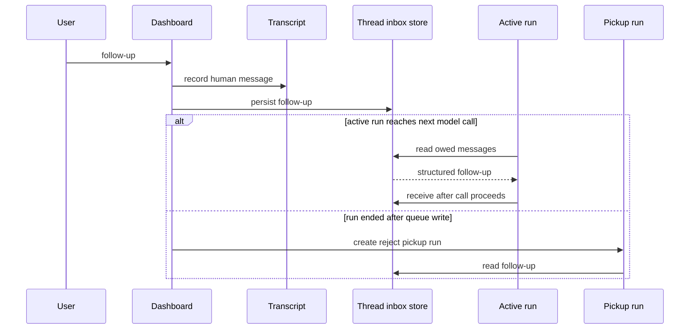
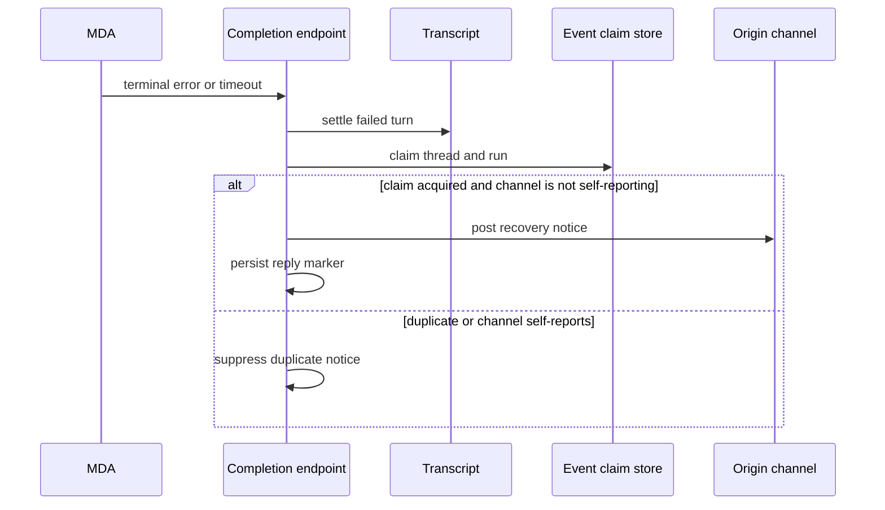

# Invocation, Interrupt, Follow-up, and Completion Workflow

Open SWE turns dashboard, Slack, GitHub, Linear, schedule, and automation triggers into a durable LangGraph run on a thread. The common dispatch layer is the boundary for application-owned inputs and run defaults; the thread router then sends a thread's execution to Managed Deep Agents (MDA) or, for legacy indexed threads, the local runtime. A thread tagged with `metadata.channel` remains an MDA channel conversation: the channel owns messages in that conversation and starts runs through the trusted channel ingress. Backend background work must wake or leave work for that owner; it must not post into the channel directly.

## Lifecycle and ownership

A **thread** is the durable conversation and state container; a **run** is one execution against it. The PostgreSQL thread index is the router's system of record for thread metadata and status, while the runtime holds execution state/history. New ordinary threads are created on MDA. Router-started MDA runs mark the index `busy`; completion and reconciliation settle that status. Legacy `local` threads are deliberately read-only for new execution.

An invocation gets a UUID. During compatibility migration, Open SWE writes both `invocation_id` and legacy `prepare_run_id`, while resolving reads only when the values are non-empty and non-conflicting. The identifier and `invocation_started_at` travel in both configurable data and run metadata, enabling terminal usage finalization and trace association.

This shows the initial invocation path: dispatch creates a durable run, and the thread runtime executes it; an integration channel remains responsible for its own conversation response.

## Intake, normalization, and thread choice

### Entry points

- The dashboard creates a thread record with ownership, visibility, repository/workspace, model selection, and (when PostgreSQL is configured) transcript metadata before it starts a run. A dashboard `run.start` enriches client input rather than trusting it: it resolves model/image eligibility, sender attribution, dynamic context, transcript message/turn IDs, and fresh invocation identity.
- Slack's public webhook verifies Slack signatures, deduplicates/gates the event, and either handles a backend-owned flow or forwards an MDA-owned conversation to Trigger Server after acknowledging Slack. The MDA Slack endpoint only constructs a run for a previously remembered, backend-approved request.
- GitHub's public webhook verifies its signature, records delivery data, rejects unknown workspace ownership with `503` so GitHub retries, and forwards issue-conversation work to the MDA GitHub channel. The channel applies repository/workspace, event-action, requester, mention, and public-repository gates before preparing a run.
- Linear's MDA channel endpoint receives a delivery that the channel already signature/age validated. It records each delivery once, triggers issue automations in the background, and only session-turn events can become agent runs.
- Schedules, event subscriptions, and task completions use the same durable dispatch contract and can enqueue work for an existing thread instead of inventing a second reply path.

`input_messages` makes model input explicit. Human and system messages are serialized as an `<input-message>` envelope containing namespaced sender ID, surface, kind, optional channel, and escaped structured data. Stable people, channels, and systems are introduced as hashable `<dynamic-context>` messages, so repeated context is suppressed until it changes or summarization hides it. This prevents a raw channel payload from becoming the agent's ambiguous conversational identity.

### Dispatch contract

`dispatch_agent_run()` constructs a `RunInput` from an explicit context or derives one from source/configuration; `create_durable_run()` is the single creation path. It creates/titles an owned thread if requested, computes attribution itself rather than accepting caller-supplied attribution fields, prepares metadata/configuration, and calls `client.runs.create`.

The defaults are intentional:

- `multitask_strategy="interrupt"` means an ordinary new turn interrupts an active run and continues from durable checkpoints; background work may request `enqueue` instead.
- `durability="async"` checkpoints each step without blocking every subsequent model/tool step on the write.
- v3 stream modes and subgraphs are enabled, but externally dispatched streams are not resumable because the dashboard reads its transcript rather than replaying server-held events.
- A completion webhook is attached only if `RUN_COMPLETE_WEBHOOK_SECRET` exists and `COMPLETION_WEBHOOK_URL` is an absolute non-loopback HTTP(S) URL. Otherwise dispatch continues without a webhook instead of making every run creation fail.

The runtime router protects the ownership boundary. For a channel-owned MDA thread, ordinary backend writes are refused; permitted run, interrupt, and cancellation operations acquire MDA's channel-write authority and are sent through its trusted ingress. Channel endpoint metadata is filtered so MDA-reserved and acting-user keys cannot be supplied by the endpoint response.

## Follow-ups while work is active

There are two related mechanisms, selected by the initiating surface and timing.

1. **Steer a live run.** A dashboard follow-up that reaches an active run is persisted in the transcript immediately and placed in the per-thread `QueuedMessage` store. The running agent's `ThreadInbox` reads it before its next model call, so it can react without ending the current execution. If the run ended between the live check and queue write, a guarded `reject` pickup run is attempted so the message is not stranded.
2. **Queue a separate turn.** `queue_follow_up_run()` records the transcript turn as requested, creates an `enqueue` run, marks the turn queued with the returned run ID, and lets the platform start it once the thread is idle. The recorded `queued_by` principal supports safe withdrawal rules.

The inbox is an at-least-once handoff, not destructive polling. A read snapshots queued follow-ups, task messages, and event matches and turns them into structured model messages, but leaves them owed until the run confirms `receive()` for the model call that proceeds. Thus a run that dies after reading does not lose the work. Task/event loading is enabled only with PostgreSQL; errors reading a class of inbox work are logged and leave other classes usable.

This shows an interrupt/enqueue follow-up: live work consumes durable inbox data before its next model call, while a race after completion is recovered by a pickup run. A separately queued dashboard turn uses LangGraph `enqueue` and starts after the active run becomes idle.

On successful terminal completion, the completion handler looks for inbox work that arrived after the final model call and, unless the completed run was already a pickup run, calls `dispatch_pending_follow_ups()`. It first checks for a pending run and uses `reject`, avoiding a duplicate run if another start is already in flight. Successful or failed terminal runs also deliver task messages and event subscriptions with `enqueue` semantics.

## Cancellation and interruption

The dashboard stop path lists *all* `pending` and `running` runs, rather than trusting cached `latest_run_id`, then requests `cancel_many(..., action="interrupt")`. A user stop preserves a queued run whose `queued_by` is another user; a machine/admin cancellation cancels all eligible work. The transcript turns for the runs actually cancelled are settled as interrupted, metadata is stamped interrupted, and the owner may dispatch a pickup for remaining stored follow-ups. Completion treats `interrupted` as terminal for status/transcript/telemetry but not as a user-visible failure: interruption is the expected result of normal multitask replacement.

## Completion, failures, and visible recovery

The platform posts terminal results to `/webhooks/run-complete`. The route is fail-closed: absent secret rejects every call, and token comparison uses `hmac.compare_digest`. Completion refreshes thread status, finalizes invocation usage when identity is valid, and settles the transcript turn. It also invalidates relevant pull-request views, records worker completion, synchronizes Slack background state, and may schedule deferred Slack session-cost enrichment after successful Slack agent runs.

Only `error` and `timeout` are terminal user-failure statuses. The handler classifies known model/sandbox/backend reasons into short recovery guidance, can include a LangSmith error link, and posts best-effort to the originating Slack thread, Linear issue, or GitHub issue/PR context. Failure-reply delivery is run-scoped and race-safe: an event claim with a two-day TTL prevents duplicate webhook/sweep replies, successful posting is persisted in bounded metadata, and an unsuccessful post releases the claim for retry. Event- or task-woken failures are rate-limited after three consecutive notices; a later success resets the count. Automated wakeup failures intentionally do not notify users.

For an MDA channel run, the backend hands completion to the channel with the run. Linear is configured to report failures in its own conversation, so the generic completion handler does not post a duplicate. GitHub does not claim that exception and may receive the standard GitHub failure comment. This preserves the invariant that a channel owns posting in its own conversation.

This shows terminal failure handling: failure notification is idempotent per run, while channel-owned reporting prevents a backend duplicate.

## Operations and extension guidance

Set both `RUN_COMPLETE_WEBHOOK_SECRET` and an externally reachable HTTPS `COMPLETION_WEBHOOK_URL` ending at `/webhooks/run-complete` to enable authenticated completion handling. A relative, schemeless, or loopback URL is deliberately disabled with a warning because the platform rejects it. Monitor warnings for status refresh, thread fetch, transcript settlement, inbox pickup, and reply-post failures: completion continues best-effort where possible so telemetry or a notification failure does not block other terminal cleanup.

To add an inbound surface, normalize its verified sender/channel/system data into `InputMessageContext`/`RunInput`, preserve source context in metadata/configuration, and use durable dispatch rather than calling `runs.create` directly. For a conversation MDA owns, implement a protected channel endpoint that independently validates/gates the event, prepares the signed MDA run payload, uses filtered `channel_run_metadata()`, attaches the completion webhook when available, and marks the thread busy only after the answer is ready. Do not have generic background code post into that conversation; queue/wake its thread or let the channel report it.

## Focused verification

The focused test suites cover the high-risk boundaries: `tests/threads/test_inbox.py` exercises non-destructive inbox delivery and follow-up serialization; `tests/threads/test_thread_router.py` and `tests/threads/test_channel_run_metadata.py` cover runtime routing and channel metadata restrictions; `tests/webhooks/test_completion_webhook.py` covers authenticated completion, terminal outcomes, reply deduplication, and failure behavior; and `tests/webhooks/test_linear_channel_routes.py` together with `tests/slack/test_slack_mda_forwarding.py` cover MDA-channel ingress and forwarding. When changing this workflow, add a race case around completion versus a newly queued follow-up and a channel-ownership assertion in addition to the happy path.
