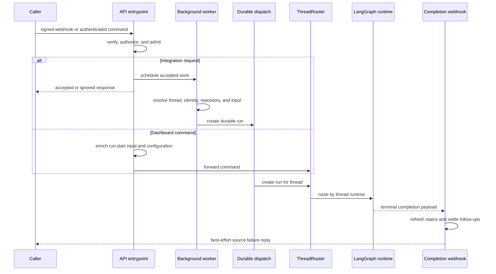

# Inbound Invocation and Durable Dispatch

Open SWE has two invocation boundaries. Integration routes authenticate and cheaply admit external deliveries, then hand accepted work to background processing. The dashboard command proxy authenticates the person, enforces thread access, and enriches `run.start` before forwarding it. Both paths ultimately create a LangGraph run on a stable thread, with structured input and metadata that preserve source, identity, repository, workspace, and correlation information.

## End-to-end path

This sequence shows the common durable boundary; webhook routes acknowledge before remote enrichment, while dashboard commands are enriched synchronously before the run starts.

## API composition and admission

`create_app` installs `ThreadRouter` before the core thread/run endpoints and includes dashboard, plan, workflow-approval, Linear, Slack, health/completion, and GitHub routers (as well as other operational routers). Dashboard CORS always permits credentials, includes `open-swe://app` for the desktop scheme, and rejects `*` in `DASHBOARD_ALLOWED_ORIGINS`. During lifespan startup it validates GitHub-login policy, sandbox, local-model, and Managed Deep Agents configuration before database migration and workers start.

GitHub, Linear, and Slack webhook routes first read the raw request body, then verify the platform signature before parsing it. Invalid signatures return `401`; Linear also rejects a signed delivery whose `webhookTimestamp` is more than one minute from current time. Each route records the raw delivery in `EventLog`, then returns an explicit accepted, ignored, or error result instead of turning malformed or ineligible input into a run. A GitHub workspace-routing lookup failure is exceptional: the route returns `503` so GitHub retries rather than silently dropping work whose ownership could not be determined.

## Integration-specific routing

### Slack

Slack resolves the channel context before ordinary message admission. A channel that is external/shared or otherwise not eligible cannot operate Open SWE; an `app_mention` in an external shared channel gets a one-time claimed refusal reply. Bot and self messages are rejected unless an allowed external bot explicitly addresses Open SWE. Outside code channels, an ordinary message must be a mention, DM, permitted kitchen-channel message, or a qualifying solo-thread follow-up. Code channels deliberately differ: all messages share the code-channel session timestamp and are treated as directed turns.

Before background processing, Slack claims the event with `claim_slack_event`. The claim is the deduplication boundary: a duplicate cannot schedule the normal worker. The route resolves a Slack location to an agent thread by preferring an explicit mapping, then matching stored source metadata, then a deterministic Slack thread id; conflicting matches cause a user-facing error instead of a guess.

The worker derives the mapped GitHub login and requires a usable token for a human Slack sender; it prompts for account linking or reauthentication rather than dispatching if no token is available. It fetches conversation context and creates typed human/system messages with channel and sender identities. Explicit requests use `multitask_strategy="interrupt"`; other follow-ups use `enqueue`. Message edits are associated only with a delivered message from the same sender and become a queued correction, not an independent conversation.

### Linear

Linear accepts a `Comment` `create` only when it is not bot-authored and mentions Open SWE. It derives the issue id from the comment and selects a repository from explicit comment text, then the commenter's dashboard default, then the workspace default; the selected repository must be allowed. Issue create/update deliveries take a separate automation path.

The worker maps the triggering author (falling back to issue creator then assignee) to a GitHub login, derives a deterministic Linear issue thread id, and stores `SourceContext.linear_issue` plus workspace/repository metadata. It serializes the issue description as system input and relevant comments as per-author human input, optionally using a vision fallback for image URLs, then calls the common dispatcher. This preserves the issue context as state rather than reducing it to an unstructured prompt.

### GitHub and reviewer runs

GitHub handles supported issue, pull-request, comment/review, push, and CI events. It rejects unassigned workspaces and disallowed repositories, filters unsupported actions, and requires an Open SWE mention for ordinary issue work. Pull-request events also update agent state, can launch configured automations, and can start auto-review only where enabled and permitted by the public-repository organization gate. Comments from unregistered users are ignored; replies to review findings take a separate reviewer route.

For a PR comment, the worker prefers an existing agent-thread id or the UUID embedded in an Open SWE branch; otherwise it deterministically derives a PR-comment thread id. It verifies the commenter can prompt a private thread, resolves their token, retries once after a GitHub authentication failure, fetches relevant comments, and dispatches typed input. Reviewer work is isolated on `reviewer_thread_id` with `assistant_id="reviewer"`, separate from the coding-agent thread. A reviewer run records PR metadata and can create/track a GitHub check so completion can settle an unfinished check if the graph fails.

## Dashboard commands, thread routing, and schedules

The dashboard sends commands through the thread proxy. A nonexistent thread is accepted only for `run.start`; that first command creates and stamps the dashboard thread. The proxy checks post/read authority for existing threads, normalizes model selection and workspace/repository choices, validates images against the resolved model, replaces raw client content with attributed structured messages, and stamps an invocation id and timing metadata. User-controlled identity, visibility, and authorization fields are removed from run metadata.

A `run.start` on a busy thread does not blindly create concurrent work. A person’s default follow-up can steer into the open turn; `multitask_strategy="enqueue"` queues a follow-up run. Machine principals cannot steer or queue and receive a conflict. If a run-start race loses after the busy check, the proxy re-reads the thread and queues the saved command when possible.

`ThreadRouter` owns the backend runtime boundary. It indexes threads and copies metadata to their runtime; on a first run for a hosted graph with no local history, it claims the thread for Managed Deep Agents. It marks a thread busy before the run-start response is sent, routes run/state/history operations to the selected local or MDA runtime, and lets completion/reconciliation settle status.

Schedules are administrator-managed records. A schedule trigger owns a LangGraph cron, while GitHub, Linear, and Slack triggers can also launch automation records from their respective webhook paths. On an agent schedule launch, Open SWE checks that the configured workspace still exists and that its repository is still accessible, creates a **fresh UUID thread**, writes automation metadata, creates system-authored automation input, and uses `create_durable_run`. Once run creation succeeds, it records the latest thread/run ids and trigger state; later bookkeeping failures do not undo the durable dispatch.

## Stable thread identity and structured input

Thread-id derivations are persisted routing contracts. Slack locations, Linear issues, GitHub issues and PRs, and reviewer runs must recompute exactly the same namespaced stable key to find prior state. Changing a formula or its inputs orphans live threads. In particular, `thread_id_from_branch` extracts only a UUID; a PR without one falls back to the canonical PR key.

At the graph boundary, input is structured rather than arbitrary prompt text. `human_input` requires `kind="human"`, `system_input` requires `kind="system"`, and both serialize authored text in XML-escaped `<input-message>` envelopes. Identity and channel introductions use hashed `<dynamic-context>` blocks; callers can suppress introductions already visible in state, but must reintroduce context hidden by summarization. Slack carries channel topic and purpose as data in this structured context rather than treating external text as trusted control configuration.

## Durable run contract and completion

`dispatch_agent_run` is the common agent/reviewer helper. It refuses calls that mix prebuilt input with raw content or identity arguments; otherwise it builds input when necessary and delegates to `create_durable_run`. The durable factory can create/title a system-owned thread, derives run user attribution from the source configuration, correlates configurable state and metadata with a single invocation/`prepare_run_id`, and creates the LangGraph run with default `interrupt`, asynchronous durability, resumable streaming, the v3 compatibility marker, v3 stream modes, and subgraph streaming. Asynchronous durability checkpoints each step while later work proceeds, trading at most a step of recovery for less per-step latency.

A completion webhook is attached only when `RUN_COMPLETE_WEBHOOK_SECRET` is present and `COMPLETION_WEBHOOK_URL` is an absolute non-loopback HTTP(S) URL. Otherwise dispatch deliberately omits it rather than allowing a rejected local URL to break every run. `/webhooks/run-complete` fails closed on the token.

Completion refreshes thread status, finalizes invocation telemetry, settles transcript turns, and can start a pickup run for remaining follow-ups after a successful non-pickup run. Successful eligible Slack agent runs schedule a per-run-deduplicated cost refresh. For `error` or `timeout`, completion best-effort settles a reviewer check, restores a code-channel session only when no newer run is live, and posts a source-appropriate Slack, Linear, or GitHub failure reply. Failure replies are idempotent by run id (with a legacy thread-level fallback when absent); `interrupted` intentionally produces no failure reply because it is normal interrupt-follow-up behavior.

## Focused verification and safe changes

- Preserve raw-body signature validation before JSON parsing; test invalid signatures, Linear replay rejection, GitHub workspace lookup retries, Slack external-channel refusal, and event claims.
- Treat `openswe/thread_ids.py` formulas and source context as data compatibility boundaries. Test conflicting Slack mappings rather than adding a heuristic that guesses a thread.
- Put new backend triggers through `dispatch_agent_run` or `create_durable_run`; `tests/agent/test_dispatch.py` verifies durability, streaming shape, invocation correlation, user attribution, and completion-webhook behavior.
- Test dashboard command enrichment and busy-thread steer/queue behavior in the thread proxy/runs tests, including lazy creation and run-start races.
- Test completion status handling, pending-follow-up pickup, source-specific failure replies, per-run idempotence, reviewer cleanup, and intentional silence for interrupted runs.
